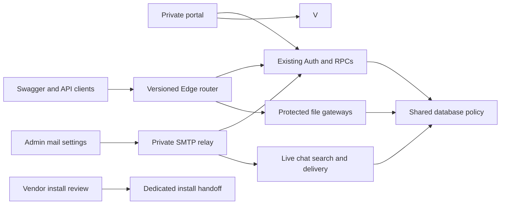

# Scope & Gates

### Ein Umsetzungsauftrag direkt auf `main`

Die OneDrive-Datei `ROADMAP.txt` ist der verbindliche Änderungsauftrag: **FC-01–FC-58**, **A.1 und G1–G8** sowie **LMS-T01–T34, API-T01–T16 und WL-T01–T15**. Die Umsetzung ist ausdrücklich gewünscht. Die nummerierten Aufgaben sind interne Arbeitspakete für einen zusammenhängenden Auftrag, keine einzelnen Prompts, Branches, Worktrees oder PRs.

- **Arbeitsweise:** Direkt im vorhandenen lokalen `main` arbeiten. Keine neuen Feature-Branches, Worktrees oder PRs anlegen. Vorhandene Passwort- und Kalenderänderungen gezielt prüfen und nur passende Teile übernehmen. Die vorgemerkten `.idea`-Dateien und andere fremde Änderungen unangetastet lassen. Nur geprüfte, aufgabenbezogene Änderungen signiert übertragen, sofern GitHub den direkten Push erlaubt; andernfalls den lokalen Stand erhalten und den konkreten Blocker melden. Keine Schutzregeln
  oder Pflichtprüfungen umgehen.
- **Reihenfolge:** Zuerst alle internen Funktionen und ihre Testfälle programmieren, danach den vollständigen Abnahmelauf starten. Fehler beheben und die betroffenen Prüfungen sowie den vollständigen Lauf am finalen Stand wiederholen. White-Label bleibt gemäß G8 ein Folgeprodukt: erst nach vollständiger Kernabnahme entwickeln, dann separat testen. Der freigabepflichtige Website-Footer bleibt eine externe Aufgabe.

- **Baseline:** the repository `main` and the separate `codex/fc16-calendar-tools-20261120` worktree were at `b00c5a3` when inspected. The previous password/calendar work is not on `main`; focused tests and `./portal check` were reported green, but complete browser acceptance was not established. Tasks 01–02 reconcile and finish that work instead of assuming it shipped or starting over. Leave the original staged `.idea` files and foreign worktrees alone.
- **Internal release:** P0 launch blockers must pass on the exact candidate. Requested P1 features must pass their own gates before real use; Premium remains OFF on real companies until the whole applicable LMS matrix passes and activation is separately approved. The brief’s **1 December 2026** date is a target, not permission to publish or a reason to override a no-go.
- **White-label:** tasks 35–41 are fully planned but cannot start until the complete core `ROADMAP.md` is accepted, including prerequisite items outside the OneDrive change list. Preserve and explicitly surface those outstanding base work items; do not count them as done. White-label stays in `WHITELABEL_ROADMAP.md` and does not block the internal launch. The shared multi-tenant SaaS product is not part of this implementation.
- **Separate website:** task 42 covers the P2 bilingual footer request in an independent lane. The Website repository is read-only until separately authorised; keep its approval or explicit deferral visible. Portal Forum/Contracts P2 links are included in task 15.
- **No implied production actions:** delivering source and tests through protected `main` does not publish a CMS release, deploy Hostinger, message real users, change DNS, purchase services, or authorise live Premium activation. A failed or unavailable release witness is a recorded no-go, not a substitute test.

# Technical Design

### Reuse the project’s existing owners

- Feed them synthetic view models and callbacks, never the real page loaders or live role information. Use `src/components/preferences.tsx`, `src/styles.css` and `public/brand/` as the design
  baseline. Its fictional business state stays in memory; user-chosen appearance preferences are distinct.
- **Identity and core business:** preserve Supabase Auth and the `accounts` Edge handler, including caller-scoped `reserve_account_creation`. Extend `src/features/accounts/accounts.tsx`, existing `src/features/commercial` views and the existing role, pricing, claims, withdrawal and invoice RPCs with additive migrations. Repeated claims/releases/notifications must resolve transactionally, not through frontend state. The accepted rate, currency, sessions and exact document versions remain
  immutable.
- **Premium — agreed shared database policy:** extend `ClientsPage` in `src/features/operations/clients.tsx` and the `course_workspace`/`course_workspace_action` authorisation path backed by `20261116091015_course_learning_workspace.sql` and later migrations. Keep current entitlement, active actor, organisation membership, enrolment/assignment and course scope authoritative in PostgreSQL. Apply it separately wherever metadata or bytes leave the system: RLS, direct RPC, both file gateways,
  search, live room delivery, queued mail/push and browser state. Preserve `participant_course` membership origins, existing learning/completion modules and the scanner, not a second LMS. Admin retained-data oversight is audited and narrowly scoped; it is not a bypass for DMs or private notebooks.
- **API — agreed single Edge router:** introduce a versioned ingress with domain route definitions and shared validation, errors and schema metadata. Reuse caller-authorised RPCs and the existing `supabase/functions/{accounts,files,course-documents}/` handlers or business contracts; keep legacy endpoints compatible. The Accounts `openapi.ts` is precedent, not full parity. Support human JWT sessions and separate scoped integration principals without broadening database grants. Use the existing
  notification outbox/worker approach as a reference for permission-checked webhook delivery.
- **Mail administration — approved private relay:** use one internal-only SMTP relay for GoTrue Auth and the existing notification outbox worker. Store validated, versioned settings and credentials encrypted at rest; only the authorized administration path and relay may read secrets. The UI is write-only for credentials, connection checks are server-side, and the service has no public ingress. Local tests continue to use Mailpit. Optional IMAP is limited to permission-checked configuration and
  connection health; no mailbox ingestion is implied.
- **White-label — agreed reviewed installer handoff:** one shared source base, dedicated customer installation boundaries, and a separate vendor control plane. A reviewed, versioned installation specification drives the same installer in self-hosted/customer-run and operator-run managed modes; do not build a managed provisioning worker in this scope. Reuse `deploy/hostinger/selfhost/` configuration patterns and `deploy/hostinger/updates/` verification and migration tooling without copying an
  internal environment’s secrets or data.

### Contract anchors

- `Auth UUID` remains the database identity. `Luminovia User ID` is a stable, random public-facing reference, not lookup authority. `username` is a changeable case-insensitive installation-local Auth alias; email-only legacy accounts remain valid. Protected login returns an existing short-lived Supabase Auth session; recovery resolves the alias server-side and does not disclose account existence.
- `setCompanyPremium(companyId, enabled, expectedVersion, requestId)` models an audited, idempotent command restricted to an active account holding the actual `admin` role. The client confirms either direction; cancelling sends no command. Course access is checked as **current edition/entitlement + actor activity + resource membership + operation permission**, not as a JWT flag. Signed/previous download links must not provide independent access after revocation; check on delivery, and ensure
  existing live subscriptions lose access server-side. Do not claim to recall bytes previously downloaded to a user's device.
- Proposed public routes: `/api/v1/*`, `/api/docs` and `/api/openapi.json`. Versioned route contracts own operation IDs, typed schemas, capability/edition declarations and errors; the API inventory maps every supported UI action to a tested operation or an explicit reason not to expose it. Use correlation IDs, stable bounded cursors, idempotency keys and expected versions where relevant.

### Planned file boundaries

- Extend existing feature owners and adjacent tests in `src/`; keep shared navigation presentation in the portal shell.
- Add versioned SQL in `supabase/migrations/`; add a product API Edge package, tentatively `supabase/functions/product-api/`, plus neutral installer/edition configuration in the follow-on. Never rewrite released migration bytes or vendored Supabase sources.
- Extend `scripts/*-api-check.mjs`, `scripts/*-db-tests.mjs`, `tests/e2e/`, `API_REFERENCE.md`, `GUIDE.md`, `ROADMAP.md` and `WHITELABEL_ROADMAP.md` at their owning milestones. Use `.github/workflows/ci.yml` and `security.yml` as the canonical CI gate owners.

### Architecture

# Master Coding Prompt

### Übergabe für die direkte Umsetzung

> Implement the full Luminovia OneDrive roadmap in `/home/carinaschoppe/IdeaProjects/Luminovia-Management-Tool`. Use `/home/carinaschoppe/OneDrive/Work/Luminovia Training & Consulting/General/Misc/ROADMAP.txt` for the owner’s requested changes, `AGENTS.md` for repository rules, `ROADMAP.md` for the complete internal product, and `WHITELABEL_ROADMAP.md` for the separate follow-on. Use the architecture and numbered task list attached to this prompt. Begin at task 01 and continue through the next
> eligible tasks without asking me to paste each task again. For a new coding session, pass the last handover and restart at the next eligible task. Do not shrink the programme to an MVP or claim the full roadmap is complete because a slice passed.
>
> Prüfe vor jedem Arbeitspaket den Stand von `main`, konkurrierende Änderungen sowie die zuständigen Dateien, Migrationen und Tests. Nutze vorhandenen Code und dokumentiere je Anforderung Test-ID, Status, Evidenz, Revision und Abhängigkeit. Implementiere beide Varianten von `API-T04`: eindeutige Benutzernamen und parallele Umbenennungen laut OneDrive, Passwortgrenze laut Repository. Nimm die zusätzlichen Repository-Tests `API-T17` bis `API-T20` in die Kernabnahme auf.
>
> Setze alle Arbeitspakete im vorhandenen lokalen `main` um. Keine neuen Branches, Worktrees oder PRs. Schreibe zusammen mit dem Code die DE/EN-Texte, Dokumentation und Roadmap-Testfälle. Starte nach Abschluss des internen Codes `./portal check`, `./portal test` sowie die vollständige Roadmap-Abnahme mit isolierten fiktiven Daten. Behebe Fehler und wiederhole die finalen Prüfungen; erfülle alle GitHub-Pflichtprüfungen für den exakten Stand. Committe ausschließlich aufgabenbezogene Änderungen
> signiert. Push direkt nur, wenn der Branch-Schutz es erlaubt; bei einer Sperre nichts umgehen und keinen Ersatz-Branch erstellen. Bestehende Migrationen, Auth-UUIDs, Anmeldedaten, Finanzsnapshots, Mitgliedschaften und Storage-Objekte erhalten.
>
> Blockierte Abhängigkeiten mit Revision, erster konkreter Ursache und nicht erreichten Prüfungen dokumentieren; nur unabhängige, bereits zulässige Arbeiten fortsetzen. Am Ende den lokalen Commit, gegebenenfalls den bestätigten Remote-SHA, die Ergebnisse je Anforderung und konkrete Blocker nennen. Premium bei realen Firmen ausgeschaltet lassen. Ohne separate Freigabe nicht veröffentlichen, deployen oder Produktivdaten verändern. White-Label erst nach der vollständigen Kernabnahme beginnen.

# Core Tasks 01–17

### Nummerierte Arbeitspakete in einem Umsetzungsauftrag

**01 — Password floor · FC-16 / G7.1.** Reconcile the earlier worktree first. Align `password.tsx`, account creation, Edge validation/schema, local and deployed Auth settings to eight characters for create, invite activation and reset; preserve existing sign-in and Auth protections. Prove seven rejected and compliant eight accepted in real Auth as well as UI; reconcile composition hints with actual configured rules.

**02 — Calendar tools · FC-06, FC-07, FC-12.** Resume the earlier `CalendarPage` work. Keep calendar and subscriptions independently operable, put ICS import/export/offline schedule in initially closed in-flow controls, preserve the current authorised subscription surface and offline/error behaviour, and reconcile stale guide text. Verify resize, focus, non-overlap and functioning controls at all four widths; resolve isolated-run blockers without touching foreign services.

**03 — Role assignment and account actions · FC-10, FC-17.** Use `accounts.tsx`, existing account/role RPCs and the protected deletion action. Align role and permanent-delete buttons without appending usernames; preserve confirmation and keyboard focus. Enforce admin-only granting of management/admin; test permitted delegated roles and denial of self-escalation and owner/last-admin abuse.

**04 — IDs for every account · FC-24, G2, LMS-T01.** Add and backfill unique, unpredictable human-readable IDs without rekeying UUIDs or foreign keys. Display through authorised profile/directory projections, reserve lookup for scoped and rate-limited workflows, and prove stable concurrent creation/backfill plus no account enumeration.

**05 — Expertise vs qualifications · FC-18–FC-19.** Use profile/taxonomy and current assignment eligibility code for directly selectable skills; show immediately after save, reload and in authorised search. Keep evidence and explicit verified qualification gates separate, and prove that adding a skill cannot satisfy those gates.

**06 — Mail administration · FC-23.** Add permissioned SMTP configuration and optional IMAP settings/test to Administration using the existing Auth/notification mail paths, secret storage and workers. Validate TLS, host/port and sender, provide write-only credentials and controlled connection tests, monitor health, use isolated mail locally and defer approved real-recipient verification to 34.

**07 — Lecturer rates and offers · FC-14–FC-15.** Extend `lecturer-compensation.tsx`, role pricing and quote acceptance for lecturer/senior defaults and per-person fixed rate/period or percentage overrides. Verify restricted reads/writes and accepted full-block amounts for each role, currency and override without recalculating history.

**08 — Framework agreements · FC-21–FC-22.** Reuse `contracts.tsx`, `pdf-upload.tsx` and the scanned file registry for existing clean signed PDFs, picker and drag/drop. Allow authorised staff to register for a lecturer with correct owner, dates, signer/evidence and audit; verify exact file versions, scan failure and denied access. Do not claim an electronic signature.

**09 — Assignment release and visibility · FC-26, FC-28–FC-29.** Extend existing claim/withdrawal lifecycle transactions. Reopen eligible capacity only after valid release and eligibility recheck; enqueue deduplicated matching notifications and preserve scoped lifecycle visibility for the assigned lecturer, originating company and authorised staff. Test concurrent claim and release, full-block allocation and absence of open listings for other lecturers once allocated.

**10 — Marketplace discovery · FC-25, FC-27, FC-30, FC-32.** Extend `jobs.tsx`/`discovery-api.ts` with keyboard-operable subject checkboxes (OR within subjects, combined with other filter groups), stable next-start ordering, history default OFF and bounded scoped results. Test time zones/ties, reset, archived/delivered/expired cases and no leakage from deep links or search.

**11 — Invoice submission and settlement · FC-34–FC-35.** Extend `finance.tsx`, course links and invoice RPCs. Eligibility comes from the last scheduled session of the accepted block ending, not learner attendance or quizzes; route cancelled/partially delivered cases to review. Verify clean exact PDFs, duplicate/currency rules, upload timestamp, company/privacy boundaries, approvals/rejections, auditable status corrections and lecturer open/paid views. Payment is a recorded status, not a
transfer.

**12 — Finance trends and payment terms · FC-33, FC-36–FC-37.** Build role-scoped charts from original-currency ledgers. Default due date to issue +30 days only when absent; preserve explicit agreed terms. Prioritise overdue/due-soon; show accessible green/amber/red/purple status plus text/icons, with defined half-term, overdue, partial-payment and reversal boundaries. Reconcile totals and verify gross/net and cross-company denial.

**13 — Calendar source and personal colours · FC-31.** Distinguish customer-created entries with a light, legible treatment, and persist private actor-owned colour preferences. Test both themes, IANA/DST rendering and separation between users.

**14 — Scoped Courses and staff preview · FC-11, FC-13, FC-32.** Use `SectionHub`, `Shell` and existing Learning/Operations projections. Route lecturers to assigned courses, company contacts to owned/requested, and staff to permitted operations. Add an obvious Management/Lecturer/Company preview for authorised staff using safe fixture or already authorised scoped data; never impersonate, change roles, or expand permissions. Test navigation, direct links, search, switch/reset and server denials.

**15 — Contextual references · FC-08–FC-09.** Link Chats and Knowledge & Help to the existing permission-controlled `/forum`; link Files to `/contracts` when appropriate. Verify keyboard navigation, denied deep links and that no second forum or contract data store exists.

**16 — Portal dark theme · FC-03.** Extend shared theme tokens for coherent dark surfaces, accents, states and alerts; preserve the seven-colour light baseline except for named accessibility corrections. Capture representative portal screenshots and test contrast, focus, hover, disabled and responsive states in DE/EN.

live business requests, writes, email/push/payments or protected caches, plus visual parity and accessible navigation across the required matrix. Revisit changed presentation in 26 and test the white-label omission in 35.

# Premium & API Tasks 18–32

### Premium LMS stays OFF throughout internal development

**18 — Entitlement and retained-data admin view · FC-38–FC-40, FC-52, G1/G6; LMS-T05–T08/T31.** Add default-OFF, versioned company entitlement and shared DB policy; add the Admin > Companies labelled red/green control, two confirmations, current-role check, conflict/audit records, and audited retained-course view. Keep base company/course operations available and make UI routing, direct reads and mutations fail closed where applicable.

**19 — Participant accounts and association · FC-41–FC-42, G2; LMS-T02–T04/T13–T14.** Restore participant-only Auth and scoped onboarding via existing accounts infrastructure. Add verified invite/accept by stable User ID, exact-company membership, deduplicated requests and expiry; reject privileged/wrong identities without disclosure. Test activation, two-company concurrency and independent membership removal without disabling the global account.

**20 — Enrolment and participant dashboard · FC-43–FC-44, FC-52, G3; LMS-T09–T10/T15.** Extend the workspace context and existing enrolments for authorised company add/remove. Make rights changes atomic with course state and chat/file access at the data layer. Surface own enabled courses, lecturer, dates, announcements and learning materials only. Test A OFF/B ON and restoration of eligible rights only, plus cancellation/reassignment and no course/finance/roster leakage.

**21 — Course chat and live revocation · FC-39, FC-45, FC-52–FC-53, G1/G3; LMS-T09–T12/T15–T16/T30.** Reuse `participant_course` rooms and origin tracking; enrol learners and assigned lecturers plus authorised company/staff. Provide audited admin oversight of course groups, management within its authorised course scope, and no unrelated DM/notebook access. Enforce current rights on server-side live delivery, search and queued mail/push; invalidate affected query/session views and keep restricted
data out of service-worker/offline caches. Test an already-connected socket, already-queued notification, surviving B access and no duplicate delivery on re-enable.

**22 — Scanned course files and welcome area · FC-46–FC-47, G3; LMS-T11/T17–T19/T29.** Add course-scoped versioned files and published welcome/info content to the current workspace. Use protected reservations, quarantine and authorised exact-byte downloads; scope folders/categories, ownership, unpublished versions and linked attachments. Prove stale-link denial and that lecturers cannot delete company originals. Include audit for edits, publication and allowed removals.

**23 — Optional exam PDFs · FC-48–FC-49, G4; LMS-T19–T23.** Give assigned lecturers and owning-company staff a versioned, audited Exam required/No exam required control. Auto-publish a student-facing PDF only after its exact scan is clean and it is enabled; never auto-publish drafts, answer keys or marking guides. OFF hides participant navigation and denies metadata/bytes without deleting files. Test concurrent changes and the complete audience/scanner matrix. No new exam engine.

**24 — Session attendance · FC-50, G5; LMS-T24–T26.** Extend existing attendance around actual sessions and enrolled participants. Add day/session grid, one-click and safe bulk marking, present/absent (excused/unexcused)/late, arrival/departure, notes, audited corrections and scoped reports. Test time zones, stale versions and participant roster denial; distinguish learner attendance from lecturer delivery, completion and invoice eligibility.

**25 — Attendance evidence and structured import · FC-51, G5; LMS-T27–T28.** Add clean, protected, versioned PDF evidence per session/day without treating it as verified attendance. Implement the optional CSV/XLSX path as an explicit preview/confirm workflow to cover the requested matrix. Validate participant/session/company matching and reject duplicate, foreign or invalid rows before an atomic commit. Test exact bytes, retained versions and denied download.

acceptance, not production activation.

### Full versioned product API

**27 — Username-or-email sign-in · G7.1–G7.2; brief API-T01–T06.** Add installation-unique normalised aliases and safe versioned rename/profile UX over the same Auth UUID. Preserve legacy verified email, invitations, recovery, refresh, deactivation and sign-out. Add protected password exchange for web/PWA and clients; no discovery endpoint, duplicate credential store or human password as API key. Verify equivalent permissions, generic failures, throttling and collision/reserved-name rules.

**28 — API entry point and core action families · G7.2–G7.5; API-T05–T08/T10/T12–T13.** Implement the single versioned Edge router with caller-scoped domain adapters and typed contracts. Begin the parity ledger and ship accounts/profiles/usernames/IDs, expertise/evidence, organisations, course operations/readiness/delivery, assignment/marketplace, calendar/availability/ICS. Reuse existing backends; preserve legacy paths, browser and non-browser auth, TLS/origin/CSRF policy, bounded paging,
errors, versions, idempotency and correlation IDs.

**29 — Finish domain parity · G7.3–G7.5; API-T07/T10–T13.** Add Premium/participant memberships/enrolment, chats/messages/notices, welcome/exams/quizzes/attendance, feedback/completion, knowledge/forum, notifications/preferences/support, protected files, contracts/invoices, admin configuration, scoped search/reports/audit/exports. Include scan/import/export status and permission-safe exact-version downloads. For every supported UI action record a tested API counterpart or justified exception.
Apply actor, company, course, role and entitlement checks through direct API as well as UI.

**30 — Scoped integration identities · G7.2/G7.5; API-T06/T10/T13.** Add admin Integrations/API Management for dedicated least-privilege principals, explicit scope and organisation, expiry, revoke/rotate, rate limits, usage and audit. Ensure scope and current grants are checked on each call and no human password, vendor secret or service-role credential is handed out.

**31 — Optional signed webhook subscriptions · G7.5; API-T14.** Implement opt-in subscriptions, signed event IDs, rotation, bounded retry/replay handling and delivery-health UI. Deliver only committed, scoped business events such as invitation/enrolment, reschedule/assignment, exam/attendance/completion, file scan and authorised payment status. Recheck current integration and event permission before each delivery; exercise duplicate/out-of-order and revocation cases.

**32 — Swagger and developer contracts · G7.4–G7.6; API-T07–T09/T15–T16.** Publish release-matched OpenAPI 3.1 and responsive interactive Swagger, DE/EN guide and Help/Integrations links, safe caller-token authorisation, typed request/response/error/scopes, search/tags and examples. Run fictional curl, TypeScript and Python samples; compare schemas to live handler/response samples and check drift and backward compatibility in CI. Publish the version/deprecation policy and changelog; do not
present unavailable routes as usable.

# Release & Follow-on 33–42

### Internal release qualification

Keep remaining requirements and actual evidence visible in the roadmap.

**34 — Retained-data migration and release decision · FC-56–FC-58; LMS-T32–T34, repo API-T20.** Extend release checking using existing Hostinger package/updater and reviewed-migration harnesses; verify ledger/digests, full PostgreSQL/Auth/Storage backup and independent isolated restore, then rehearse forward upgrades and compare retained accounts, roles, files/hashes, messages, contracts, accepted rates, invoices and audit. Produce a go/no-go record for the exact approved candidate with
application/security CI, actual authorised Hostinger SHA and health, external SMTP to an authorised recipient, monitoring, capacity, backup age and recovery. Without approval or evidence, record no-go; do not publish, migrate live systems, or enable Premium. Keep core CMS development evidence distinct from production evidence.

### White-label only after complete core roadmap acceptance

operations at API/RPC/RLS/file/search/Realtime boundaries. Test licence expiry without data deletion or rights expansion.

**36 — Branding everywhere · G8.2; WL-T02/T13.** Add customer-local, versioned and audited branding with safe previews and scanned assets: legal/display names, logos, theme, welcome/footer/legal links, custom domain, favicon, PWA/title/push, sender/templates, help, Swagger and PDFs/certificates. Carry allowed legal notices and per-installation origin/TLS/Auth configuration. Test real branded surfaces in DE/EN, both themes and mobile sizes; preserve internal branding and customer-safe onboarding.

**37 — Academy-local administration and courses · G8.3; WL-T03–T06/T08.** Let installation admins manage local staff, participants, courses, groups, calendar, content, reports, settings and scoped integrations. Enable direct course creation and lecturer assignment/enrolment with no Luminovia vacancy, framework contract or commission prerequisite. Verify learner workflows and Swagger using only customer-local identities and policy; no vendor plane, other install or private content access.

**38 — Optional local lecturer compensation · G8.3; WL-T07.** Add customer-owned rates, agreements, currencies, terms and tracked payments as a separate optional entitlement. Keep it out of UI and API when disabled, never require it to deliver a course, and keep vendor billing/commission/margins absent and denied when enabled.

**40 — Vendor wizard and installer handoff · G8.2/G8.4; WL-T08/T12.** In the separate vendor control plane, capture legal/display names, academy and first-admin details, hosting mode, domain, locale/time zone, brand, licence, capacity, SMTP and backup/retention. Preview and explicitly approve before emitting a reviewed versioned install spec. Support retry and status for customer-run self-hosting and operator-run dedicated hosting, without vendor access to customer data or an automatic
provisioning worker. Acceptance uses independently scoped domains/credentials, health and an authorised handover.

**41 — Commercial lifecycle and acceptance · G8.4–G8.5; WL-T09–T15 and edition API matrix.** Deliver signed releases/forward updater, independently tested backup/restore, monitoring/diagnostics, incident and rollback procedures, standard data export/offboarding/ownership transfer, and edition-aware API docs/compatibility. Verify upgrades preserve accounts, branding, licence, course history and hashes, and run the full white-label and relevant API tests on the exact signed build in canonical CI.
Obtain actual redistribution/licence, support and data-owner approval before commercial handoff; do not assert legal compliance from software tests.

### Independent external P2 task

**42 — Bilingual Website footer · FC-01.** Keep this in the separate public Website project. After explicit website approval, translate Jobs/LinkedIn references appropriately and verify their real destination links in DE/EN browsers. Until approval, report the exact deferred external change; no website edits or deployment from the portal task.

# Verification & Handover

### Vollständige Abnahme nach der Implementierung

Die in den Arbeitspaketen genannten Prüfungen sind zu implementieren und für den Abnahmelauf vorzubereiten. Den vollständigen internen Testlauf erst nach Abschluss des internen Codes durchführen; danach die White-Label-Ausführung und ihre eigene Abnahme gemäß G8.

- Prefer existing tests and extend them: `scripts/accounts-api-check.mjs` for Auth; job discovery/capacity/withdrawal scripts for concurrency; `scripts/commercial-api-check.mjs` for invoices; `scripts/company-participant-api-check.mjs`, `scripts/course-workspace-api-check.mjs`, `scripts/documents-api-check.mjs` and `scripts/notification-delivery-api-check.mjs` for LMS policy and deliveries. Wire new scenarios into `scripts/runtime-test.mjs` and the canonical workflows rather than treating
  standalone local passes as a substitute.
- Use Playwright against fictional isolated fixtures. Apply DE/EN, light/dark, 390/768/1280/1920px, keyboard/focus, usable hover/disabled states, layout geometry and WCAG 2.2 AA checks where relevant.
- Exercise concurrent payments/claims/enrolments/role and toggle changes where applicable, strict API/RLS denials, exact file/version/byte access, stale links, currently open streams and already queued delivery. These checks complement browser visibility; a hidden menu is not a security control. Include Europe/Berlin DST and Australia/Brisbane for scheduled flows.
- Je Test-ID Pfad, Befehle, Ergebnis, Revision, CI-Lauf und noch notwendige Freigabe dokumentieren. LMS- und API-Matrizen in der Kernabnahme 33–34 vollständig ausführen. `WL-T01–T15` und API-Kompatibilität der Kundenversion in Schritt 41 prüfen.
- Record blocked separately from failed and not run. If the isolated runner collides with a port or exceeds a run window, diagnose its owned logs and rerun using the canonical features and fixtures; never touch unrelated running stacks, weaken assertions, or manufacture a completed result.

# Delivery Steps

### ✓ Step 1: Deliver account, calendar and mail foundations

Accounts, calendar tools and communications meet the first set of launch safeguards.

- Execute tasks 01–06: reconcile prior password/calendar work, enforce role delegation, add stable IDs and profile expertise, and add secure mail administration.
- Ship corresponding Auth, API/RLS, component and responsive browser regressions; isolate local mail and retain the real-delivery witness for authorised release qualification.

### ✓ Step 2: Complete marketplace and finance workflows

Assignments, agreements and invoices agree with current permissions and immutable accepted terms.

- Execute tasks 07–13 in commercial, jobs and calendar owners; wire role/individual rates, approved agreement handling, release/claim lifecycle, scoped discovery, invoice eligibility/status, reports and event colours.
- Fälle für Parallelität, verweigerten Zugriff, exakte Dateiversionen, Währungen, Fristen und Zahlungshistorie in die bestehenden DB/API- und Browser-Testläufe für die Abschlussabnahme aufnehmen.

### ✓ Step 3: Align portal navigation and theme

- Execute tasks 14–16 across `Shell`, `SectionHub`, feature links and theme tokens.
- Track task 42 independently as the permission-gated separate-Website footer deliverable; do not make it a portal release dependency.

###       * Step 4: Deliver the gated Premium LMS

Enabled companies receive scoped learning features while OFF companies retain data without granting operational access.

- Execute tasks 18–26 through the shared database policy, existing course workspace, participant origins, scan gateways and delivery worker paths.
- Implement verified participant membership, course collaboration, welcome content, exams, session attendance and learning-module integration in bounded slices.
- Testfälle für ON/OFF sowie den Zugriffsentzug bei Altlinks, offenen Verbindungen und wartenden Benachrichtigungen anlegen; Premium bei realen Firmen ausgeschaltet lassen.

### Step 5: Deliver the supported product API and Swagger

Portal business operations are supported by a versioned, edition-aware API with tested documentation and scoped integrations.

- Execute tasks 27–32: username/email session exchange, single Edge API with domain parity, integration credentials and opt-in webhooks, and release-matched Swagger/OpenAPI.
- API-Tests für Rollen-, Mandanten- und Ressourcengrenzen sowie Kompatibilitäts- und Schema-Tests gegen echte Handler für die Abschlussabnahme implementieren.

### Step 6: Qualify the internal launch candidate

The internal release has a complete exact-candidate evidence record and an explicit go/no-go decision.

- Aufgabe 33: Rollenabläufe und Barrierefreiheits- und Layout-Prüfungen vervollständigen. Nach Abschluss der internen Implementierung `./portal check`, `./portal test` und die vollständige Roadmap-Matrix ausführen; Fehler beheben und den finalen Stand erneut prüfen.
- Execute 34: rehearse additive upgrades against restored retained data, verify the release ledger, and collect authorised Hostinger/runtime/mail evidence.
- Keep missing production approval or evidence visible as no-go, without publishing or enabling Premium.

### Step 7: Deliver dedicated white-label editions

After core acceptance, customer-owned and managed dedicated academies can be handed over without including Luminovia’s intermediary product or data.

- Execute tasks 35–38: trusted edition/licence exclusion policy, independent branding, local administration/course workflows and optional local compensation.
- Execute tasks 39–41: installer, reviewed vendor handoff, signed updates, recovery/export and exact-build commercial acceptance.
- Verify independent tenant, credential, backup and API boundaries.
