# Development

Consolidated reference. Source and tests remain authoritative for current behavior.

## Authentication policy update — 17 November 2026

The current repository uses password-only authentication: no MFA enrollment or factors, and no MFA/AAL checks in protected actions. Database roles, active-account status, resource membership and RLS remain mandatory. MFA-specific passages in the dated engineering history below describe earlier revisions. Verify an installed host separately from repository source.

<a id="section-developer-guide"></a>

<a id="section-developer-guide-developer-guide"></a>

# Developer guide

This document explains the code that actually exists and its business boundaries. The full target scope is in the [roadmap](ROADMAP.md); executed checks are recorded in the relevant pull request checks. A feature marked as pending there is not an implicitly completed part of the application. The separately configured self-hosted CMS development instance and its release automation are documented in [HOSTINGER_DEVELOPMENT](OPERATIONS.md#section-hostinger-development)
and [HOSTINGER_AUTOMATIC_UPDATES](OPERATIONS.md#section-hostinger-automatic-updates).

<a id="section-developer-guide-getting-started-and-working-locally"></a>

## Getting started and working locally

Read [AGENTS](AGENTS.md), the [project guides](README.md#documentation), [roadmap](ROADMAP.md), [master specification](PRODUCT_BRIEF.txt), and the current Git status first. Consult QA evidence for results tied to a named source revision. Preserve working modules, normal database volumes and concurrent changes. Use your own `codex/` branch or a separate worktree when other work is present in the original directory.

```bash
./portal start
./portal status
./portal check
./portal test
./portal stop
```

Use the Node version in [`.node-version`](.node-version) and install the exact lockfile with `npm ci`. `start` installs locked dependencies when needed, migrates without resetting data and starts Vite, PostgreSQL, Auth, Storage, Realtime, Edge, Mailpit and ClamAV. `test` uses its own sanitized copy and random project/volume identities. Details and ports: [LOCAL_DEVELOPMENT](DEVELOPMENT.md#section-local-development). Two normal checkouts of the same project share default ports/volumes; stop the
previously managed stack in its original checkout before starting it from a new one. The port check never terminates unrelated processes.

Develop and verify on the local PC by default. `./portal check` runs fast local
quality, coverage and build checks without starting services. Run `./portal test`
for complete isolated acceptance of the working source before delivery; `./portal github test` checks freshly fetched `main` in its own
local QA checkout, and `./portal github` starts its persistent preview. The full
runner holds a shared host-wide QA lock: coordinate concurrent agents and leave
foreign services untouched. No self-hosted GitHub Actions runner is required.
After exact-main application and security push checks succeed, the verified automatic workflow may create an immutable CMS development release. An explicit manual `workflow_dispatch` with `publish_release=true` and the exact `expected_commit` is also available. PR deployment metadata remains manual. See [development publication](DEVELOPMENT.md#section-pr-previews-hosted-previews-and-existing-releases) and [release gates](DEVELOPMENT.md#section-ci-quality).

The normal environment contains only fictional development data unless you later add your own records. Startup does not overwrite passwords, profiles, roles, suspensions or accepted assignments. `./portal credentials` deliberately displays the original local bootstrap password in your own terminal; it does not reset passwords. Invitations and recovery messages are captured locally in Mailpit. Production publication, real email and real payment instructions are separate operations.

<a id="section-developer-guide-application-startup-and-responsibilities"></a>

## Application startup and responsibilities

| Entry point                                  | Responsibility                                                                                                                      |
|----------------------------------------------|-------------------------------------------------------------------------------------------------------------------------------------|
| `src/main.tsx`                               | Shared providers, global styles and router application.                                                                             |
| `src/app/app.tsx`                            | Actual routes, protected areas, error boundary and PWA status. Feature pages are loaded lazily where appropriate.                   |
| `src/app/shell.tsx`                          | Role-aware navigation, mobile primary navigation, search, notifications, language/theme and confirmed sign-out.                     |
| `src/features/auth`                          | Native Supabase sign-in, invitation/recovery callback, password and session changes.                                                |
| `src/lib/supabase.ts`                        | One browser client with a public URL/publishable key. No service credentials.                                                       |
| `src/lib/queries.ts` and feature API modules | TanStack Query keys, server calls and DTOs. Private data belong in the cache scoped to the current identity.                        |
| `src/components`                             | Shared fields, states, dialogs and controls. Business permissions remain authoritative on the server.                               |
| `supabase/migrations`                        | Versioned relational contract, including RLS, grants, private implementations and the public API.                                   |
| `supabase/functions`                         | Authenticated file/avatar gateways and account/invitation operations requiring server secrets.                                      |
| `scripts/runtime-*`                          | Local process supervision, ownership checks, environment sanitization, data persistence and the isolated complete verification run. |

The protected router outlet is also keyed by user ID: a direct account change clears local shell/form state. Refreshing a token for the same actor preserves it. The public invitation/recovery callback is outside this remount boundary.

Auth events can arrive before the first `getSession()` call completes. The Auth provider therefore protects event ordering and clears private queries before an identity change. Forms keep drafts locally; confirmed business state follows a successful server response. Failed or rejected SDK promises must leave a visible state that supports retry. Keyboard submission, language changes and concurrent requests are also part of each form's contract.

<a id="section-developer-guide-data-flow-and-permissions"></a>

## Data flow and permissions

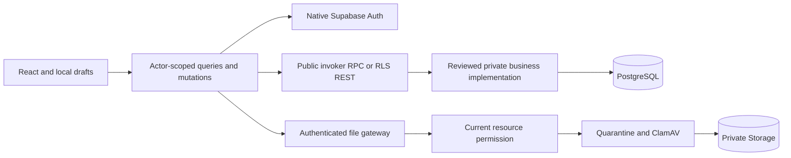

Roles are read from current database rows. Editable `user_metadata`, submitted author/user IDs and visible navigation do not grant permissions. The public SQL API uses `security invoker`; necessary privileged implementations live in the unexposed private schema, check the actual caller and have restricted execution grants. Every exposed table has RLS.

Admin/owner accounts can exercise permitted business roles. Financial, role, contract and moderation operations retain current capability and resource checks. Private DMs require actual membership; private calendars remain owner-only data. The separate account HTTP API performs data operations with the caller's JWT. Only invitation delivery/completion and account creation use narrowly scoped server-side Auth administration permissions. Both invitation entry points share the same durable
reservation protocol.

The [generated API reference](API_REFERENCE.md) lists actual parameters, return types and execution grants from a migrated temporary PostgreSQL database. `scripts/api-surface-db-tests.mjs` connects actual frontend calls to this database through compiler symbols. A documented API or migration is not dead code merely because the browser does not call it.

<a id="section-developer-guide-feature-modules-and-their-connections"></a>

## Feature modules and their connections

| Module                 | Code and data contract                                                                       | Important boundary / documentation                                                                                                                                                                           |
|------------------------|----------------------------------------------------------------------------------------------|--------------------------------------------------------------------------------------------------------------------------------------------------------------------------------------------------------------|
| Profiles and expertise | `features/profile`, `features/people`, profile/expertise tables and safe person projections  | Own contact/evidence data are separate from intentionally shared profile information. [PROFILES_REVIEWS](GUIDE.md#section-profiles-reviews).                                                                 |
| Profile pictures       | Avatar editor/API, `profile_avatars`, existing document versions and the files avatar action | Own clean image, exact version, authorized profile viewing and reauthorization before returning bytes. [PROFILE_AVATARS](GUIDE.md#section-profile-avatars).                                                  |
| Customers and courses  | `features/operations`, organization/template/run/session model                               | Private contacts/notes remain protected; reusable content and an actual course run are separate entities. [OPERATIONS](OPERATIONS.md#section-operations).                                                    |
| Course building blocks | Provenance catalogue, `building_blocks`, source versions and referencing templates           | One canonical template per code, each original source with hash/pages/filename. No import of compensation, contacts or real participants. [COURSE_BUILDING_BLOCKS](GUIDE.md#section-course-building-blocks). |
| Job offers             | `features/admin`, `features/jobs`, job/session/requirement tables                            | Template → run → referenced job, verified current source data and an immutable accepted snapshot.                                                                                                            |
| Immediate allocation   | Claim RPC, lecturer/job locks, unique claims and interval exclusion                          | All sessions or none; one winner, idempotent retry, no drag/frontend shortcut.                                                                                                                               |
| Comments               | `features/comments`, private comment/revision data                                           | Resource-specific staff discussions; own versioned edits/withdrawal and reasoned authorised moderation; no modification of accepted terms. [RESOURCE_COMMENTS](GUIDE.md#section-resource-comments).          |
| Calendar               | `features/calendar`, private events, confirmed session snapshots and published global events | No global derivation from private appointments; actual instants plus the intended IANA zone.                                                                                                                 |
| Chat                   | `features/chat`, rooms/memberships/messages and Realtime                                     | Separate staff/participant rooms; future delivery and file access follow current membership. CHAT_SECURITY.                                                                                                  |
| Files                  | `features/files`, Edge gateway, documents/versions, quarantine/clean buckets                 | MIME/magic/size, scanning, hashes/versions and current permission; no permanent public URLs.                                                                                                                 |
| Knowledge and search   | `features/knowledge`, `features/search`, wiki versions/forum and safe search projections     | A new draft does not replace a published wiki version; content is rendered as an allowed editor tree/text. KNOWLEDGE_SECURITY.                                                                               |
| Contracts and invoices | `features/commercial`, exact clean PDF versions, accepted claims, invoice items/payments     | Receipt acknowledgement is not an electronic signature; amounts come from accepted agreements. COMMERCIAL_SECURITY.                                                                                          |
| Clients and commission | Client portal, current organization membership, private gross/commission snapshots           | Private versioned role policy; lecturers see their own compensation, admin/owner sees full prices; unknown historical gross prices remain unknown. CLIENT_COMMISSION_SECURITY.                               |
| Account management     | `features/accounts`, accounts Edge, role/activation/invitation RPCs                          | Current permissions and action-specific rank rules; the last active administrator is preserved under a shared lock.                                                                                          |

<a id="section-developer-guide-maintaining-course-provenance-and-offers"></a>

## Maintaining course provenance and offers

The catalogue contains no absolute local user paths and does not publish the original PDFs. A source reference includes the code, exact filename, SHA-256, pages and dates. LPC3/LPC4 revisions with the same title are distinct sources of the same canonical building block. The import/check routine and its arguments are documented in [COURSE_BUILDING_BLOCKS](GUIDE.md#section-course-building-blocks).

New runs use a selected template; customer, delivery mode, location/link and actual sessions can be planned separately. The course-to-job form displays a frozen source snapshot and submits only financial terms with `source_revision`. The server reads and locks the real resources, compares the revision and uses the original session IDs. A stale draft is rejected. Once a job exists, its source chain is protected; a new building-block revision receives a new template rather than redirecting
existing jobs.

Administrators with the gross-price capability enter the full client price; the existing private commission agreement calculates lecturer compensation. Management without that capability uses the existing net-price contract. This path does not invent a gross client price. Currencies remain separate, and accepted amounts/rates/terms stay unchanged.

<a id="section-developer-guide-files-images-and-cache-lifetimes"></a>

## Files, images and cache lifetimes

Files reserve a specific version and are actually checked before release. Cancellation or scanner failure does not count as a clean upload. Contracts/invoices reference exactly the confirmed bytes. Profile pictures use the same secure upload path but a separate, narrowly scoped read projection. This does not grant other profiles access to general personal documents.

The avatar editor produces a bounded raster image without the original metadata; the server independently validates the canonical PNG. Replacement, removal and membership revocation are checked even during download. Blob URLs belong to the current identity and selection, are released on changes/unmount/offline transitions, and are not stored as global URLs. The PWA caches only the public application shell, not private API/file responses.

<a id="section-developer-guide-code-changes-and-comments"></a>

## Code changes and comments

Keep components, DTOs and queries in the feature module that owns them. Share actual business rules between callers; for example, `private.can_read_job` applies to both job RLS and job comments. Duplicated permission conditions can drift apart later.

Comment on the reason for a lock, important ordering, the authorization contract, version/retry handling or memory cleanup directly beside the code. Types and clear names describe the data; security/architecture documents explain broader decisions. Update comments when behavior changes. Document known limits instead of returning success from unimplemented branches.

Comprehensive English source commentary now covers maintained frontend modules, tests, Edge handlers, runtime tools and operating configuration. Keep file purposes, function/component/hook contracts and important control-flow explanations current; preserve useful existing comments and directives. The [agent guide](AGENTS.md) maps ownership, commands and invariants. Released migration bytes remain unchanged because preview/update checks bind their hashes;
the [SQL migration guide](DEVELOPMENT.md#section-migration-guide) explains the historical files and additive follow-up migrations in order. JSON/lockfiles, generated data, binary assets and the vendored upstream snapshot retain their own formats and provenance.

Create additive migrations with the actually installed CLI (`npx --no-install supabase migration new NAME`). Do not modify migrations that have already been delivered. Check new tables, indexes, constraints, RLS and grants together with their UI/API. Avoid a second source of truth for accepted compensation, confirmed sessions or author identities.

<a id="section-developer-guide-loading-behavior-and-runtime-reliability"></a>

## Loading behavior and runtime reliability

The system audit documents status-dependent metadata polling intervals, the two-minute fast-scan polling limit, immutable version-specific image bytes and batched chat revalidation. It includes actual before/after measurements and their limits. Language/theme persistence is best effort; blocked local storage must not crash the active UI. Native Auth storage keeps its separate SDK contract.

Session intervals must be finite at the database layer. The new migration validates existing data and stops on an invalid record; it does not silently change accepted agreements. Process timeouts and cancellation require actual process termination and an honest cleanup confirmation.

<a id="section-developer-guide-testing-strategy-and-failure-diagnosis"></a>

## Testing strategy and failure diagnosis

| Layer               | What it proves                                                                                       | Execution                                                                              |
|---------------------|------------------------------------------------------------------------------------------------------|----------------------------------------------------------------------------------------|
| Source/components   | Validation, failed requests, state/language changes, cache/Blob lifetime and concrete UI regressions | `npm test`, or targeted `npx --no-install vitest run FILE`                             |
| Import/symbol graph | Connected modules, imports, routes, static assets and actual export references                       | `node scripts/code-integrity.mjs --exports` and automatically discovered runtime tests |
| PostgreSQL          | Fresh migrations, constraints, roles/RLS, versions, transactions and concurrency                     | Automatically discovered `*-db-tests.mjs` in the complete command                      |
| Real API            | Native password Auth, REST/RPC, WebSockets, private object bytes, actual scanning and Mailpit        | Automatically discovered `*-api-check.mjs` in the complete command                     |
| Browser             | Real data workflows, keyboard, DE/EN, layout, axe and permissions through separate actors/sessions   | Playwright within `./portal test`                                                      |
| Built PWA           | Actual service worker, offline deep links and excluded private caches                                | Separate build/preview stage in the complete command                                   |

`scripts/testing/api.mjs` provides shared API fixtures: a strictly random canonical project, local test ports, real separate password accounts with no MFA factors and checked cleanup. Register owned resources through `defer`; resources are removed before their test accounts. Cleanup failures fail the check and are retained alongside the original failure. `scripts/testing/database.mjs` creates and removes owned temporary databases.

Reproduce an actual failure first, add a meaningful failing check and correct the owning contract. Simulated SDK failures are useful for error presentation; they do not replace real Auth/server acceptance. Concurrent PostgreSQL calls must test actual concurrency. Use independent BrowserContexts for different actors so their Auth storage is not shared.

The complete command also includes offline update/release/proxy checks. These additionally require Python 3; the test run changes neither the hosted server nor its configuration. Deliberate operator review boundaries for migrations remain. Releasing a package is not proof that a migration has already been applied to the development instance.

The complete command writes protected reports under `.local/tests/<run>/`. Inspect the first failing stage and its specific trace/error context first. Verify the necessary correction, then run complete acceptance again before delivery. Private traces, tokens, QR codes and credentials do not belong in Git or screenshots.

Local Chromium emulation and automated axe checks do not replace actual mobile installation, other browsers, manual accessibility checks or subsequent host/SMTP/restore acceptance. Remaining release gates are in the plan and [deployment runbook](OPERATIONS.md#section-deployment-runbook).

<a id="section-local-development"></a>

<a id="section-local-development-local-application-and-persistence"></a>

# Local application and persistence

The supported entry point is the executable `./portal` in the repository root. It orchestrates the actual React/Vite frontend, PostgreSQL, Supabase Auth, Storage, Realtime, Edge Functions and Mailpit. The required local malware scanner is started before Edge Functions when its script is present. This is a development environment, never a production deployment.

<a id="section-local-development-one-command-start"></a>

## One-command start

```bash
./portal start
```

Requirements: a Linux host (CachyOS locally / Ubuntu CI), Node.js as pinned in [`.node-version`](.node-version) (the package minimum is 22.12), npm, Docker Engine 25 or later and Docker Compose 2.20.2 or later with healthcheck `start_interval` support. Full verification additionally needs Python 3 for the updater fixtures and util-linux `flock` for the shared host/user QA lock. Complete encrypted-backup guards require official `age`/`age-keygen` 1.x (tested 1.3.2) on PATH, or the explicit
`AGE_TEST_BINARY`/`AGE_KEYGEN_TEST_BINARY` fixture paths; missing tools fail before crypto tests can skip. The launcher installs exact lockfile dependencies when required, starts the local services, applies new migrations without resetting tables, initializes fictional fixtures only for an empty first bootstrap, waits for the actual invitation handler and frontend to be ready, and prints the local URLs.

The pinned Deno package needs its reviewed postinstall script to copy the platform executable into place. `package.json` explicitly allows that exact version for npm versions that otherwise block dependency scripts. When updating Deno, review its installer and update the version-specific `allowScripts` entry together with the dependency and lockfile; do not enable all dependency scripts globally.

- Portal: <http://127.0.0.1:5173>
- Supabase API: <http://127.0.0.1:54321>
- Local email capture: <http://127.0.0.1:54324>
- Fresh bootstrap accounts: `admin@example.invalid`, `carina@example.invalid` (owner demonstration), `client@example.invalid` (fictional organisation), `lecturer01@example.invalid` through `lecturer11@example.invalid`, `participant@example.invalid` — 15 distinct Auth identities. Populated instances retain existing records and are never automatically reseeded.

The first start needs Docker image downloads and may take several minutes. The scanner needs additional RAM for signature loading; see the scanner documentation. Ports must be free; the launcher does not kill an unrelated process occupying a port.

The launcher creates only its own labelled `portal_network_<project>` Docker bridge with `com.docker.network.bridge.host_binding_ipv4=127.0.0.1`, then passes that network explicitly to Supabase startup and Edge Functions. It inspects the effective container port bindings before reporting readiness: PostgreSQL, the API and Mailpit must publish only to loopback; ClamAV publishes no host port. It refuses an unowned network and never changes the Docker daemon configuration. The legacy
`scripts/local-start.sh` and `scripts/local-functions.sh` both delegate to the same managed launcher. This uses the documented [Docker bridge binding option](https://docs.docker.com/engine/network/drivers/bridge/#default-host-binding-address) and [Supabase CLI network flag](https://supabase.com/docs/reference/cli/introduction#global-flags).

To inspect the generated local fixture password deliberately in your own terminal:

```bash
./portal credentials
```

The password is stored in the permission-restricted ignored `.local/ACCOUNTS.txt`; server credentials stay in ignored `.env.test.local`. Start/status output and runtime logs do not print keys or passwords. A password changed through the app remains changed; the credentials file describes the original bootstrap password, not a password-reset mechanism. If the credentials file was lost while database volumes remain, existing passwords are not overwritten: use the known password or local Mailpit
recovery.

<a id="section-local-development-repeated-use-preserves-data"></a>

## Repeated use preserves data

```bash
./portal status
./portal stop
./portal start
```

`stop` shuts down only this project's managed processes and containers. It keeps PostgreSQL/Auth/Storage volumes and the scanner signature volume. Profile edits, roles, suspensions, declared expertise and historical attestations, passwords, accepted assignments, calendar events, messages and actual uploaded file objects remain in local persistent storage. Startup never invokes `db reset`, never uses `--no-backup`, and never rotates the fixture password or overwrites existing profiles. The
supervisor verifies a PID/session identity before signalling a recorded process, so stale PID reuse cannot kill an unrelated process.

An empty owned Docker network is removed after its containers stop. Data volumes are independent of this disposable network. A network still used by a container is left in place with an error; the launcher never detaches unrelated containers to force cleanup.

Use `./portal restart` for a data-preserving stop/start, or `./portal up` to stay attached and stop with Ctrl+C. Local services started with `start` remain running until `stop`, system shutdown or a fatal child-service failure. Source/plan/QA evidence ledger persist independently in Git; a process is not a substitute for durable source.

Do not manually delete Docker volumes or `.local` credentials if their data are needed. A volume is persistence, not an off-site backup. Production backup of PostgreSQL and Storage objects, retention and restore drills remain separate release requirements.

<a id="section-local-development-one-command-complete-local-verification"></a>

## One-command complete local verification

```bash
./portal test
```

This command creates a sanitized temporary checkout with its own random Supabase project ID and its own ports. It never resets or mutates the normal development database:

| Service       | Development | Isolated tests |
|---------------|-------------|----------------|
| Frontend      | 5173        | 5273           |
| Built preview | —           | 4273           |
| Supabase API  | 54321       | 55321          |
| PostgreSQL    | 54322       | 55322          |
| Mailpit       | 54324       | 55324          |

Tests use separate PostgreSQL/Auth/Storage and scanner volumes. Package files are reused, while Vite caches, `.env` files, credentials, reports, build output and process state are independent. Inherited Supabase/E2E/Vite environment values are stripped before test subprocess configuration, and all mutating harnesses restrict targets to loopback. Only one updated checkout at a time can hold the shared kernel QA lock, because test ports are fixed. Its persistent lock file is private under the OS
temporary directory; kernel ownership is released when the process closes or dies, and diagnostic PID metadata cannot steal it. A separate per-checkout marker remains for local recovery. Before any snapshot/proxy/service activity the runner also refuses occupied test ports from older checkouts or unrelated processes; it never stops those listeners.

When the hosted-development source is present, the same command also discovers reviewed migration/package Node tests and runs Python updater, private Envoy routing and Caddy ingress checks using only fixtures and owned containers. It never invokes the hosted updater or uses hosted credentials.

The command runs source lint/typecheck/formatting, runtime safety tests, component/unit tests, dependency audit, Edge handler tests/typechecks, real services, actual stop/start persistence with password/no-MFA-factor/profile/private-event/Storage-byte verification, SQL/RLS/concurrency tests, real HTTP/Edge/Mailpit journeys, desktop/mobile browsers, production build and separate built-PWA checks. The main browser suite excludes the built-PWA cases because those run after the production build
against its separate preview.

Results and private failure artifacts are stored under `.local/tests/<run>/`. Reports can contain local Auth traces; do not publish them. The test supervisor and only the randomly named test stack/volumes are removed in `finally` cleanup, including on a failing check. Normal development can remain running while tests execute. If the process is killed forcibly before cleanup, inspect its explicitly named test project and lock before removing only that test project's resources.

New test harnesses must honour `PORTAL_DB_CONTAINER`, `E2E_BASE_URL`, `E2E_MAILPIT_URL`, `PORTAL_APP_ORIGIN` and the current checkout's `.env.test.local`; never hard-code the normal development ports. `scripts/*-api-check.mjs` are automatically included in the complete command. Tests must not call hosted URLs or real email recipients.

<a id="section-local-development-honest-limits"></a>

## Honest limits

A complete local command does not mean every target-product module already exists. The full product scope and remaining work stay in [ROADMAP.md](ROADMAP.md). The local environment does not prove hosted SMTP deliverability, Hostinger headers, GDPR/legal acceptance, physical iOS/Safari PWA installation or a tested production disaster-recovery process.

<a id="section-local-development-historical-runtime-verification--15-november-2026"></a>

## Historical runtime verification — 15 November 2026

Executed locally during this continuation:

- `./portal start` started the real PostgreSQL/Auth/Storage/Realtime/Mailpit/Edge/Vite stack and applied the new complete document/chat migrations without resetting the existing database. An immediate repeated start returned the same ready instance.
- `node scripts/runtime-persistence-check.mjs` created an ephemeral fictional account and private bucket, performed an actual managed stop/start with ClamAV, and passed checks for the same password, verified TOTP factor, edited profile/timezone, private appointment and exact stored object bytes. Probe data were cleaned afterwards; the existing thirteen fixtures were not edited.
- `node --test scripts/runtime-safety.test.mjs` passed seven checks: redaction of CLI secret formats, inherited-environment isolation, loopback URL boundaries, unrelated-PID protection, protected environment writes, unfinished-migration/digest handling, and Docker binding/network ownership boundaries.
- The actual normal stack was moved without data loss to the owned bridge; Docker inspection confirmed only `127.0.0.1` on API54321, database54322 and Mailpit54324, with no scanner host port. The real Auth/MFA/profile/private-event/Storage-byte persistence check passed after this change; existing thirteen fixtures remained untouched.
- Targeted ESLint, Node syntax checks and shell syntax checks passed for the runtime files.

The following aggregate checkpoint records the later complete isolated run. For acceptance of a newer source revision, use its exact-source result in the relevant pull request checks. An empty migration is intentionally refused before starting a fresh stack. Source-only checks and the persistence rehearsal above are not a substitute for that final whole-command run; the integrated result belongs in the main QA evidence ledger and QA record.

<a id="section-local-development-historical-complete-command-acceptance--15-november-2026"></a>

## Historical complete-command acceptance — 15 November 2026

The complete command passed on 2026-11-15 at 13:53:47 UTC, report `.local/tests/999c091e/RESULT.txt`: 42 source, 7 runtime, 11 Edge, 78 SQL, all actual API/Mailpit suites, 40 desktop/mobile workflows, current build and 2 built-PWA checks, followed by successful owned cleanup. Temporary persistence records are removed with checked results. A targeted later mobile-input visual correction and exact GitHub revision status are recorded in the relevant pull request checks.

Development HMR ignores generated QA reports, private `.local` state, coverage and documentation. A real filesystem-watcher regression keeps actual source changes watched while report HTML no longer triggers application reloads.

The actual native selfhost image/retained-data rehearsal is a separate CI job. Full-profile PRs run system and browser phases in independent stacks; main/manual runs retain the complete command. Documentation-only and ordinary frontend PRs select narrower profiles described in [CI_QUALITY](DEVELOPMENT.md#section-ci-quality). Explicit development publication requires successful complete application and native gates. Offline maintenance/backup guards belong to `./portal test`; separately running a
native encrypted three-database restore remains an explicit operation.

<a id="section-local-development-latest-github-preview"></a>

## Latest GitHub preview

Use `./portal github` to fetch and start the exact latest main in a separate persistent local preview on port 5373/API 56321. Use `./portal github test` for a separate latest-source QA checkout. The normal development tree, its dirty files and data are preserved. The [complete preview guide](DEVELOPMENT.md#section-github-local-preview) explains ownership, retained data, local migration review, commands and ports; this is distinct from updating your development branch with Git.

<a id="section-github-local-preview"></a>

<a id="section-github-local-preview-try-the-latest-github-version-locally"></a>

# Try the latest GitHub version locally

Local execution is the default development workflow. Run `./portal check` for
fast quality/coverage/build feedback and `./portal test` in your own checkout for
complete isolated acceptance before delivery. Use `./portal github test` to
fetch and verify the latest `main` on this PC. Neither command publishes a
GitHub deployment or requires registering the PC as an Actions runner.
Automatic GitHub quality/security checks remain additional independent evidence.

```bash
./portal github
```

This command fetches the current `main` from **Luminovia-Training-Consulting/Luminovia-Management-Tool**, displays its full commit ID and starts it as a separate local portal at **http://127.0.0.1:5373**. Your current checkout and uncommitted changes are preserved. It does not run `git pull` in your development branch or reset an existing database.

Requirements are the same as for [local development](DEVELOPMENT.md#section-local-development): Linux, Node/npm, Git, Docker Engine/Compose, Python 3 and util-linux `flock`. The first start downloads the locked dependencies, Supabase services and scanner signatures. Concurrent development and preview environments each need memory for their own scanner; complete QA needs additional resources.

<a id="section-github-local-preview-local-only-administrator"></a>

### Local-only administrator

The separately owned GitHub preview creates a fictional account at startup. On
`http://127.0.0.1:5373`, sign in with username **admin** and password **admin**.
The shortcut is available only when the browser and API are on the dedicated
loopback preview addresses. Supabase Auth still authenticates the account and
current administrator capability and active-account checks apply. This intentionally weak account
must never be created on a hosted instance or copied into any non-test database.

The account is separate from the existing `admin@example.invalid` fixture. If
the preview account already exists, its password and profile are retained, so a
later password change is not reset to the original value. The ordinary local
development stack, PR previews and isolated QA stacks do not create this
account. The existing generated fixture credentials remain available through
`./portal github credentials`.

<a id="section-github-local-preview-commands"></a>

## Commands

| Command                                      | Effect                                                                                                                                   |
|----------------------------------------------|------------------------------------------------------------------------------------------------------------------------------------------|
| `./portal github` or `./portal github start` | Fetch the current GitHub version, update the owned preview if necessary and start it.                                                    |
| `./portal github update`                     | Fetch the current version, apply an update without resetting data and start it.                                                          |
| `./portal github status`                     | Show the saved commit ID, actual supervisor phase and local addresses; no network fetch.                                                 |
| `./portal github stop`                       | Stop only the managed preview; preserve its data.                                                                                        |
| `./portal github credentials`                | Deliberately display the original password for your fictional preview accounts. Do not share it.                                         |
| `./portal github plan`                       | Show the current GitHub version, new migrations and review requirements without updating or stopping a running preview.                  |
| `./portal github test`                       | Run the complete `./portal test` against the latest commit in a separate test checkout. A running preview stays on its existing version. |

Every start, update or test invocation must successfully fetch the current main branch. Network and Git errors are reported: the launcher does not claim to be current or start an older fallback version. A failed fetch does not stop an already running preview. `status`, `stop` and `credentials` do not need a GitHub fetch.

<a id="section-github-local-preview-separate-services-and-persistent-test-data"></a>

## Separate services and persistent test data

| Environment        | Portal | Supabase API | PostgreSQL | Mailpit |
|--------------------|--------|--------------|------------|---------|
| Normal development | `5173` | `54321`      | `54322`    | `54324` |
| GitHub preview     | `5373` | `56321`      | `56322`    | `56324` |
| Complete QA        | `5273` | `55321`      | `55322`    | `55324` |

All addresses bind to loopback. The preview receives its own stable Supabase project, `luminovia-portal-github-…`, derived from the launcher directory. New empty previews receive only the existing fictional sample accounts. Passwords, profiles, appointments and Storage files are not reinitialized by stop/start or successful forward updates. No credentials or real data are copied from your normal development environment.

The managed source is under `.local/github-preview/source/`. Its own ignored `.local/` and environment files survive updates. Git records the exact main-branch commit; only `supabase/config.toml` receives a documented local project/port adjustment. The launcher verifies its fingerprint before every update. This source copy is for trying the application: make your own code changes in a normal development branch. Modified or foreign files in the managed source are rejected rather than overwritten.

GitHub test checkouts are separate, under `.local/github-preview/test-<full-commit-ID>/`. The canonical test launcher still creates a random, short-lived QA database there and uses the shared system-wide QA lock. Reports remain in that checkout's `.local/tests/`. Test checkouts and installed dependencies consume additional disk space; they are not automatically deleted along with potentially useful diagnostics.

A local Docker volume is not a backup. This tool does not synchronize production data or perform a hosted installation.

<a id="section-github-local-preview-migrations-and-interrupted-updates"></a>

## Migrations and interrupted updates

The existing local runtime applies new additive migrations during normal startup. Rewound Git history, changed or removed historical migrations, backdated migrations, a different PostgreSQL major version or a changed remote address are rejected before any data change.

For new migrations, the preview plan uses the existing updater's SQL compatibility check. Changes requiring review are rejected **before stopping services**. Inspect the named SQL files at the specific commit and back up any preview data you need. Only after reviewing them should you accept the exact displayed plan:

```bash
./portal github plan
./portal github update --accept-migration-plan DISPLAYED_SHA256_DIGEST
```

Replace `DISPLAYED_SHA256_DIGEST` with the full displayed digest. It binds the target commit, previous state and new migration sources. A version that changes in the meantime requires a new plan. Acceptance is a local operator decision only: it is not production approval and does not bypass history checks or the PostgreSQL major-version restriction. It does not automatically undo business-data changes made by a deliberately accepted migration.

A private transition record detects interruptions between Git checkout and writing the local port configuration. Only the recorded old or new commit with unchanged source files is normalized. Unknown changes are rejected. The launcher does not reset the database or silently roll it back. If a subsequent service startup fails, the owned source, data and private logs remain available for diagnosis.

<a id="section-github-local-preview-launcher-development-and-acceptance"></a>

## Launcher development and acceptance

The eleven `runtime-github.test.mjs` cases use real temporary Git repositories and real Node subprocesses. They check version changes, retained fictional password/file bytes, untouched development changes, data/history boundaries, separate test checkouts, existing and dangling symlinks, interrupted configuration transitions and release of the kernel lock after process exit. Their service adapter is explicitly a fixture; these cases do not replace a real Supabase Auth/Storage restart acceptance
check.

```bash
node --test scripts/runtime-github.test.mjs
```

The regular complete command discovers these cases automatically. Actual complete/native checks and the real preview restart are recorded separately in QA evidence.

<a id="section-github-local-preview-executed-m6-upgrade-checkpoint--16-november-2026"></a>

## Executed M6 upgrade checkpoint — 16 November 2026

The official preview was actually upgraded from main `5f89986` with 18 migrations to the accepted main merge `dc8e9a7` with 24 migrations. The six new migration sources were reviewed and their exact plan digest accepted; the update returned exit 0. Status and database history independently confirmed that SHA and 24 migrations on the separate `5373`/`563xx` project. A subsequent real stop/start probe returned exit 0 and preserved the password, verified MFA, edited profile/timezone, private event
and exact private Storage bytes; only its fictional probe records/bucket were removed. Normal `5173`/`543xx` and hosted databases were not targeted. These historical values are evidence, not a digest to reuse for a later update: always review the newly displayed plan.

<a id="section-pr-previews"></a>

<a id="section-pr-previews-pr-checks-and-local-preview-packages"></a>

# PR checks and local preview packages

Run `./portal check` on the local PC for fast feedback while editing, then
`./portal test` for complete isolated acceptance before delivery. To test the
latest `main` locally use `./portal github test`; `./portal github` starts its
persistent local preview. These commands require no GitHub deployment or
self-hosted Actions runner.

Every pull request receives build, TypeScript, style, coverage, security and metadata checks. Verified Draft documentation changes additionally run runtime/Edge/audit checks; ordinary Draft frontend changes also run all existing SQL migration/RLS/concurrency suites in two independent pinned PostgreSQL clusters. Sensitive/unknown changes and every ready PR require aggregate full system, browser and native retained-data acceptance. Full-PR system and browser phases use separate fresh stacks;
neither phase alone is complete acceptance. Switching to Ready starts a fresh full run through `ready_for_review`, even without another commit. Main/manual always receives complete acceptance. See [CI profiles](DEVELOPMENT.md#section-ci-quality). This includes forks and Dependabot. GitHub may still require approval for first-time external workflow runs. Missing required labels continue to fail `PR metadata`; a preview package replaces neither this classification nor the separate security
analysis.

The `PR preview package` job waits for all five quality jobs, coverage, scope, `verify`, `Isolated browser acceptance` and `Actual isolated selfhost image compatibility`. Only then does it create a downloadable package of the commit actually tested. Drafts may carry a narrower documentation or SQL profile; ready PRs require the full system/browser/native profile, with actual completion of every phase. The manifest and bilingual README record the actual profile. Wait for the fresh Ready/full run
before queuing a merge; a narrower Draft package does not certify complete acceptance. A manual Portal checks run on the branch can exercise full verification separately. Creating the artifact does not create a GitHub Deployment record. Its own fresh checkout contains no credentials or reports from the preceding test run. The package contains:

- `portal-source.tar.gz`: tracked application sources only, including migrations and the local launcher.
- `manifest.json`: the PR head, tested merge commit, workflow run and attempt, and the source archive's SHA-256.
- `README.txt`: German/English startup instructions and prerequisites.
- `preview.mjs`: the entry point for a separate local PR runtime with persistent data.

<a id="section-pr-previews-try-a-package"></a>

## Try a package

Open the link in the `PR preview package` job summary. If a maintainer explicitly publishes deployment metadata, its `pr-<number>-local-preview` record links to the same artifact. Downloading it normally requires signing in to GitHub. It is explicitly **not an internet-hosted portal instance**. GitHub retains the package for seven days unless it is deleted earlier.

Review an external contribution's source before running it locally. It executes on your computer, including package installation and development tools. Extract the artifact into a new, dedicated directory. In that directory, run:

```bash
tar -xzf portal-source.tar.gz
node preview.mjs start
node preview.mjs credentials
```

Prerequisites are Linux, Node.js 22.12 or later, npm, Docker Engine and Docker Compose 2.20.2 or later. Preview ports 5473/573xx must be available; the launcher does not terminate unrelated processes. These ports differ from normal development, full tests and the latest-main preview. Other prerequisites are documented in [LOCAL_DEVELOPMENT](DEVELOPMENT.md#section-local-development).

Use the wrapper; running `./portal start` in the extracted canonical source directory would use its unchanged normal development identity. The wrapper verifies the archive and configuration checksums, creates a separate private copy under `.preview/source`, and changes only that copy's project ID, Auth URLs and ports. The project ID includes the PR number and a hash of the tested source revision and package path; this also keeps database/Storage volumes separate from a stopped normal development
environment. The unchanged archive and its canonical sources remain the reference. Modified project configurations, unrelated directories and symlinked private runtime state are refused.

The separate runtime installs the locked dependencies, starts the complete local application including Supabase and Mailpit, and creates fictional accounts in an initially empty environment. The portal opens at <http://127.0.0.1:5473>; the API and Mailpit use ports 57321/57324. Generated credentials are created locally only; actual email delivery is intercepted locally. Do not overwrite existing development directories with this package.

```bash
node preview.mjs stop
```

This command stops the separate preview while preserving its local data. `node preview.mjs status` checks this runtime; `node preview.mjs prepare` only creates and verifies the separate source copy, without starting a service. A successful package build does not prove that the preview has already started on every other computer.

<a id="section-pr-previews-github-deployments-and-permissions"></a>

## GitHub deployments and permissions

The [pr-previews.yml](.github/workflows/pr-previews.yml) workflow is **manual-only** and accepts dispatches on `main`. It has no automatic
`workflow_run`, PR or scheduled deployment trigger. In GitHub Actions, choose
`PR preview deployments` → `Run workflow` on `main`, then select:

- `action=publish`, with the successful `Portal checks` run's `run_id` and exact
  `run_attempt`, to publish its verified local artifact metadata.
- `action=cleanup` (the default), to deactivate stale/closed/expired metadata
  without publishing a new deployment. Run this deliberately when cleanup is
  needed; PR closure and the passage of time no longer schedule it automatically.

Publication requires an explicit user request. The workflow executes only the
publisher from the trusted default branch. It has `deployments: write` and
read-only permissions for sources, Actions and PR metadata. It does not install
packages, download artifacts or execute PR code, and receives no hosting secrets.

The publisher reconfirms the repository, actual workflow path, PR head, current workflow attempt and every expected successful job through GitHub's API. It reads only the metadata of the uniquely named, unexpired artifact, including its GitHub-provided digest. A newer run or a changed/closed PR must prevent an old result from being published as current. Fork payloads without a direct PR association are resolved through the associated commit API. Free-form PR text is never used as commands or
URLs.

The deployment is transient and non-production. Its `success` means **“local preview package available for download”**; the supplied link points to
the actual artifact. Publishing a current preview deactivates superseded records;
the manual cleanup action deactivates closed, expired, deleted or stale records.
Existing records are not claimed removed merely because the workflow changed.
Record actual publication/cleanup evidence separately from local test results.

<a id="section-pr-previews-hosted-previews-and-existing-releases"></a>

## Hosted previews and existing releases

The development installation at `cms.luminovia.org` remains separate and holds persistent data. After exact-current-main push runs of both Portal checks and Security analysis succeed, the automatic CMS workflow may publish a verified immutable release for the existing VPS poller. The manual exact-SHA release path also remains available. Migrations, backups, health and rollback are still checked by the server updater; a successful workflow alone does not establish an installation. PR metadata
publication remains separate and manual. The local PR package receives neither server keys nor hosted data.

A persistently browser-accessible portal for each PR requires a separately configured preview host with isolated Auth, database, Storage and email environments, plus controlled cleanup. A static frontend copy with an invented backend would not provide working login and business workflows. This implementation registers no such service and claims no public PR URL.

References: [GitHub deployment API](https://docs.github.com/en/rest/deployments/deployments), [deployment statuses](https://docs.github.com/en/rest/deployments/statuses) and [security boundaries for privileged workflows](https://docs.github.com/en/actions/reference/security/secure-use).

<a id="section-architecture"></a>

<a id="section-architecture-architecture-and-decisions"></a>

# Architecture and decisions

<a id="section-architecture-current-system"></a>

## Current system

The application is a static React/TypeScript/Vite PWA backed by Supabase PostgreSQL, Auth, Data API, Realtime, private Storage and bounded Edge Functions. There is no additional business application server. Accepted main `4f7f6c0` contains 69 released SQL files, including the merged smart-operations, PR24 operational modules and PR25 private enquiry intake. [API_REFERENCE](API_REFERENCE.md) is regenerated from that complete migration replay; [ERD](DEVELOPMENT.md#section-erd) maps the physical
domain relations and [MIGRATION_GUIDE](DEVELOPMENT.md#section-migration-guide) explains source order.

Browser components validate input and call identity-scoped query/mutation APIs. PostgreSQL checks the current actor, active status/capability, resource membership, expected version and transaction invariants before committing. Realtime and notifications refresh authorised projections after the commit. Edge gateways hold server credentials only for narrowly checked invitation, private-byte and rendering operations; browser roles never receive them.

The original master specification and later accepted extensions remain the full target. [PRODUCT_SPEC](PRODUCT.md#section-product-spec) and [ROADMAP](ROADMAP.md) separate delivered source from remaining work. Exact executed results belong in the relevant pull request checks; merging documentation or source proves no hosted installation, provider delivery, physical PWA acceptance or production release. The ADRs below preserve decisions and explicitly labelled historical checkpoints.

Course readiness is a live resource-scoped SQL projection; no authoritative percentage is writable. Private per-run settings, tasks and instruction receipts bind current schedules/assignments and actual accessible clean material. Teaching delivery uses editable unsubmitted drafts and immutable submitted revisions/review history, leaving accepted prices/invoices unchanged. A replacement calls the existing claim implementation within a rollback-safe handover transaction and preserves the original
until success. Support uses ticket ownership or explicit support capability, with separate filtered internal messages and dedicated frozen attachments. No capability grants unrelated private calendar/chat/contract file contents. Contract owners upload their own scanned PDFs; contract managers with MFA receive only the bounded filename/version candidate projection needed to register an executed agreement. Legacy files remain readable only by their owner, including files formerly uploaded by
management. New wrappers remain invoker functions; private tables retain RLS and no browser table access. Online confirmation remains mandatory. General API responses and private files are not cached; ADR-026 documents the separately opted-in minimal own teaching snapshot. Actual implementation/evidence/limits.

Dedicated support evidence also checks optional course-resource history. Incoming dedication and a reverse registry trigger serialize on the document row; neither ownership nor removed course history can override that exclusivity. A feature introducing that registry later must install the reverse guard and preserve private selectors/downloads. Contract and actual checks.

The smart-operations model complements these workflows. The ordered model includes current actor-role quotes, immutable recipient-specific substitution consent, current-status receipts, own Teaching Day course/contact context, effective-amendment forecasts and dedicated private-document isolation. The current combined source requires fresh and retained-data replay plus the complete application/native acceptance; previous source-bound results remain in the relevant pull request
checks. [ERD](DEVELOPMENT.md#section-erd) maps physical relations, [MIGRATION_GUIDE](DEVELOPMENT.md#section-migration-guide) explains source order and [API_REFERENCE](API_REFERENCE.md) inventories replayed interfaces. The full target remains [PRODUCT_SPEC](PRODUCT.md#section-product-spec) and the authoritative [master prompt](PRODUCT_BRIEF.txt). Hosted state, external delivery and platform acceptance remain separate operational evidence.

The [website enquiry gateway](GUIDE.md#section-website-enquiries) is a bounded integration-only Edge entry point, disabled by default. It adds a private server credential above the existing gateway boundary, stores original consent-versioned submissions in private ledgers and exposes management decisions through current capability-checked invoker RPCs. Conversion creates an unpublished course plan atomically; it neither creates a quote nor activates a public Website transport.

<a id="section-architecture-confirmed-permanent-deletion-extension"></a>

## Confirmed permanent deletion extension

Permanent deletion uses the existing account Edge facade and public invoker RPCs, with private plan/operation/permit/lease journals. The browser submits only typed target IDs and actor-bound confirmation IDs. Current database authority and dependency fingerprints are checked again at confirmation and before privileged execution. Native Auth hard deletion and exact-version Storage removal remain server-only. Upload leases and durable path fences prevent completed deletion from being followed by
late promotion. Private body ACLs remain authoritative; protected accepted financial/shared dependencies cause explicit blockers. See [PERMANENT_DELETION](GUIDE.md#section-permanent-deletion) for scope and failure recovery. Source/unit/SQL passes alone do not establish native or browser acceptance.

<a id="section-architecture-adr-001--separate-private-portal-and-static-frontend"></a>

## ADR-001 — separate private portal and static frontend

Use the existing `Luminovia-Training-Consulting/Luminovia-Management-Tool` repository. The public `Website` is solely a brand reference. React/TypeScript/Vite supplies the static SPA; no independent Node/Express application service is required. The original 15 November hosting decision used managed Supabase and reserved Docker/Supabase CLI for development. That hosting decision is historical: the user subsequently authorised the official Supabase Docker distribution on the Hostinger VPS as
described in ADR-012.

**Hosting superseded on 16 November:** the user explicitly chose complete Supabase self-hosting at Hostinger. ADR-012 and [HOSTINGER_DEVELOPMENT](OPERATIONS.md#section-hostinger-development) own the actual deployment; the security and static-frontend decisions remain applicable.

<a id="section-architecture-adr-002--source-of-truth-and-feature-boundaries"></a>

## ADR-002 — source-of-truth and feature boundaries

TanStack Query manages remote state through `@supabase/supabase-js`; no duplicated browser database or fake-auth runtime. React Router protects private screens and preserves deep links, while RLS/API checks remain authoritative. React Hook Form and Zod validate forms accessibly; database constraints revalidate security-critical data. i18next/react-i18next provide German/English text; browser locale/theme preferences may be persisted. The separately opted-in, minimal own teaching snapshot in
ADR-026 is the explicit private-data persistence exception; authenticated API responses and private files are not generically cached. Tailwind/shadcn primitives and Lucide icons use verified brand tokens. FullCalendar owns calendar rendering; the M6 permissioned job Kanban uses dnd-kit with keyboard controls and explicit status-action fallbacks. Wiki/forum use Tiptap with a strict stored/rendered JSON whitelist and code-block language highlighting.

Historical M1 API baseline (later migrations extend or replace these contracts): `get_my_permissions()` returns capability names; own `profiles` uses `id`, `display_name`, `bio_de`, `bio_en`, `phone`, `time_zone`, `locale`, `active` with restricted self-edit fields. `topics` and `lecturer_topics` distinguish self-selected expertise from protected verification. Jobs expose nested `job_sessions`/`job_requirements`. `set_job_status(p_job_id, p_status)` allows audited draft/published/archived
transitions and refuses silent changes to filled work. `claim_job(p_job_id, p_idempotency_key, p_terms_version)` returns a truthful status and optional claim ID. `create_job(p_payload jsonb)` requires `jobs.manage` and AAL2 and creates the complete supported block atomically. Private events stay owner-only. Check backend notes for the final full payload, validation and result codes before adding callers.

Current routes include Auth, dashboard, jobs/detail, calendar, chats, files, knowledge, client/people/course and commercial screens. M6 adds `/topics`, `/availability`, `/notifications`, `/settings` and `/admin/audit`; M7 adds `/announcements` and `/admin/announcements`. The account-onboarding extension adds the own-account `/welcome` guide and private compensation administration. The actual route definitions are in `src/app/app.tsx`; a route or navigation item is not evidence that the full
target module is complete.

Feature flow: component → validated form/query/mutation → Supabase Auth/data API/RPC → permission/RLS + constraints → committed database records → query invalidation/refetch. Claims, messages and uploads show success only after server confirmation. A failed write never becomes a local confirmed allocation.

<a id="section-architecture-adr-003--invitation-only-auth-and-granular-capabilities"></a>

## ADR-003 — invitation-only Auth and granular capabilities

Production public signup is disabled. Supabase manages credentials, sessions, password recovery and invitation consumption. Privileged operations require an active profile and a database-managed capability. MFA factors and assurance gates are disabled in the current source; editable user metadata never grants authority. Users may have several explicit roles, mapped to granular permissions. Senior lecturers inherit no commercial access. Deactivation is checked at the API/database boundary rather
than relying solely on JWT expiry.

User self-service edits must not change identity, verified qualification fields, role, capability, contract status or sensitive commercial data. Auth administration and invitation sending belong in tightly permissioned Edge Functions with server-only credentials, not browser administration APIs.

<a id="section-architecture-adr-004--postgresql-owns-claims-and-scheduling"></a>

## ADR-004 — PostgreSQL owns claims and scheduling

The original M1 single-position API remains compatible. M6 adds explicit capacity 1–20 for new standalone per-position administrative offers. Existing offers, catalogue-linked course offers and client requests retain their capacity-one commercial meaning. `claim_job` still authenticates the current actor, checks qualifications, the applicable contract and current terms, locks the lecturer scheduling boundary and job, and allocates every session atomically. Confirmed claims are unique per
job/lecturer, confirmed count cannot exceed capacity, and only unreleased intervals participate in the per-lecturer exclusion constraint. The final free position closes the offer. No UI drag operation confirms a booking.

Accepted compensation, currency, contract, sessions and revenue remain immutable history. `cancel_job_assignment` requires current management permission/MFA and an explicit reason, refuses started or invoiced work, releases the complete interval block and updates intended course-room membership. Cancellation closes the offer to `draft`; replacement requires the separate audited `manage_job_offer` reopen action. Existing other confirmed positions remain accepted. Invoice submission and
cancellation share the lecturer mutex, preventing a late invoice from attaching to a concurrently cancelled claim. These operations record tracking/audit state, not bank refunds or transfers. See [JOB_LIFECYCLE](GUIDE.md#section-job-lifecycle).

Private appointments and unavailable windows share the profile→lecturer advisory-lock boundary with assignment writes. Management sees only explicitly shared reduced availability metadata; neither availability sharing nor administrative role grants another person's private calendar. See [AVAILABILITY](GUIDE.md#section-availability).

Where privileged routines are unavoidable, implementation lives in a non-exposed private schema, with a fixed/empty search path, current-actor checks, no browser-supplied actor identity, narrow grants and reviewed public SECURITY INVOKER wrappers. Do not solve RLS problems with a blanket administrator bypass. Follow migration definitions for exact grants and locking order.

<a id="section-architecture-historical-m1-schema-boundary"></a>

## Historical M1 schema boundary

The first migration contains 22 core RLS-enabled public tables: `profiles`, `user_roles`, `role_permissions`, `topics`, `lecturer_topics`, `organisations`, `course_templates`, `course_runs`, `course_sessions`, `jobs`, `job_sessions`, `job_requirements`, `contracts`, `job_claims`, `assignment_sessions`, `personal_events`, `global_events`, `notifications`, `claim_events`, `audit_events`, `chat_rooms`, `chat_members`. It separates own-only events/allocations and lecturer commercial records from
management capabilities. Column grants exclude self-assigned activation, verification and accepted deal mutation.

At the M1 checkpoint, course-chat membership and committed notifications were infrastructure; later collaboration, contract PDF/receipt, directory/course and M6 lifecycle/capacity migrations extend that baseline. The original atomic job creation RPC creates organisation/template/run/session records for its block. Its historical one-slot/no-reopen limitation does not describe the current M6 implementation above. The current waitlist and explicit atomic substitution protocol is described in
ADR-023; the original one-position milestone did not implement it.

A second migration adds `invitation_requests` (23 exposed RLS-enabled tables in total) and scoped invitation reservation/completion RPCs. The browser-facing `invite-lecturer` Edge Function requires current Auth, `users.manage`, AAL2 and an approved exact origin. A durable database reservation precedes the external Auth email send; one email address is reserved across administrators, idempotency prevents repeat sends and each inviter is limited to five new reservations per fifteen minutes. The
browser cannot choose a privileged role: completed invitations grant only `lecturer`. Completion is server-only. A send timeout/failure is held for manual reconciliation rather than automatically retried into duplicate emails. Actual local Edge/Auth/Mailpit delivery and idempotency have been verified separately from handler unit tests. The custom token-hash invitation callback, password setup, sign-out/new-password login and PKCE recovery were subsequently verified in actual local browser tests.
The actual self-hosted CMS later passed captured invitation/password setup and PKCE recovery through private Mailpit. That milestone did not test external SMTP deliverability. Current provider proofs and activation state belong in [NOTIFICATION_MAIL_OPERATIONS](OPERATIONS.md#section-notification-mail-operations) and the relevant pull request checks.

A third migration adds `verify_lecturer_topic(p_user_id, p_topic_id, p_verified, p_valid_until)` and `set_user_active(p_user_id, p_active)` without adding an exposed table. Verification requires `qualifications.verify` plus AAL2, an active lecturer target and an existing self-selected topic; false clears expiry. It records a management attestation, not an uploaded-certificate assertion. Activation requires `users.manage` plus AAL2, protects self-deactivation/last active admin and serializes
concurrent changes. Audit details retain the target, topic where relevant, old/new values and attestation basis. Browser table-column grants remain restricted; no direct verified/active writes are introduced.

<a id="section-architecture-adr-005--resource-level-privacy-and-files"></a>

## ADR-005 — resource-level privacy and files

Every exposed table has RLS plus explicit table/column/function grants. Profiles, role assignments, verification, jobs, claims and private events use distinct policies. Private events are owner-only even for an ordinary admin. DMs use active membership, not admin status. Course lecturer discussion and participant discussion are separate rooms. Search, realtime and storage must apply equivalent resource authorisation, including after revocation.

Storage is private by default. Authorised metadata precedes access; sensitive downloads pass through the authenticated Edge Function with a fresh metadata permission check before and after fetching bytes; the client receives no reusable signed Storage URL. Uploaded content stays quarantined until scanning succeeds. No uploads are considered production-complete until type/size/rate limits, scan processing, audit, retention and cross-user denial are tested. Database backups alone do not include
Storage binaries.

<a id="section-architecture-adr-006--time-money-and-content"></a>

## ADR-006 — time, money and content

Persist start/end as canonical `timestamptz` instants with the intended IANA time zone retained. End must follow start. A Berlin wall-clock time during a DST gap/overlap requires explicit disambiguation; display conversion must not assume a fixed UTC offset. Brisbane has no Berlin DST shift. The database compares actual instants for conflicts. Use localised UI formatting with an explicit display zone.

Money uses exact numeric amounts and original ISO currency, with an enumerated fee unit (`per_day`, `per_teaching_unit`, `per_hour`, `fixed_total`). Never silently convert EUR/AUD. An assignment preserves its accepted terms/rate/currency independently of editable future job offers. Authored text stays in its original language; UI translation does not purport to translate content.

<a id="section-architecture-adr-007--pwa-and-deployment-safety"></a>

## ADR-007 — PWA and deployment safety

Service-worker precache is limited to the public app shell and public brand assets. No runtime cache of authenticated API responses, contracts, messages, invoices or private files; online writes require server acknowledgement. Update handling must avoid losing unsaved forms and indicate when a new app version is available. Production requires HTTPS, correct manifest/icons and supported-platform install testing.

GitHub CI validates source and migrations; it does not automatically publish to production. Separate staging/production credentials, approved migrations/hosting changes, actual DB+storage backups, restore drill and rollback gate production. Deployment instructions are in [DEPLOYMENT_RUNBOOK.md](OPERATIONS.md#section-deployment-runbook).

<a id="section-architecture-external-configuration-and-present-limits"></a>

## External configuration and present limits

The connected Supabase project inventory returned no projects on 15 November 2026. No hosted project, real user invitation, production deployment or Hostinger change has been made by this milestone's reconnaissance. Local Supabase/test infrastructure can validate the usable slice independently; local validation is not managed-staging, SMTP or production acceptance.

That paragraph describes the initial reconnaissance. Actual authorised self-hosted development, DNS and hosted acceptance on 16 November are recorded in the relevant pull request checks; the existing free Cloud project is unused.

<a id="section-architecture-adr-008--persistent-local-orchestration-and-disposable-verification"></a>

## ADR-008 — persistent local orchestration and disposable verification

The executable `./portal` is the sole complete local entry point. `start` supervises loopback Vite, local Supabase, Edge Functions, Mailpit and internal-network ClamAV. Locked migrations apply incrementally; insert-only fictional bootstrap never resets existing passwords, MFA, profiles or business data. Database/Auth/Storage and scanner signatures persist in Docker volumes through `stop`/`restart`. Local credentials and process state are private ignored files; PID/session ownership prevents
stopping unrelated processes. See [LOCAL_DEVELOPMENT](DEVELOPMENT.md#section-local-development).

`./portal test` copies source without development credentials into a random disposable project, uses separate ports/volumes, and runs actual Auth/MFA/Storage persistence, SQL/RLS/concurrency, WebSocket/HTTP, Mailpit and browser/PWA checks. Cleanup targets only that random test project. CI runs the same command. A separate trusted-main workflow publishes the explicitly authorised CMS development artifacts only after exact-main application and security checks; production is separate.

<a id="section-architecture-adr-012--user-requested-self-hosting-at-hostinger"></a>

## ADR-012 — user-requested self-hosting at Hostinger

The user explicitly replaced the managed-backend preference with a single-provider, self-hosted architecture. A pinned official Supabase Docker bundle supplies PostgreSQL/Auth/PostgREST/Storage/Realtime/Edge and its Envoy gateway on a private network; optional Studio/meta/analytics/pooler are omitted. Caddy serves the static React build at `cms.luminovia.org` and exposes only reviewed API routes under `/backend`. Private ClamAV TCP needs no additional application server. The optional
authenticated HTTPS scanner adapter remains available in source but is not an active service here.

The authorised environment is development on purchased KVM 1, with fictional acceptance fixtures and explicit small quotas. Its initial mail acceptance used private Mailpit; later external-channel configuration and authorised delivery proofs are recorded separately in the notification operations guide and QA results. No paid capacity upgrade is authorised. Approximately 100 GB of documents and 15–25 members are future sizing requirements, not current load acceptance. RLS, granular
capabilities/AAL2, immutable snapshots, atomic online claims, private messages and private calendar/file boundaries remain authoritative in the database.

The active database image is `supabase/postgres:17.12.0.000@sha256:8630950b489ecc70563300180287a98c192a4a48f5ae00b4febdaeea1abe85de`, measured as PostgreSQL 17.12 after a controlled same-major patch. The original vendor bundle and 17.6 pin remain historical provenance. A real off-site database/object backup passed original-image and 17.12-candidate restores with exact roles/grantors/options, RLS/counts/quotas and private object hashes; the candidate additionally matched all eleven stored
migration SQL sources to repository files. Actual post-patch CMS Auth/MFA/PKCE/file/50-way-claim and WSS delivery/revocation checks passed separately. Stored and actual database ICU versions match 153.121; no collation rebuild was required. [Patch provenance](deploy/hostinger/selfhost/postgres-upgrade-provenance.json) records the exact scope and limits.

The web service bind-mounts the stable `/opt/luminovia-portal/www` parent. Caddy reads the SPA shell from `/srv/current`, a symlink into `www/releases`, and immutable assets from shared `/srv/assets`; changing the release pointer preserves access for already loaded older clients. Private runtime configuration and PostgreSQL/Storage/Mailpit data are outside the web directory. `www/maintenance.enabled` reversibly makes the public API return 503; it is an operational control, not proof that
internal writers are quiescent.

Use the official production self-hosted bundle, never the CLI development stack, for this hosted instance. Separate private server configuration from public frontend build settings, preserve keys during endpoint changes, keep backend ports unpublished and back up the database plus actual object files. Source/image provenance, concrete commands, executed acceptance and operational limits are maintained in [HOSTINGER_DEVELOPMENT](OPERATIONS.md#section-hostinger-development).

<a id="section-architecture-adr-009--collaboration-and-rich-content-boundaries"></a>

## ADR-009 — collaboration and rich-content boundaries

Chat membership is the common authorisation predicate for room metadata, messages, reactions and room-scoped files. A removed member can observe only their own removal tombstone so the client clears the room, while Postgres Realtime rechecks message access for future events. Staff/lecturer and participant course rooms are distinct; administration grants no DM membership. Message idempotency prevents duplicate uncertain retries. See CHAT_SECURITY.

Wiki public snapshots are separate from private newer drafts; lists/search never expose unpublished revision bodies to other staff. Allowed editor JSON nodes/attributes/links are validated on both boundaries, with React rendering rather than authored HTML. Forum moderation requires its explicit capability/MFA; authors retain scoped edit rights. See KNOWLEDGE_SECURITY.

<a id="section-architecture-adr-010--immutable-documents-and-commercial-tracking"></a>

## ADR-010 — immutable documents and commercial tracking

Uploads reserve immutable version metadata, undergo bounded MIME/magic validation and private quarantine, then actual ClamAV INSTREAM scanning. Only clean bytes are copied into the clean private bucket. Failure/outage remains unavailable. Old versions keep their hashes and exact bytes. A restrictive Storage policy blocks direct download/signing, including by an authenticated owner; Edge performs live authorisation. Each scope has its own predicate; room removal removes the uploader's access too.
Course/job materials use room or pre/post-claim job scope. Existing soft deletion/archive checks remain authoritative; richer shared folders, expiry links and wiki attachments remain target work. Personal M7 organization below does not change those scopes.

Commercial records link exact clean PDF versions/hashes. A current `contracts.manage` actor can register an externally executed contract or addendum for a lecturer using an existing clean PDF or by uploading it within the registration flow. On-behalf uploads retain the lecturer as owner, identify the staff uploader and grant only that uploader a scoped read of the exact personal-contract versions while the permission remains current. Other staff and unrelated personal files remain private.
Lecturer receipt is an immutable acknowledgement, never asserted to be a legal signature. Claim prerequisites serialize on the lecturer lock and select the applicable contract chain. Accepted terms stay immutable. Invoices derive amounts from owned accepted claims, retain original currencies, and support audited review/payment corrections. Linked legal/financial versions cannot be silently removed. This is compensation/invoice tracking, not accounting, payroll, tax or a bank integration.

<a id="section-architecture-adr-011--account-api-client-tenancy-and-private-commission"></a>

## ADR-011 — account API, client tenancy and private commission

Individual identities use native Supabase Auth and current database roles. The versioned Account Edge façade validates real bearer identities and delegates business mutations to the caller-authenticated SQL API. Invitations alone use a server credential for Auth delivery/completion; the original lecturer endpoint delegates to the same durable reservation ledger. Administrative role/status mutations share one lock to protect the last active administrator. The
generated [API reference](API_REFERENCE.md) is taken from actual migrated PostgreSQL metadata, and an automated surface check binds delivered frontend RPC names to executable SQL functions.

Client membership is explicit per active organisation and rechecked on every scoped request/report. Customer gross quotes, configurable platform percentages and immutable accepted gross/platform/net snapshots remain in the unexposed private schema. Lecturer-facing job, claim and invoice amounts remain lecturer compensation. Accepted historical net-only deals retain unknown gross, rather than guessed commission. Admin/owner receives full financial reporting with MFA; management retains its
explicit net invoice/payment capabilities. See commission boundaries.

Separate profile-detail and review projections share only intentional authored biography/expertise/labels. Course history derives its phase from real confirmed assignment instants; links appear only when the viewer can open the course. Optional learners are enrolled by authorised management and may review a real assigned teacher only after recorded completion. Reviews use optimistic versions, identity-safe public projections and reasoned MFA moderation. Neither the administrator functional-role
fallback nor profile access grants private DM/calendar membership. See [profile boundaries](GUIDE.md#section-profiles-reviews).

<a id="section-architecture-adr-013--verified-development-releases"></a>

## ADR-013 — verified development releases

The source retains immutable, content-hashed development releases and the existing five-minute VPS poller. The user authorised automatic development publication after successful exact-main push runs of both Portal checks and Security analysis. The separate trusted-main publisher checks the commit is still current, shares a per-SHA lock with the unchanged manual dispatch path, and publishes immutable artifacts only after both workflows pass. The VPS still independently verifies exact current
main, complete CI, release content and migration safety. An unsafe migration or failed health check stops installation; a successful source check is not proof of installation.

An installation pauses backend writers for a backup, preserves historical migration source and private configuration, applies eligible incremental SQL, and promotes a static release through the stable mounted parent. PostgreSQL major changes and unsafe/out-of-order migrations require operator review. OS security updates share a lock with application deployments. This source/automation boundary is not production approval or proof of an actual server installation.
See [automatic update policy](OPERATIONS.md#section-hostinger-automatic-updates), [local-first publication](DEVELOPMENT.md#section-github-workflow) and ADR-032 for reviewed migration plans.

<a id="section-architecture-adr-014--reusable-course-provenance-teaching-discussions-and-scoped-avatars"></a>

## ADR-014 — reusable course provenance, teaching discussions and scoped avatars

Reusable course content is a versioned source catalogue, not a set of duplicated job drafts. The reviewed JSON represents 24 originals under 22 canonical Kurzzeichen. Each source stores filename/hash/pages/dates; raw PDFs, source authors and machine-local paths are excluded. Course templates reference exact source versions; actual runs keep customer/delivery/session identity. New offers derive from locked existing resources and require the reviewed source revision. Stable source links freeze
once a job exists, while a different edition uses a new template. Existing accepted monetary/term snapshots are unchanged.

Staff discussions use one resource-comment implementation for jobs and course templates. Job visibility is shared through private.can_read_job; authorised enrolled/client course access does not grant staff discussion. Text, author/version/idempotency, cursor limits, withdrawals and MFA moderation live in private rows/revisions. React renders literal text; a resource/actor switch resets unsent drafts. No comment rewrites accepted terms.

Profile pictures reuse clean immutable private document versions. The editor rasterises a bounded metadata-free PNG; the server independently validates its structure/dimensions and actual ClamAV result. A separate selected-avatar projection uses current person visibility, and the file gateway rechecks selection/access after retrieving bytes. Generic personal-document ACLs remain unchanged. Actor-bound Blob URLs are memory-only and revoked on identity/version/offline/unmount changes.

[Developer guide](DEVELOPMENT.md#section-developer-guide), [course building blocks](GUIDE.md#section-course-building-blocks), [comment contract](GUIDE.md#section-resource-comments), [avatar boundary](GUIDE.md#section-profile-avatars) and functional audit record the owning implementation and verification. Compiler-based source/export/RPC and documentation-link checks supplement actual SQL/API/browser tests; they do not replace runtime authorisation.

<a id="section-architecture-adr-015--shared-local-qa-ownership-and-bounded-revalidation"></a>

## ADR-015 — shared local QA ownership and bounded revalidation

All checkouts of this user/machine share fixed isolated test ports. A per-checkout marker cannot exclude another worktree, as an actual concurrent test demonstrated. Acquire a private kernel flock before snapshots/proxy/service work, retain its inode, then probe the fixed ports to refuse legacy/unrelated listeners. The kernel releases ownership on process exit; PID metadata is diagnostic. Linux util-linux is an explicit prerequisite. A forced termination can still leave services/local recovery
state requiring ownership inspection.

Application server state remains memory-only and actor-scoped, apart from the explicit minimal offline schedule in ADR-028. Settled files use bounded revalidation; active scans have a two-minute fast-check window. Exact avatar bytes are immutable by actor/target/version while selection/permission revalidation stays separate. Realtime hints batch for 150 ms and still fetch authorised rows; removal stays synchronous. A user-ID key on the protected Outlet clears local drafts on account switch while
preserving same-actor refresh and public callback continuity. Full rationale/measurements: SYSTEM_AUDIT.

<a id="section-architecture-adr-016--bounded-m7-discovery-and-private-saved-state"></a>

## ADR-016 — bounded M7 discovery and private saved state

Jobs and files now use authorized server-side cursor pages instead of treating the
Data API's first 1,000 rows as the complete catalogue. `job_discovery` accepts a
closed validated filter object, sort and filter-bound cursor; `document_discovery`
accepts its documented literal filters and timestamp/UUID cursor. Both return
`items`, `has_more` and `next_cursor`, with at most 100 rows per call. The job UI
requests 50; files request 40. Pages load on explicit demand, never by silently
collecting the full catalogue. Stable UUID tie-breaking covers equal timestamps
and prices. Each page rechecks current permissions; cursors are not frozen
multi-request database snapshots.

`job_detail` fetches one authorized UUID independently of list bounds.
`job_dashboard` supplies full authorized scalar counts plus at most two suggestions
and five own upcoming assignment rows. Counts do not come from a truncated preview.
`assignment_job_titles` resolves only requested own confirmed assignments, including
in an administrator's calendar; an empty assignment list starts no title query.
Pure client/learner screens do not issue lecturer discovery/dashboard queries.
Money bounds/sorting require an explicit currency; rate comparisons additionally
require a unit. Date filters use actual session overlap with local calendar-day
boundaries in the selected IANA zone. Availability filtering never reserves work
or replaces the online claim checks.

The final role-aware discovery migration uses the current actor's authorized quote
for discovery bounds, ordering, detail and dashboard-suggestion projections; its
cursor fingerprint binds the actor's role/tier and policy context. The complete
integrated database/API test result is still required. Raw zero sentinels
are storage placeholders, not a free teaching offer or a comparison price. Every
claim still requires consent to the exact server-returned quote and current role;
management discovery must not reveal protected compensation.

`private.document_organisation` stores each account's tags/virtual folder for an
accessible document. It changes no shared filename, bytes, Storage path or access
policy. `private.saved_job_views` stores at most 20 own named canonical filters.
`save_document_organisation`, `save_job_view` and `remove_job_view` use observed
versions, reject competing stale changes with `40001`, and derive the actor from
Auth. Saved-view creation uses version 0 and a stable operation UUID within the
same uncertain-response dialog; cancelling and opening a genuinely new dialog
creates a fresh UUID. An authoritative `42501` unmounts captured private view
content, including during an automatic query retry; an ordinary network error or
version conflict preserves the draft. Only a successful authorized refresh clears
the denial boundary. Nothing is persisted in browser storage.

Saved-view mutations first lock the actor profile `FOR SHARE`, then check current
activity/lecturer-or-management capability in a separate statement, then lock the
view row (save also takes its actor quota mutex). The entry points remain
`VOLATILE`, so a wait behind `set_account_roles`' profile `FOR UPDATE` observes the
committed role withdrawal before authorization. Saved views confer no broader job
or calendar access and have no administrator read exception. See
[JOB_DISCOVERY](GUIDE.md#section-job-discovery) and [FILES](GUIDE.md#section-files).

<a id="section-architecture-adr-017--versioned-mentions-reuse-existing-chat-authority"></a>

## ADR-017 — versioned mentions reuse existing chat authority

`messages.content_version` and private content/mention version rows bind structured
recipients to the current body. `send_message_with_mentions` and
`edit_message_with_mentions` commit the message, at most 20 current eligible room
members, optional notices and the exact actor/request ledger together. Edits use
an expected content version; plain legacy edits produce a new version without
retaining earlier structured recipients. The request ledger binds exact normalized
parameters and never appears in ordinary history or administrative audit.

`chat_mention_candidates` loads eligible members on demand;
`chat_messages_with_mentions` projects current authorized recipients and a
room-scoped moderation flag. Target profile/role locks precede room/member locks;
a private DM never becomes visible through a moderation role. The first ever
message/recipient mention may renew its one existing `chat_message` notice, even
if an ordinary notice was already read. Repeating, editing or remove/re-add does
not renew it again. Explicit mentions may override room mute, while the global
chat-category filter still applies. Quiet hours change attention counts only;
they do not suppress or defer notice persistence. Drag/drop uses the existing
clean-file gateway, with one upload and no send before scan confirmation. See
[CHAT](GUIDE.md#section-chat) and CHAT_SECURITY.

<a id="section-architecture-adr-018--attention-preferences-and-published-announcement-revisions"></a>

## ADR-018 — attention preferences and published announcement revisions

`private.attention_preferences` is separate from M6's four-category
`private.notification_preferences`. `attention_preferences` and
`save_attention_preferences` expose only the active caller's versioned daily
wall-clock window, including overnight and IANA/DST behavior. The existing
category RPC payload/version contract is unchanged. `notification_inbox` adds
`quiet_active` and, only while quiet, `attention_count`; `unread_count`, rows and
read state remain intact. Committed `claim_confirmed`, `claim_cancelled` and
`contract_available` receipts retain attention. Important announcement notices
also count while their exact publication remains currently readable. The shell
uses its existing 30-second inbox revalidation, not a new per-card timer or
notification transport. See [NOTIFICATIONS](GUIDE.md#section-notifications).

Announcements separate mutable parent pointers from immutable draft revisions and
publication receipts. `manage_announcement` requires current
`announcements.manage`/MFA and an observed version; `save` cannot replace the
public snapshot. Explicit `publish` atomically commits the publication, optional
important-notice fanout, safe audit event and exact actor/request result. A future
start requires later manual publication; no scheduler is implemented.
`archive`/`recover` retain original publication and acknowledgement identities.
Ordinary `announcements` pages and exact `announcement` reads require an active
account, current database-role audience, current publication and live display
window. A new draft is never an ordinary-reader response.

`acknowledge_announcement` binds the caller to one published revision, returns the
same timestamp on exact retry and marks only that corresponding own inbox notice
read. A newly published revision requires its own acknowledgement. Management and
ACK writes take the actor profile lock before current role/MFA/audience checks,
then publication state locks. Important notices use revision UUID plus recipient
for deduplication; later audience joins can read a current publication without
retroactive fanout. Old/unavailable inbox targets are redacted on fresh reads.
Private bodies, role arrays and retry payloads are not public REST tables or
administrative audit details. See [ANNOUNCEMENTS](GUIDE.md#section-announcements).

<a id="section-architecture-adr-019--m8-purpose-scoped-resource-pickers"></a>

## ADR-019 — M8 purpose-scoped resource pickers

`job_picker` replaces the final file/chat callers of the unpaged `jobsQuery`.
It returns at most 100 metadata options (UI: 40), a purpose/search-bound cursor and
one freshly resolved selected item. Literal search/paging loads on explicit demand;
it never accumulates every page or requests a full session/commercial DTO.
`job_attachment` requires current `jobs.manage`/MFA, matching upload registration.
`participant_course` requires current `courses.manage`/MFA, independently of lecturer
marketplace eligibility. Course results deduplicate by run and project template
title, run organization, first course session/IANA zone and a short run reference.
They do not project or search hidden job text or grant financial/job-detail rights.
A real representative job UUID keeps `create_chat_group(p_job_id)` compatible.

Personal upload and topic-chat flows start no privileged option query. A connected
upload/create action appears only after exact selection validation; keeping the
same native control during that request preserves keyboard focus without confirming
an operation optimistically. Known permission denial hides the operation/options
and refreshes surrounding capabilities; ordinary transport failure preserves a
current draft. Existing file scanning, resource ACLs, channel uniqueness and claim
transactions remain authoritative. The obsolete shared `jobsQuery` export is removed;
the independent administrative board still discloses its newest-500 limit. See
[JOB_PICKERS](GUIDE.md#section-job-pickers).

<a id="section-architecture-adr-020--bounded-explicit-global-event-publication"></a>

## ADR-020 — bounded explicit global-event publication

M8 extends existing `public.global_events`; it does not introduce another event
catalogue or change private appointments into global records. `global_calendar_events`
queries actual overlap with the visible FullCalendar window, at most 93 days,
using `(updated_at,id)` cursor pages (UI 50, API at most 100). Ordinary active
accounts see published, unarchived events only. `p_manage=true` requires current
`courses.manage`/MFA. Existing authorized published-course sessions remain a separate
integration with their existing bounds; their paging was not silently rewritten.

`manage_global_event` takes the actor profile SHARE lock before a fresh current
permission check, then exact request/event locks and observed-version checks.
`private.global_event_requests` binds actor/request to exact parameters and the
original result. Save creates a draft; editing published content also unpublishes
it. Publish, unpublish, archive and recover are explicit actions; recovery returns
an unpublished draft. This updates the same row, unlike announcements' separate
immutable published-revision pointers. Description and validated HTTPS link are
published content, not file attachments or fetched remote content. Finite instants,
IANA zones, DST input validation and unchanged exact seconds are preserved. There
is no scheduled publication, email/push worker or private-calendar bypass. See
[CALENDAR](GUIDE.md#section-calendar).

<a id="section-architecture-adr-021--self-shared-exact-qualification-evidence"></a>

## ADR-021 — self-shared exact qualification evidence

`lecturer_topics` remains the current eligibility/verification record. Four private
relations add current evidence/CAS state, exact evidence bindings, protected events
and request fingerprints. No historical decisions are invented for old verifications.
An eligible owner uploads through the existing personal certificate/scanner path,
then explicitly shares one clean `document_versions.id` and SHA-256 for a selected
topic. Upload/share does not verify eligibility. `own_qualification_certificates`
pages only that account's clean certificate versions, including intentional older
versions; it is not a reviewer-wide document/version listing.

`qualification_review` and `qualification_history` require the owner or current
`qualifications.verify`/MFA and an active eligible lecturer target. Review requires
the current selected topic; history remains scoped to its owner/topic after
deselection. `save_qualification_evidence` binds/withdraws with CAS and
request identity. `attest_qualification` records an explicit manual or current
shared-evidence decision. The unchanged `verify_lecturer_topic` signature delegates
to this same decision/history core as a legacy manual attestation. Mutations lock
the actor profile before fresh authorization, then the target/topic/state; role
withdrawal cannot be bypassed by an earlier pre-lock permission result. Dirty review
drafts retain their observed evidence/version and unchanged expiry retains exact
seconds/milliseconds. Exact retries append no event and return the currently
sanitized record, not stale withdrawn metadata.

Qualification permission no longer grants blanket foreign certificate reads or
foreign certificate uploads. Existing `users.manage`/MFA CV access, contract and
finance capabilities retain their separate meanings; no new CV/contract/invoice
right follows from qualification review. `qualification_evidence_access` resolves
only the current shared binding. Files Edge action `qualification_evidence_download`
checks caller authorization, exact clean version, owner/personal-certificate scope,
size and SHA-256, retrieves bounded bytes with server authority, hashes them and
rechecks the caller's current binding before release. No reusable Storage URL or
access to replacement/all-version bytes is created.

Withdrawal, replacement, document soft archive or expertise deselection ends the
old evidence download. Re-adding a topic does not resurrect it. These actions do
not revoke a previous verification or rewrite an accepted claim/fee/session;
revocation of eligibility is an explicit management decision. Browser users cannot
edit event history. Privileged account/version purges have documented cascade
semantics for controlled cleanup; this is not a retention UI or tamper-proof archive
claim. See [QUALIFICATIONS](GUIDE.md#section-qualifications) and physical keys in [ERD](DEVELOPMENT.md#section-erd).

<a id="section-architecture-adr-022--delegated-authority-and-private-role-pricing"></a>

## ADR-022 — delegated authority and private role pricing

Current database authority restricts account mutations to subordinate roles and targets, including invitation completion. Management receives role-assignment authority without the financial authority to grant company budgets. Company invitations may omit an organisation; only Administration can attach the financial membership. Role removal revokes old memberships. The same lifecycle lock serializes membership/role changes, and a profile lock serializes claims against changes to the claimant's
role.

Commercial policy is private operational data because repository source is public. An empty RLS-enabled private singleton is configured through an administrative MFA/CAS endpoint. New offers capture both private role percentages and the policy version; global changes affect future offers. Old accepted claims/revenue remain immutable. Raw role-priced job amounts are zero sentinels, while `job_offers()` returns the current lecturer's net quote or null protected Management pricing.
Role-discriminated consent versions and complete UI quote fingerprints prevent unreviewed changes to the accepted amount. [Owning contract](GUIDE.md#section-delegated-roles-pricing).

<a id="section-architecture-adr-023--personal-introduction-and-untrusted-pr-previews"></a>

## ADR-023 — personal introduction and untrusted PR previews

Welcome progress is private presentation state, accessed only by target-free own-account RPCs. Versioned online writes implement step changes, pause/resume, skip and restart. Server roles/permissions select the explanatory steps; the guide cannot grant authority or complete business actions. The shell resets protected caches when server-returned authority changes. [Guide](GUIDE.md#section-welcome-guide).

PR packaging runs with read-only permissions after complete application/native checks. A separate trusted default-branch metadata writer has deployment write authority and never executes contribution code or artifacts. Deployment metadata publication and cleanup are manual-only; an ordinary PR event publishes neither a record nor a release. A subsequent exact-main push can publish a development CMS release after both required workflows pass. Its URL links the actual runnable package. The
packaged launcher leaves the canonical archive/source intact and creates an owned private runtime with unique database volumes and separate ports. `source_head` and `tested_revision` are distinct manifest fields; a dynamic association with a newer PR head cannot make an old run current. No hosted per-PR backend or production deployment is implied. [Preview contract](DEVELOPMENT.md#section-pr-previews).

<a id="section-architecture-current-scope-and-evidence-boundaries"></a>

## Historical M7 scope and evidence boundaries

At this recorded M7 checkpoint, all 62 published main migrations remain byte-identical. The existing M7 additions provide structured chat mentions, private personal file organisation, bounded job discovery and saved views, attention preferences and announcements. Their private tables use RLS and revoke
direct PUBLIC/anon/authenticated access. Public invoker wrappers call scoped
private implementations with empty search paths and explicit authenticated
execution grants; pure internal trigger/filter helpers revoke browser execution. Private routines
needed by public wrappers retain their own current-actor/resource checks. Service credentials remain server-only. [ERD](DEVELOPMENT.md#section-erd) records physical
keys and exceptions rather than inferring grants from schema placement.

The published M8 extensions provide scoped administrative job pickers, explicit global-calendar publications and qualification evidence/attestation history. Their chronological source links are recorded in [MIGRATION_GUIDE](DEVELOPMENT.md#section-migration-guide); the now-published PR17 sources follow the earlier 36-file prefix without changing released bytes. The picker is a
projection; calendar extends the existing event table plus one private request
ledger; qualification adds four private relations. New private tables use RLS and
revoke direct browser access. See [JOB_PICKERS](GUIDE.md#section-job-pickers),
[CALENDAR](GUIDE.md#section-calendar) and [QUALIFICATIONS](GUIDE.md#section-qualifications).

The newest-500 administrative job board remains explicitly bounded. Discovery, course, financial, search and resource projections retain their own documented windows/page limits; no feature raises the global REST row cap. The following ADRs describe implemented PR17 source, including explicit substitutions, course resources, calendar exports and standalone delivery workers. Broader invitation/knowledge-resource/retention functions, live worker activation, actual provider/device delivery,
production-scale recovery and physical-platform acceptance remain separate requirements. The combined native Auth/API/browser/PWA and retained-data gates must exercise current feature interactions; focused results and earlier milestone passes do not establish that combined result. Current actual outcomes belong in the relevant pull request checks.

<a id="section-architecture-adr-024--personal-presentation-and-explicit-staff-contact-consent"></a>

## ADR-024 — personal presentation and explicit staff contact consent

`dashboard_preferences` saves only the current account's allowed widget order and visibility with a version check. `teaching_day` derives confirmed, unreleased assignments for the profile's current local day. Its `teaching_preparation` checklist is private to the owning assignment; it is separate from the shared course preparation in ADR-026. Presentation preferences confer no resource access and offline clicks cannot confirm a mutation.

`staff_contact_visibility` defaults to private. An active staff member may opt in separately to sharing their current Auth email and stored profile phone with other active staff. `person_contact` is a narrow projection; the existing people/profile projection is unchanged, clients/participants gain no directory contact right and administrators gain no consent override. Both preference editors use current identity and compare-and-swap. See [PERSONAL_DASHBOARD](GUIDE.md#section-personal-dashboard)
and [STAFF_CONTACT_VISIBILITY](GUIDE.md#section-staff-contact-visibility).

<a id="section-architecture-adr-025--interest-lists-and-explicit-assignment-substitution"></a>

## ADR-025 — interest lists and explicit assignment substitution

`job_waitlist` records interest, not a reservation, priority claim or routine approval queue. Reopening can notify currently eligible waiting lecturers; an ordinary online claim still wins the complete available position under the existing rules.

`job_substitutions` binds a proposal to the original accepted claim, a specific target, an immutable quote/hash and expiry. Current owners or permitted managers may propose; only the target can explicitly accept the quoted terms. Acceptance locks both lecturer scheduling boundaries and the relevant job/claim, rechecks availability, qualification, contract, invoices and capacity, and atomically releases the old block and creates the new accepted block. No partial-day handover or browser-only
allocation is introduced. Old accepted compensation remains historical. Private calendars are used only for eligibility and are not returned as candidate detail. See [ASSIGNMENT_HANDOVER](GUIDE.md#section-assignment-handover).

<a id="section-architecture-adr-026--scoped-course-workspaces-and-versioned-customer-briefs"></a>

## ADR-026 — scoped course workspaces and versioned customer briefs

`/learning` and `/courses/:id/workspace` consume `my_course_workspaces` and `course_workspace`. Current course managers, assigned confirmed lecturers, active enrolled/completed learners and linked customer organisations receive different projections. Shared preparation and the selected same-organisation contact are explicit course state; private organisation notes, contracts and personal preparation are not bundled into it.

`course_resources` binds a clean exact material version to an explicit course audience. Acknowledgements identify that exact resource, and later private replacements do not silently replace agreed bytes. The private notebook is owner-only; Q&A is scoped to staff/enrolled learners. Attendance self-report is distinct from staff verification. Reasoned corrections use CAS and append an audit row; active completion records lock corrections until explicit revocation. Feedback retains a private author
for integrity, excludes author identity from ordinary summaries and withholds those summaries until three responses; it is not described as truly anonymous.

Quiz publication creates immutable versions; learner projections omit correct answers. Attempts are current-version eligible, capped and retry-bound. Completion requires a completed enrolment, ended sessions, verified attendance of at least 80% in every session and a passed current published quiz when required. Issuance freezes facts; revocation retains the record and reissue requires fresh verification after revocation. The resulting PDF is a completion document, not a legal-signature service.
See [COURSE_LEARNING_WORKSPACE](GUIDE.md#section-course-learning-workspace).

`client_request_briefs` adds whole required teaching units of 45/60 minutes, instructions, document requirements and explicit scanned material/report attachments to the existing original-currency request. Required teaching minutes must fit planned session time and do not derive prices. Creation retries compare the immutable first brief; later pre-publication edits use CAS and the publication row lock. `client_request_revisions` records baseline/submission, brief and lifecycle snapshots with
bounded history cursors. Access remains the exact current customer organisation or existing gross-finance capability/MFA. Repeat booking copies requirements and teaching time into a fresh future request, without attachments or private learner records. Request material sharing does not widen ordinary file RLS or lecturer access to gross requests. See [CLIENT_REQUEST_BRIEFS](GUIDE.md#section-client-request-briefs).

<a id="section-architecture-adr-027--workbench-finance-facts-and-unified-discovery"></a>

## ADR-027 — workbench, finance facts and unified discovery

The former `/workbench` route now redirects to the dashboard. The retained backend stores private or operations tasks, immutable task history, reusable templates and idempotent template runs. A private task remains creator-only. Operations tasks require current teaching-team access and the applicable creator/assignee/management relationship. A task linked from a chat message additionally requires continuing access to the nondeleted source message; copying it does not grant a manager access to a
private DM. Bulk state changes validate the entire bounded batch before committing. Personal favourites are references that are resolved again under current resource rights. Recommendations use permitted preferences and current job eligibility, never reserve a position. See [WORKBENCH](GUIDE.md#section-workbench).

The former `/timesheets` route now redirects to `/finance`. The retained backend links one versioned time record to an actual accepted assignment session; interval constraints and audited submit/approve/reject transitions preserve real evidence. Time and breaks do not rewrite accepted compensation. `finance_statement` and `assignment_confirmation` expose authorised printable facts plus a stable hash; owned statements omit customer gross/platform values. Finite exclusive financial periods are at
most 93 days. Forecasts separate accepted figures, original currencies, known/unknown gross history and an explicitly chosen pipeline probability; payments are recorded facts, not a bank connection. `/control-center` requires current `jobs.manage` and returns only permitted operational exceptions; it does not expose private notes or feedback authors. See [TIMESHEETS_FINANCE_CONTROL_CENTER](GUIDE.md#section-timesheets-finance-control-center).

`unified_search` keyset-pages a server-authorised union across jobs, clean files, selected wiki revisions, forum, accessible chats, people, courses, clients, tasks and authorised commercial metadata. It derives the actor from Auth, accepts 2–100 search characters and returns at most 80 rows per page with a complete kind/title/UUID cursor. Search results, saved filters and favourites never substitute for the destination's permission check.

<a id="section-architecture-adr-028--private-calendar-files-subscriptions-and-opt-in-offline-schedule"></a>

## ADR-028 — private calendar files, subscriptions and opt-in offline schedule

`export_my_calendar` is a bounded current-owner projection of confirmed unreleased allocations and optionally the owner's private events. UTC instants preserve the intended IANA zone; ICS escaping/folding prevents authored text from becoming calendar fields. The UI obtains fresh authorised data before producing a file.

`calendar_subscriptions` stores only a SHA-256 token hash. An explicitly created subscription can optionally include private events, expires and can be rotated/revoked with CAS. The exact GET `/calendar-feed?token=…` function boundary is the single bearer-JWT exception: its high-entropy capability is verified through service-only snapshot/recheck RPCs against the current active owner, expiry and revocation. The feed covers the prior 30 and next 365 days, fails beyond 2,000 events and rechecks
immediately before response. Every other function route retains its reviewed authentication boundary. Default Caddy error-log filtering removes query values and Referer; runtime error logging emits fixed classifications rather than request URLs or exception text. Capability URLs must not be copied into routine logs or screenshots.

Offline schedule is a separate explicit local opt-in. IndexedDB stores only the current owner's minimal teaching titles, instants and zones for a bounded snapshot; it excludes contacts, files, contracts, messages, quiz answers and private events. It expires after seven days. Identity generations, abort controllers and transaction cancellation prevent a delayed old-account write; sign-out/account changes clear the snapshot. Offline reads are visibly dated and cannot confirm claims, attendance or
mutations. The service worker still caches only public shell/assets. See [CALENDAR_CONNECTIONS](GUIDE.md#section-calendar-connections).

<a id="section-architecture-adr-029--committed-notifications-and-separate-external-delivery"></a>

## ADR-029 — committed notifications and separate external delivery

The inbox remains the committed-event source. Private email and Web Push outboxes deduplicate notification occurrences, lease bounded batches and distinguish pending/leased/sending/accepted/suppressed/failed/uncertain outcomes. Worker prepare rechecks current recipient activation, channel preference, quiet hours and current event/resource eligibility immediately before handing off delivery. Course preparation, questions/answers, resource/quiz publication, attendance and completion changes,
waitlists/substitution, tasks, timesheets and due reminders use scoped targets rather than leaking private content into generic messages. In-app quiet attention does not erase committed operational receipts.

Email is an explicit per-account opt-in. SMTP credentials remain private operating configuration; verified TLS465 or mandatory STARTTLS587, retry bounds and uncertain acceptance handling belong to the worker/runbook. Push additionally requires explicit browser permission and an active device subscription; endpoint/key validation, provider bounds and private VAPID material remain server-side. Notifications contain generic text and require fresh authorisation after opening the destination. Local
cryptographic/provider fixtures and headless browser permission results are not real-device delivery acceptance. Source/systemd templates do not prove a live timer, provider activation or delivery. See [NOTIFICATION_MAIL_OPERATIONS](OPERATIONS.md#section-notification-mail-operations) and [WEB_PUSH](GUIDE.md#section-web-push).

<a id="section-architecture-adr-030--protected-printable-facts-use-the-existing-edge-tier"></a>

## ADR-030 — protected printable facts use the existing Edge tier

`course-documents` reuses the Supabase Edge tier, not a new application server. Caller JWT/current Auth plus reviewed SQL facts determine course resource, request resource, attendance, completion, assignment-confirmation and earnings-statement downloads. It checks actual Auth and the same permission-bound facts both before and after Storage/rendering; changed/revoked facts fail closed. Resource bytes must match the exact reviewed SHA-256, and responses are private/no-store with attachment
headers.

The pinned, vendored pdf-lib/fontkit runtime and licensed DejaVu font ship with the release. Explicit fields, deterministic wrapping/pagination and supported-glyph checks avoid arbitrary private-object rendering or silent name alteration. Printed facts and hashes do not assert legal signatures, invoice submission or qualification certification. Read-only mounted assets, the actual self-hosted Edge font boundary and release-archive asset integrity have separate focused checks. The owner-reviewed
extensions below are implemented source; combined and live acceptance remain separate.

<a id="section-architecture-adr-031--personal-qualification-passport"></a>

## ADR-031 — personal qualification passport

An active lecturer can explicitly export their own selected expertise. The API has no subject-ID parameter. Eligibility, self-declarations, current certificate availability and historical attestations remain distinct; missing legacy provenance stays unknown. One Edge-chosen instant binds both current facts reads and the hash. The deterministic DE/EN PDF creates no verification, public link or certificate-byte sharing. See [QUALIFICATION_PASSPORT](GUIDE.md#section-qualification-passport).

<a id="section-architecture-adr-032--explicit-reviewed-migration-release"></a>

## ADR-032 — explicit reviewed migration release

Unattended updates retain the existing strict classifier. An explicit root-private, expiring one-shot plan binds the exact immutable green current-main release, full installed history and pending source hashes. The reviewed path shares the host lock, requires a fresh encrypted backup and uses existing stopped-writer backup/physical-checkpoint/install/private-health/rollback. It repeats identity/history checks and expiry before durable consumption; failure requires a fresh review. No automatic
plan discovery, history rewrite or rewind after admitting public writes is added. See [REVIEWED_MIGRATION_PLANS](OPERATIONS.md#section-reviewed-migration-plans).

<a id="section-architecture-reasoned-short-notice-withdrawal-decisions"></a>

## Reasoned short-notice withdrawal decisions

The withdrawal extension separates application review from ordinary first-come
claims. The first session's canonical instant determines the 168-hour boundary;
only a completed database action releases any allocation. Private application and
command tables retain actor-bound retries and authored decision history. Current
MFA job-management authority is required to decide someone else's short-notice
application. The original cancellation transaction remains the release owner and
retains invoice/snapshot/chat guards. Private inbox targets reauthorize the current
actor without copying reason text into notices. See
[workflow and operating contract](GUIDE.md#section-assignment-withdrawals).

<a id="section-architecture-job-specific-references-and-consented-contacts"></a>

### Job-specific references and consented contacts

`private.job_briefings` and its actor-bound retry ledger are unexposed RLS data. Public invoker RPCs project only the current staff/job audience; after-claim contacts require a currently confirmed assignment unless management explicitly releases them to authorised offer viewers. Current role loss and cancellation revoke that access. Versioned writes require existing management MFA and actor/request/job locks, while accepted commercial snapshots and internal customer contacts remain separate. The
job-detail query is actor-scoped and refreshed by claim/cancellation actions. [Contract and evidence](GUIDE.md#section-job-briefing).

<a id="section-erd"></a>

<a id="section-erd-relational-model-and-permission-boundaries"></a>

# Relational model and permission boundaries

<a id="section-erd-permanent-deletion-records"></a>

## Permanent deletion records

The permanent-deletion extension adds private `deletion_plans`, `deletion_operations`, `deletion_permits`, `deletion_upload_leases` and exact Storage-path fences. Plans bind current actor, typed target, dependency hashes and expiry; operations retain only reduced execution metadata. Permits are short-lived service execution authority; upload leases must actually settle before completion. No journal stores deleted bodies or provides restore. Typed owned children and protected inbound references
are distinct; the [deletion contract](GUIDE.md#section-permanent-deletion) documents the confirmation and native cleanup boundary. These source additions still require their own native/functional acceptance.

<a id="section-erd-added-operational-records"></a>

## Added operational records

Readiness settings/tasks/instruction receipts/events reference course_runs and currently assigned profiles; percentages derive from current source records. Delivery records reference assignment_sessions, with immutable submissions and events plus actor/request receipts. Replacement offers link original job_claims to a new accepted job_claim only after atomic handover; allocation history remains in assignment_sessions. Support tickets link their requester, optional authorised
course/claim/organisation and support assignee; separate messages/events/attachments enforce hidden internal entries. All new persistent operational tables are private, RLS-enabled and accessed by reviewed invoker RPCs over scoped implementations. Schema/workflow guides and additive migration source own exact columns and acceptance.

The target diagrams preserve the complete product map; conceptual entities do not claim that every table exists. Implemented diagrams show selected physical relations in the **71 SQL sources** including the proposed withdrawal migration on top of accepted main `85b02b8`, with `PRIVATE_*` aliases mapped to unexposed private relations. PR17, PR24 and PR25 cohorts are merged. This is a domain map, not a complete schema dump. Later routine replacements, triggers and constraints must be read in
source order. [ARCHITECTURE](DEVELOPMENT.md#section-architecture), [MIGRATION_GUIDE](DEVELOPMENT.md#section-migration-guide) and [API_REFERENCE](API_REFERENCE.md) explain the current boundaries. Source identity and a diagram do not establish hosted installation or complete acceptance; see the relevant pull request checks.

The enquiry cohort adds private original-submission, history and retry records, with links to authorised management, directory organisations/contacts and an explicitly converted course run. These selected diagrams do not enumerate the complete enquiry schema. [WEBSITE_ENQUIRIES](GUIDE.md#section-website-enquiries) and its owning migration describe exact columns and grants; directory linkage does not create customer-account membership.

<a id="section-erd-core-target-relations"></a>

## Core target relations

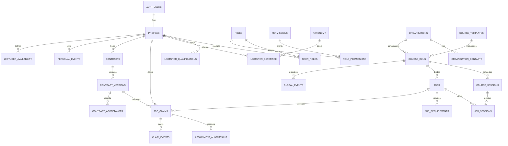

<a id="section-erd-collaboration-and-commercial-target-relations"></a>

## Collaboration and commercial target relations

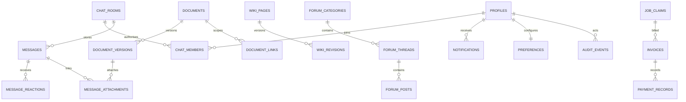

<a id="section-erd-implemented-core-and-course-relations"></a>

## Implemented core and course relations

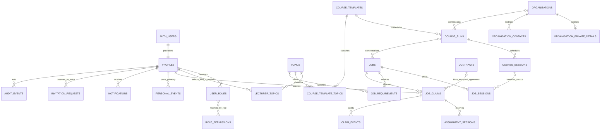

Roles and permission identifiers are text values in the implemented joins, rather than separate `roles`/`permissions` tables. `lecturer_topics` stores self-selection and separately managed verification; there is no separate public `lecturer_qualifications` table. M8 adds the private evidence/state/history relations below without replacing that eligibility record. M6 adds actual `lecturer_availability` and private notification preferences; M7 adds the separate own attention preference below.
Broader scheduling and settings remain target scope. In this schema each `contracts` row is one executed version; there is no separate implemented `contract_versions` table.

<a id="section-erd-implemented-collaboration-and-files"></a>

## Implemented collaboration and files

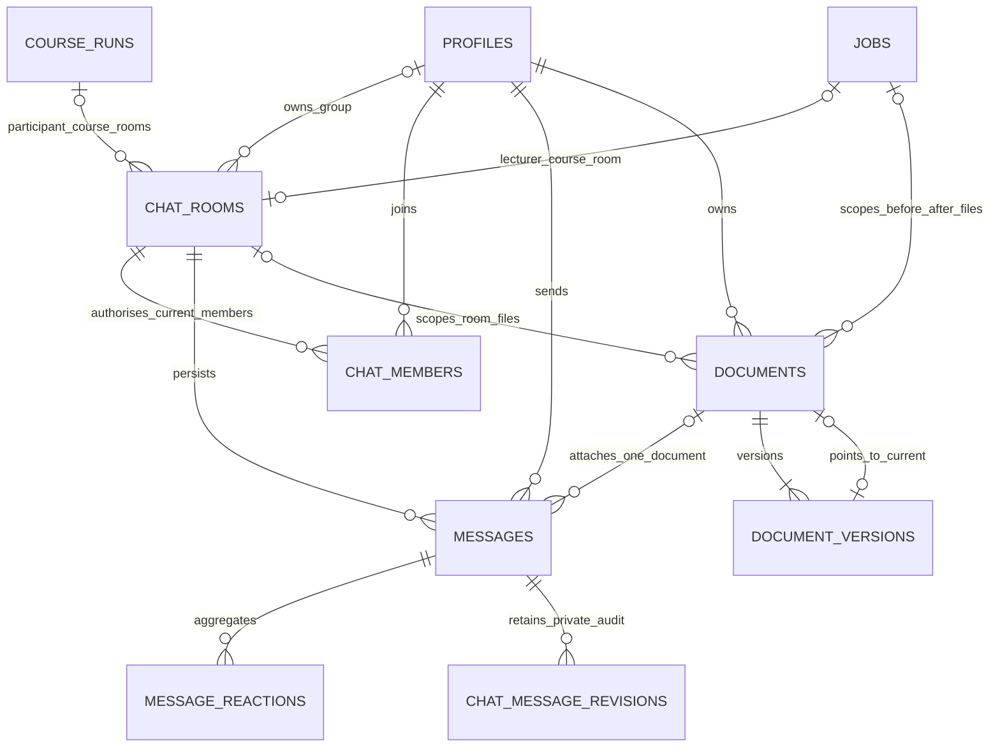

`chat_rooms.kind` distinguishes DMs, lecturer general chat, staff topics, lecturer job rooms and participant course channels. A participant room references the course run and keeps `job_id` null. It does not expose the commercial job relation. DM pair keys are unique; `(room_id,user_id)` memberships carry removal tombstones, monotone read state and mute preference. Messages retain sender-scoped retry UUIDs, edit/delete state and stable cursor order. Reactions use removal tombstones. There are no
separate current `message_attachments` or `document_links` tables: a message has one optional `document_id`, while a document has a validated personal/room/job-before/job-after scope. Ordinary chat attachments follow that document's current clean version; commercial evidence instead fixes an exact historical version below.

`documents.current_version_id` is updated as versions are reserved. Versions carry the immutable storage object key, original filename/MIME/size, SHA-256 and scanner result/version. Metadata RLS is independent of scan state; binary download additionally requires a clean requested version. Quarantine and clean buckets are private, and restrictive Storage policies deny direct anonymous/authenticated object access. Files flow through the authenticated Edge gateway; they are not public or durable
signed URLs.

Reservation retry UUIDs bind the create/replace operation and exact replacement document. Owner-scoped quota locks serialise both self uploads and uploads by different authorised managers on that owner's behalf. Those constraints are enforced in the follow-up migration `20261115132410_document_reservation_retry_quota.sql`, preserving the earlier applied migration files.

<a id="section-erd-implemented-knowledge-and-commercial-relations"></a>

## Implemented knowledge and commercial relations

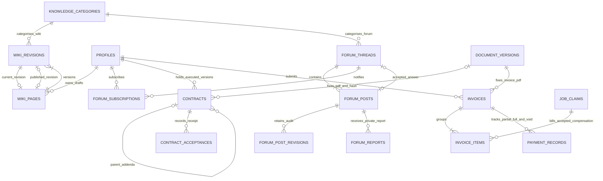

Wiki/forum categories share one `knowledge_categories` table with a kind discriminator. Wiki current and published version pointers are separate composite foreign keys, so an author's newer draft cannot replace the published reader snapshot. Bodies use server-validated Tiptap JSON plus server-derived searchable text, not stored arbitrary HTML. Wiki and forum are staff-only at this checkpoint; participant knowledge ACLs and knowledge attachments remain pending.

Executed contract rows fix a `document_versions.id` and SHA-256, with optional same-owner parent addendum. Legacy fictional contract metadata can have no PDF and cannot receive a file receipt. `contract_acceptances.kind` is explicitly `receipt_acknowledgement`, not a legal electronic signature. Accepted claims keep their immutable contract reference and original amount/currency/terms. Invoices join claims through `invoice_items`, with a unique active invoice per claim. Payment rows track the
original currency; corrections void entries with audit rather than overwrite amounts. Referenced commercial file versions and agreement/invoice snapshots are immutable, and linked documents cannot be hidden through ordinary soft deletion.

<a id="section-erd-implemented-m3-account-profile-and-financial-extension"></a>

## Implemented M3 account, profile and financial extension

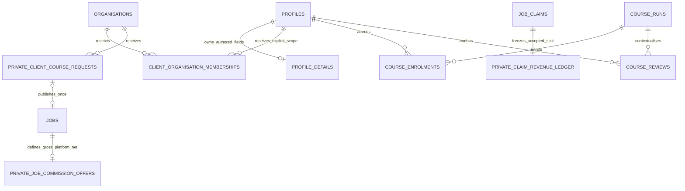

`PRIVATE_*` entities in this diagram name actual `private.client_course_requests`, `private.job_commission_offers` and `private.claim_revenue_ledger`; they are not public REST tables. Only authorised security-invoker wrappers call the private implementations. The accepted ledger is one snapshot per claim. A client request may create a draft or published capacity-one job; reports count publication from the actual job state. M6 permits several historical revenue-ledger rows for a job, one
immutable row per accepted claim, and sums current accepted position revenue without counting that course several times. Invoice labels change metadata only; PDF versions, accepted compensation and payment history keep their original invariants.

`profile_details` separates the new authored country/languages/experience/labels from private contacts/evidence. `course_enrolments` keeps current membership/completion/removal, while `course_reviews` carries course/actual lecturer/author, versioned text/rating and moderation/withdrawal state. Direct review table reads are denied; identity-safe RPCs project each reader's authorised view. Existing `invitation_requests` now binds the requested role/organisation/display name; both invitation
handlers use this single lifecycle. Exact schema/arguments are in [API_REFERENCE](API_REFERENCE.md) and the three additive M3 migrations.

<a id="section-erd-implemented-private-policy-and-welcome-progress"></a>

## Implemented private policy and welcome progress

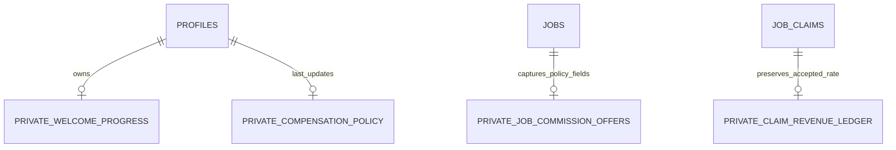

`private.welcome_progress.user_id` is both the primary key and a cascading profile foreign key. Its step/status/version are personal presentation state. The table has no direct client grants or administrator bypass; only active own-account RPCs can read/change progress, with compare-and-swap versions.

`private.compensation_policy` is an optional singleton whose `updated_by` references the responsible administrator profile. It contains no seeded business values. `private.job_commission_offers` stores its own regular/senior percentage and policy-version snapshot; these are copied values, not foreign keys to the mutable singleton. Later policy edits cannot alter existing offers or accepted revenue rows. The existing private revenue ledger still freezes actual accepted gross/net/platform amounts
per claim. Raw role-priced `jobs` columns contain no alternate-role fee; `job_offers()` projects the current actor's net quote. [Detailed authority and upgrade rules](GUIDE.md#section-delegated-roles-pricing).

<a id="section-erd-implemented-m4-source-catalogue-avatars-and-discussions"></a>

## Implemented M4 source catalogue, avatars and discussions

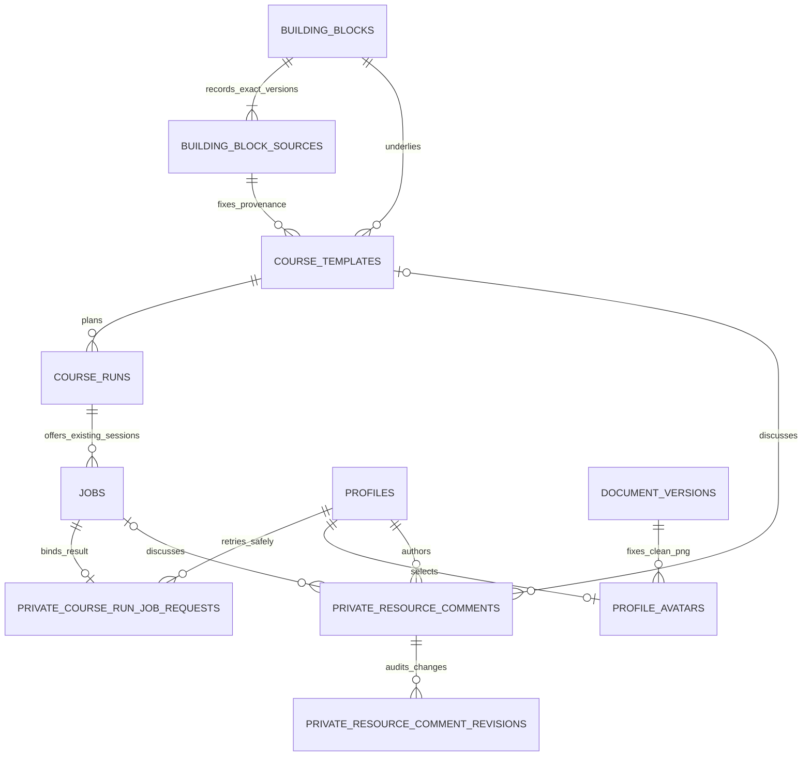

A comment references exactly one job or template, enforced by a database constraint. Cursor indexes order each resource; actor request UUIDs deduplicate concurrent submissions and actor locks serialize rate checks. Private revisions are not ordinary reader data. A profile avatar selects an exact immutable clean image version; its owner-only metadata table does not grant peers the underlying personal document. Peer display uses the separate current-profile projection and authenticated gateway.

Source versions have stable provider/code/file/hash identity. LPC3/LPC4 each retain two real PDF variants under one block. Template/run provenance freezes when a linked job exists. The private course-offer request ledger binds the original financial request and resulting existing-run job; client full-fee requests remain in the existing client ledger when actually known. No new duplicate source columns are added to job/claim snapshots.
See [COURSE_BUILDING_BLOCKS](GUIDE.md#section-course-building-blocks), [RESOURCE_COMMENTS](GUIDE.md#section-resource-comments) and [PROFILE_AVATARS](GUIDE.md#section-profile-avatars).

<a id="section-erd-implemented-m6-operations-additions"></a>

## Implemented M6 operations additions

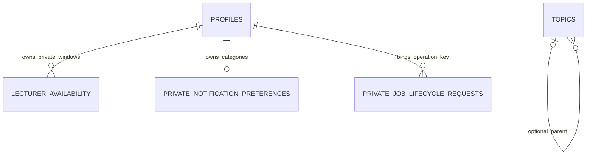

These entities map to `public.topics`, `public.lecturer_availability`,
`private.notification_preferences` and `private.job_lifecycle_requests`.
Topics retain shared IDs across expertise, course templates and job requirements;
archive/version/parent guards do not rewrite existing references. Availability
keeps finite instants, IANA zone, own notes and default-false explicit management
sharing. The direct table read policy remains owner-only; the shared RPC exposes
only its reduced opt-in projection. Notification preferences have one profile-FK
primary key and the four independent `chat`, `forum`, `job_updates`, `reminders`
booleans with optimistic versioning.

`private.job_lifecycle_requests` has primary key `(actor_id,request_id)` and a
profile FK. Its `result` UUID binds the operation result through checked RPC logic;
it is **not** a declared job foreign key. Job lifecycle metadata/board/audit reads
are projections, not additional storage tables. [JOB_LIFECYCLE](GUIDE.md#section-job-lifecycle),
[TAXONOMY](GUIDE.md#section-taxonomy), [AVAILABILITY](GUIDE.md#section-availability),
[NOTIFICATIONS](GUIDE.md#section-notifications) and [ADMIN_AUDIT](GUIDE.md#section-admin-audit) describe the
scoped APIs.

M6 replaces the original single-confirmed-claim-per-job index with partial unique
`(job_id,lecturer_id) WHERE status='confirmed'`. Job capacity is 1–20;
`capacity_basis='single_position'` requires capacity 1, while an explicitly new
per-position offer may have several positions. The transactional job lock guards
its remaining count. `assignment_sessions.released_at` preserves cancelled
intervals; only unreleased rows participate in the GiST lecturer/time exclusion.
Cancellation preserves accepted claim/fee/session/revenue history and closes the
offer to draft until audited reopening. Shared lecturer locking prevents invoice
submission racing cancellation. There is no new refund or bank-payment relation.

<a id="section-erd-implemented-m7-private-personal-organization"></a>

## Implemented M7 private personal organization

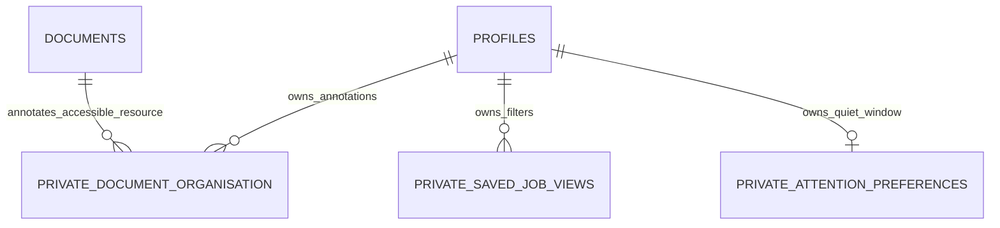

| Diagram entity / physical table                                   | Key and actual foreign keys                                                              | Stored invariant / API                                                                                                                                                                                |
|-------------------------------------------------------------------|------------------------------------------------------------------------------------------|-------------------------------------------------------------------------------------------------------------------------------------------------------------------------------------------------------|
| `PRIVATE_DOCUMENT_ORGANISATION` / `private.document_organisation` | PK `(user_id,document_id)`; FKs to `profiles.id` and `documents.id`, both delete-cascade | Own tags/folder/version only; `document_discovery`, `save_document_organisation`. No Storage path or shared-file move.                                                                                |
| `PRIVATE_SAVED_JOB_VIEWS` / `private.saved_job_views`             | PK `id`; `user_id` FK to `profiles.id`, delete-cascade; unique `(user_id,lower(name))`   | At most 20 canonical closed-JSON views per actor, checked under quota lock; `saved_job_views`, `save_job_view`, `remove_job_view`. Filter IDs inside JSON are validated by the API, not declared FKs. |
| `PRIVATE_ATTENTION_PREFERENCES` / `private.attention_preferences` | PK/FK `user_id` to `profiles.id`, delete-cascade                                         | Separate versioned daily minute window/IANA zone; `attention_preferences`, `save_attention_preferences`. Missing row reads as version 0 without insertion.                                            |

All three tables enable RLS and revoke direct PUBLIC/anon/authenticated access.
The first two explicitly grant service-role table access; this is not a browser
permission or an administrator read bypass. Scoped invoker RPCs/private definers
check the current actor and resource. Personal document metadata requires current
underlying document access, including after room revocation. Saved views confer
no access to a filtered job. Quiet settings confer no access to another inbox.

`job_discovery`, `job_detail`, `job_dashboard` and `assignment_job_titles` are
projections of existing job/claim/session/profile data, **not** duplicated job or
dashboard tables. Discovery cursors include stable sort/UUID values and a filter
fingerprint. File discovery orders by `(created_at,id)`. Both page on the server;
neither raises the global 1,000-row Data API setting. Dashboard totals are
server-authorized aggregates, not counts of a preview page. Calendar title lookup
returns only requested own confirmed assignment jobs. See [JOB_DISCOVERY](GUIDE.md#section-job-discovery)
and [FILES](GUIDE.md#section-files).

Both saved-view mutations take actor profile `FOR SHARE` **before** the separate
current-role/capability check and saved-view row lock. The volatile entry's new
statement snapshot observes a role withdrawal that held profile `FOR UPDATE`.
A stale expected view version fails with `40001`; an authoritative `42501` hides
and discards captured private editor/list data. Network errors retain the draft.
Operation UUID reuse is limited to retries of the same open create dialog.

<a id="section-erd-implemented-m7-chat-content-and-mention-versions"></a>

## Implemented M7 chat content and mention versions

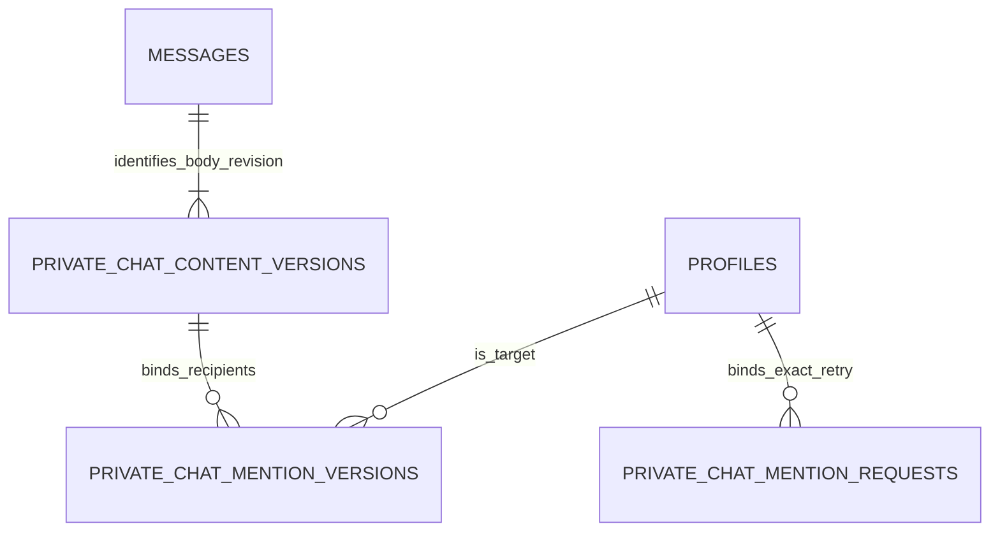

| Physical table                  | Key / relation                                                                                                                                                           |
|---------------------------------|--------------------------------------------------------------------------------------------------------------------------------------------------------------------------|
| `private.chat_content_versions` | PK `(message_id,version)`; message FK delete-cascade. Records version identity/time; existing private message revisions retain body audit.                               |
| `private.chat_mention_versions` | PK `(message_id,version,user_id)`; composite FK to content versions, delete-cascade; target profile FK. Index `(message_id,user_id)` supports first-ever mention lookup. |
| `private.chat_mention_requests` | PK `(actor_id,request_id)`; actor profile FK delete-cascade; exact normalized payload/result JSON, not ordinary chat history.                                            |

`messages.content_version` changes with body/edit/deletion state, including legacy
API edits; only the current version's authorized recipients appear in
`chat_messages_with_mentions`. A legacy edit does not carry forward an earlier
structured selection. `send_message_with_mentions` and
`edit_message_with_mentions` atomically bind current eligible room members and
exact retry parameters; `chat_mention_candidates` is a current-room projection.
Internal helpers and these three RLS-enabled private tables have no direct browser
grants. Normal chat membership/role predicates still apply to reads, edits,
moderation, attachments and Realtime; administrator status does not open DMs.

Notifications reuse unique `(user_id,kind,resource_id)` with kind `chat_message`
and the message UUID. The **first ever** committed structured message/recipient
mention can renew that same notice; retries and remove/re-add cycles do not.
History retains that fact even if category preference suppressed delivery.
Room mute may be overridden by an explicit mention; the global category opt-out
still applies. Quiet hours affect attention only. The polymorphic notification
`resource_id` has no message FK; current target resolution supplies authorization.
See [CHAT](GUIDE.md#section-chat) and CHAT_SECURITY.

<a id="section-erd-implemented-m7-announcement-snapshots-and-acknowledgements"></a>

## Implemented M7 announcement snapshots and acknowledgements

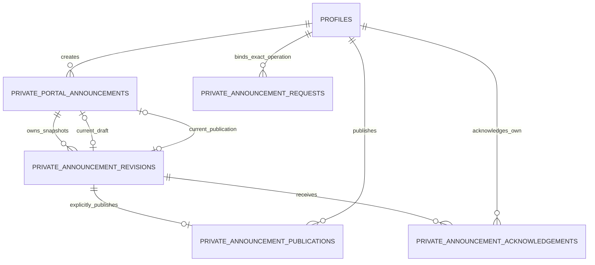

| Physical table                          | Keys and state boundary                                                                                                                                                                                              |
|-----------------------------------------|----------------------------------------------------------------------------------------------------------------------------------------------------------------------------------------------------------------------|
| `private.portal_announcements`          | UUID PK; creator profile FK; optimistic parent `version`, archive state, separate draft/published revision pointers.                                                                                                 |
| `private.announcement_revisions`        | UUID PK; parent FK delete-cascade; unique `(announcement_id,revision)` and `(announcement_id,id)`; creator profile FK. Immutable DE/EN title/body, importance, role audience, finite display instants and IANA zone. |
| `private.announcement_publications`     | PK/FK `revision_id` delete-cascade; publisher profile FK; immutable publication timestamp. A draft alone has no publication receipt.                                                                                 |
| `private.announcement_acknowledgements` | PK `(user_id,revision_id)`; profile/revision FKs delete-cascade; exact retry preserves original acknowledgement timestamp.                                                                                           |
| `private.announcement_requests`         | PK `(actor_id,request_id)`; actor profile FK delete-cascade; exact action/version/payload and original result. No JSON-result FK is implied.                                                                         |

Parent `(id,draft_revision_id)` and `(id,published_revision_id)` are separate **composite**, initially deferred FKs to revision `(announcement_id,id)`. Thus a
parent cannot point to another announcement's revision. Saving a new immutable
draft leaves the published snapshot intact. Update guards protect revisions and
publication receipts. Ordinary reads start from the current published pointer;
older, draft, archived, expired and newly unauthorized revisions fail exact reads.

`manage_announcement` uses current `announcements.manage`/MFA, profile-first locks,
parent version and exact request binding. Publication, optional important inbox
fanout, safe audit and retry result commit atomically. Future-start publication is
explicitly refused until manually due. `announcements` and `announcement` return
only currently authorized display-window publications;
`admin_announcements`/`admin_announcement` expose the separately permissioned
editor. `acknowledge_announcement` locks the actor profile before current audience
checks, binds only that actor/revision and marks only its corresponding own inbox
row read. Archive/recover preserves existing ACK/notice identity; a new published
revision is a new acknowledgement target.

All five private tables enable RLS and revoke direct PUBLIC/anon/authenticated
access; internal helpers are also execution-restricted. Audience roles come from
current database grants, never user metadata. Important notices use
`portal_announcement` plus revision UUID in the existing notification uniqueness
key. These are logical references, not additional FKs. Important current readable
publications add quiet-hour attention; ordinary inbox rows and full unread count
remain unchanged. The older four-category preference table/API is not replaced.
No scheduler, email delivery, push transport or history-purge policy is implied.
See [ANNOUNCEMENTS](GUIDE.md#section-announcements) and [NOTIFICATIONS](GUIDE.md#section-notifications).

<a id="section-erd-implemented-m8-qualification-evidence-and-decisions"></a>

## Implemented M8 qualification evidence and decisions

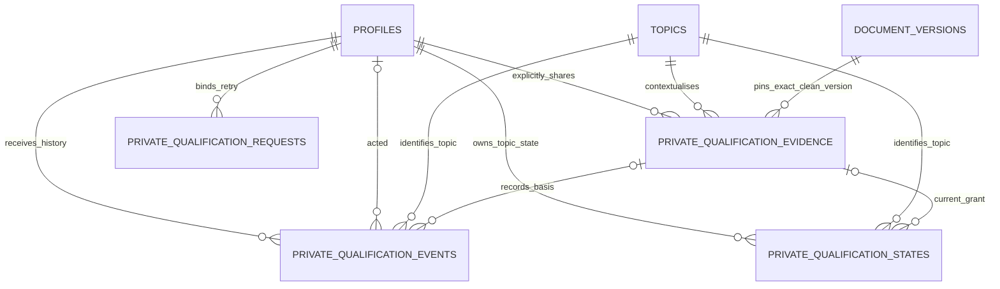

| Physical table                   | Keys and actual foreign-key behavior                                                                                                                                                                                                       |
|----------------------------------|--------------------------------------------------------------------------------------------------------------------------------------------------------------------------------------------------------------------------------------------|
| `private.qualification_states`   | PK `(user_id,topic_id)`; profile FK delete-cascade; topic FK; optional evidence FK delete-set-null. Current nonnegative CAS version and current binding.                                                                                   |
| `private.qualification_evidence` | UUID PK; owner profile FK delete-cascade; topic FK; exact `document_version_id` FK delete-cascade; stored SHA-256 and withdrawal instant.                                                                                                  |
| `private.qualification_events`   | UUID PK; unique `(user_id,topic_id,version)`; owner profile FK delete-cascade, actor profile FK delete-set-null, topic FK and optional evidence FK delete-cascade. Bind/withdraw/deselect/attest events retain decision, expiry and basis. |
| `private.qualification_requests` | PK `(actor_id,request_id)`; actor profile FK delete-cascade; exact-command fingerprint. No stored result/document FK is implied.                                                                                                           |

The same `(user_id,topic_id)` coordinates current `lecturer_topics` and private
state through RPC/trigger logic; it is **not** a new composite FK to
`lecturer_topics`. Owner/topic consistency of evidence bindings is checked by the
mutators, not a diagram-implied extra constraint. Evidence/version/topic and
cursor/actor-rate indexes support these references. All four private tables enable
RLS, revoke PUBLIC/anon/authenticated table access and explicitly grant service-role
access. Normal browser calls use reviewed invoker wrappers/private implementations.
They cannot directly change protected history or promote themselves as verified.

`save_qualification_evidence` accepts only a selected topic and one own clean
personal certificate version; null withdraws access. `qualification_review`,
`qualification_history` and `qualification_evidence_access` project only permitted
current state/history. `attest_qualification` uses observed version/request identity;
legacy `verify_lecturer_topic` keeps its signature and uses the same manual
attestation/history core. Both own and review mutations take actor profile SHARE
before fresh current-role/MFA checks. Unchanged expiry fields retain the original
instant, and captured dirty drafts retain their observed CAS/evidence identity.
Retries append no event and return current sanitized state rather than old private
metadata. Earlier verifications are not backfilled with invented decisions.

The binding grants **one version**, not `documents` or all `document_versions`
reads. The existing users-manage CV policy remains, as do separate contracts and
finance policies. Qualification permission alone grants none of those. Files Edge
`qualification_evidence_download` performs current caller ACL before and after
fetching/hash-checking exact bounded bytes. Withdrawal, document archive and topic
deselection stop subsequent reads; historical event IDs grant no historical byte
access. Re-adding expertise does not restore an old grant. Existing verified state,
accepted claims/compensation and assignments are not rewritten by evidence changes.

History is immutable to browser users; trusted server purges retain explicit
cascade/set-null cleanup semantics. Topic FKs do not silently cascade history on
physical taxonomy deletion. Normal taxonomy uses archive; normal file UI uses
soft deletion, not a privileged version purge. This is not a shipped retention
policy or tamper-proof archival claim. See [QUALIFICATIONS](GUIDE.md#section-qualifications).

<a id="section-erd-implemented-m8-global-event-lifecycle-and-picker-projections"></a>

## Implemented M8 global-event lifecycle and picker projections

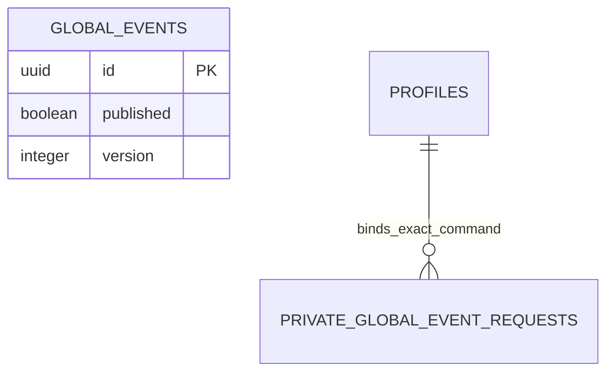

`public.global_events` is the existing physical event table, extended with
`description`, `link_url`, `archived_at`, positive `version` and `updated_at`.
There is no duplicate global-calendar table or announcement-revision pointer.
The event table has no creator-profile or course-run FK; the actor is recorded
in the request/audit records, and published course sessions are a separate
calendar projection.
`private.global_event_requests` adds PK `(actor_id,request_id)`, profile FK
with delete-cascade, exact payload and original result JSON. Its JSON result is
not an event FK. The ledger enables RLS and revokes browser table access. Event
rows retain public RLS: ordinary active readers see published/nonarchived records;
management access requires its current capability/MFA.

`global_calendar_events` checks actual interval overlap in a finite window of at
most 93 days and returns timestamp/UUID pages (maximum 100). `manage_global_event`
uses profile-first fresh role checks, parent row/version locks and exact retry
binding. Save creates/unpublishes a draft; publish/unpublish/archive/recover are
explicit, and recovery is unpublished. Audit rows expose only reviewed safe
metadata. Descriptions/HTTPS links do not expose private appointments, attach
files or trigger remote fetching. Existing course-session calendar queries remain
separately authorized and retain their own bounds. See [CALENDAR](GUIDE.md#section-calendar).

The new `job_picker` and private `job_picker_candidates` are **projections**, not
new tables or relationships. `job_attachment` follows `jobs.manage`/MFA;
`participant_course` follows `courses.manage`/MFA and returns one course run with
an existing representative job UUID for compatibility. Course labels/search use
permitted template/organization metadata plus first-session/IANA information,
not hidden job text or fees. Its selected item is resolved in the same bounded
request. Purpose/search-bound cursors and job/run/session lookup indexes replace
the last two unpaged `jobsQuery` callers without widening commercial rights or
changing claim/upload/channel mutation APIs. No per-option RPC or all-pages loop
is added. The administrative board remains separately limited to 500. See
[JOB_PICKERS](GUIDE.md#section-job-pickers).

The three additive sources are `20261116080741_scoped_administrative_job_pickers`,
`20261116080743_global_calendar_publications` and
`20261116080746_qualification_evidence_and_attestation_history`. Together with the
29 earlier migration sources these form the historical 32-migration M7/M8 model.
The following diagram covers the fourteen-source operational cohort depicted here, not every later addition in the current 69-source inventory. Focused source,
SQL/component/Edge checks do not establish combined native acceptance.

<a id="section-erd-implemented-personal-settings-and-external-delivery"></a>

## Implemented personal settings and external delivery

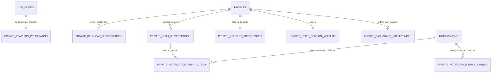

Aliases name `private.dashboard_preferences`, `teaching_preparation`, `staff_contact_visibility`, `delivery_preferences`, `push_subscriptions`, `calendar_subscriptions`, `notification_email_outbox` and `notification_push_outbox`. `private.push_configuration` is a separate singleton for the enabled state/public VAPID key, not an account or private-key table. Dashboard/contact/preferences use own identity and revision checks. The teaching-day checklist belongs to the claim owner; it is not the
customer's shared preparation.

Email occurrence uniqueness is `(notification_id, occurrence_at)`; Push adds `subscription_id`. Leases, attempts, availability, fixed outcome/error codes and terminal uncertain state distinguish a committed inbox notice from an external accepted delivery. Worker APIs have separate service-only grants and recheck current recipient/resource/channel rights. Push subscriptions retain private provider endpoint/encryption material; ordinary UI/device projections do not expose it. Mail/VAPID
credentials are operating configuration, not a diagrammed database relation.

Calendar subscriptions retain a token hash, explicit private-event inclusion, expiry/revocation, version and owner-bound creation/rotation retry keys. Snapshot/recheck RPCs are service-only; possession of a currently valid high-entropy feed capability is the read boundary at the exact calendar-feed endpoint. The feed does not create event copies in a new table. The separately opted-in minimal offline teaching snapshot is an expiring, identity-cleared IndexedDB record, not a PostgreSQL relation
or a generic private-response cache.

<a id="section-erd-implemented-waitlists-tasks-and-teaching-time-evidence"></a>

## Implemented waitlists, tasks and teaching-time evidence

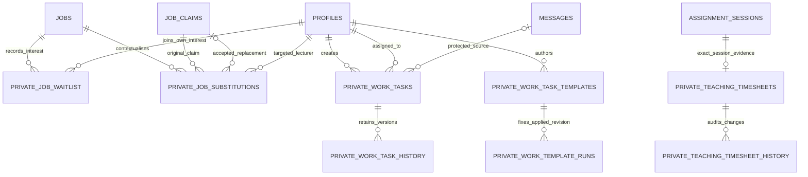

These aliases map directly to `private.job_waitlist`, `job_substitutions`, `work_tasks`, `work_task_history`, `work_task_templates`, `work_template_runs`, `teaching_timesheets` and `teaching_timesheet_history`. Additional actual private tables are `personal_favourites` and `teaching_timesheet_requests`. The favourite key `(user_id, kind, resource_id)` is a polymorphic reference checked on read/write, not a foreign key to every possible resource. Template runs retain a template revision and
`task_ids uuid[]`; those array elements are application-validated references, not individual SQL foreign keys. Timesheet action retries use `(actor_id, request_id)` with the exact payload/result.

Waitlist primary key is `(job_id, user_id)` and gives no allocation. A substitution binds original/accepted claim IDs, proposer/target, quote/hash and expiry; one pending/accepting proposal per original claim is enforced. Its scheduling/claim transaction preserves the all-session boundary. Task history/template/user/message references and timesheet history deliberately restrict deletion unless an explicit cascade is defined; these are not a user erasure service. Private tasks remain creator-only
even for administrators. Operations/message-derived tasks need their current task and source-room rights.

A timesheet has one unique `assignment_sessions.id`, current lecturer and optional reviewer references, bounded real intervals/breaks, state/version and a nonoverlap exclusion per lecturer except rejected entries. It does not replace accepted claim compensation or participant attendance. Financial statements, forecasts and Control Center are checked projections over existing claims/invoices/payments/timesheets/tasks/courses; there is no fabricated bank account, forecast ledger or finance-export
table. See [WORKBENCH](GUIDE.md#section-workbench), [ASSIGNMENT_HANDOVER](GUIDE.md#section-assignment-handover) and [TIMESHEETS_FINANCE_CONTROL_CENTER](GUIDE.md#section-timesheets-finance-control-center).

<a id="section-erd-implemented-shared-course-preparation-and-exact-materials"></a>

## Implemented shared course preparation and exact materials

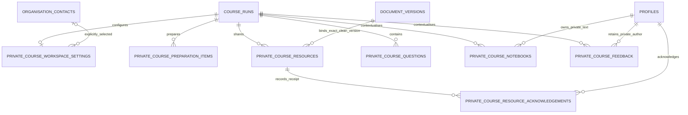

Aliases name actual `private.course_workspace_settings`, `course_preparation_items`, `course_resources`, `course_resource_acknowledgements`, `course_questions`, `course_notebooks` and `course_feedback`. Settings use `run_id` as primary key; deleting the selected organisation contact sets the contact pointer null. The RPC independently requires the contact's organisation to match this course. Preparation has a client-visible flag and CAS version. A material/report resource is unique by
`(run_id, version_id, audience)` and can be explicitly removed; acknowledgements use `(resource_id, user_id)` and do not grant future access.

Notebook and feedback keys are `(run_id, user_id)`. Notebook text is owner-only; Q&A author/answer references remain private while the current course projection determines which users can read or respond. Feedback keeps an author for server integrity but ordinary aggregate results disclose no author identity and remain unavailable below three responses. There is no true-anonymity assertion or participant-notebook management bypass. Clean resource bytes remain behind the authenticated
exact-version gateway; ordinary file RLS is unchanged.

<a id="section-erd-implemented-participant-attendance-quizzes-and-completion-facts"></a>

## Implemented participant attendance, quizzes and completion facts

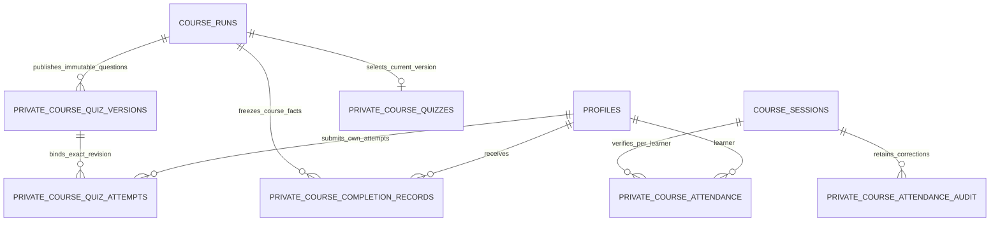

Aliases map to `private.course_attendance`, `course_attendance_audit`, `course_quizzes`, `course_quiz_versions`, `course_quiz_attempts` and `course_completion_records`. Attendance's key is `(session_id, user_id)`; audit rows independently retain affected user, actor, before/after states and reason, with restrictive history references. Self-report and verified attendance are different states. Completion locks subsequent attendance correction until explicit revocation.

Quiz versions use `(run_id, version)`; the attempt uses that composite foreign key and `(user_id, request_id)` retry uniqueness. The current-quiz integer is an application-managed pointer, not an additional composite foreign key. Learner projections omit correct answers; submission checks current publication, attempt allowance and current membership. A partial unique index permits one nonrevoked completion per `(run_id, user_id)`. Immutable completion facts require completed enrolment, ended
sessions, verified 80% attendance per session and current-quiz pass where required. Revocation retains the old record and constrains reissue; PDF generation adds no separate completion/qualification/legal-signature table. See [COURSE_LEARNING_WORKSPACE](GUIDE.md#section-course-learning-workspace).

<a id="section-erd-implemented-customer-request-briefs-and-retained-revisions"></a>

## Implemented customer request briefs and retained revisions

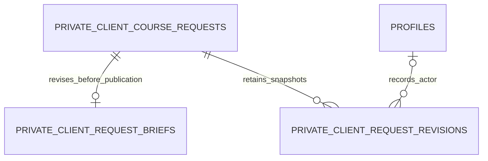

`PRIVATE_CLIENT_REQUEST_BRIEFS` and `PRIVATE_CLIENT_REQUEST_REVISIONS` are `private.client_request_briefs` and `private.client_request_revisions`. They cascade only when the parent request is deliberately removed; an actor account purge sets the history actor pointer null. A generated revision ID supplies stable decreasing cursor pages. No authenticated history update/delete API exists. Older requests receive an accurately labelled migration baseline; past events are not reconstructed.

Brief JSON stores whole teaching units, 45/60-minute units, preparation instructions, required-document descriptions and exact version/category references. These JSON version IDs are validated by the RPC; they are not declared document foreign keys. Only own clean personal materials or already explicitly shared request versions can be retained, categorized as material/report. Contracts, CVs, qualification evidence and invoices have no attachment bypass. The current request
organisation/gross-finance boundary authorizes the protected byte gateway, which checks exact hash and rechecks rights before release. Required time cannot exceed real session duration; it never derives the quote. Creation retry compares the immutable first brief, and revisions share the publication row lock and expected version. Repeat booking copies requirements/time but no attachments or learner records. See [CLIENT_REQUEST_BRIEFS](GUIDE.md#section-client-request-briefs).

<a id="section-erd-required-constraints-and-ownership"></a>

## Required constraints and ownership

- Stable UUID foreign keys with explicit deletion behaviour; no accidental cascading deletion of executed contracts or accepted assignments. Unique role/permission/expertise and room membership joins. Verification is server-managed independently of lecturer self-selected expertise.
- Templates contain reusable course content; runs contain actual delivery/customer context; sessions contain canonical instants and intended display zone. A job includes one or more complete sessions. Legacy/client/Course jobs keep capacity one; explicit new administrative per-position jobs support 1–20. Job locks, confirmed-count checks and unique active job/lecturer claims protect capacity without partial multi-session allocation.
- Claims own immutable accepted amount/currency/rate unit/terms and the applicable executed-contract row. Its immutable file reference/hash fixes the agreement evidence when present. Idempotency keys are scoped to actor/request; claim events and notifications deduplicate by committed event. A later job edit never rewrites accepted terms.
- Allocation intervals use non-overlap protection per lecturer across jobs, together with transaction locking; private events/availability are included in server-side eligibility. Every session reserves or the entire transaction rolls back.
- Personal events belong solely to their creator. Global events require explicit publication. Business contacts/internal notes, contracts, CVs/evidence and invoices need separate capabilities or resource membership. Private room membership is not implied by admin status.
- Every exposed relation requires RLS and explicit least-privilege grants. Private schema objects are unexposed and execution-locked. User IDs/roles are derived from verified Auth/current database authority, never editable metadata.
- Implemented indexes include job publication/requirements, assignment exclusion ranges, owner/member and cursor lookups, wiki/forum searchable text, invoice active-claim uniqueness and scoped payment history. Search always runs under actor authorisation. Search/list limits are documented in feature notes. M7 job/file discovery pages beyond 1,000; M8 replaces the legacy file/chat job pickers with bounded purpose-specific pages, while the administrative board retains its explicit newest-500
  bound. Other unconverted lists are not claimed unbounded.

<a id="section-erd-implemented-permission-matrix"></a>

## Implemented permission matrix

| Resource/action                  | Owner / eligible lecturer                                                                                   | Ordinary peer                                          | Privileged management                                                                                             |
|----------------------------------|-------------------------------------------------------------------------------------------------------------|--------------------------------------------------------|-------------------------------------------------------------------------------------------------------------------|
| Own profile self-service fields  | Read/edit                                                                                                   | Only intentionally public fields, when implemented     | Explicit management capability where needed                                                                       |
| Roles and verification           | Read own applicable grants; no self-promotion                                                               | No mutation                                            | Explicit capability plus MFA; audited                                                                             |
| Published jobs                   | Read when authorised/eligible; claim through RPC                                                            | Same permission-based rules                            | Manage with `jobs.manage` and MFA                                                                                 |
| Accepted assignment snapshot     | Read own                                                                                                    | No                                                     | Explicit commercial/resource permission                                                                           |
| Private calendar event           | Read/edit own                                                                                               | Denied                                                 | Denied unless actual owner                                                                                        |
| Executed contract/file/receipt   | Read own; receipt own exact hash                                                                            | Denied                                                 | Specific `contracts.read`/`contracts.manage` plus MFA; receipt cannot impersonate owner                           |
| Private DM/messages/revisions    | Current room member only                                                                                    | Denied                                                 | No implicit access; DM membership is not administratively editable                                                |
| Group/channel and room files     | Current nonremoved membership plus current role constraints                                                 | Denied outside membership                              | Owner or explicit capability within accessible room; no room bypass                                               |
| Personal files                   | Owner; clean bytes only                                                                                     | Denied                                                 | CV/contract/invoice retain specific capability/MFA boundaries; certificates need the current exact evidence grant |
| Customer contacts/private notes  | No implicit lecturer access                                                                                 | Denied                                                 | `organisations.manage` plus MFA                                                                                   |
| Course catalogue                 | Published/assigned; participants explicitly enrolled through managed enrolment or course-channel membership | Denied otherwise                                       | `courses.manage` plus MFA for changes                                                                             |
| Wiki drafts/history              | Author and current wiki managers                                                                            | Published revisions only for staff                     | `wiki.manage` plus MFA for publish/archive                                                                        |
| Forum/report/revision            | Staff; own reports, own post revisions                                                                      | Staff discussion only                                  | `forum.moderate` plus MFA for moderation/reports                                                                  |
| Earnings/invoice/payment history | Own original-currency records                                                                               | Denied                                                 | `finance.manage` plus MFA; mutations audited                                                                      |
| Private file tags/virtual folder | Own annotation for a currently accessible document                                                          | Other account's annotation denied                      | No annotation read bypass                                                                                         |
| Saved job views / quiet window   | Own active actor; saved views additionally require current lecturer/manage access                           | Denied                                                 | Only own records under the same rules                                                                             |
| Qualification evidence / review  | Own explicit exact certificate-version sharing/withdrawal                                                   | No foreign grant                                       | Current `qualifications.verify`/MFA for the selected shared version; no blanket document/CV/contract access       |
| Global events                    | Published, unarchived records only; private appointments remain separate                                    | Same public-event policy                               | `courses.manage`/MFA for bounded drafts/lifecycle; no private-calendar bypass                                     |
| Scoped resource choices          | Only the current action's capability/MFA                                                                    | No privileged query from ordinary personal/topic flows | Job attachment vs participant-course metadata; no additional financial rights                                     |
| Structured chat recipients       | Current eligible room members, current message version                                                      | Denied outside room                                    | Room-scoped moderation only; no DM/history bypass                                                                 |
| Published announcements / ACK    | Current active-account audience/window; own exact-revision ACK                                              | Same current audience rules                            | Management drafts/publication need `announcements.manage` and MFA                                                 |

Additional operational boundaries:

| Resource/action                          | Own current account / authorised participant                    | Other accounts and management                                                       |
|------------------------------------------|-----------------------------------------------------------------|-------------------------------------------------------------------------------------|
| Personal widget/preparation preferences  | Own versioned presentation or confirmed claim                   | No private-checklist bypass                                                         |
| Staff directory contact                  | Explicit own email/phone consent                                | Active staff only; no client/participant or admin consent override                  |
| Waitlist / substitution                  | Own interest; explicit targeted quote acceptance                | Scoped proposer/manager actions; no private-calendar contents                       |
| Private task or message-derived task     | Creator-only or current permitted operations relationship       | Management never bypasses private scope or source-room access                       |
| Timesheet / financial facts              | Own accepted session/time and net facts                         | Current finance capability/MFA; gross requires its own capability                   |
| Course shared checklist/material/contact | Current server-scoped role and explicit audience                | No private notes, contract or implicit personal-file access                         |
| Notebook / feedback                      | Own notebook/feedback; identity protected in ordinary summaries | No foreign notebook read; feedback threshold does not remove private author storage |
| Attendance / quiz / completion           | Current learner eligibility; server-confirmed records           | Staff correction/revocation is audited; quiz answers remain role-scoped             |
| Request brief/history/material           | Current exact client organisation                               | Existing gross-finance/MFA scope only; original private file RLS unchanged          |
| Calendar capability / offline schedule   | Explicit owner opt-in; expiry/revocation and identity clearing  | No administrator calendar bypass; no general private-response cache                 |
| Notification channel/device              | Own preference/device; current eligible event                   | Service-only delivery leases do not grant browser data access                       |

See CHAT_SECURITY, KNOWLEDGE_SECURITY, COMMERCIAL_SECURITY, [OPERATIONS](OPERATIONS.md#section-operations) and BACKEND_SECURITY_REVIEW for tested boundaries and outstanding acceptance. Current combined 62-source native acceptance is recorded separately in QA results; authored cases and focused passes do not establish that result. Tombstones, archives and audit revisions preserve data; none is a production legal-erasure or retention-policy guarantee.

<a id="section-erd-assignment-withdrawal-applications"></a>

## Assignment withdrawal applications

`private.assignment_withdrawals` references the immutable `job_claims` and its
lecturer profile. It stores the bounded authored reason, pending/final status,
reviewer, decision note and timestamps. A partial unique index allows one pending
application per claim. `private.assignment_withdrawal_commands` binds each actor
and request UUID to its exact payload and application for safe transport retries.
Both tables have RLS and no client table grants; scoped RPCs expose only own or
current MFA-authorized management work. Existing claim/session/commercial rows
retain their identities and accepted snapshots. See
[assignment withdrawals](GUIDE.md#section-assignment-withdrawals).

<a id="section-erd-job-briefing"></a>

## Job briefing

`private.job_briefings.job_id` links the authored briefing to its job. `private.job_briefing_requests` binds each request to its actor, job and version for idempotency. Both tables use RLS without direct browser grants; [JOB_BRIEFING](GUIDE.md#section-job-briefing) describes the current permission boundaries.

<a id="section-migration-guide"></a>

<a id="section-migration-guide-reading-and-safely-extending-sql-migrations"></a>

# Reading and safely extending SQL migrations

This guide covers **71 SQL source files**, including the proposed withdrawal migration on top of the 70 present in accepted main `85b02b8` on 17 November 2026. PR17's operational cohort, PR24's six additional files and PR25's enquiry intake are merged; earlier candidate/pending descriptions apply only to their historical checkpoints. The ordered source versions and byte hashes are bound into the generated [API reference](API_REFERENCE.md).

Published SQL participates in preview, update and recovery fingerprints and must remain byte-identical. New business changes require additive migrations. Repository history does not establish what an installed or hosted database has applied. Read the relevant pull request checks for source-specific executed checks and [FUNCTIONAL_ACCEPTANCE](DEVELOPMENT.md#section-functional-acceptance) for the current acceptance contract. A split CI phase alone is not complete application acceptance;
publication remains a separate authorised manual operation.

The running database reflects **all migrations applied in order**. A later `create or replace function` replaces the earlier implementation. To understand a current RPC, find every definition and read the newest one last. [API_REFERENCE](API_REFERENCE.md) inventories the API, parameters and grants actually read from a migration replay; this guide is not a second authoritative, automatically maintained API
inventory. [ERD](DEVELOPMENT.md#section-erd), [DEVELOPER_GUIDE](DEVELOPMENT.md#section-developer-guide) and the relevant feature guides explain how the parts connect.

<a id="section-migration-guide-permanent-deletion-extension"></a>

## Permanent deletion extension

PR35 follows all 70 accepted sources with three CLI-created migrations: `20261116173902_permanent_resource_deletion.sql`, `20261116173905_company_job_deletion_authority.sql` and `20261116173907_deletion_smart_operations_dependencies.sql` (73 sources in this integration). No accepted source is renamed or edited. The typed deletion registry, actor-bound reviewed plans, execution permits, upload leases and exact Storage fences preserve current private-resource and immutable commercial boundaries.
Company deletion requires consistent current organisation ownership; former lecturer history grants no staff file access.

The document helper retains its original OID/ACL and delegates to the exact installed support/qualification implementation through a fully revoked private clone. The dependency repair explicitly owns accepted housekeeping and request histories while retaining shared-evidence and uncertain-delivery blockers. Both foreign-key catalogue walks have deterministic ordering, so valid planner choices cannot create a false stale scope. The actual accepted-prefix upgrade fixture derives its baseline from
the complete source inventory and verifies retained support/notification/enquiry helper identity and ACLs. Source replay does not by itself prove native Auth/Storage/browser acceptance. See [PERMANENT_DELETION](GUIDE.md#section-permanent-deletion).

<a id="section-migration-guide-order-and-purpose"></a>

## Order and purpose

The test files below are existing feature entry points. Listing them does not claim that this documentation pass reran a complete database acceptance test. Run mutating checks only in their own isolated stack through `./portal test`.

<a id="section-migration-guide-01-foundation-schema-and-atomic-immediate-assignment"></a>

### 01. Foundation schema and atomic immediate assignment

Source: [20261115111133_portal_foundation.sql](supabase/migrations/20261115111133_portal_foundation.sql).

Profiles, roles/capabilities, courses, jobs, claims, calendar snapshots and private events. The initial claim contract serializes access to the lecturer and offer; interval and uniqueness rules protect complete reservation. RLS and column grants limit direct writes. Later migrations replace individual functions, so this first version alone does not describe the current contract.

Test entry point: [db-rpc-tests.mjs](scripts/db-rpc-tests.mjs).

<a id="section-migration-guide-02-durable-invitation-reservations"></a>

### 02. Durable invitation reservations

Source: [20261115112053_lecturer_invitations.sql](supabase/migrations/20261115112053_lecturer_invitations.sql).

`reserve_invitation` and `complete_invitation` separate an authorized reservation from external Auth delivery. Invitation status comes from the durable server ledger. The accounts extension below unifies both entry paths.

Test entry point: [accounts-db-tests.mjs](scripts/accounts-db-tests.mjs).

<a id="section-migration-guide-03-verification-and-activation"></a>

### 03. Verification and activation

Source: [20261115113559_lecturer_verification_and_suspension.sql](supabase/migrations/20261115113559_lecturer_verification_and_suspension.sql).

Management verifies an already declared qualification with an expiry date and can deactivate/reactivate specific accounts. This confirmation does not replace certificate review. Current roles/capabilities and privileged MFA remain required.

Test entry point: [db-rpc-tests.mjs](scripts/db-rpc-tests.mjs).

<a id="section-migration-guide-04-private-document-metadata-and-versions"></a>

### 04. Private document metadata and versions

Source: [20261115121732_private_documents.sql](supabase/migrations/20261115121732_private_documents.sql).

`documents` and `document_versions` store ownership, context and scan status. `reserve_document` reserves a version; `can_access_document` checks current resource rights. Storage objects are not directly available to browser roles. The Edge gateway serves the bytes actually authorized for the caller.

Test entry point: [documents-db-tests.mjs](scripts/documents-db-tests.mjs).

<a id="section-migration-guide-05-chat-access-through-membership"></a>

### 05. Chat access through membership

Source: [20261115121922_secure_chat_collaboration.sql](supabase/migrations/20261115121922_secure_chat_collaboration.sql).

Rooms, members, messages, reactions and their revision history share an access boundary. DMs have no blanket administrator access. Course teaching-team and participant chats remain separate. Reads, writes, reactions and read state go through checked routines.

Test entry point: [chat-db-tests.mjs](scripts/chat-db-tests.mjs).

<a id="section-migration-guide-06-chat-attachments-with-document-authorization"></a>

### 06. Chat attachments with document authorization

Source: [20261115123659_document_chat_attachment_authorization.sql](supabase/migrations/20261115123659_document_chat_attachment_authorization.sql).

Replaces the initially denying adapter with a check of the clean document and its specific room. A valid document identifier or former room membership alone is insufficient.

Test entry point: [chat-db-tests.mjs](scripts/chat-db-tests.mjs).

<a id="section-migration-guide-07-versioned-knowledge-and-a-moderated-forum"></a>

### 07. Versioned knowledge and a moderated forum

Source: [20261115123853_wiki_forum_knowledge.sql](supabase/migrations/20261115123853_wiki_forum_knowledge.sql).

A restricted Tiptap JSON structure replaces arbitrary HTML. The server validates nodes and derives search text. Wiki drafts, published revisions and revision history remain separate. Forum replies, reports, moderation and subscriptions have distinct permissions; this historical version is staff-only.

Test entry point: [knowledge-db-tests.mjs](scripts/knowledge-db-tests.mjs).

<a id="section-migration-guide-08-organizations-templates-and-course-runs"></a>

### 08. Organizations, templates and course runs

Source: [20261115125144_customer_course_operations.sql](supabase/migrations/20261115125144_customer_course_operations.sql).

Private contacts and notes are stored separately. Reusable templates and actual course runs/sessions are different resources. Read rights follow publication/assignment; copying does not carry over unwanted personal data.

Test entry point: [operations-api-check.mjs](scripts/operations-api-check.mjs).

<a id="section-migration-guide-09-executed-contracts-invoices-and-payments"></a>

### 09. Executed contracts, invoices and payments

Source: [20261115125912_contracts_finance_tracking.sql](supabase/migrations/20261115125912_contracts_finance_tracking.sql).

Contract and invoice records bind an exact clean PDF version. Acknowledgment records receipt, not an electronic signature. Claims select the valid contract version; invoice items and payments retain immutable snapshots and projections scoped by role.

Test entry point: [commercial-db-tests.mjs](scripts/commercial-db-tests.mjs).

<a id="section-migration-guide-10-retry-identity-and-owner-quotas"></a>

### 10. Retry identity and owner quotas

Source: [20261115132410_document_reservation_retry_quota.sql](supabase/migrations/20261115132410_document_reservation_retry_quota.sql).

Replaces only the private reservation implementation while preserving the public signature. The same client operation cannot be reinterpreted as another person's reservation; quotas are charged to the actual document owner.

Test entry point: [documents-db-tests.mjs](scripts/documents-db-tests.mjs).

<a id="section-migration-guide-11-client-accounts-and-confidential-fee-allocation"></a>

### 11. Client accounts and confidential fee allocation

Source: [20261115141620_client_commission_revenue.sql](supabase/migrations/20261115141620_client_commission_revenue.sql).

Private client requests, offer allocations and the accepted revenue ledger separate the total client price, platform share and lecturer fee. Acceptance copies the valid state into an immutable snapshot. Functional admin/owner roles do not grant access to other people's private resources. Unknown historical total prices remain unknown.

Test entry point: [commission-db-tests.mjs](scripts/commission-db-tests.mjs).

<a id="section-migration-guide-12-profile-details-enrolments-and-reviews"></a>

### 12. Profile details, enrolments and reviews

Source: [20261115141740_profiles_labels_reviews_enrolment.sql](supabase/migrations/20261115141740_profiles_labels_reviews_enrolment.sql).

Extends personal profiles, safe people projections and optional managed enrolments. Reviews require actual eligibility for completed courses; other reviewers' identities are not generally disclosed. Participant read rights are explicitly integrated into existing course permissions.

Test entry point: [profiles-db-tests.mjs](scripts/profiles-db-tests.mjs).

<a id="section-migration-guide-13-versioned-account-and-role-management"></a>

### 13. Versioned account and role management

Source: [20261115141856_account_roles_and_api.sql](supabase/migrations/20261115141856_account_roles_and_api.sql).

The account projection, role changes, activation and both invitation entry points use current database permissions. A shared activation lock prevents concurrent removal of the last active administrator. Browser metadata is not a source of roles.

Test entry point: [accounts-db-tests.mjs](scripts/accounts-db-tests.mjs).

<a id="section-migration-guide-14-shared-and-individual-storage-quotas"></a>

### 14. Shared and individual storage quotas

Source: [20261115142130_document_storage_capacity.sql](supabase/migrations/20261115142130_document_storage_capacity.sql).

Server-internal limits and bounded reservation protect total and per-owner capacity. Browser roles cannot change these limits. The 100 MiB file limit is also aligned with the private buckets; it is not a promise of future total capacity.

Test entry point: [documents-db-tests.mjs](scripts/documents-db-tests.mjs).

<a id="section-migration-guide-15-narrowly-scoped-avatar-selection"></a>

### 15. Narrowly scoped avatar selection

Source: [20261115154942_profile_avatar_selection.sql](supabase/migrations/20261115154942_profile_avatar_selection.sql).

An avatar references a specific clean image version owned by that user. Selection and removal are separate operations. The profile projection does not grant general access to the personal document, other versions or Storage URLs.

Test entry point: [avatars-db-tests.mjs](scripts/avatars-db-tests.mjs).

<a id="section-migration-guide-16-resource-specific-teaching-team-comments"></a>

### 16. Resource-specific teaching-team comments

Source: [20261115155038_resource_comments.sql](supabase/migrations/20261115155038_resource_comments.sql).

`private.can_read_job` is shared between job RLS and discussions. Comment and revision data remain private; writing, editing, withdrawal and reasoned MFA moderation are versioned operations. Course participation or client access alone does not grant access to teaching-team discussions.

Test entry point: [comments-db-tests.mjs](scripts/comments-db-tests.mjs).

<a id="section-migration-guide-17-source-linked-course-templates-and-teaching-offers"></a>

### 17. Source-linked course templates and teaching offers

Source version: `20261115155208` in [the immutable migration directory](supabase/migrations). Its historical filename and bytes remain unchanged; public guidance uses the version identifier.

The building block and exact source revision remain separate from editable templates. Hashes, filenames and page references record provenance without shipping the original PDFs. `course_run_job_defaults` and `create_course_run_job` bind the current source revision, actual session IDs and idempotent financial inputs.

Test entry point: [course-building-blocks-db-tests.mjs](scripts/course-building-blocks-db-tests.mjs).

<a id="section-migration-guide-18-finite-schedule-intervals"></a>

### 18. Finite schedule intervals

Source: [20261115180559_finite_schedule_intervals.sql](supabase/migrations/20261115180559_finite_schedule_intervals.sql).

Additional CHECK constraints reject PostgreSQL +/-infinity at storage boundaries. They validate existing records atomically and stop on invalid history rather than silently changing accepted work. An absent deadline remains NULL.

Test entry point: [schedule-db-tests.mjs](scripts/schedule-db-tests.mjs).

<a id="section-migration-guide-19-hierarchical-germanenglish-topic-catalogue"></a>

### 19. Hierarchical German/English topic catalogue

Source: [20261115203718_taxonomy_catalogue_management.sql](supabase/migrations/20261115203718_taxonomy_catalogue_management.sql).

Existing topic IDs remain historical references. Acquiring the catalogue lock before row locks prevents cycles formed by concurrent moves. CRUD and archiving are versioned; internal trigger helpers have no direct browser execution rights.

Test entry point: [taxonomy-db-tests.mjs](scripts/taxonomy-db-tests.mjs).

<a id="section-migration-guide-20-versioned-offers-cancellation-and-reopening"></a>

### 20. Versioned offers, cancellation and reopening

Source: [20261115203956_job_lifecycle_audit.sql](supabase/migrations/20261115203956_job_lifecycle_audit.sql).

Dedicated operation IDs and expected versions protect retries and stale drafts. Eligible future assignments are released in full without deleting accepted price, schedule or revenue history. Explicit audited reopening is required before replacement claims.

Test entry point: [jobs-lifecycle-db-tests.mjs](scripts/jobs-lifecycle-db-tests.mjs).

<a id="section-migration-guide-21-personal-inbox-and-preferences"></a>

### 21. Personal inbox and preferences

Source: [20261115204354_notification_inbox_and_preferences.sql](supabase/migrations/20261115204354_notification_inbox_and_preferences.sql).

Preferences control future optional notifications; accepted work retains its receipts. Destinations are resolved against current permissions on every read. Deferred job notifications see the transaction's final set of requirements. Reminders are generated on an explicit refresh, not by an assumed scheduler.

Test entry point: [notifications-db-tests.mjs](scripts/notifications-db-tests.mjs).

<a id="section-migration-guide-22-private-availability-windows"></a>

### 22. Private availability windows

Source: [20261115210134_lecturer_availability.sql](supabase/migrations/20261115210134_lecturer_availability.sql).

Personal available/blocked windows are separate from private appointments. Sharing is opt-in and gives management only a reduced view. Locks and triggers serialize conflict checks with actual assignments; internal range/trigger helpers are not public RPCs.

Test entry point: [availability-db-tests.mjs](scripts/availability-db-tests.mjs).

<a id="section-migration-guide-23-explicit-multi-position-offers-and-management-kanban"></a>

### 23. Explicit multi-position offers and management Kanban

Source: [20261115210814_job_capacity_and_board.sql](supabase/migrations/20261115210814_job_capacity_and_board.sql).

Only new offers explicitly priced per position receive 1–20 positions. Legacy, client and course-originated offers retain their single-position meaning. `claim_job` locks the person and offer, checks available positions and reserves every session atomically. Lifecycle, cancellation, invoice review and client/revenue projections account for active positions while preserving history.

Test entry point: [jobs-capacity-db-tests.mjs](scripts/jobs-capacity-db-tests.mjs).

<a id="section-migration-guide-24-bounded-administrative-audit-projection"></a>

### 24. Bounded administrative audit projection

Source: [20261115213550_admin_audit_viewer.sql](supabase/migrations/20261115213550_admin_audit_viewer.sql).

Requires the current `audit.read` capability and MFA; only explicitly reviewed action names are allowed. Private action families and `details` JSON are neither returned nor searched. Finite time windows and a timestamp/ID cursor bound the query without broadening the original table RLS.

Test entry point: [admin-audit-db-tests.mjs](scripts/admin-audit-db-tests.mjs).

<a id="section-migration-guide-25-subordinate-roles-and-private-role-specific-compensation"></a>

### 25. Subordinate roles and private role-specific compensation

Source: [20261116020953_delegated_roles_and_private_role_pricing.sql](supabase/migrations/20261116020953_delegated_roles_and_private_role_pricing.sql).

Current database authority controls the assignable role catalogue, account lifecycle and invitation completion. Management can assign subordinate roles; self, equal and higher targets remain protected. Guest provides no business capability. Company budget memberships stay administrative, and incompatible staff/company combinations cannot combine private gross and net access.

Administration configures a private versioned compensation policy with current MFA; no business percentages are seeded. Commissioned offers capture their policy and keep raw public price sentinels at zero. `job_offers()` returns only the current actor's net quote, and claim consent binds that quote to the current role. Later role/policy changes do not rewrite accepted revenue, compensation or invoice history. Legacy net-only offers keep their original meaning.

Read `private.job_offers`, `private.role_net` and `private.role_quote_version` together with the later `private.claim_job` and claim/revenue triggers in this file. A numeric zero in a role-dependent job's public columns is a storage sentinel, whereas `null` in the authorised JSON quote means no prospective monetary value is available. An authorised numeric zero can still be a real quote. The nullable `Job` DTO and list/detail rendering preserve those distinctions; they do not calculate the quote
from public columns. Frontend consent captures the exact displayed values and quoted version before the server checks that version under the actor lock. An accepted claim retains its base terms version and immutable amounts.

The later `private.job_lifecycle` definition also returns an authorised `max_net_budget`; an explicit protected `null` must not be replaced by the viewer's personal quote times capacity. These policy, claim and budget functions remain owned by migration 25. Migration 30 introduces the discovery interfaces, and migration 36 supplies their current private quote projection and cursor replacements without changing this released
source. [Current source map](GUIDE.md#section-delegated-roles-pricing-current-source-ownership) explains the connected SQL/DTO/UI ownership and shared quote, null and consent boundaries.

Test entry points: [delegated-pricing-db-tests.mjs](scripts/delegated-pricing-db-tests.mjs), [commission-api-check.mjs](scripts/commission-api-check.mjs) and [roles-pricing.spec.ts](tests/e2e/roles-pricing.spec.ts). [Detailed operating rules](GUIDE.md#section-delegated-roles-pricing).

<a id="section-migration-guide-26-personal-welcome-progress"></a>

### 26. Personal welcome progress

Source: [20261116021008_welcome_guide_progress.sql](supabase/migrations/20261116021008_welcome_guide_progress.sql).

Own-account invoker RPCs read and version personal step/status state in the unexposed private schema. There is no target-user parameter or administrative bypass. Advancing, pausing or skipping the guide grants no role, MFA level or completed business action. The new source includes an outer BEGIN/COMMIT transaction so retained-data replay records the exact SQL and its history entry atomically; the native migration inventory regression checks this contract for every file.

Test entry points: [welcome-db-tests.mjs](scripts/welcome-db-tests.mjs), [welcome-api-check.mjs](scripts/welcome-api-check.mjs), [welcome-guide.spec.ts](tests/e2e/welcome-guide.spec.ts) and [selfhost-candidate-check.test.mjs](deploy/hostinger/maintenance/selfhost-candidate-check.test.mjs). [Welcome guide](GUIDE.md#section-welcome-guide).

<a id="section-migration-guide-27-customer-neutral-catalogue-labels-and-reusable-templates"></a>

### 27. Customer-neutral catalogue labels and reusable templates

Source: [20261116032005_customer_neutral_course_catalogue.sql](supabase/migrations/20261116032005_customer_neutral_course_catalogue.sql).

The catalogue namespace describes curriculum, independently of the customer organisation selected for each actual run. The forward transaction replaces the original single-provider CHECK with a trimmed namespace of 1–80 characters; provider/code uniqueness and the existing read/write permissions remain unchanged.

Exact original SHA-256 value digests guard changes to curated provider, description and notes fields. Default template titles/descriptions are replaced only when their source identifiers and all original teaching fields still match, they have no course run or topic links, they are not archived, and no authored-save audit exists. Edited, saved, used, archived and copied templates are retained. The generated seed DML inserts missing canonical identities and fills only an unset default-template
link; it does not overwrite existing authored content.

All 22 canonical block identities and 24 exact source revisions remain intact. Original source filename/hash/page/date references, actual organisation memberships, run/session/job links and accepted fee/contract/revenue records are not rewritten. No original PDFs or local personal paths are published. [Course building blocks](GUIDE.md#section-course-building-blocks) explains the import and customer-independent workflow.

The constraint replacement and bounded data changes retain the hosted operator-review gate. Installation requires the existing reviewed maintenance/writer-stop and verified backup/recovery procedure; neither this guide, generated SQL nor a local test result applies the migration or approves production. Do not edit earlier migration sources or bypass the ordinary update classifier.

Test entry points: [upgrade/preservation rehearsal](scripts/course-catalogue-preservation-db-tests.mjs), [building-block SQL groups](scripts/course-building-blocks-db-tests.mjs) and [catalogue/reproducibility regressions](scripts/runtime-course-catalogue.test.mjs). These fixtures distinguish fresh catalogue state from two independent customers sharing a template, edited/used templates and an accepted pre-upgrade agreement; actual full application/hosted outcomes remain separately recorded.

<a id="section-migration-guide-28-versioned-structured-chat-mentions"></a>

### 28. Versioned structured chat mentions

Source: [20261116080730_chat_structured_mentions.sql](supabase/migrations/20261116080730_chat_structured_mentions.sql).

Adds message content versions, version-bound mention targets and actor/request retry records without removing the earlier message APIs. A mention is an explicit selection of at most 20 distinct current, active, role-eligible room members; text resembling `@name` is not authorization. Message send/edit and the selected mentions commit together. Edits use the expected content version, the existing sender/edit-window rules and a payload-bound retry identity. Profile/role, room and member locks
protect the membership checks against concurrent revocation. Reads and history retain current room access; first explicit mentions can renew a notice or override a room mute, while the global notification category and attention rules still apply.

Private version/request tables have RLS and no browser table grants; internal trigger/helpers are not public APIs. See [CHAT](GUIDE.md#section-chat) for message/history contracts and [NOTIFICATIONS](GUIDE.md#section-notifications) for notice filtering.

Test entry point: [chat-mentions-db-tests.mjs](scripts/chat-mentions-db-tests.mjs).

<a id="section-migration-guide-29-server-paged-files-and-private-personal-organisation"></a>

### 29. Server-paged files and private personal organisation

Source: [20261116080732_file_discovery_personal_organisation.sql](supabase/migrations/20261116080732_file_discovery_personal_organisation.sql).

`document_discovery` applies literal filename search, owner/kind/job filters and own tag/folder filters before paging by descending `(created_at,id)`. Each page contains at most 100 rows and rechecks `can_access_document`; paging does not raise the Data API row cap or provide an enduring download grant. The separate `document_organisation` rows belong to an account/document pair, with their own RLS and no direct authenticated table grants. Tags and virtual folders are personal annotations, not
shared document metadata or Storage paths.

Saving annotations locks the active profile, then the document, then the account/document writer and annotation row. The expected version starts at 0 for an absent row; stale writes fail with `40001`. This serializes ordinary concurrent saves and document archiving/replacement while preserving the existing upload, quarantine, exact-version and authenticated byte-download checks. See [FILES](GUIDE.md#section-files).

Test entry point: [files-discovery-db-tests.mjs](scripts/files-discovery-db-tests.mjs).

<a id="section-migration-guide-30-bounded-job-discovery-summaries-and-own-saved-views"></a>

### 30. Bounded job discovery, summaries and own saved views

Source: [20261116080735_job_discovery_and_saved_views.sql](supabase/migrations/20261116080735_job_discovery_and_saved_views.sql).

Adds server-side literal discovery, validated criteria/sorts, exact job resolution, scoped assignment titles and dashboard summaries. The discovery cursor binds its sort position to the normalized filter fingerprint; pages permit 1–100 offers and recheck the current lecturer or `jobs.manage` capability/MFA boundary. Commercial projections retain their existing net/gross permissions. Search, summaries and a selected job do not confirm claim eligibility or reserve any session.

Saved views contain only the current account's normalized criteria, with RLS, private table access, a 20-view bound, unique personal names and expected versions. Both save/remove enter as volatile mutations, lock the acting profile before a separate current role/permission check and then lock the target state; saves additionally serialize the account's view writers. An identical initial-create retry can return the same view, while changed/stale versions and foreign IDs fail.
See [JOB_DISCOVERY](GUIDE.md#section-job-discovery); the original all-session `claim_job` transaction remains authoritative.

Test entry point: [job-discovery-db-tests.mjs](scripts/job-discovery-db-tests.mjs).

<a id="section-migration-guide-31-own-in-app-attention-preferences"></a>

### 31. Own in-app attention preferences

Source: [20261116080737_notification_attention_preferences.sql](supabase/migrations/20261116080737_notification_attention_preferences.sql).

Adds a separate private daily quiet-period preference using explicit IANA time zones and local minute boundaries, including overnight/DST behavior. It leaves the existing four category switches independent. `notification_inbox` retains its prior arguments and adds the server-calculated `quiet_active` and, only while quiet, `attention_count`. Quiet hours change the bell's attention count, not the retained unread events or explicit read state. Binding claim/cancellation/contract notices remain
counted; the announcement migration below adds currently readable important announcements.

Own preference writes lock the active profile, serialize first saves through an account-bound transaction lock and use the preference row/CAS version, initially 0 without a stored row. Forged actor fields, equal endpoints and invalid times/zones are rejected. Direct table access and anonymous helper/API execution remain closed. This migration supplies no SMTP, push or delivery scheduler. See [NOTIFICATIONS](GUIDE.md#section-notifications).

Test entry point: [attention-db-tests.mjs](scripts/attention-db-tests.mjs).

<a id="section-migration-guide-32-immutable-announcement-drafts-publication-and-acknowledgements"></a>

### 32. Immutable announcement drafts, publication and acknowledgements

Source: [20261116080739_portal_announcements.sql](supabase/migrations/20261116080739_portal_announcements.sql).

Adds `announcements.manage` to the existing owner/admin/management roles and private, RLS-protected announcement, revision, publication, acknowledgement and retry records. Draft revisions and publication records are immutable. Saving a bilingual draft preserves the separately published text, role audience and finite display window. Active readers must satisfy the current publication, archive, audience and time checks; management uses the current capability and MFA rather than a client-supplied
role.

Management locks the acting profile/roles, rechecks permission, then applies request-payload idempotency and the announcement row's expected version. Publication is explicit; future-start drafts require a later manual publication, not an assumed scheduler. Important published revisions create deduplicated inbox notices. Acknowledgements are own, current-revision operations with idempotent timestamps; archive/recover retains the publication and acknowledgement identity. The migration extends the
notice destination/quiet-attention helpers and safe administrative action allowlist while preserving the earlier families. See [ANNOUNCEMENTS](GUIDE.md#section-announcements) and [NOTIFICATIONS](GUIDE.md#section-notifications).

Test entry point: [announcements-db-tests.mjs](scripts/announcements-db-tests.mjs).

<a id="section-migration-guide-33-purpose-bound-administrative-job-and-course-pickers"></a>

### 33. Purpose-bound administrative job and course pickers

Source: [20261116080741_scoped_administrative_job_pickers.sql](supabase/migrations/20261116080741_scoped_administrative_job_pickers.sql).

`job_picker` returns bounded metadata for two closed purposes: `job_attachment` requires current `jobs.manage`/MFA; `participant_course` requires current `courses.manage`/MFA. These match the existing file-registration and channel-management actions. The course projection contains template/organisation/schedule metadata and one representative real job binding per course run, without exposing that job's hidden commercial text. The helper does not silently apply lecturer marketplace, contract or
claim-qualification gates to administrative choices.

Literal search and cursor fingerprints bind purpose/search to stable job/run ordering; each page permits 1–100 choices and rechecks current rights. The optional exact selected item is resolved under the same purpose independently of the visible page. Public wrappers retain invoker security; the internal candidate helper explicitly revokes browser execution. No new reservation, file grant or chat membership is created by selecting metadata. See [JOB_PICKERS](GUIDE.md#section-job-pickers).

Test entry point: [job-picker-db-tests.mjs](scripts/job-picker-db-tests.mjs).

<a id="section-migration-guide-34-published-global-calendar-management"></a>

### 34. Published global-calendar management

Source: [20261116080743_global_calendar_publications.sql](supabase/migrations/20261116080743_global_calendar_publications.sql).

Extends the existing global-event rows with versions, archive state and a private request ledger. The global read policy permits ordinary active accounts only explicitly published, nonarchived events; `courses.manage`/MFA permits management of drafts. The range API enforces finite intervals of at most 93 days, bounded literal search, stable cursors and pages of 1–100 events. Descriptions remain authored plain text; optional HTTPS links and instants/IANA zones are validated before saving or
publishing.

The volatile mutation locks the actor profile before its current permission check, then uses an actor/request transaction lock, exact payload retry binding and event-row/CAS locking. Editing returns an existing event to draft; publish/unpublish/archive/recover are explicit versioned actions. The audit allowlist adds five reduced calendar actions without returning descriptions or links. None of these grants reveal another person's private calendar. See [CALENDAR](GUIDE.md#section-calendar).

Test entry point: [calendar-global-db-tests.mjs](scripts/calendar-global-db-tests.mjs).

<a id="section-migration-guide-35-explicit-qualification-evidence-and-attestation-history"></a>

### 35. Explicit qualification evidence and attestation history

Source: [20261116080746_qualification_evidence_and_attestation_history.sql](supabase/migrations/20261116080746_qualification_evidence_and_attestation_history.sql).

Adds private RLS-protected topic state, evidence bindings, decision/history events and request records. A lecturer explicitly shares an own clean personal certificate version for a selected topic; the sharing grant identifies that exact version rather than whichever replacement is newest. Current `qualifications.verify`/MFA authorizes targeted review and download, replacing blanket foreign-certificate access. The existing separate `users.manage`/MFA CV exception and contract/finance scopes
remain intact. Upload registration also stops another account's certificate upload. Existing manual `verify_lecturer_topic` delegates to the same attestation/history core.

Mutations lock the active actor profile before fresh role/permission checks, then serialize request and selected-topic/state/evidence locks with CAS. Exact retries return currently sanitized state, not old private metadata. Withdrawal, topic removal or file archiving ends the prior download grant; re-adding a topic does not restore it. History grants no historical byte access, and old verifications receive no invented retrospective events. The Edge gateway rechecks the narrow evidence binding
around Storage retrieval. Evidence sharing/upload does not itself verify a qualification or change accepted claim snapshots. See [QUALIFICATIONS](GUIDE.md#section-qualifications) and [FILES](GUIDE.md#section-files).

Test entry point: [qualifications-db-tests.mjs](scripts/qualifications-db-tests.mjs).

<a id="section-migration-guide-36-role-aware-prospective-job-discovery"></a>

### 36. Role-aware prospective job discovery

Source: [20261116080748_role_aware_job_discovery.sql](supabase/migrations/20261116080748_role_aware_job_discovery.sql).

Adds private quote/context helpers and replaces only the latest discovery candidate, item and page implementations. Role-priced offers derive the current lecturer's prospective amount and consent version from each offer's captured private policy. Actors without lecturer eligibility receive no alternative prospective quote. Legacy net-only offers retain their original amounts, and accepted claims/revenue are not rewritten. The internal helpers have explicit execution revokes and current
active-actor/read checks.

`private.job_discovery_quote` reads current actor/job access and returns the applicable amount, total and role-specific terms version. `private.job_discovery_quote_context` supplies the actor/tier and global policy-version context for the cursor fingerprint. Both internal helpers explicitly revoke execution from PUBLIC, anon, authenticated and service-role callers. The existing public invoker signatures and saved-view operations from migration 30 remain in place; its `job_detail` and
`job_dashboard` implementations reuse the replaced `private.job_discovery_item` rather than independently reconstructing a price.

Price bounds and sorting use those authorized amounts instead of the raw public zero sentinels. Unknown quotes remain null in items, fail money bounds even when the minimum is zero and sort after known amounts in either monetary direction using only internal ordering sentinels. A genuine authorised numeric zero remains a valid numeric quote. No gross price, policy percentage or alternative tier is added to the response. Original-currency and fee-unit requirements remain unchanged.

The cursor fingerprint binds canonical filters to the current actor, lecturer eligibility/tier marker and global policy version. A cursor from a different such context is rejected; other permission changes are enforced by current read checks rather than by hashing every permission. A newer global policy does not rewrite an existing offer's captured quote. Observed role changes also reset the client's infinite-page query key; unobserved changes remain subject to server cursor validation. The
TypeScript DTO preserves null without coercion, cards/detail render restricted prices honestly, and the detail checkbox captures all displayed quote fields before submitting the quoted terms version to the original claim transaction. Management `max_net_budget` remains the separate migration-25 projection. Paging remains bounded and provides neither a frozen cross-request snapshot nor confirmed eligibility/reservation.

Test entry points: [role-aware-job-discovery-db-tests.mjs](scripts/role-aware-job-discovery.archived.mjs), [role-aware-job-discovery-api-check.mjs](scripts/role-aware-job-discovery-api-check.mjs) and [job-discovery-db-tests.mjs](scripts/job-discovery-db-tests.mjs). Their presence is not a claim that the final integrated native checks have passed. See [JOB_DISCOVERY](GUIDE.md#section-job-discovery) and [DELEGATED_ROLES_PRICING](GUIDE.md#section-delegated-roles-pricing).

<a id="section-migration-guide-37-private-email-preferences-and-committed-event-outbox"></a>

### 37. Private email preferences and committed-event outbox

Source: [20261116091007_notification_email_outbox.sql](supabase/migrations/20261116091007_notification_email_outbox.sql).

Own email/quiet-hour/zone preferences are versioned and disabled by default. Notification occurrences enter a private deduplicated outbox; service-only lease/prepare/finish routines separate current eligibility from provider submission. Accepted, suppressed, failed and uncertain outcomes do not imply inbox deletion or an automatic retry after ambiguous SMTP acceptance. Credentials do not belong in these tables.

Test entry point: [notification-delivery-db-tests.mjs](scripts/notification-delivery-db-tests.mjs).

<a id="section-migration-guide-38-private-dashboard-layout-and-teaching-day-preparation"></a>

### 38. Private dashboard layout and teaching-day preparation

Source: [20261116091009_personal_dashboard_and_teaching_day.sql](supabase/migrations/20261116091009_personal_dashboard_and_teaching_day.sql).

Own allowed widget order/visibility uses CAS. Teaching-day data derives current confirmed, unreleased allocations in the profile zone; an own claim-bound preparation checklist is separate from shared customer progress. Neither preferences nor admin status expose another person's private checklist or files.

Test entry point: [dashboard-personal-db-tests.mjs](scripts/dashboard-personal-db-tests.mjs).

<a id="section-migration-guide-39-bounded-own-calendar-file-projection"></a>

### 39. Bounded own calendar-file projection

Source: [20261116091010_calendar_file_export.sql](supabase/migrations/20261116091010_calendar_file_export.sql).

The security-invoker export reads only current-owner confirmed/unreleased allocations and explicitly included own private events. It accepts finite windows and fails beyond 500 events. IANA identity/instants remain explicit; the browser produces ICS from fresh checked data. No calendar copy table is added.

Test entry point: [calendar-export-db-tests.mjs](scripts/calendar-export-db-tests.mjs).

<a id="section-migration-guide-40-explicit-staff-directory-contact-visibility"></a>

### 40. Explicit staff-directory contact visibility

Source: [20261116091011_staff_contact_visibility.sql](supabase/migrations/20261116091011_staff_contact_visibility.sql).

Own email/phone consent defaults off and uses current identity/CAS. The separate contact projection admits active staff to opted-in current Auth email/profile phone; clients/participants and administrative consent overrides are excluded. Existing people/profile projections stay narrow.

Test entry point: [staff-contact-db-tests.mjs](scripts/staff-contact-db-tests.mjs).

<a id="section-migration-guide-41-waitlist-interest-and-atomic-explicit-substitution"></a>

### 41. Waitlist interest and atomic explicit substitution

Source: [20261116091012_assignment_waitlist_and_substitution.sql](supabase/migrations/20261116091012_assignment_waitlist_and_substitution.sql).

Private waitlist rows record interest without reserving capacity. Substitution proposals fix the original claim, target, quote/hash, expiry and retry identity. Explicit target acceptance serializes both lecturer schedules, rechecks current eligibility and atomically releases/recreates the complete block while retaining original accepted history.

Test entry point: [assignment-handover-db-tests.mjs](scripts/assignment-handover-db-tests.mjs).

<a id="section-migration-guide-42-device-opt-in-and-committed-web-push-delivery"></a>

### 42. Device opt-in and committed Web Push delivery

Source: [20261116091013_web_push_notifications.sql](supabase/migrations/20261116091013_web_push_notifications.sql).

A private configuration singleton, owner-bound provider subscriptions and occurrence/device outbox separate browser consent from external delivery. Endpoint/encryption validation, active-device expiry, service-only worker leases and recipient eligibility fail closed. VAPID private material is operating configuration; source does not establish actual device permission or delivery.

Test entry point: [web-push-db-tests.mjs](scripts/web-push-db-tests.mjs).

<a id="section-migration-guide-43-shared-course-and-participant-learning-workspace"></a>

### 43. Shared course and participant learning workspace

Source: [20261116091015_course_learning_workspace.sql](supabase/migrations/20261116091015_course_learning_workspace.sql).

Adds scoped preparation/contact settings, exact material/report resources and receipts, audited attendance, staff/learner Q&A, private notebooks, identity-protected feedback aggregates, immutable quiz versions/eligible attempts and frozen completion facts. The workspace derives current manager/assignment/enrolment/client scope. Repeat booking creates a fresh future request; later brief integration copies requirements without private learner data.

Test entry point: [course-workspace-db-tests.mjs](scripts/course-workspace-db-tests.mjs).

<a id="section-migration-guide-44-private-favourites-versioned-tasks-and-reusable-workflows"></a>

### 44. Private favourites, versioned tasks and reusable workflows

Source: [20261116091016_personal_workbench_and_tasks.sql](supabase/migrations/20261116091016_personal_workbench_and_tasks.sql).

Private/operations tasks retain CAS history, exact creation retries and bounded all-or-none bulk changes. Templates/applications bind a selected revision and retry key. Message-derived tasks require continuing current source-room access; neither manager access nor a copied description bypasses private scope. Favourites/recommendations re-resolve current resource/eligibility rights.

Test entry point: [workbench-db-tests.mjs](scripts/workbench-db-tests.mjs).

<a id="section-migration-guide-45-audited-teaching-time-printable-finance-facts-and-control-center"></a>

### 45. Audited teaching time, printable finance facts and Control Center

Source: [20261116091017_timesheets_finance_and_control_center.sql](supabase/migrations/20261116091017_timesheets_finance_and_control_center.sql).

Timesheets bind actual assignment sessions, bounded intervals/breaks, nonoverlap and audited review/retry state. Accepted compensation remains unchanged. Current capability/MFA gates own/all printable stable-hash facts, original-currency forecasts and date-bounded operational exceptions; customer gross requires its separate capability. No accounting, bank, payroll or legal-signature integration is implied.

Test entry point: [timesheets-finance-db-tests.mjs](scripts/timesheets-finance-db-tests.mjs).

<a id="section-migration-guide-46-revocable-private-calendar-capabilities"></a>

### 46. Revocable private calendar capabilities

Source: [20261116091018_private_calendar_subscriptions.sql](supabase/migrations/20261116091018_private_calendar_subscriptions.sql).

Own creation/rotation/revocation binds CAS/retry keys and stores only a token hash plus explicit private-event inclusion and expiry. Service-only snapshot/recheck routines validate current active owner and the capability before/after rendering. The exact GET calendar-feed endpoint is the reviewed JWT exception; all other function authentication remains unchanged.

Test entry point: [calendar-subscriptions-db-tests.mjs](scripts/calendar-subscriptions-db-tests.mjs).

<a id="section-migration-guide-47-current-permission-unified-search"></a>

### 47. Current-permission unified search

Source: [20261116091019_permission_aware_unified_search.sql](supabase/migrations/20261116091019_permission_aware_unified_search.sql).

Adds a checked paginated union across the actual authorized modules, with kind/title/UUID cursor and bounded input/page size. Selected wiki revisions, current chat/task access and commercial capability checks prevent a search index from becoming a new read grant. No global materialized search table or all-pages browser download is added.

Test entry point: [unified-search-db-tests.mjs](scripts/unified-search-db-tests.mjs).

<a id="section-migration-guide-48-cross-feature-notification-targets-and-delivery-rechecks"></a>

### 48. Cross-feature notification targets and delivery rechecks

Source: [20261116091020_smart_operations_notifications.sql](supabase/migrations/20261116091020_smart_operations_notifications.sql).

Replaces earlier target/category/prepare/reminder/attention definitions with the combined course, task, waitlist/substitution, timesheet and existing notification model. Committed changes emit scoped generic notifications; current recipient, channel, quiet-window and resource rights are checked again at delivery. Read this latest definition after the initial inbox/email/Push migrations.

Test entry point: [smart-notifications-db-tests.mjs](scripts/smart-notifications-db-tests.mjs).

<a id="section-migration-guide-49-direct-current-authorisation-task-lookup"></a>

### 49. Direct current-authorisation task lookup

Source: [20261116091022_workbench_direct_task_lookup.sql](supabase/migrations/20261116091022_workbench_direct_task_lookup.sql).

Resolves an explicit task deep link through the same current task/source-message helper used by paged tasks. Finding a private task by UUID never widens its visibility and avoids fetching every history page in the browser. No new table is created.

Test entry point: [workbench-db-tests.mjs](scripts/workbench-db-tests.mjs).

<a id="section-migration-guide-50-versioned-customer-teaching-briefs-and-immutable-request-snapshots"></a>

### 50. Versioned customer teaching briefs and immutable request snapshots

Source: [20261116091023_client_request_brief_and_history.sql](supabase/migrations/20261116091023_client_request_brief_and_history.sql).

Adds explicit whole teaching units of 45/60 minutes, required-document descriptions and exact scanned material/report attachments without changing original prices. Required minutes must fit planned sessions. Atomic creation retries compare the immutable first brief; edits share the publication row lock and CAS boundary before publication. Current organisation history uses stable pages, while repeat booking copies requirements/time but no attachments or learner records.

Test entry point: [client-request-brief-db-tests.mjs](scripts/client-request-brief-db-tests.mjs).

<a id="section-migration-guide-51-own-qualification-passport-facts"></a>

### 51. Own qualification passport facts

Source: [20261116091024_own_qualification_passport.sql](supabase/migrations/20261116091024_own_qualification_passport.sql).

The invoker API accepts locale and a bounded current snapshot instant, derives its subject from the actual active lecturer and returns explicit facts plus SHA-256. Verified/unverified/expired eligibility, current evidence availability and historical attestation provenance remain separate. It neither exports certificate bytes/private paths nor creates verification decisions. The protected PDF gateway repeats the same facts/access read before releasing generated bytes.

Test entry points: [qualification-passport-db-tests.mjs](scripts/qualification-passport-db-tests.mjs), [qualification-passport-api-check.mjs](scripts/qualification-passport-api-check.mjs).

<a id="section-migration-guide-52-recipient-role-substitution-pricing-and-unknown-forecast-costs"></a>

### 52. Recipient-role substitution pricing and unknown forecast costs

Source: [20261116091025_role_aware_handover_and_forecast.sql](supabase/migrations/20261116091025_role_aware_handover_and_forecast.sql).

Captures the recipient's own private role-pricing context and net quote. Acceptance rechecks that context under the existing locks, then independently verifies the inserted claim and revenue snapshot. Original accepted fees and customer gross remain immutable. Other lecturers and ordinary management cannot inspect the recipient's fee/hash. Role-dependent prospective costs remain unknown (`null`) with an explicit count rather than presenting the raw privacy sentinel as a zero cost.

Test entry points: [role-aware-handover-db-tests.mjs](scripts/role-aware-handover.archived.mjs), [role-aware-handover-api-check.mjs](scripts/role-aware-handover-api-check.mjs).

<a id="section-migration-guide-53-withdrawal-authority-after-concurrent-role-edits"></a>

### 53. Withdrawal authority after concurrent role edits

Source: [20261116091026_substitution_withdrawal_permission_recheck.sql](supabase/migrations/20261116091026_substitution_withdrawal_permission_recheck.sql).

Rechecks current manager withdrawal capability after the profile, schedule, job, claim and offer locks. A request queued behind a role edit cannot use its former permission. Immutable proposer/source ownership remains a separate active-account right. No released substitution implementation is edited.

Test entry point: [role-aware-handover-db-tests.mjs](scripts/role-aware-handover.archived.mjs), including an observed blocked-session negative-control regression.

<a id="section-migration-guide-54-current-course-context-in-the-own-teaching-day"></a>

### 54. Current course context in the own Teaching Day

Source: [20261116091027_teaching_day_course_workspace.sql](supabase/migrations/20261116091027_teaching_day_course_workspace.sql).

Extends the existing own-day projection with the current nonarchived course, its explicitly selected same-organisation shared contact, shared preparation totals and bounded exact authorised clean resource versions. The active lecturer must still own a confirmed, unreleased assignment session. Internal contacts/notes, another organisation's contact and private document versions remain excluded. Shared progress stays distinct from the lecturer's three private checklist items.

Test entry points: [teaching-day-course-db-tests.mjs](scripts/teaching-day-course-db-tests.mjs), [dashboard-personal-api-check.mjs](scripts/dashboard-personal-api-check.mjs).

<a id="section-migration-guide-55-current-resulting-assignment-on-accepted-retries"></a>

### 55. Current resulting assignment on accepted retries

Source: [20261116091029_substitution_receipt_current_status.sql](supabase/migrations/20261116091029_substitution_receipt_current_status.sql).

An exact accepted-offer retry reads the resulting claim's current owner, job and status under the existing locks. A subsequently cancelled assignment returns `cancelled`, without new reservations, notifications or audit events. Exact quote hash and explicit terms consent remain mandatory. Historical accepted-offer state alone no longer fabricates a current confirmation.

Test entry points: [role-aware-handover-db-tests.mjs](scripts/role-aware-handover.archived.mjs), [role-aware-handover-api-check.mjs](scripts/role-aware-handover-api-check.mjs).

<a id="section-migration-guide-56-current-lecturer-authority-on-accepted-retries"></a>

### 56. Current lecturer authority on accepted retries

Source: [20261116091030_substitution_retry_current_lecturer_authority.sql](supabase/migrations/20261116091030_substitution_retry_current_lecturer_authority.sql).

After the existing profile/workflow locks and exact consent checks, accepted retries require current lecturer authority. An active account that lost its teaching role receives `not_eligible`; a suspended account is denied. Tests observe both role and activation mutations holding the profile lock, then verify the waiting request uses the newly committed authority without changing business history or creating notices.

Test entry points: [role-aware-handover-db-tests.mjs](scripts/role-aware-handover.archived.mjs), [role-aware-handover-api-check.mjs](scripts/role-aware-handover-api-check.mjs). The vulnerable52910-only negative control fails the new role-revocation regression.

<a id="section-migration-guide-57-explicit-plpgsql-initializer-types-and-quiz-index"></a>

### 57. Explicit PL/pgSQL initializer types and quiz index

Source: [20261116091031_smart_operations_explicit_plpgsql_types.sql](supabase/migrations/20261116091031_smart_operations_explicit_plpgsql_types.sql).

The strict complete-CI lint gate found implicit text-to-UUID-array/JSONB initializer conversions and a shadowed quiz loop index/unused local row. This forward migration explicitly types the three empty values, removes the unused declaration and gives the automatic loop index its own name. Independent exact-definition comparison confirms every other business, permission, lock, retry and grant remains unchanged. All three replacement routines pass actual `plpgsql_check` with ordinary/extra
warnings enabled; focused course/workbench/brief SQL flows pass. The complete CI gate is retained.

Test entry points: [course-workspace-db-tests.mjs](scripts/course-workspace-db-tests.mjs), [workbench-db-tests.mjs](scripts/workbench-db-tests.mjs), [client-request-brief-db-tests.mjs](scripts/client-request-brief-db-tests.mjs).

<a id="section-migration-guide-58-effective-accepted-amendments-and-active-forecast-months"></a>

### 58. Effective accepted amendments and active forecast months

Source: [20261116091032_amendment_aware_finance_forecast.sql](supabase/migrations/20261116091032_amendment_aware_finance_forecast.sql).

An internal, ungranted adapter resolves the optional Formal Amendments module's actual `effective_assignment(uuid)` at read time. Current accepted lecturer cost and margin use that effective net; only unreleased allocations choose the month. Original claims and customer-gross ledger rows remain immutable. Valid accepted zero fees are supported; missing, negative and nonfinite snapshots fail. The original-currency, nullable prospective-price and current finance/MFA boundaries stay effective.

Test entry point: [amendment-forecast-db-tests.mjs](scripts/amendment-forecast-db-tests.mjs). Default replay verifies the current source; explicit pinned local amendment fixtures exercise real consent/application in both installation orders. The executed21 focused groups and14 existing finance groups are separate from full native/Auth/browser acceptance. Contract and evidence.

<a id="section-migration-guide-59-dedicated-private-document-isolation-at-course-boundaries"></a>

### 59. Dedicated private document isolation at course boundaries

Source: [20261116091034_course_document_dedicated_registry_isolation.sql](supabase/migrations/20261116091034_course_document_dedicated_registry_isolation.sql).

Optional Support, enquiry and customer-invoice registries are checked dynamically on course selection, sharing, current resource reads and exact download facts. An unconditional course-resource trigger and shared document/version locks serialize cross-domain registration. Removed share history still prevents reusing the same document for a private enquiry. Normal authorised exact-version teaching resources retain their course audience access. Existing routine identities, unrelated action
branches and private execution grants are preserved.

Test entry point: [course-document-privacy-db-tests.mjs](scripts/course-document-privacy-db-tests.mjs). Its self-contained, hash-bound contract metadata and exact enquiry RPC excerpt exercise18 groups in both module orders, including observed lock races. These fixtures do not claim full foreign-module or actual Edge/Auth acceptance. Boundary and evidence.

<a id="section-migration-guide-60-current-waitlist-authority-after-a-profile-lock-wait"></a>

### 60. Current waitlist authority after a profile-lock wait

Source: [20261116091534_waitlist_current_authority_after_profile_lock.sql](supabase/migrations/20261116091534_waitlist_current_authority_after_profile_lock.sql).

Replaces only the existing private waitlist mutation implementation, preserving its public API and grants. Immediately after the existing profile `FOR SHARE` lock, it rechecks current account activation and, for joining, current lecturer authority. A request that waited behind a committed suspension may neither join nor leave using the earlier authority result; the waitlist and corresponding notice remain unchanged. An active former lecturer may still withdraw their own existing interest. No
assignment, capacity reservation or accepted commercial snapshot is changed.

Test entry point: [waitlist-authority-db-tests.mjs](scripts/waitlist-authority-db-tests.mjs). Four deterministic real PostgreSQL cases observe the profile-lock wait and verify suspended join/leave denial, downgraded-role join denial and permitted active-former-lecturer withdrawal. The vulnerable original routine fails the suspension regression before this correction; all four cases pass with the new migration. These focused results do not replace current combined native/Auth/browser acceptance.
The preceding 59 SQL files remain byte-identical.

<a id="section-migration-guide-61-metadata-private-waitlist-withdrawal-and-retained-interest"></a>

### 61. Metadata-private waitlist withdrawal and retained interest

Source: [20261116100136_waitlist_private_withdrawal_receipts.sql](supabase/migrations/20261116100136_waitlist_private_withdrawal_receipts.sql).

An idempotent leave request is own-state cleanup, not a foreign job lookup. After the current active-account/profile-lock checks, a caller without their own interest receives the same empty-title receipt for guessed private or missing job IDs before any foreign job lookup or row lock. Null job IDs remain denied. All successful leave receipts omit the title, including when removing a genuine own row, and preserve the permitted withdrawal by an active former lecturer.

Stored own interest does not grant access to later private job edits. Exact and own-list projections redact draft/archived titles unless the caller currently has ordinary job-read authority. The existing reduced published/filled marketplace projection remains intact. The UI labels hidden interest generically, omits its job-detail link and retains its own leave action; no private title or job-existence oracle is introduced by withdrawal. The preceding 60 migration files and public API/grant
identities remain unchanged.

Test entry point: [waitlist-authority-db-tests.mjs](scripts/waitlist-authority-db-tests.mjs). All eight focused authority/privacy PostgreSQL groups pass on the 61-source fixture, including the existing observed profile-lock races, guessed-ID withdrawal, retained-interest private-title changes and own-notice cleanup. Restoring the vulnerable 60-source leave implementation makes the new metadata regression fail. These bounded results are separate from full 61-source native/Auth/browser acceptance;
exact broader outcomes belong in the relevant pull request checks.

<a id="section-migration-guide-62-explicit-safe-update-targets-for-service-only-push-configuration"></a>

### 62. Explicit safe-update targets for service-only Push configuration

Source: [20261116101427_web_push_safe_update_targets.sql](supabase/migrations/20261116101427_web_push_safe_update_targets.sql).

Preserves the existing private `configure_web_push` signature, public invoker wrapper, service-only execution grants and public-key validation. A changed VAPID public key invalidates only currently active subscriptions with an explicit `WHERE active` predicate. The configuration write targets its existing singleton with `WHERE singleton=true`. Inactive device history is retained; the database's safe-update protection remains enabled rather than being disabled to permit unbounded updates.

The preceding 61 SQL files remain unchanged, and no API or browser privilege is added. All six focused [safe-update PostgreSQL groups](scripts/web-push-safeupdate-db-tests.mjs) passed with the actual installed safe-update module loaded and enabled in the RPC backend. They cover initial/same-key configuration, active-only rotation with unchanged inactive history, disable/re-enable behavior, validation and service-only grants. Restoring the original routine reproduces `21000` under the same test.
Existing [Push PostgreSQL checks](scripts/web-push-db-tests.mjs) and [actual Auth/PostgREST acceptance](scripts/web-push-api-check.mjs) exercise configuration and device behavior. Exact safe-update negative-control and corrected-source results belong in the relevant pull request checks; a focused source/SQL pass does not establish the full 62-source application/native gate or external Push delivery.

<a id="section-migration-guide-63-derived-course-readiness-and-scoped-preparation"></a>

### 63. Derived course readiness and scoped preparation

Source: [20261116121554_course_readiness.sql](supabase/migrations/20261116121554_course_readiness.sql).

Private settings/tasks/instruction receipts complement live assignment, agreement, qualification, material, contact and schedule checks. No percentage setter exists. Reads require current course management/MFA or assignment ownership; historical or published visibility alone does not grant preparation access. Writers lock the run before the preparation advisory lock, and compare reviewed versions. A thin wrapper reuses current standalone job creation and fills its newly created run's mode/venue;
it never rewrites existing authored runs.

Tests: [readiness-db-tests.mjs](scripts/readiness-db-tests.mjs), [readiness-api-check.mjs](scripts/readiness-api-check.mjs).

<a id="section-migration-guide-64-private-support-tickets-and-dedicated-attachments"></a>

### 64. Private support tickets and dedicated attachments

Source: [20261116121556_internal_support_desk.sql](supabase/migrations/20261116121556_internal_support_desk.sql).

Own ticket history and explicit MFA support authority replace an administrator-wide shortcut. Replies, internal notes, transitions, version checks and retry receipts stay private; internal notes/files are withheld from requesters. Clean single-version evidence becomes dedicated/frozen and the ticket ACL takes precedence over ordinary personal-document ownership, including after role revocation.

Tests: [support-db-tests.mjs](scripts/support-db-tests.mjs), [support-api-check.mjs](scripts/support-api-check.mjs).

The support migration also rejects existing/removed optional course-resource references and guards the reverse registry insertion with the same document lock. The automatically discovered [support/course contract tests](scripts/support-course-registry-db-tests.mjs) distinguish synthetic optional-schema contracts from the strict manual actual-module gate. Chronology and evidence.

<a id="section-migration-guide-65-whole-block-replacement-without-premature-release"></a>

### 65. Whole-block replacement without premature release

Source: [20261116121558_replacement_marketplace.sql](supabase/migrations/20261116121558_replacement_marketplace.sql).

Open/selected emergency searches keep the original confirmed allocation. Sorted profile/lecturer locks precede job/claim/offer locks. The existing current claim implementation executes inside a subtransaction; every failed handover restores the original, while success retains old financial/schedule history and transfers current calendar/chat/file authority. Optional role-price helpers are discovered by exact trusted signatures and missing quotes fail closed. Started/invoiced/partial-work
orchestration and ordered notifications remain explicit limitations.

Tests: [replacements-db-tests.mjs](scripts/replacements-db-tests.mjs), [replacements-api-check.mjs](scripts/replacements-api-check.mjs).

<a id="section-migration-guide-66-immutable-lecturer-delivery-evidence"></a>

### 66. Immutable lecturer delivery evidence

Source: [20261116121600_attendance_delivery.sql](supabase/migrations/20261116121600_attendance_delivery.sql).

Assignment sessions own drafts, immutable submitted revisions and independent review/customer events. Version/request locks protect concurrent changes. Customer projections omit draft/private notes/invoice IDs; existing accepted fees and invoices never change when evidence is corrected. The feature records freelance teaching delivery and does not introduce payroll or clock-in processing.

Tests: [delivery-db-tests.mjs](scripts/delivery-db-tests.mjs), [delivery-api-check.mjs](scripts/delivery-api-check.mjs).

<a id="section-migration-guide-67-current-authority-operational-inbox-targets"></a>

### 67. Current-authority operational inbox targets

Source: [20261116121603_operations_notification_integration.sql](supabase/migrations/20261116121603_operations_notification_integration.sql).

Preserves the prior resolver and composes readiness/support/delivery/replacement destinations under current access. Assigned preparation reminders respect preferences and actual task changes. Removed memberships, cancelled allocations and revoked capabilities cannot turn an old notification into a private-resource link. No mail service or public cache is added.

Strict non-trigger body diagnostics are additionally checked by [operations-lint-db-tests.mjs](scripts/operations-lint-db-tests.mjs); canonical SQL lint/advisor/trigger and actual Auth/browser checks remain mandatory. The extension ledger distinguishes executed focused checks from full acceptance and release status.

<a id="section-migration-guide-68-optional-forward-notification-and-handover-composition"></a>

### 68. Optional forward notification and handover composition

Source: [20261116121605_operational_module_notification_handover_integration.sql](supabase/migrations/20261116121605_operational_module_notification_handover_integration.sql).

Replaces the current inbox target in place and retains an owner-only trusted core/smart fallback. Readiness, delivery, support and marketplace targets retain their own current resource checks; exact optional enquiry/amendment helpers fail closed when absent. Where directed substitutions are installed, an accepted transition atomically closes competing open marketplace offers, with idempotent historical repair. No email/push category is activated. Later modules that replace this resolver must
preserve its composition in their own newer migration.

Tests: automatically discovered [operational-forward-db-tests.mjs](scripts/operational-forward-db-tests.mjs); strict optional [operational-pr17-integration.mjs](scripts/operational-pr17-integration.mjs). Integration, chronology and actual evidence.

<a id="section-migration-guide-69-private-website-enquiry-intake-and-planning"></a>

### 69. Private website enquiry intake and planning

Source: [20261116143242_website_enquiry_intake.sql](supabase/migrations/20261116143242_website_enquiry_intake.sql).

A service-only intake RPC validates a bounded, consent-versioned submission and records original private content, sender-scoped retry identity and durable rate limits. Current `organisations.manage` and MFA protect the management queue, history, assignment, notes and customer linking. Conversion additionally requires `courses.manage`, locks the enquiry and creates a complete unpublished course run atomically; it creates no accepted quote, job or customer account. Private ledgers retain RLS
without direct browser grants.

The current notification resolver discovers its owner-only enquiry helper without renaming the accepted resolver or granting authenticated users direct helper execution. Later capability/status revocation is checked after lock waits. The integration-only Edge endpoint remains disabled by default and requires a separate server credential; a public Website change or external delivery is not implied by a source merge. See [WEBSITE_ENQUIRIES](GUIDE.md#section-website-enquiries) for the HTTP contract
and activation boundary.

Tests: [enquiries-db-tests.mjs](scripts/enquiries-db-tests.mjs), [enquiries-upgrade-db-tests.mjs](scripts/enquiries-upgrade-db-tests.mjs), [enquiries-api-check.mjs](scripts/enquiries-api-check.mjs) and [enquiries.spec.ts](tests/e2e/enquiries.spec.ts). These are entry points; actual execution remains source-bound evidence in the relevant pull request checks.

<a id="section-migration-guide-the-critical-data-flows"></a>

## The critical data flows

**A job is claimed:** browser draft and idempotency key → public `claim_job` invoker → latest private implementation → current actor, locks, contract/qualification/capacity/time-conflict checks → immutable claim/schedule/revenue snapshots, memberships and notifications → transaction commit → confirmed UI. An error cannot leave a partially successful multi-day booking. Kanban calls permitted lifecycle actions; dragging a card does not create a claim.

**A file is uploaded:** authenticated Edge request → bounded and validated bytes → version reserved under caller permissions → immutable quarantine bytes → actual scan → fresh current-permission check → clean exact version. A download checks current rights again; a saved notification or avatar ID is not a permanent access token. SQL metadata alone does not prove an actual object transfer or a clean scan.

**A private projection is read:** authenticated actor → current capability/MFA and resource rights → explicitly bounded result. A `public` wrapper is an API boundary, not proof of public visibility. An internal `security definer` implementation technically bypasses RLS, so it must retain its own actor/resource checks and precise grants. Administrative overviews do not implicitly grant access to private DMs, calendars or contracts.

**A substitution is accepted:** targeted quote/hash and explicit acceptance → current actor/resource checks → stable profile/scheduling/job/claim lock order → renewed qualification/contract/conflict/invoice checks → complete old block release plus new immutable claim/allocation → commit. The waitlist does not allocate or bypass this protocol.

**A brief is revised or repeated:** current organisation scope → request publication row lock → expected brief version → whole teaching-time and exact scanned-version validation → append immutable snapshot → commit. A creation retry compares the immutable first brief; later revisions remain intact. Repetition requests new future dates and never copies learner records or document consent.

**A protected printable document is downloaded:** caller JWT/current Auth → reviewed SQL facts/exact share → private Storage bytes or bounded deterministic PDF rendering → SHA-256 and repeat current Auth/permission/fact checks → private/no-store response. Vendored fonts/runtime and the release archive are separate source assets, not a migration or a legal signature.

**An external notice is delivered:** committed business event → deduplicated occurrence/device outbox → service-only bounded lease → fresh current recipient/preference/quiet-window/resource preparation → provider submission → explicit outcome. An uncertain handoff does not become a fabricated success or an automatic duplicate retry. Worker installation/provider/device acceptance is separate from database replay.

<a id="unreleased-branch-version-reconciliation"></a>

<a id="section-migration-guide-historical-pre-release-source-version-reconciliation"></a>

## Historical pre-release source version reconciliation

At this historical pre-PR17-release checkpoint, the accepted main prefix contained 36 published SQL files. The table retains its status at that time; accepted main now includes these files in the 69-source inventory above. Nine shared branch sources are byte-identical to their published canonical files and are represented once. The 23 then-undelivered PR17 files were assigned new forward identifiers with the installed CLI, preserving every SQL byte, SHA-256 and relative dependency order. This is
source-file reconciliation before release, not an installed-database history repair. No ordinary or hosted database was reset, backdated or given fabricated migration records. The separate 60th source adds the post-lock waitlist authority correction described above; it does not rewrite those 59 files.

| Earlier branch version | Current source version | Status at reconciliation |
|------------------------|------------------------|--------------------------|
| 20261116021141         | 20261116091007         | Then pending PR17 file   |
| 20261116021232         | 20261116091009         | Then pending PR17 file   |
| 20261116022220         | 20261116091010         | Then pending PR17 file   |
| 20261116022729         | 20261116091011         | Then pending PR17 file   |
| 20261116022730         | 20261116080730         | Published canonical file |
| 20261116022731         | 20261116080732         | Published canonical file |
| 20261116022732         | 20261116080735         | Published canonical file |
| 20261116022733         | 20261116080737         | Published canonical file |
| 20261116022734         | 20261116080739         | Published canonical file |
| 20261116022735         | 20261116080741         | Published canonical file |
| 20261116022736         | 20261116080743         | Published canonical file |
| 20261116022737         | 20261116080746         | Published canonical file |
| 20261116031429         | 20261116091012         | Then pending PR17 file   |
| 20261116031533         | 20261116091013         | Then pending PR17 file   |
| 20261116031728         | 20261116091015         | Then pending PR17 file   |
| 20261116032008         | 20261116091016         | Then pending PR17 file   |
| 20261116032842         | 20261116091017         | Then pending PR17 file   |
| 20261116034053         | 20261116091018         | Then pending PR17 file   |
| 20261116034638         | 20261116091019         | Then pending PR17 file   |
| 20261116040854         | 20261116091020         | Then pending PR17 file   |
| 20261116041354         | 20261116091022         | Then pending PR17 file   |
| 20261116042100         | 20261116091023         | Then pending PR17 file   |
| 20261116044535         | 20261116091024         | Then pending PR17 file   |
| 20261116045011         | 20261116091025         | Then pending PR17 file   |
| 20261116045609         | 20261116080748         | Published canonical file |
| 20261116051736         | 20261116091026         | Then pending PR17 file   |
| 20261116052704         | 20261116091027         | Then pending PR17 file   |
| 20261116052910         | 20261116091029         | Then pending PR17 file   |
| 20261116054135         | 20261116091030         | Then pending PR17 file   |
| 20261116055929         | 20261116091031         | Then pending PR17 file   |
| 20261116063201         | 20261116091032         | Then pending PR17 file   |
| 20261116065156         | 20261116091034         | Then pending PR17 file   |

A private experimental database that applied earlier unmerged identifiers needs separate inspection; never reset or falsify its history. Actual hosted history and any planned installation require the existing exact-source migration review, backup, writer-stop and recovery gates. The reviewed updater plan is an operating-controller extension, not a migration; [REVIEWED_MIGRATION_PLANS](OPERATIONS.md#section-reviewed-migration-plans) documents its release/history binding and one-shot approval.
Source documentation proves no live activation or complete acceptance.

<a id="section-migration-guide-before-changing-sql"></a>

## Before changing SQL

1. Find the definition, later replacements, triggers, RLS/grants and every API caller. An internal trigger or documented RPC without a browser import is not automatically dead code.
2. Create a **new additive migration** with the installed Supabase CLI. Include an explicit outer BEGIN/COMMIT envelope for exact-source atomic history replay. Do not rewrite released SQL files, production history or accepted snapshots.
3. Comment new tables, functions, lock ordering, actor/MFA checks, `search_path`, versioning/idempotency and grants directly in the new SQL source. New internal helpers need explicit EXECUTE revokes; do not broadly expand wrapper/definer boundaries.
4. Check a fresh replay, actual RLS/concurrency and the affected Auth/API/browser flows. Updating an existing database and preserving actual Storage bytes require separate evidence. Use the existing isolated full verification command and document the stages actually reached.
5. Update the API reference only through its intended actual replay; also update this guide, feature documentation and PR validation evidence. Hosted migrations follow the existing operations and approval path.

<a id="section-migration-guide-job-briefing-migration"></a>

## Job briefing migration

[Job briefing contacts and references](supabase/migrations/20261116163013_job_briefing_contacts_references.sql) adds private briefing and request records after the accepted migration prefix. Current actor and job access determine the disclosed projection; see [JOB_BRIEFING](GUIDE.md#section-job-briefing).

<a id="section-migration-guide-71-reasoned-short-notice-assignment-withdrawals"></a>

### 71. Reasoned short-notice assignment withdrawals

Source: [20261116170334_assignment_withdrawal_requests.sql](supabase/migrations/20261116170334_assignment_withdrawal_requests.sql).

Adds private application and actor-command tables with RLS and no client table
grants. Own withdrawal at least 168 hours before the first session releases the
whole block directly. Shorter notice requires a reason and a non-author
Administration/Management decision with current MFA. Pending/rejected applications
retain all sessions. Accepted commercial snapshots remain unchanged. Existing
private cancellation/lifecycle/notification helpers are retained behind restricted
wrappers; the old self-cancellation endpoint cannot bypass review. A claim-status
trigger closes requests overtaken by administrative cancellation or substitution.

Test entry points: [claim-withdrawal-db-tests.mjs](scripts/claim-withdrawal-db-tests.mjs),
[assignment-withdrawal-api-check.mjs](scripts/assignment-withdrawal-api-check.mjs)
and [assignment-withdrawal.spec.ts](tests/e2e/assignment-withdrawal.spec.ts).
See [workflow and operations](GUIDE.md#section-assignment-withdrawals) and the pull request for actual
executed results; this inventory does not certify a hosted installation.

<a id="section-brand-design-system"></a>

<a id="section-brand-design-system-verified-luminovia-brand-and-portal-design-system"></a>

# Verified Luminovia brand and portal design system

<a id="section-brand-design-system-provenance"></a>

## Provenance

Verified on 15 November 2026. Read-only source: [Website repository](https://github.com/Luminovia-Training-Consulting/Website) at `2778a9be96b7d6c29ec0f11a1677c7530c602ccc`; `git ls-remote` confirmed the then-current `main` matched the local source checkout. This is dated asset provenance, not a new live-website check. Portal asset bytes were compared to raw files at that exact commit. The live [Luminovia website](https://luminovia.org/) was inspected as the brand reference. No website files
were changed. No design-board image was present in the supplied attachment directory.

| Source file                                          | SHA-256                                                            |
|------------------------------------------------------|--------------------------------------------------------------------|
| `src/index.css`                                      | `02a8bea0420609089da99d3daf695775d5502c5c8b6c4026530deeb4add42949` |
| `src/styles/home.css`                                | `a74a180a7e8dd53e2acb87f46ffe8bdfb1506d85629e618ca4ffd13667a928ff` |
| `public/images/luminovia-logo-mark-160.webp`         | `34659900f9c14b09f30e29bd7b1cb4c463b59da0f8dc77d05c5012d3755099d2` |
| `public/images/luminovia-logo-full.webp`             | `13a1e718fd58b4d770019e2b845e0f60ead8383d89bda9aef9d14f309fb74b98` |
| `public/fonts/space-grotesk-latin-wght-normal.woff2` | `0640890476fc1198ab4de571fb658de443c4d85b66466ec09534a8737ab1ce9d` |
| `public/fonts/space-grotesk-OFL.txt`                 | `18a4de52385f6b988782639d5d0cc1326e5a8c2de9a7f01d7b20d9aedcc60943` |

The four asset files are copied unchanged under `public/brand/` with their original filenames. The font retains its SIL Open Font License. The full logo was visually checked: authentic book/learning mark, rainbow ring, Luminovia wordmark and “TRAINING & CONSULTING” on a light background. Use the compact mark in navigation and full logo where space permits; preserve aspect ratio and give the image a light backing where required. Do not fabricate a replacement mark or recolour the raster logo. Do
not copy portraits, personal certificates or downloads into demo data.

<a id="section-brand-design-system-tokens"></a>

## Tokens

| Token        | Light     | Dark      |
|--------------|-----------|-----------|
| paper        | `#f8f5ee` | `#111a2e` |
| surface      | `#fffdf8` | `#1b2840` |
| ink          | `#14233b` | `#f6f9ff` |
| muted        | `#4f5b70` | `#c7d3e9` |
| line         | `#ccd6e3` | `#4a5c78` |
| accent       | `#1749b5` | `#b5cdff` |
| accent-hover | `#123a92` | `#d4e2ff` |
| on-accent    | `#ffffff` | `#102755` |

Persistent brand values: navy `#172b4b`, brand-blue `#1749b5`, brand-blue-hover `#123a92`, blue-soft `#dce8ff`. Seven-colour sequence: coral `#ffae9a`, peach `#ffc68e`, yellow `#ffdb76`, mint `#b8edd9`, blue `#1749b5`, indigo `#7d88d8`, lilac `#ded2fa`.

Use navy text on pastel panels, never low-contrast white. Blue is the primary action, not the sole decorative colour; indigo/lilac are restrained parts of the full palette. Night colours are intentional surface/text/accent substitutions; pale pastel cards retain dark text for contrast.

<a id="section-brand-design-system-typography-forms-and-surfaces"></a>

## Typography, forms and surfaces

Headings: self-hosted Space Grotesk variable weight 300–700 with `font-display: swap`; body: readable system sans-serif matching the source website. Use generous line heights and avoid tiny UI labels. Reuse the seven-colour strip, organic overlapping arcs and asymmetrically rounded panels from the website's visual language. Dense operational screens use compact headings; reserve the substantial hero for dashboard/login/onboarding.

Inputs require visible labels, validation text linked with `aria-describedby`, appropriate autocomplete and keyboard focus. Controls must have accessible names and at least 44px practical touch targets. Colour supplements text/status icons. Respect reduced motion. Dialogs need focus management, escape behaviour and labelled titles.

<a id="section-brand-design-system-responsive-patterns"></a>

## Responsive patterns

Desktop: navy sidebar, content workspace, top language/theme controls and user actions. The authenticated workspace uses a persistent collapsible icon rail; the non-sensitive `luminovia.sidebar-collapsed` preference defaults to the compact rail and is local to the browser. Named tooltips remain available to pointer and keyboard users, and global search, notifications and sign-out remain reachable from the rail; language and theme controls are in the top bar. Mobile: preferences and sign-out
remain in the top bar, while search, notifications and all permitted destinations are available in the More disclosure. Never expose non-working module navigation as completed functionality. Keep layouts usable at 360px, large text and keyboard zoom. Loading/error/empty/offline states use real copy in DE/EN rather than invented content or figures.

<a id="section-brand-design-system-state-and-content"></a>

## State and content

Persist only non-sensitive UI preferences such as locale and theme. Switching locale/theme must preserve unsaved form values and navigation state. Format money with original currency and dates with locale and explicit time zone. User content is displayed as authored text; no automatic translation claim. Interface screenshots must contain only fictional development records.

<a id="section-ci-quality"></a>

<a id="section-ci-quality-github-checks-security-and-coverage"></a>

# GitHub checks, security and coverage

> The recorded 16 November 2026 06:42:36 UTC snapshot had three active `main` rulesets and the sole personal PR-only review exception for `CarinaSchoppe` (`User:29256704`). The 12:16:58 UTC disabled-review readback is historical. A subsequent live readback confirms review ruleset `27329000` active after its 13:38 UTC update; all fifteen strict checks and the separate history/signature layer retain no bypass actors, and neither roles nor the maintenance App gain a review exception. Root changed
> no server settings. [GitHub administration](DEVELOPMENT.md#section-github-workflow-active-rule-layers) retains the dated chronology. The prepared App controller still requires independent current-head review for every author, and active policy alone does not prove its delivery.

The prepared integration now includes accepted Main38 `bcba6734`, with all 69 released SQL files and Main25 production application bytes unchanged. Its support browser fixture and API-generator/documentation changes still require fresh combined-source acceptance. QA results scopes the pre-Main38 697/358/31/8 local checks and pending `02dc8a84` workflow; [ROADMAP](ROADMAP.md) retains the full A–N scope. The retired implementation plan/work log are not recreated, and neither prior evidence nor
source presence establishes controller/App-merge delivery or production acceptance.

**Pre-Main38 Main25 evidence:** Current Main25 quality composition includes accepted `4f7f6c06` and exactly 69 SQL sources, with the previous 68 unchanged. Local checks pass 697 frontend cases/91 files, V8 S66.70/B62.08/F56.69/L68.84%, both critical APIs 100% across 65 included cases, 358 runtime/maintenance cases including 17 real Deno HTTP cases, 31 package cases in 10.2 seconds and eight production enquiry Edge-handler cases. Full types/ESLint/actionlint/source-workflow-doc formatting,
production Edge lint, graph (200 modules / 48 routes / 56 links / 190 RPCs / one Edge call / zero issues) and production/PWA build (89 entries) pass. The [enquiry guide](GUIDE.md#section-website-enquiries) owns the private intake and separate public-activation boundary. Historical `a084859d`/Main12-base native and 158 desktop/mobile plus four built-PWA passes do not verify this later composition. Fresh current-head/current-base full system/browser/native/security/package CI remains required,
with all fifteen contexts and the separate actual browser prerequisite; no final system outcome or current-source complete pass is inferred.

**Historical Main12 checkpoint:** Current Main12 quality composition includes accepted `2c7d326` and all 68 unchanged SQL files. Local checks pass 690 frontend cases/90 files, 341 unique runtime/maintenance cases (260 + 81), full types/lint/actionlint/format, the 197-module/46-route graph with zero issues and the production/PWA build with 86 precache entries. Whole-source V8 is S66.57/B61.98/F56.92/L68.70%; both APIs retain 100% across the 65 focused cases included in the frontend total.
Package-concurrency correction `c24` is integrated as signed `5c8444d`, with 31/31 package cases passing in 6.78 seconds and the post-package combined 341-case run passing in 9.18 seconds. Remote merge `2659618` is preserved normally without changing those source bytes. The older `b9043df` CI against `99add7de` passed native compatibility, but system/browser were cancelled at 15:10 UTC after the remote update; no complete green or rebased acceptance is claimed. Fresh final-source
system/browser/native/security/package gates remain required.

**Historical Main24 checkpoint:** Current accepted Main24 `99add7de` has 68 released SQL sources. Local quality composition `a0a7b48` passes 690 frontend cases/90 files, 331 runtime/maintenance cases, full TypeScript/ESLint and the production/PWA build. V8 whole-source coverage is S66.75/B62.14/F56.93/L68.87%, with both critical lifecycle/notification APIs separately at 100% across 65 focused cases. The older 62-migration workflow passed 144 application browsers, four built-PWA cases, security
and its native SQL-worker step, then system/native were cancelled at 14:28 UTC after an external PR-head update. Its dependent preview failed the cancelled prerequisites; this is not complete acceptance of the current composition. Fresh final-source system/browser/native/security/package gates remain required. Current Main24 does not yet machine-enforce `merge:hold`; Draft guards PR19 until the assigned Ready transition triggers fresh full verification.

Every PR retains quality/build, full-source unit coverage, CodeQL, dependency
review and metadata. Only a verified open Draft event bound to its canonical PR
ref, repository and exact tested merge parents may use a cheaper path below.
Ready PRs always select full, including documentation-only work. Labels and
caller-supplied paths cannot select a cheaper profile. Missing event/Git evidence,
invalid paths and unknown source locations conservatively select full.

| Change profile                                                                                                                | Acceptance beyond quality/coverage/security                                                                                                                  |
|-------------------------------------------------------------------------------------------------------------------------------|--------------------------------------------------------------------------------------------------------------------------------------------------------------|
| Verified Draft: documentation/templates only                                                                                  | Runtime/Edge/audit checks; no SQL or native run is claimed.                                                                                                  |
| Verified Draft: ordinary frontend/static changes                                                                              | Runtime/Edge/audit plus every existing SQL migration/RLS/race suite, split exhaustively between two separate digest-pinned, networkless PostgreSQL clusters. |
| Backend, Auth, private file/chat access, shared app/cache code, dependencies, test/delivery infrastructure or unknown changes | Full system/SQL/API and desktop/mobile/PWA phases on separate isolated PR runners, plus actual native retained-data acceptance and both SQL workers.         |
| Every ready PR, including `ready_for_review`                                                                                  | Full system, browser and native acceptance; Draft-only evidence does not authorize merging.                                                                  |
| Every main push or manual run                                                                                                 | Complete unchanged application and native retained-data acceptance in parallel.                                                                              |

The required verification jobs start after the small scope job instead of waiting
for the quality matrix. Their first shell step independently rejects a failed,
missing or invalid scope, and rejects every non-full ready/main/manual profile. Thus a
broken selector cannot convert a required check into a successful skipped job.
No required context is removed and no threshold, race count or security assertion
is reduced. The workflow explicitly subscribes to `ready_for_review` as well as
the default PR actions, so a transition to Ready starts a fresh full run even
without a source push. See [GitHub's PR event types](https://docs.github.com/en/actions/reference/workflows-and-actions/events-that-trigger-workflows#pull_request).
Wait for that full run before queuing a native merge; a completed Draft package
is not full acceptance. Full-profile PR acceptance requires actual successful
system, browser and native steps behind the current canonical check jobs. The
controller browser-job binding is implemented. Its pre-union `41866c6` evidence
and the then-pending queued-source validation are historical. The later Main24
composition passes 690 frontend and 331 runtime/maintenance cases; fresh final
68-migration system/browser/native/security/package CI remains required.
A manual branch run remains available for complete verification.

Full-profile PRs, including every ready PR, split the runner into explicit `--phase system` and
`--phase browser` invocations. Each owns a fresh random stack, database, test
snapshot, credentials, ports, lock and cleanup on a separate runner. Both start
the real services and exercise persistence before seeding fictional commercial
fixtures. The system phase retains every native SQL, lint/advisor, runtime,
Edge, backup and real API check; the browser phase retains every desktop/mobile
journey, production build and built-PWA check. Tests remain sequential inside each
browser stack with no retries. Neither phase claims complete acceptance alone.
The required preview gate rejects failure, cancellation, skipping or a missing
result from either phase. Main/manual/local `./portal test` still executes the
complete original sequence in one owned stack.

Each SQL worker has its own engine, connection limit, random ownership label and
UUID databases. No host ports/mounts or network are available. Cancellation stops
the peer and both owned cleanup paths settle before failure is reported. Only the
PR fixture disables JIT compilation; durability/transaction settings stay unchanged.
Per-suite timings appear in logs and the job summary. SQL uses existing emulated
Auth helpers; actual Auth/Storage/browser/PWA/retention is covered by the full profile.
The historical selfhost check name is retained for required-check compatibility.
Preview manifests and bilingual instructions record the actual verification profile.

Publication still requires explicit exact-main approval and both complete gates.
Local complete acceptance, daily maintenance and repository protections remain unchanged.
Npm dependency caching and cancellation of superseded PR runs were already present;
no credentials, database state or generated QA files are cached.

Actual baseline [43827354265](https://github.com/Luminovia-Training-Consulting/Luminovia-Management-Tool/actions/runs/43827354265) took about28minutes, including21minutes application then6minutes native upgrade. The first optimized [PR34 run43855915270](https://github.com/Luminovia-Training-Consulting/Luminovia-Management-Tool/actions/runs/43855915270) on signed608687f passed in **11minutes36seconds**, approximately59%less elapsed time. Quality/coverage took26–48seconds,
runtime/Edge/audit39seconds, and the serial SQL job10minutes30seconds with351PASS groups. All15required contexts passed after the missing metadata labels were corrected. The subsequent signed8f29147 run43860971674 also passed every required check, with two-worker SQL5m07s (about50%less than the earlier10m10.6s), complete native/retained-data acceptance and114desktop/mobile plus2built-PWA cases. Its sensitive-PR full run took32m35s. PR34 merged as signedmain c528100. Those timings belong to the
named earlier architecture. The system/browser split is now implemented in the checked-in workflow; its own exact-source outcomes must be read from the corresponding run rather than inferred from these earlier measurements.

Development and testing use the local PC by default. `./portal check` runs fast
quality, coverage and build checks without starting services; `./portal test`
provides complete isolated acceptance of the working source before delivery, `./portal github test` verifies freshly fetched `main` locally,
and `./portal github` starts a separate persistent preview. No GitHub deployment
or self-hosted Actions runner is needed. GitHub checks remain independent
verification; a successful check or merge is not a publication request.

<a id="section-ci-quality-visible-checks"></a>

## Visible checks

| Check                                                             | What it verifies                                                                                                                                                                                                                                                                            |
|-------------------------------------------------------------------|---------------------------------------------------------------------------------------------------------------------------------------------------------------------------------------------------------------------------------------------------------------------------------------------|
| Build                                                             | Production frontend and PWA bundling using only synthetic public Supabase configuration. The parallel Typecheck gate validates TypeScript; the build does not repeat it.                                                                                                                    |
| Typecheck                                                         | TypeScript project checks through `npm run typecheck`, run in parallel with the production bundle.                                                                                                                                                                                          |
| Lint                                                              | ESLint with no warnings allowed.                                                                                                                                                                                                                                                            |
| Formatting                                                        | Existing source formatting and GitHub configuration.                                                                                                                                                                                                                                        |
| Code quality                                                      | Existing compiler-based checks for reachable modules, exports and connections.                                                                                                                                                                                                              |
| Tests and coverage                                                | All Vitest unit/component tests, V8 coverage and enforced thresholds; downloadable HTML/LCOV/JSON artifacts.                                                                                                                                                                                |
| verify                                                            | Docs/ordinary PR: runtime guards, Edge lint/types/tests and production audit. Sensitive PR: system/SQL/API phase; parallel required quality/coverage jobs are not repeated. Main/manual: complete system and browser/PWA acceptance with the same required quality/coverage jobs delegated. |
| Isolated browser acceptance                                       | Sensitive PR: all desktop/mobile/build/PWA checks on a separate fresh stack. Other PRs explicitly record their narrower profile. Its success is required by the preview gate.                                                                                                               |
| Actual isolated selfhost image compatibility                      | Ordinary PR: two isolated PostgreSQL workers. Sensitive PR/main/manual: actual native images and retained data; docs records its narrower scope.                                                                                                                                            |
| PR preview package                                                | Package the committed tested application and upload its real runnable local preview artifact; required before PR merge.                                                                                                                                                                     |
| PR metadata                                                       | Current PR labels and matching repository/commit identity.                                                                                                                                                                                                                                  |
| CodeQL (javascript-typescript), CodeQL (python), CodeQL (actions) | Completion of each configured language analysis.                                                                                                                                                                                                                                            |
| Dependency review                                                 | Newly introduced vulnerable dependencies on the PR.                                                                                                                                                                                                                                         |
| CodeQL                                                            | Generated findings check, separate from successful scanner execution.                                                                                                                                                                                                                       |

All 15 existing server-required contexts remain mandatory before a PR can merge. The additional browser phase is enforced through the required preview gate, which rejects a failed, skipped, cancelled or missing browser result; no repository rule is weakened. The strict rule also requires the PR to be up to date with `main`. Neither maintainers, administrators nor the maintenance App can bypass these checks.

The existing manual release job still requires an authorised exact-main `Portal checks` dispatch. A separate user-authorised automatic publisher waits for successful push runs of both complete Portal checks and Security analysis on exact current main, then rechecks main before publishing. Failed, missing or superseded checks block it. The VPS independently checks exact-main CI, immutable release content and its migration/backup/health policy. Source changes do not establish that a hosted release
or installation occurred.

The `PR preview deployments` workflow is manual-only. The verified downloadable
PR package remains an artifact, independent of optional deployment metadata.
See [PR_PREVIEWS](DEVELOPMENT.md#section-pr-previews) for that explicit publication and cleanup path.

[CodeQL](.github/workflows/security.yml) additionally analyses JavaScript/TypeScript, Python and GitHub Actions on PRs/main and on Mondays at 05:23 UTC (15:23 Brisbane). This is static security analysis, not a replacement for real RLS/auth/file-access tests. Findings appear under GitHub Security/Code scanning; a successfully completed scan does not by itself mean there are no warnings. Its three language analyses, Dependency review and the generated CodeQL finding result are mandatory PR checks.
Fourteen contexts are bound to GitHub Actions integration `15368`, and generated CodeQL to `57789`. The automatic publisher also verifies this separate Security workflow succeeded on the exact main push. The manual release job keeps its existing dependencies.

<a id="section-ci-quality-interpreting-source-and-integration-evidence"></a>

## Interpreting source and integration evidence

The checked-in migration inventory and generated [API reference](API_REFERENCE.md) describe current source. Counts in earlier 24-, 27-, 32- or 36-migration checkpoints below remain historical measurements. They are not current inventory or acceptance of a later composition. The current module-to-suite map is [FUNCTIONAL_ACCEPTANCE](DEVELOPMENT.md#section-functional-acceptance); actual executed outcomes belong in the relevant pull request checks.

Documentation and metadata checks cover their own scope. API-generator, test, workflow or infrastructure changes conservatively select full acceptance. The required suite must pass on the final submitted source; neither collection, an earlier green revision nor a merged PR proves hosted installation.

<a id="section-ci-quality-running-and-interpreting-coverage"></a>

## Running and interpreting coverage

```bash
npm ci
npm run test:coverage
```

The local HTML report is `coverage/index.html`; machine-readable output is in `coverage/coverage-summary.json` and `coverage/lcov.info`. In GitHub Actions, download the coverage report from the run's Artifacts section. `coverage/` is intentionally not versioned.

Coverage includes **all executable `src` TS/TSX files and `scripts/public-config.ts`**, including modules not imported by tests. Tests, test setup and declarations are excluded. V8 coverage comes from unit/component tests; SQL, Edge, Python/Node maintenance and real browser workflows are not combined into an invented overall percentage.

The historical PR11 measurement with its additional cases passed **197 tests in 46 files**: statements 47.09%, branches 41.61%, functions 37.07%, lines 48.89% across 106 source files. Global thresholds 46.5/41/36.5/48 limit regressions against this measured baseline with a small allowance for variation. Untested UI paths remain visible; files are not excluded to manufacture an arbitrary 80% result.

The 32-migration checkpoint before Demo integration, including the preserved PR11 cases and six additional download-contract regressions, passed **342 tests in 54 files**: statements **55.78%**, branches **50.40%**, functions **46.94%**, lines **57.60%**. File API coverage is **98.92% lines / 96.29% functions**; every configured global and critical-file threshold passed. This measured unit/component result is not complete native acceptance. The canonical `./portal test` now runs this same
coverage command and retains its reports with the private test artifacts.

The later functional preflight integrating accepted Main16/Demo source, the Calendar correction and the scoped picker fixes passed **372/372 Vitest cases in 57 files**: statements **57.65%**, branches **52.32%**, functions **49.11%**, lines **59.46%**; every configured floor passed. This is actual unit/component evidence for that functional checkpoint. Documentation integration and complete native acceptance still require a fresh combined run; these percentages are not an overall system-coverage
or production claim.

Critical areas have stricter gates: 100% for browser-key configuration, time-zone/DST/date logic and scheduling; separate high statement/branch/function/line thresholds for file transfer and safe knowledge content. Exact values are in [vite.config.ts](vite.config.ts). Future improvements should raise measured coverage; thresholds are not automatically lowered.

New real cases check uploads only after online/auth confirmation, progress capped at 95% until clean status is confirmed, quarantine/timeouts/retry context, exact-version `no-store` downloads and rejection of secret browser keys. The test run needs no real user or customer file.

<a id="section-ci-quality-dependabot-and-security-features"></a>

## Dependabot and security features

[dependabot.yml](.github/dependabot.yml) adds updates for SHA-pinned GitHub Actions (Mondays 04:17 UTC / 14:17 Brisbane) and npm security fixes (daily configuration 04:47 UTC / 14:47 Brisbane). Regular npm/Node/JSR/container versions remain with the existing daily full candidate-verification path, avoiding two uncoordinated systems handling the same regular updates. Vitest and `@vitest/*` are treated there as one family with matching exact peers.

Dependabot PRs receive suitable existing type/area/risk labels and run through the same checks. There is no blanket automatic merge of unverified dependencies. Dependabot alerts were already enabled; security-update PRs, Secret Scanning and Push Protection have now been enabled and read back on the public repository. The initially disabled dependency graph was enabled in repository settings; the real Dependency Review retry and comparison of 12 changed dependencies passed. No paid service was
added. Full npm audit still reports the four previously documented low-severity build-tool findings in the unchanged `deepmerge`/Workbox chain; the production audit is separate. Dependency review evaluates newly introduced findings and does not declare this existing debt fixed.

<a id="section-ci-quality-maintainers-and-server-side-rules"></a>

## Maintainers and server-side rules

The history and required-check rules remain active, with all15current-base contexts, required signatures and no bypass actors. The versioned review policy is an active-policy snapshot granting only CarinaSchoppe's personal account (`User:29256704`) a `pull_request` exception; other users and Apps require independent/latest-push approval and resolved conversations under that reviewed contract. The executing account, not authorship or repository role, determines the exception. A later check
observed that separate review layer temporarily disabled; the coordinated operational restoration returned it to active with every other field unchanged, followed by independent readback. The resulting three active layers match the reviewed source contract. This documentation correction itself performs no setting mutation. [GITHUB_WORKFLOW](DEVELOPMENT.md#section-github-workflow) records the distinction and remaining operational App setup.

The initial quality setup was merged through [PR11](https://github.com/Luminovia-Training-Consulting/Luminovia-Management-Tool/pull/11) under the previous policy, which allowed an early maintainer merge while long-running tests were active. That historical result is not the current merge policy. The scanner job and generated CodeQL findings check were verified separately; the initial test-fixture finding was fixed by checking the exact URL origin. The first complete main scan additionally
reported existing operations/test-script findings. They are individually assessed in CODE_SCANNING_TRIAGE; a successful PR-diff scan does not imply a main scan without warnings.

Official references: [GitHub CodeQL](https://docs.github.com/en/code-security/code-scanning/introduction-to-code-scanning/about-code-scanning-with-codeql), [Dependabot](https://docs.github.com/en/code-security/concepts/supply-chain-security/dependabot-version-updates), [Vitest coverage](https://vitest.dev/guide/coverage.html). Exact executed checks and GitHub runs are recorded in QA evidence.

The earlier English-guide branch CI covered its 24-migration baseline. It does not accept the later 32-migration product integration. Exact CI43794921492 on `9c42730` passed 316 SQL cases, 26 actual business API suites and restart persistence, but failed 2 of 94 browser journeys. The independent local run of the same `9c42730` source reproduced those two failures after the same 316 SQL/26 API/46 Edge checks and real restart persistence passed. Focused Calendar correction `bf09f19` passes 12
Calendar cases; the combined corrected 32-migration/Demo/guide source still needs a fresh complete run. See the relevant pull request checks.

<a id="section-ci-quality-current-governance-boundary"></a>

## Current governance boundary

The source policies retain all fifteen mandatory checks without a CI or history/signature exception. The accepted maintenance publisher creates a signed PR and must satisfy its required checks and review; it has no technical rule exception. Live server rules may change independently and must be read back before merging. [Current rules and evidence](DEVELOPMENT.md#section-github-workflow).

<a id="section-ci-quality-native-failure-diagnostics"></a>

## Native failure diagnostics

The isolated native candidate reports a bounded excerpt of failed child output after removing its registered secrets, JWTs and API-key patterns. It preserves the primary failure and final cleanup context; long cleanup aggregates cannot replace the original error with a secondary Auth or REST failure. The executable regression uses a real failing child with fictional secrets and verifies both context and redaction. This diagnostic behavior changes no assertion, retry, timeout or acceptance gate.

<a id="section-test-plan"></a>

<a id="section-test-plan-verification-plan-and-acceptance-evidence"></a>

# Verification plan and acceptance evidence

Run the checks relevant to the changed slice, fix observed failures, then record exact commands/results in QA evidence. A planned test is not a passed test. Use the lockfile and actual package scripts; inspect `--help` before using evolving Supabase CLI commands. No real customer/person records or production endpoints in tests.

<a id="section-test-plan-github-quality-and-measured-coverage"></a>

## GitHub quality and measured coverage

Separate Build, Typecheck, Lint, Formatting, Code quality and Tests and coverage checks complement the complete command. `npm run test:coverage` measures all executable frontend source, includes untested modules and enforces global plus critical-module floors. HTML/LCOV/JSON reports are inspectable; real SQL/HTTP/Edge/maintenance/browser results are separate evidence, not part of the V8 percentage. CodeQL and dependency review add static security/supply-chain checks.
See [CI_QUALITY](DEVELOPMENT.md#section-ci-quality) for exact scopes and thresholds.

<a id="section-test-plan-canonical-complete-command"></a>

## Canonical complete command

[Functional acceptance](DEVELOPMENT.md#section-functional-acceptance) maps implemented module slices to real SQL/API/browser suites. The complete runner rejects skipped, flaky, retried, empty or incomplete browser selections and preserves separate application/PWA evidence plus a source-bound machine-readable acceptance summary. A real Playwright negative probe verifies that exit-zero skips cannot pass the acceptance guard.

Run `./portal test` for all mutating integration/browser verification. It creates a sanitized temporary checkout with a random independent Supabase project, separate ports/volumes and scoped cleanup, preserving the normal local development instance. It includes actual restart persistence, all `*-db-tests.mjs` / `*-api-check.mjs`, all Edge tests, browser/axe and a separate built-PWA stage. Reports stay in ignored `.local/tests/<run>/`. Main/manual CI uses the complete command. Full-profile PR CI
partitions its unchanged stage set into independent `--phase system` and `--phase browser` stacks; neither partial phase alone is a complete pass. Documentation-only and ordinary frontend profiles perform narrower checks, as described in [CI_QUALITY](DEVELOPMENT.md#section-ci-quality).

Individual `npm run test:e2e` and legacy broad API checks are guarded against accidental normal-development mutation. Use isolated mode through the canonical runner. `./portal start` / `stop` are persistent development operations, never test reset commands.

<a id="section-test-plan-automated-source-checks"></a>

## Automated source checks

```sh
npm ci
npm run typecheck
npm run lint
npm test
./portal check
```

`./portal check` also performs source/GitHub formatting, compiler integrity, coverage and a production build using synthetic public configuration. A standalone `npm run build` needs `VITE_SUPABASE_URL` and `VITE_SUPABASE_PUBLISHABLE_KEY`; it does not start a backend. Use `npm run format:check` for source formatting. Do not repeat passing unchanged checks without a reason. Dependency audit results should record severity/scope and actual resolution, not imply that scanning alone proves security.

<a id="section-test-plan-local-backend-setup-and-data-tests"></a>

## Local backend setup and data tests

The development scripts and README own exact current setup. Use local Supabase/Docker, isolated fictional fixtures, local keys and a generated ignored credential file. `npm run test:db` checks core invariants and SQL/advisors; the canonical runner additionally discovers every domain `*-db-tests.mjs`. Never repoint a destructive local reset/seed/test operation at a hosted project.

Required database/API cases:

1. Apply every migration to a clean local schema; inspect grants/RLS and advisory results. Anonymous access to private tables/RPCs fails.
2. Sign in as distinct active lecturers, participant, management and suspended user. Self-service cannot change roles, identity, activity or qualification verification. Forged IDs and metadata confer no authority.
3. Create customer/course/run/five sessions/job through authorised management RPC at AAL2. AAL1 management and lecturers cannot publish. Job requirements/rate/zone/deadline constraints reject invalid payloads.
4. Launch fifty simultaneous claims at one single-slot, five-session job. Assert exactly one success/winner, five allocations, one immutable accepted snapshot and one committed notification/event set. Losers receive a truthful filled/conflict/eligibility result. Repeat winner request and check no duplication.
5. Run one lecturer's parallel claims across overlapping jobs. Assert at most one succeeds; adjacent non-overlapping sessions may succeed. Reject overlaps with own private events, missing/expired verification, expired contracts and stale terms version.
6. Attempt direct changes to accepted terms, claim actor and allocation records; deny. Edit future job data and prove accepted monetary/currency/terms snapshot does not change.
7. Lecturer and admin cannot read or mutate another lecturer's private event. Published global events never derive from private events. Deactivated users are denied with existing JWTs.
8. Invitation handler/unit/type checks: `npx --no-install deno test --allow-env supabase/functions/invite-lecturer/handler_test.ts supabase/functions/files/handler_test.ts` and Deno checks for all invitation/files/accounts entry points (automatically discovered by the canonical runner). Add actual Edge HTTP tests for approved/forged origins and preflight, disabled configuration, current Auth+AAL2 capability, fixed lecturer role, durable deduplication/throttling, local captured email, implemented
   redirect, password setup and subsequent login. Mocked handler dependencies do not replace this journey.
9. As later modules land, add contract/CV/invoice/file guessed-path tests, DM/course participant membership/realtime revocation, rich-content XSS tests and permission-aware search.

Real PostgreSQL locking tests are required; a mocked reducer or sequential loop does not establish concurrency. A local stack result does not establish hosted SMTP, managed configuration or production acceptance.

<a id="section-test-plan-unitcomponent-tests"></a>

## Unit/component tests

Regression cases from independent review: a refetch after accepting terms must require fresh consent or preserve/pass the exact previously reviewed version; navigating to another job must not retain a previous confirmation or idempotency request identity; a block with sessions on days 1 and 10 must not match a session-range filter for days 5–6; profile validation must match the 4,000-character database cap; switching authenticated actors must clear the previous actor's private query state;
unfinished MFA enrollment must be recoverable.

Test server-result mapping and rejected claim UX, schema validation, bilingual keys/state preservation, combined filter logic, localised fee units and money, timezone conversion with actual IANA rules, protected-route behaviour, error/loading/empty states, query invalidation and no optimistic allocation. Verify Berlin summer/winter and DST boundaries versus Brisbane; invalid/nonexistent local times must not silently shift.

<a id="section-test-plan-browsere2e-and-accessibility"></a>

## Browser/E2E and accessibility

Entry point: `./portal test`; its isolated browser stage invokes `npm run test:e2e`. Use actual Supabase Auth and Data API for the principal journeys; mocks may isolate error rendering but must be labelled. Store screenshots of fictional data only. Verify:

- Invitation/recovery → sign-in → own profile/expertise save → reload persistence → sign-out/private deep link.
- Admin MFA enrollment/challenge → create offered job → lecturer combined search/detail → accept current terms/claim → confirmed calendar → repeat/conflict error.
- Own event add/edit/delete and horizontal denial; explicit zone indicators and week/month/agenda layouts as implemented.
- German/English switch preserves form and navigation state; light/dark/system on desktop and narrow mobile; keyboard focus and control names; automated axe plus manual keyboard/contrast review.
- Offline app shell works without private caches. Claims/messages/uploads require connectivity. Confirm reconnection/update messaging without false success or form loss.
- Inspect manifest/icons/service worker build. Test actual installation on supported platforms before marking installability accepted; a generated manifest alone is insufficient.

Cross-browser smoke tests and real mobile/installed PWA acceptance remain release gates when only local Chromium has been exercised.

<a id="section-test-plan-evidence-ledger"></a>

## Evidence ledger

Record date, source commit (when available), exact command, environment, counts/result and limitations in the relevant pull request checks. Do not mark all modules complete because M1 checks pass. Production gates include staging demo, security/privacy review, real SMTP, DB+storage restore drill and reviewed rollback.

<a id="section-test-plan-approved-m3-accountprofilecommission-acceptance"></a>

## Approved M3 account/profile/commission acceptance

- Accounts: actual Auth-issued JWTs, closed own-profile payload, native timezone validation, bounded directory including explicit NULL RPC inputs, current roles/MFA, self/last-admin protection under concurrent role/activation edits, scoped organisation links/revocation, invitation role/org/idempotency binding and inviter-authority recheck. Exercise both the new HTTP façade and direct RPC paths; legacy invitation compatibility uses the same ledger.
- Financial tenancy: client A/B separation, revoked memberships/current roles, default/custom split and cent rounding, distinct EUR/AUD, private gross absent from lecturer REST/RPC/UI and unexposed private tables, atomic accepted revenue with concurrent claims/rollback. Legacy net-only snapshots stay unchanged with unknown gross. Draft offers cannot inflate published spend.
- Documents/invoices: real clean/quarantine ClamAV PDF path, net-only immutable invoice from the accepted claim, bounded labels, combined search/status/currency/label filters and formula-safe filtered CSV, MFA review/manual payment tracking. No real bank transfer or tax computation.
- Profiles/reviews: authored labels/languages/experience validation and intentional safe projections; actual current/upcoming/past assignment instants; viewer-authorised course links; manager enrolment; only completed real attendance/assigned lecturer can review; no self review or ordinary reviewer-identity disclosure; optimistic edits/withdrawals and reasoned MFA moderation; immediate revocation/suspension.
- Integration/audit: delivered literal frontend RPC names resolve to executable migrated invoker APIs; all public tables retain RLS; new owner/admin functional roles preserve private DM/calendar boundaries. Late initial Auth lookup cannot restore a signed-out/prior actor. Real desktop/mobile browser actors use separate BrowserContexts to avoid sharing Supabase login storage.

Executed counts and exact pass/fail checkpoints belong in the relevant pull request checks, not this plan. `scripts/generate-api-reference.mjs` derives the API inventory from a disposable database; it is an explicit documentation task, not a mutating implicit test step.

<a id="section-test-plan-m4-templates-avatars-comments-and-integration"></a>

## M4 templates, avatars, comments and integration

- Course building blocks: verify all24 original source hashes and22 canonical codes, preserve alternate LPC3/LPC4 revisions, reject unsafe importer delimiters, and render source lineage on direct job navigation. Exercise template→dated run→financial-only offer with actual session IDs, changed preview rejection, idempotent/concurrent creation, immutable accepted context and gross/net isolation. Test weekday planning against actual time-zone/DST rules; generated dates still need the operator's
  holiday/break review.
- Avatars: reject unsupported/oversized sources before decoding; independently validate bounded canonical PNG bytes/server scan status. Test actual image conversion/upload/select/reload/view/remove, invalid replacement retaining the former picture, same-actor/version cache ownership, access removed during byte download, and no private offline cache.
- Resource comments: prove actual template/job access rather than general login alone; actor/resource-bound retry, real concurrent posting/edit conflicts, cursor/rate boundaries, own withdrawal, reasoned MFA moderation, archived history and immediate role/suspension revocation. Use independent browser identities for author, peer and moderator.
- Audit/error paths: recovery Enter, pending/rejected SDK operations, MFA initialization/enrolment/challenge retry, bilingual notices, logout failure and committed search-URL changes. Compiler fixtures must detect disconnected modules/exports/routes/assets and renamed/transitive RPC wrappers; bind literal calls to actual migrated APIs. Keep functional headless/server/vendor interfaces rather than deleting them solely because the browser does not import them.
- Local/release boundaries: copy a synthetic tree and assert nested real env/private/site paths stay outside the scratch snapshot while source/example configuration remains. Discover scanner HTTP/TCP, package/review and Python updater tests, then run actual isolated Envoy/Caddy checks in the same canonical command. The exact M4 history/source review and disposable rollback/old-row preservation probe are documented in REVIEWED_M4_MIGRATIONS; neither authorises a hosted installation.

Run counts and failures remain in the relevant pull request checks. The combined full command and exact PR CI are required after integrating concurrent hosting source; the earlier isolated application run alone does not accept that integration.

<a id="section-test-plan-m5-system-and-performance-regressions"></a>

## M5 system and performance regressions

Check blocked/full preference storage during actual boot and language/theme changes; bounded idle/scan/stuck-scan metadata loads; actor/abort/revocation and exact document-version bytes; immutable avatar focus/reconnect behavior; failed chat receipts and bounded realtime bursts without delayed old callbacks. Exercise finite schedules at SQL and actual HTTP boundaries with complete rollback and preserved accepted work. Validate Office files with real ZIP cases and label synthetic resource
measurements honestly. Real child-process timeout/cancellation and stop-acknowledgement fixtures must be discovered by the same complete command. System audit and evidence scope.

<a id="section-test-plan-optional-job-contactreference-checks"></a>

## Optional job contact/reference checks

The job-briefing SQL/API/browser entry points cover empty existing jobs, current management MFA, explicit reference publication, default confirmed-assignee contact visibility, optional offer-viewer release, cancellation/current-role revocation, strict closed payloads and URL/email/bounds, stable retries/concurrent CAS, safe duplication/archive, and unchanged accepted money/terms. Desktop/mobile tests exercise actual editing, online claim/cancellation-driven refresh, literal authored text, safe
links, German/English, dark theme and axe. Unit tests cover retained drafts, denied-data hiding, explicit reload, network/offline refusal and confirmed versions. Run only through the documented disposable fixtures; ordinary development data are outside these mutating checks.

<a id="section-functional-acceptance"></a>

<a id="section-functional-acceptance-functional-and-integration-acceptance"></a>

# Functional and integration acceptance

The complete command is `./portal test` (`npm run test:all`). It runs the real application against disposable PostgreSQL, Auth/MFA, REST/RPC, Storage, Realtime, Edge, ClamAV and captured Mailpit mail. It preserves the ordinary development instance. Unit coverage alone cannot establish that these connected functions work.

<a id="section-functional-acceptance-what-a-passing-complete-run-means"></a>

## What a passing complete run means

- Source checks, operating guards, all migrations, PostgreSQL permissions/concurrency, all discovered domain API suites, actual invitations, retained-data restart, desktop/mobile browser workflows and built-PWA checks passed.
- Browser discovery independently inventories every `tests/e2e/**/*.spec.ts` in both supported projects. Application and built-PWA execution must exactly match their respective discovered workflow keys. Zero cases, missing files/projects, skips, expected failures, flaky results, retries and interrupted cases fail acceptance. Focused `.only` tests are forbidden.
- `.local/tests/<run>/acceptance.json` records the sanitized source SHA-256, stage commands/status/times and actual browser workflow outcomes. It does not contain environment variables, response bodies, stdout or attachments. GitHub retains distinct `portal-functional-acceptance-verify-<run>-<attempt>` and `portal-functional-acceptance-browser-<run>-<attempt>` summary artifacts.
- Private local evidence separates `browser/application/` and `browser/pwa/`, each with discovery JSON, execution JSON, HTML and failure artifacts. The PWA stage cannot overwrite the application's HTML report or traces. These raw reports and traces stay local. CI uploads the reduced summary and the separate, exact allowlist of fictional course-building-block PNGs maintained by the existing workflow.
- `RESULT.txt` becomes PASS only after the owned stack is cleaned up. A failed run is retained as failed; planned/discovered cases are never represented as passed.

The source fingerprint identifies the actual copied bytes, including uncommitted and untracked source. Git HEAD alone would misidentify an uncommitted working tree. It is an audit identifier, not a signed build attestation or a code coverage percentage.

<a id="section-functional-acceptance-explicit-ci-phases"></a>

## Explicit CI phases

The default local `./portal test` still selects `all` and runs complete acceptance on one owned stack. Full-profile PR CI runs explicit `system` and `browser` phases on separate fresh runners, each with its own real services, retained-data rehearsal, fictional policy seed and checked cleanup. This preserves the full work while allowing the two paths to run concurrently.

Every new `acceptance.json` records its `phase`, selected `stagePlan`, actual stage results and sanitized `sourceSha256`. A passed `system` phase claims its SQL/API/Edge/operating checks; a passed `browser` phase claims its complete application/build/PWA selection. Neither partial phase alone establishes complete acceptance. Both successful phase reports must identify the same copied source, and the final PR gate requires both jobs plus native compatibility, quality, coverage and security before
a full-profile package can pass.

CI retains separate safe summary artifacts for the verify and browser jobs, avoiding an upload-name collision. Uploads follow actual success/failure/cancellation of the respective stage, skip unstarted/reduced-profile stages and still fail if required evidence is missing. Raw traces/reports stay private. A complete `all` run remains independently distinguishable from the combined CI phase evidence.

<a id="section-functional-acceptance-existing-module-slices-and-their-connected-suites"></a>

## Existing module slices and their connected suites

This maps the authoritative specification A–N to delivered connected suites, including the accepted `99add7d` operational source and its 68 immutable migrations. Each row describes the **implemented slice**. This source inventory does not claim a fresh combined pass after that integration. The full remaining feature list in [roadmap](ROADMAP.md) is still required; these suite associations do not claim that every target feature or every branch already exists or is covered.

| Module                                                              | Real API/database suites under `scripts/`                                                                                                                                                                                                                                                                                                                                  | Browser files under `tests/e2e/`                                                                                                                                                                   |
|---------------------------------------------------------------------|----------------------------------------------------------------------------------------------------------------------------------------------------------------------------------------------------------------------------------------------------------------------------------------------------------------------------------------------------------------------------|----------------------------------------------------------------------------------------------------------------------------------------------------------------------------------------------------|
| A Dashboard/navigation/search/workbench                             | `local-api`, `dashboard-personal`, `unified-search`, `workbench`, `readiness`, `notifications`, `attention`, `job-discovery` and domain permission cases                                                                                                                                                                                                                   | `dashboard`, `dashboard-personal`, `search`, `unified-search`, `workbench`, `readiness`, `preferences`, `portal`, `attention`, `guided-demo`, `portal-tour`, `theme-contrast`, `pointer-readiness` |
| B Accounts/Auth/profiles                                            | `accounts`, `profiles`, `avatars`, `qualifications`, `qualification-passport`, `staff-contact`, `welcome` API/DB; actual invitation                                                                                                                                                                                                                                        | `accounts`, `onboarding`, `people`, `avatars`, `qualifications`, `qualification-passport`, `staff-contact`, `welcome-guide`, `roles-pricing`, `portal`                                             |
| C Topic/tool/language catalogue                                     | `taxonomy`, `qualifications` API/DB                                                                                                                                                                                                                                                                                                                                        | `taxonomy`, `qualifications`                                                                                                                                                                       |
| D Customers and contacts                                            | `operations-api`, `commission`, `client-request-brief`, `course-workspace` API/DB                                                                                                                                                                                                                                                                                          | `operations`, `commission`, `client-request-brief`, `course-workspace`                                                                                                                             |
| E Courses/runs/sessions/learning/readiness/delivery                 | `operations-api`, `course-building-blocks`, `profiles`, `calendar-global`, `course-workspace`, `dashboard-personal`, `client-request-brief`, `readiness`, `delivery` API/DB; `teaching-day-course`, `course-document-privacy` DB                                                                                                                                           | `operations`, `course-building-blocks`, `people`, `calendar`, `calendar-global`, `course-workspace`, `dashboard-personal`, `client-request-brief`, `readiness`, `delivery`                         |
| F Jobs/claims/capacity/lifecycle/handover                           | core `db-rpc`, `schedule-db`, `local-api`, `jobs-capacity`, `jobs-lifecycle`, `commission`, `job-discovery`, `role-aware-job-discovery`, `job-picker`, `assignment-handover`, `role-aware-handover`, `replacements` API/DB; `waitlist-authority`, `delegated-pricing`, `replacement-directed-handover`, `replacement-role-pricing-compat`, `support-replacement-access` DB | `portal`, `job-capacity`, `job-lifecycle`, `course-building-blocks`, `commission`, `job-discovery`, `job-pickers`, `assignment-handover`, `roles-pricing`, `replacements`                          |
| G Personal/global calendar                                          | core `db-rpc`, `schedule-db`, `availability`, `calendar-global`, `calendar-export`, `calendar-subscriptions`, `replacements` API/DB                                                                                                                                                                                                                                        | `calendar`, `calendar-global`, `calendar-connected`, `calendar-export`, `portal`, `availability`, `dashboard`, `dashboard-personal`, `replacements`; built `pwa`                                   |
| H Private/group/course chat                                         | `chat`, `chat-mentions` API/DB with actual WebSockets/revocation; `replacements` API/DB and `support-replacement-access` DB for handover membership/material access                                                                                                                                                                                                        | `chat`, `chat-mentions`, `search`, `replacements`                                                                                                                                                  |
| I Private scanned/versioned files and protected generated documents | `documents`, `files-discovery`, `avatars`, `chat`, `commercial`, `qualifications`, `course-workspace`, `qualification-passport`, `timesheets-finance`, `support` API/DB; `course-document-privacy`, `support-course-registry`, `support-replacement-access` DB                                                                                                             | `files`, `file-discovery`, `avatars`, `chat`, `commercial`, `search`, `qualifications`, `course-workspace`, `qualification-passport`, `timesheets-finance`, `support`                              |
| J Personal contracts                                                | `commercial`, `commission`, `qualifications` API/DB; live claim prerequisites                                                                                                                                                                                                                                                                                              | `commercial`, `commission`, `qualifications`                                                                                                                                                       |
| K Wiki/forum                                                        | `knowledge` API/DB                                                                                                                                                                                                                                                                                                                                                         | `knowledge`, `search`                                                                                                                                                                              |
| L Compensation/invoices/payments/teaching time                      | `commercial`, `commission`, `timesheets-finance`, `role-aware-handover`, `delivery` API/DB; `amendment-forecast`, `replacement-role-pricing-compat` DB                                                                                                                                                                                                                     | `commercial`, `commission`, `timesheets-finance`, `assignment-handover`, `roles-pricing`, `delivery`                                                                                               |
| M Inbox/preferences/reminders/delivery                              | `notifications`, `attention`, `announcements`, `notification-delivery`, `web-push` API/DB; `notification-mail` API; `smart-notifications`, `web-push-safeupdate`, `operational-forward` DB; domain deduplication                                                                                                                                                           | `notifications`, `push`, `attention`, `announcements`, `dashboard`, `dashboard-personal`, `job-lifecycle`                                                                                          |
| N Administration/audit/control centre/support                       | `accounts`, `admin-audit`, `taxonomy`, `comments`, `job-picker`, `announcements`, `qualifications`, `timesheets-finance`, `support` API/DB; `delegated-pricing` DB                                                                                                                                                                                                         | `accounts`, `admin-audit`, `taxonomy`, `comments`, `job-pickers`, `announcements`, `qualifications`, `timesheets-finance`, `roles-pricing`, `support`, `portal`                                    |

SQL discovery includes every `*-db-tests.mjs`; API discovery includes every `*-api-check.mjs`. The core database runner and real Edge invitation run separately. HTTP tests use actual Auth-issued identities and genuine MFA, rather than trusting role metadata or faking RPC success.

The latest operational addition supplies four API/DB pairs (`readiness`, `delivery`, `replacements`, `support`) and four new browser files with those same stems. Additional normally discovered SQL suites cover directed-versus-marketplace handover, role-pricing compatibility, dedicated support/course evidence registries, current chat/document access after replacement and forward notification integration. The separately invoked `support-course-pr17-check.mjs` requires a pinned source commit;
`operational-pr17-integration.mjs` requires the installed smart-operations prerequisites. Neither is an automatically discovered API suite. Browser discovery determines the complete current title/project count; this inventory does not turn authored cases or older passing runs into acceptance of the 68-migration composition.

The built `pwa.spec.ts` selects two scenarios in each of the two Chromium projects: shell/deep-link/private-cache boundaries and an explicitly opted-in cold-offline schedule with logout/account-change purging. These are four declared built-PWA cases, distinct from the application selection; current execution counts and outcomes must come from its independent discovery and report.

The new main slices include private work tasks/favourites, personal dashboard/teaching preparation, consented waitlist/substitution with recipient-specific terms, customer teaching briefs/history, course-member preparation/resources/Q&A/private notes/attendance/quiz/completion evidence, staff contact consent, teaching-time review/financial scenarios, calendar exports/subscriptions and qualification PDFs. Their existing suites check resource-specific access rather than granting general
administration access to private messages, calendars or lecturer documents. Notification email/push source and captured/synthetic delivery checks do not establish real external SMTP delivery, device-vendor delivery or an activated production scheduler.

The operational slices additionally calculate course readiness from current assignments, agreements, qualifications, materials, schedules and explicit instruction/task receipts; preserve submitted teaching-delivery revisions through independent review and scoped customer confirmation; hand over an eligible complete future uninvoiced block only after the successor's current consent; and retain reasoned support lifecycles with restricted notes and immutable dedicated scanned evidence. Preparation
completion is distinct from delivery evidence. Delivery corrections preserve accepted commercial history, and the replacement marketplace does not claim a solution for already started, partly delivered or invoiced work. Support authority never grants general access to private calendars, chats, contracts or course resources.

The delegated-role extension also supplies `delegated-pricing-db-tests`, actual `welcome-api`/`welcome-db` checks and browser `roles-pricing`/`welcome-guide` journeys. Commission fixtures use explicitly fictional private policies and actor-bound consent tokens; production percentages are neither supplied nor inferred. The combined run must discover and execute these incoming suites together with this matrix. Accepted-history repricing must fail for that specific reason and leave the complete
accepted deal and private revenue projection unchanged. Current exact-source results remain in the evidence ledger.

<a id="section-functional-acceptance-added-lifecycle-and-boundary-checks"></a>

## Added lifecycle and boundary checks

Calendar workflows cover rejected nonexistent/ambiguous Berlin times and reversed intervals without writes; Brisbane instants/zones; real create/edit/delete/reload; disabled offline writes; other-lecturer and current-MFA administrator isolation; explicitly published global events and exact course navigation.

The aggregate-search regression keeps seven actual results from six fixture sources, including two visible jobs. It checks the actual `unified_search` POST and page DTO, foreign DM/file/wiki-draft isolation, unpublished jobs, literal `%`, `_` and backslash queries, bilingual input preservation, URL/reload state, job/wiki/chat/person-profile navigation, axe and mobile overflow. The separate `unified-search` suites cover owner-only tasks, server cursors beyond the REST row cap and current
revocation.

Expanded API flows cover versioned bilingual knowledge categories, current-only search versus private revision history, forum edits/subscriptions and deduplicated durable notices; chat membership projections/revocation; private commercial people; verified/expired/revoked qualifications and contract expiry/reactivation affecting actual claims; client-request cancellation/retry, organisation boundaries and cancelled/published lifecycle refusal.

The browser-evidence guard has adversarial report fixtures and a genuine Playwright negative probe: a runtime-skipped suite normally exits zero, but complete acceptance rejects it; an actual focused suite is rejected by Playwright.

Independent CI also exposed the old board keyboard's fixed10px/100-arrow limitation on long mobile columns. The correction uses real dnd-kit sensor activation/collision/drop with semantic next/previous allowed columns and a visible destination. The real capacity workflow seeds16drafts, enforces a gap over1000px on mobile, checks boundaries/filled-column exclusion, Escape with zero mutations/unchanged version and exactly one server-confirmed drop. The correction passed full application and actual
retained-image CI on signed1e72507; the earlier local pass did not override the intervening CI failure. Failed reduced reports retain actual passed/failed/skipped workflow identities/counts without raw errors or credentials.

<a id="section-functional-acceptance-limits-and-required-continuation"></a>

## Limits and required continuation

Current automated browser acceptance is desktop/mobile Chromium emulation. It is not physical Android/iOS installation, Safari/Firefox, complete manual accessibility, production load, real external SMTP, legal/privacy certification or production deployment. Actual main now also includes the personal operations, course learning, notification-delivery, calendar, protected-document and four operational slices mapped above. Earlier accepted results remain source-specific; the 68-migration source
requires its own recorded combined result. Remaining resource-booking models, partial/invoiced replacement amendments, permission editing, retention, operational delivery/platform acceptance and other full-specification obligations stay in the roadmap. Every new function must extend its connected database/API/browser journey and pass a new combined run.

Actual counts and pass/fail history belong in the relevant pull request checks.

Local frozen `b93b400` passed the complete command with exit0 on16November2026:78application and2built-PWA cases, all18native business API suites and234SQL cases, with no browser skips/retries. Actual visually inspected examples: desktop search, mobile search. Remote/remaining platform acceptance is tracked separately in the evidence ledger.

<a id="section-issue-guide"></a>

<a id="section-issue-guide-creating-and-working-on-issues"></a>

# Creating and working on issues

A useful issue describes a reproducible problem or a verifiable goal. Start with the [GitHub issue chooser](https://github.com/Luminovia-Training-Consulting/Luminovia-Management-Tool/issues/new/choose). Please write new issues in English so everyone can follow the discussion. The overall contribution process is in [CONTRIBUTING](CONTRIBUTING.md).

<a id="section-issue-guide-before-opening-an-issue"></a>

## Before opening an issue

Search open and closed issues as well as active pull requests. For an apparently missing product feature, check the [roadmap](ROADMAP.md). A feature listed as pending can be clarified in a proposal; it should not be reported as a broken workflow that has already been delivered.

Keep each issue focused on one related problem. Report unrelated bugs separately so their reproduction, tests and resolution remain clear.

<a id="section-issue-guide-reporting-bugs"></a>

## Reporting bugs

Use the bug report form and include:

- A short, specific title, such as File list does not show the replaced version after reopening.
- The commit or development release, browser and operating system, and the affected test account's role.
- The smallest reproducible sequence of steps using fictional data.
- Expected and observed behaviour, including the exact error message.
- Impact and frequency; for scheduling problems, include the date, time and IANA time zone.
- Sanitised screenshots or relevant log lines when helpful.

For startup problems, include the command you ran, Node and Docker versions, and the visible error. The [local development guide](DEVELOPMENT.md#section-local-development) explains services, ports and persistence. Do not delete required volumes or reset a normal database to reproduce a problem.

Remove tokens, passwords, authentication callback URLs, QR codes, personal data and private document contents from every attachment. Do not upload raw `.local` directories, Playwright traces, HAR files or database backups. Even seemingly useful netQA records can contain sessions and private responses.

<a id="section-issue-guide-proposing-features-and-improvements"></a>

## Proposing features and improvements

Start with who has the problem and what is missing today. Describe the desired workflow and verifiable acceptance criteria. Identify affected roles, views and permissions, and any consequences for existing data.

For example: After a course assignment is revoked, the existing lecturer account can no longer download that course's private files, even with its unchanged session. A general request for something secure and user-friendly is not a verifiable acceptance criterion.

Technical suggestions are welcome. Significant schema changes, additional services and changes to accepted financial agreements require a reasoned discussion before implementation.

<a id="section-issue-guide-questions-and-documentation-gaps"></a>

## Questions and documentation gaps

Use the appropriate form for a question or documentation improvement. Link to the specific page and explain what is missing or contradictory. Code questions should include a small sanitised example and the intended outcome.

<a id="section-issue-guide-reporting-security-vulnerabilities"></a>

## Reporting security vulnerabilities

Do **not publish suspected vulnerabilities, exploit instructions, stolen data or credentials in a public issue or pull request**. This is especially important for permission bypasses, private files, sessions and financial data.

Private vulnerability reporting is enabled for this repository. Use [Report a vulnerability](https://github.com/Luminovia-Training-Consulting/Luminovia-Management-Tool/security/advisories/new) in the Security area. This sends the details privately to the responsible maintainers. If you cannot access the form, use an already agreed private contact route to `CarinaSchoppe`; do not post the technical details publicly instead.

A private report should include the affected commit, a minimal reproduction using fictional data, the expected permission boundary and the impact. Do not access additional real accounts or data to expand the finding.

<a id="section-issue-guide-triage-and-labels"></a>

## Triage and labels

Maintainers review reports, request clarification when needed and apply labels. Existing labels such as `bug`, `documentation`, `question`, `duplicate`, `good first issue` and `help wanted` remain available. Related pull requests also need the required [type, area and risk labels](DEVELOPMENT.md#section-pull-request-guide-pull-request-labels).

You do not need permission to manage labels to open an issue. Mention the likely area in the description. Use `good first issue` and `help wanted` to find suitable tasks; a label does not guarantee a particular scope or review time.

<a id="section-issue-guide-from-report-to-fix"></a>

## From report to fix

1. Reproduce the problem and agree on the intended behaviour.
2. Someone takes ownership of the change and links the issue in their pull request.
3. The fix receives appropriate tests and updated documentation.
4. The pull request is merged after its checks and any required review. `Closes #123` automatically closes the linked issue.

Only `CarinaSchoppe` has the personal PR-only review exception in the reviewed server configuration. Maintainer or administrator membership alone grants no exception; required CI and commit signatures still apply. Auto-Merge waits for the active requirements. See the [pull request guide](DEVELOPMENT.md#section-pull-request-guide-review-rules-for-main) for the review and merge rules.

An issue may be closed as completed, duplicate or not planned; read its resolution and linked PR. It does not prove a production deployment. For a regression, provide a new reproducible report that links to the earlier issue.

<a id="section-pull-request-guide"></a>

<a id="section-pull-request-guide-creating-reviewing-and-merging-pull-requests"></a>

# Creating, reviewing and merging pull requests

> Reviewed server snapshot on 16 November 2026 at 15:08:47 UTC (17 November in Australia/Brisbane): Only `CarinaSchoppe` (`User:29256704`) has a personal PR-only review exception (`bypass_mode: pull_request`). No repository role, other user, bot or App has that exception. All fifteen required checks and the separate history/signature rules remain mandatory. Live server rules are authoritative and may later
> differ. [Reviewed rule configuration](DEVELOPMENT.md#section-github-workflow-active-rule-layers).

This guide explains how a change is accepted. Setup and local development are covered in [CONTRIBUTING](CONTRIBUTING.md) and [LOCAL_DEVELOPMENT](DEVELOPMENT.md#section-local-development); reports start with the [issue guide](DEVELOPMENT.md#section-issue-guide). Please write new pull requests and contribution discussions in English. The product interface remains bilingual in German and English.

The contribution guides were delivered through [PR #6](https://github.com/Luminovia-Training-Consulting/Luminovia-Management-Tool/pull/6) (`18ce633`), and the separate local GitHub preview launcher through [PR #7](https://github.com/Luminovia-Training-Consulting/Luminovia-Management-Tool/pull/7) (`5f89986`). These historical merges did not themselves activate server-side review rules; the current live activation is described below. The source catalogue [labels.json](.github/labels.json) now
contains 36 managed labels; nine original GitHub labels are also preserved.

The native controller and continuous read-only probe remain prepared; a manual metadata-access proof does not establish their default-branch execution.

<a id="section-pull-request-guide-branch-and-title"></a>

## Branch and title

Create a branch from the current `main`; external contributors use a fork. Keep each pull request focused on one related problem. Agent branches start with `codex/`. An early draft is useful when you need feedback before the implementation is ready for review.

Choose a title that describes the outcome, such as `fix: keep accepted fee when editing a course` or `docs: explain private file permissions`. A prefix helps readers but does not replace a label. Commits must be signed and clearly describe their changes.

<a id="section-pull-request-guide-pull-request-description"></a>

## Pull request description

Complete the pull request template. Describe the concrete problem and the resulting behaviour. Link the issue with `Closes #123` when its goal is fully met; otherwise use `Refs #123`.

List the checks you actually ran, including commands and results. State when a check was not run and explain why. Adding a test does not prove that it passed. Distinguish local checks, CI, native Supabase verification and actual hosted acceptance.

For visible changes, include fictional desktop and mobile screenshots covering German and English, light and dark themes. For database changes, explain migrations, existing data, RLS/grants and recovery. Keep published migrations unchanged; add another migration for new changes.

<a id="section-pull-request-guide-pull-request-labels"></a>

## Pull request labels

Every pull request needs **exactly one type label**, **at least one area label** and **exactly one risk label**. `PR metadata` validates these categories. Existing general GitHub labels remain available; `bug` or `documentation` alone does not satisfy the pull request categories.

| Type                | Use                                                                                  |
|---------------------|--------------------------------------------------------------------------------------|
| `type:fix`          | Correct a defect in delivered behaviour                                              |
| `type:feature`      | Add new product behaviour                                                            |
| `type:docs`         | Update guides or reference documentation                                             |
| `type:refactor`     | Improve structure while preserving intended behaviour                                |
| `type:tests`        | Improve tests without changing product behaviour                                     |
| `type:maintenance`  | Maintain runtime, build or repository tooling                                        |
| `type:security`     | Coordinate a security fix; never use a public PR as the initial vulnerability report |
| `type:dependencies` | Update reviewed dependencies                                                         |

Choose every area that is materially affected. The original area labels remain available: `area:frontend`, `area:backend`, `area:database`, `area:auth`, `area:files`, `area:finance`, `area:courses`, `area:devops` and `area:github`. The following areas provide more specific classifications; the final five describe API, security, performance, accessibility and design changes:

| Area                 | Use                                                         |
|----------------------|-------------------------------------------------------------|
| `area:chat`          | Messages, course/interest groups and Realtime               |
| `area:knowledge`     | Wiki, forum and knowledge management                        |
| `area:calendar`      | Events, availability, blocked time and time zones           |
| `area:notifications` | Inbox, notices and delivery preferences                     |
| `area:profiles`      | Profiles, qualifications and lecturer directory             |
| `area:clients`       | Client accounts, organisations and business contacts        |
| `area:pwa`           | Installation, service worker, offline state and updates     |
| `area:testing`       | QA, regressions, browser and permission checks              |
| `area:docs`          | Guides, API references and operational documentation        |
| `area:taxonomy`      | Topics, tools, programming languages and hierarchies        |
| `area:api`           | Public interfaces, RPC contracts, OpenAPI and compatibility |
| `area:security`      | Permission boundaries, privacy and input validation         |
| `area:performance`   | Concrete query-cost, loading or caching changes             |
| `area:accessibility` | Keyboard, focus, screen-reader and contrast work            |
| `area:design`        | Brand, layout, typography and colour system                 |

A documentation change receives `area:docs` and any relevant documented area; general contribution rules also use `area:github`. A test does not need every label used by the whole system. A feature with a migration should include the product and technical areas it actually changes. The 36 managed labels comprise eight types, 24 areas, three risk levels and the `merge:hold` stop signal; nine original GitHub labels remain available. `merge:hold` records a maintainer review stop. Preserve it until
the stated concern is addressed; it grants no permission and does not replace required checks. Additional labels do not replace a required category. Add a new managed label to the shared catalogue before applying it. See [metadata operation and historical rechecks](DEVELOPMENT.md#section-github-workflow-labels-and-metadata-validation).

Apply the five additional areas based on the actual diff. Use `area:api` for changed interface contracts or documented RPC/OpenAPI functions; `area:backend` still describes server implementation. Add `area:security` to the affected area for actual protection or permission changes. It is not a second type label: a `type:feature` can change security boundaries, while `type:security` identifies a coordinated security fix as the main purpose.

`area:performance` requires a concrete change to query, loading or cache behaviour; an incidental index or an existing full-system test is insufficient. `area:accessibility` identifies actual keyboard, focus, screen-reader or contrast work. `area:design` describes visible design changes; a theme contrast fix can need both labels. Preserve existing labels when they remain accurate. Select labels for the reviewable scope, not to use every available category.

| Risk          | Meaning                                                                                             |
|---------------|-----------------------------------------------------------------------------------------------------|
| `risk:low`    | A narrowly scoped change with limited impact, such as a corrected guide                             |
| `risk:medium` | Changed behaviour or several connected components with bounded effects                              |
| `risk:high`   | Permissions, authentication, money, migrations, data loss/recovery or similarly significant effects |

For example, a documentation correction can use `type:docs`, `area:github`, `risk:low`. A booking fix with a migration may need `type:fix`, `area:backend`, `area:database`, `area:courses`, `risk:high`. A label does not authorise deployment or replace verification.

External contributors usually cannot manage labels. Suggest the appropriate values in your description and a maintainer will apply them. Until then, `PR metadata` may report missing labels. Update the classification when scope or risk changes. Pull requests by `CarinaSchoppe` also need the required labels.

<a id="section-pull-request-guide-required-evidence"></a>

## Required evidence

| Change             | Relevant evidence                                                                                     |
|--------------------|-------------------------------------------------------------------------------------------------------|
| Bug fix            | Reproducible failure, meaningful regression test and corrected failure path                           |
| UI/form            | Component/browser checks, keyboard and mobile use, DE/EN, loading/error/empty states                  |
| API/permissions    | Real calls by separate accounts, allowed and denied access, revoked permissions and existing sessions |
| Database/booking   | Fresh and retained data, constraints/RLS/grants, atomic failures and real concurrency                 |
| Files/avatars      | Versions, scanning, bytes, permissions/revocation, failed requests and cache lifecycle                |
| Runtime/deployment | Targeted process/configuration checks, retained data, safe recovery and existing operator boundaries  |
| Documentation      | Working links, accurate commands and clear separation of tested and pending work                      |

Run targeted checks during development. The complete local acceptance command is `./portal test`. CI selects a conservative `docs`, `standard` or `full` profile from the actual changed paths. Full acceptance includes independent system, browser/PWA and native retained-data checks; a reduced profile does not claim those stages ran. Use fictional data and do not publish raw traces, credentials or private database/file backups.

Use `./portal github test` for an independent test of current `main`. `./portal github` instead starts a separate persistent preview on `5373`/`563xx`; it changes neither normal development nor the PR branch. A passing check of `main` does not prove acceptance of a different PR head. See [preview, persistence and migration controls](DEVELOPMENT.md#section-github-local-preview).

<a id="section-pull-request-guide-review-rules-for-main"></a>

## Review rules for `main`

Every change to `main` requires a pull request. Only CarinaSchoppe's immutable personal account (`User:29256704`, `bypass_mode: pull_request`) has a review exception. Every other user, including maintainers and administrators, and every App needs at least one independent approval, approval of the latest push and resolved review conversations. Self-approval does not count; new changes dismiss stale approvals. The exception follows the executing Carina account; PR authorship, pusher identity and
repository roles transfer no authority. Nobody may push directly to `main` or bypass mandatory checks or signatures.

All fifteen required checks must pass against the current base:

- `Build`, `Typecheck`, `Lint`, `Formatting` and `Code quality` check compilation, rules, style and actual source connections.
- `Tests and coverage` runs unit/component tests with complete frontend source coverage reporting and enforced thresholds.
- `verify` runs the selected profile: documentation validation for `docs`, bounded runtime/Edge/dependency guards for `standard`, or the real system/SQL/API/maintenance phase for `full`. `Isolated browser acceptance` runs desktop/mobile/PWA work on a separate stack for full-profile PRs.
- `Actual isolated selfhost image compatibility` runs the applicable PostgreSQL checks and, for `full`, the native runtime/retained-data rehearsal. A successful reduced-profile check explicitly records the stages it did not run.
- `PR metadata` checks required labels against trusted current-main code.
- `PR preview package` requires all applicable quality, coverage, system, browser and native jobs to succeed and records the selected profile. The additional browser job is enforced through this required package gate; it is not a sixteenth required context. Package availability does not claim a hosted portal or complete-product acceptance.
- `CodeQL (javascript-typescript)`, `CodeQL (python)` and `CodeQL (actions)` run the separate language-specific security analyses; `Dependency review` rejects newly introduced vulnerable dependencies.
- The generated `CodeQL` finding check evaluates the uploaded security findings separately from successful scanner execution.

Fourteen statuses are bound to GitHub Actions integration `15368`; the generated `CodeQL` status is bound to integration `57789`. All fifteen are required for merging. See [CI_QUALITY](DEVELOPMENT.md#section-ci-quality).

If main changes, update the PR as required and wait for checks against the current base. The required-check and history/signature rulesets have no bypass actors. The reviewed source ruleset grants only `CarinaSchoppe` (`User:29256704`) the personal PR-only exception within that layer. No App has a review or required-check exception. Historical App-token tests grant no current merge authority; see the [current rule configuration](DEVELOPMENT.md#section-github-workflow-active-rule-layers).

The prepared verified native controller requires independent current-head approval and GitHub's native `clean` state for **all** candidates. A human author's role grants the App no exemption. The reviewer must have current writer/admin authority and be independent of the author and any proven source pusher. Actual source pushes are bound to the exact CI check suite; a workflow actor, retry/reopen event or commit email is not push authority. Missing push evidence grants no exemption;
contradictory evidence blocks the candidate.

Keep unfinished work Draft and disable queued native auto-merge while held. The proposed metadata validator rejects `merge:hold`, but accepted Main38 does not yet enforce that label; it is a coordination marker until delivery. Changing to Ready must start fresh full system, browser and native acceptance through `ready_for_review`. A passing scanner job does not replace the generated CodeQL findings check, and a preview package is not a hosted acceptance result. The complete list includes
build/type/lint/format/connectivity, unit coverage, full application/native compatibility, PR metadata, PR preview package and the separate security outcomes.

Repository auto-merge availability and prepared source do not prove that this controller has reached main. Its own exact-source CI, merge and successful default-branch execution remain required. Historical QA records are revision-specific and cannot certify a new head or base.

Daily maintenance follows the same protected PR process: a signed separate branch, `type:dependencies`, `area:devops` and `risk:high` labels, independent review and all 15 current checks. Native auto-merge grants no App or role exception. PR22/main `319ab69f` provides the publisher source; [protected maintenance operation](DEVELOPMENT.md#section-github-workflow-protected-daily-maintenance) distinguishes it from actual token/workflow acceptance and explains existing-PR and diagnostic cleanup
behavior.

<a id="section-pull-request-guide-merge-and-publication"></a>

## Merge and publication

Review the description, labels, tests and open conversations before merging. Use the regular PR merge operation or native auto-merge. GitHub enforces all mandatory checks and signatures. The contribution workflow requires PRs and the reviewed personal-only approval policy; verify the actual review-layer activation described above rather than assuming that committing its snapshot activates it.

The separate Security outcomes remain required for PR merge eligibility. Automatic development publication separately requires successful exact-current-main push runs of both Portal checks and Security analysis. The existing manual release path retains its own `ci.yml` dependencies.

The accepted local-first controls from [PR #27](https://github.com/Luminovia-Training-Consulting/Luminovia-Management-Tool/pull/27) are present. Use `./portal check` for fast local quality, coverage and build checks, followed by `./portal test` for complete isolated acceptance. A merge triggers the normal main checks; after both complete successfully, the automatic CMS publisher can publish the exact-current-main development release. An authorised maintainer can also dispatch the existing manual
exact-SHA release. A merge does not publish PR deployment metadata. PR deployment metadata has its own manual-only publication and cleanup workflow; the verified local artifact remains downloadable without a record. See [PR previews](DEVELOPMENT.md#section-pr-previews). Production operation, real data, SMTP, DNS and risky maintenance need the appropriate separate authorization. Claim a hosted installation only when actual operational evidence exists.

Signatures remain mandatory for every actor. Native repository Auto-Merge is available and waits for applicable requirements; enable it only within the task's authorized merge scope, preserving coordinated holds and `merge:hold`.

Signed annotated `milestone/*` tags identify verified historical development states. They are not PR labels or a promise of a Semver or production version. Do not move existing tags; create tags only on the intended commit.

After merging, update the issue resolution when needed and track remaining tasks separately. A new task must not silently expand the original acceptance criteria or be described as already completed.

<a id="section-pull-request-guide-current-catalogue-and-historical-metadata-checks"></a>

## Current catalogue and historical metadata checks

The read-only metadata workflow executes only this repository's current main code and catalogue, including for fork PRs. It does not execute proposed contribution code, install dependencies or use write credentials. Automatic checks apply to open PR events; closed PR label edits do not restart this gate. Add new managed labels to the shared catalogue before applying them.

A deliberate historical check can be dispatched from main with a positive PR number. It re-reads current labels and records the actual historical head, without rerunning or rewriting its past application acceptance. See [metadata operation](DEVELOPMENT.md#section-github-workflow-labels-and-metadata-validation) and the executed repair evidence.

The gated [PR preview package and deployment record](DEVELOPMENT.md#section-pr-previews) provides an owned, locally runnable application preview after the applicable checks; its manifest identifies their scope. Its artifact URL is not a hosted portal URL.

<a id="section-github-workflow"></a>

<a id="section-github-workflow-github-administration-and-contribution-workflow"></a>

# GitHub administration and contribution workflow

> Reviewed server snapshot on 16 November 2026 at 15:08:47 UTC (17 November in Australia/Brisbane): all three `main` rulesets are active. Every change requires a PR, including maintenance-App changes. Only `CarinaSchoppe` (`User:29256704`) has a personal PR-only review exception (`bypass_mode: pull_request`). No repository role, other user, bot or App has that exception. All fifteen required checks and the separate history/signature rules remain mandatory. Live server rules are authoritative and
> may later differ. [Live rules](https://github.com/Luminovia-Training-Consulting/Luminovia-Management-Tool/rules).

The review layer was reactivated after its 13:38 UTC update. An earlier 12:16 UTC disabled-layer observation is historical and does not establish a current policy blocker. No Root server-setting change is claimed; active protection alone does not prove default-branch controller execution or an App merge.

Contributors should start with [CONTRIBUTING](CONTRIBUTING.md), the [issue guide](DEVELOPMENT.md#section-issue-guide) and the [pull request guide](DEVELOPMENT.md#section-pull-request-guide). This page explains the administrative sources and the boundaries of rule exceptions. Public contribution guidance and new contribution discussions use English; the product interface remains German and English.

Current publication policy: `./portal check` and `./portal test` remain the local verification commands. After exact-current-main push runs of both Portal checks and Security analysis succeed, the trusted automatic CMS publisher can publish the immutable development release. The existing manual exact-SHA `Portal checks` dispatch remains available. PR deployment metadata remains manual-only; see [PR_PREVIEWS](DEVELOPMENT.md#section-pr-previews). The VPS independently applies its migration, backup
and health gates; publication is not proof of installation.

<a id="rules-for-main"></a>

<a id="section-github-workflow-active-rule-layers"></a>
<a id="active-rule-layers"></a>

<a id="section-github-workflow-reviewed-rule-layers"></a>

## Reviewed rule layers

The JSON files under `.github/rulesets/` preserve the verified 16 November 2026 15:08:47 UTC server readback: all three rulesets active, no history/check bypass, and only `CarinaSchoppe` (`User:29256704`) with `bypass_mode: pull_request` in the review rule. The readback covered rulesets `27315671` (history), `27329000` (review) and `27329142` (checks) through the read-only GitHub Rules API. It matched the committed configuration; no server rule was changed. The review layer contains only its
pull-request rule. Committing JSON does not activate protection; later [server-side rules](https://github.com/Luminovia-Training-Consulting/Luminovia-Management-Tool/rules) remain authoritative. The reviewed layers are:

| Layer                    | Ruleset ID | Source                                        | Recorded exceptions                                                                        |
|--------------------------|------------|-----------------------------------------------|--------------------------------------------------------------------------------------------|
| History and integrity    | `27315671` | [history.json](.github/rulesets/history.json) | None: signatures, deletion/force-update restrictions and the existing history rules apply. |
| Pull requests and review | `27329000` | [review.json](.github/rulesets/review.json)   | Only `CarinaSchoppe` (`User:29256704`) through PRs. No role or App exception.              |
| Required verification    | `27329142` | [checks.json](.github/rulesets/checks.json)   | None: strict current-base checks apply to humans and Apps.                                 |

Under that recorded active policy, the sole personal review exception follows `CarinaSchoppe` (immutable user ID `29256704`) when performing a native PR merge, not the PR author. It grants no direct-main push, CI bypass or history/signature bypass. Maintain/Admin roles confer no review exception; all other acting accounts need independent current-head approval, latest-push approval and resolved review conversations. The maintenance App uses the ordinary reviewed native path and has no review or
check exception.

<a id="section-github-workflow-required-checks-and-native-auto-merge"></a>

## Required checks and native auto-merge

The `PR preview package` job follows quality, coverage and the source-derived verification profile. Only verified Drafts may use documentation-only verification or two independent SQL workers for ordinary UI work. Ready/sensitive/unknown PRs require full system, browser and native acceptance. Main36 runs full-PR system/SQL/API and desktop/mobile/PWA phases on separate freshly owned stacks; the preview gate requires both phase results plus native verification. Main/manual/local complete
acceptance retains its original single-stack application sequence alongside native verification. Selector failure cannot skip the required gates. All 15 existing server-required contexts remain mandatory; the additional `Isolated browser acceptance` job is enforced through the preview prerequisite. The main-only release job and separate preview-metadata workflow are not substituted for these PR checks.

The source-derived profile preserves Draft-only fast routing and `ready_for_review` full runs. Independent shell preflights reject a reduced Ready/main/manual profile. The prepared controller binds actual successful system, browser and native jobs/steps to their selected current canonical CI run, source head, suite, check URL and attempt. A retained successful earlier attempt of that same run remains valid when it backs the selected current check. Neither a single phase nor green job names with
skipped full steps establish complete acceptance. Step metadata is not command-body attestation; review must also inspect the maintained workflow and tests. Source-specific results belong in QA evidence and the PR, rather than being reused for a new head/base.

All **15** contexts are required. The first 14 below come from GitHub Actions integration `15368`; the generated findings result comes from integration `57789`.

- Build
- Typecheck
- Lint
- Formatting
- Code quality
- Tests and coverage
- verify
- Actual isolated selfhost image compatibility
- PR metadata
- PR preview package
- CodeQL (javascript-typescript)
- CodeQL (python)
- CodeQL (actions)
- Dependency review
- CodeQL — generated findings result, integration `57789`

A successful scan is not a zero-finding report, and a passing unit run is not application/native acceptance. A changed head or base requires applicable current evidence. Native auto-merge availability is enabled; queuing a PR grants no new exception. Do not disable or bypass checks to make a merge finish.

Accepted Main38 `bcba6734` does not yet machine-enforce `merge:hold` in its default-branch metadata validator. Keep held work Draft with native auto-merge disabled; the label is a coordination marker until this proposed guard is delivered. Publishing a signed integration as Draft does not accept a later Ready revision: `ready_for_review` must start fresh full verification before the permitted merge slot.

The prepared native controller requires independent review and native `clean` mergeability for every candidate, including human Maintain/Admin authors and automated authors. Carina's personal review exception is not inherited by the App, and the controller grants no user, role or actor exception. Actual push provenance comes from the exact CI check suite and source push; workflow actors, retry/reopen events and commit emails cannot supply review authority. Missing evidence grants no exemption,
and inconsistent evidence blocks the candidate.

<a id="activation-still-pending"></a>

<a id="section-github-workflow-controller-delivery-still-pending"></a>

## Controller delivery still pending

The legacy fragment above remains valid for older links. **Controller delivery remains pending; the review layer is active as recorded above.** This proposed quality integration preserves the accepted 69-file SQL history, parallel system/browser/native acceptance, protected PR-based daily maintenance and Main38's English/customer-neutral documentation structure. It still requires its own final exact-head/current-base CI, permitted merge and successful default-branch execution. Source files,
repository auto-merge availability and a configured App token do not prove that the controller is running on accepted main.

The existing App `5776881` (`luminovia-portal-maintenance`) remains scoped to this repository. Its existing protected `maintenance-signing` credentials are reused; no new App, permission scope, personal token or server credential is introduced. The standard Actions token reads REST and a fixed GraphQL operation. Only the separate App token may call the native PR merge endpoint or the two main-verification dispatch endpoints. It has no main-ref/force-write route and no native-rule bypass.

The controller submits an expected head SHA to GitHub's native merge endpoint with `merge_method: merge`. GitHub may create a different commit from the synthetic test merge; there is no exact-test-merge-SHA or atomic-base claim. Native strict checks, reviews and signatures remain authoritative. Current main verification is reconciled separately after a confirmed merge and on recovery sweeps; this does not publish or deploy an application.

The successful [read-only proof 43809731348](https://github.com/Luminovia-Training-Consulting/Luminovia-Management-Tool/actions/runs/43809731348) verified restricted-token access to all 15 check contexts, CodeQL records, the source push and current pusher permission. The probe used signed fictional commit `f7f0bee`; its owned temporary branch was removed. No App/main write occurred. This is metadata-access evidence only, not automatic-merge, controller, release or product acceptance. The final
fixed query, including immutable Bot IDs and GraphQL-to-REST Bot login mapping, passed [read-only run 43814730991](https://github.com/Luminovia-Training-Consulting/Luminovia-Management-Tool/actions/runs/43814730991) using signed fictional fixture `2d0abce`; its owned branch was removed. It performed no App, deployment or main write and adds no native-merge acceptance claim.

Earlier standard-token/ref-promotion probes, role-based review exceptions and historical broad exemptions describe their recorded configurations. They grant no exception under the current rules. The separate maintenance/signature mechanisms must obey their current owning controls; an old signing probe is not review approval.

References: [rulesets and exceptions](https://docs.github.com/en/repositories/configuring-branches-and-merges-in-your-repository/managing-rulesets/creating-rulesets-for-a-repository), [Rules API](https://docs.github.com/en/rest/repos/rules), [native PR merge endpoint](https://docs.github.com/en/rest/pulls/pulls#merge-a-pull-request), controller evidence policy. [CI_QUALITY](DEVELOPMENT.md#section-ci-quality) records historical check/coverage evidence; the dated source snapshot and later
operating readback above distinguish intended policy from live enforcement.

<a id="section-github-workflow-protected-daily-maintenance"></a>

## Protected daily maintenance

PR22/main `319ab69f` supplies the protected PR-based maintenance source. Branch-rule activation was complete in the recorded 06:42:36 UTC snapshot; the later operating readback above governs current enforcement. Successful App-token creation and actual maintenance workflow execution are separate operational evidence, not a reason to weaken protection. Under the intended active source policy, only `CarinaSchoppe` (`User:29256704`) has the personal PR-only review exception. Maintain/Admin roles
and the maintenance App have none; all 15 strict checks and the history/signature rules remain mandatory.

The maintenance workflow uses the private **Luminovia Portal Maintenance** App and the protected `maintenance-signing` environment. Its source requests repository-scoped `contents/actions/pull_requests: write` permissions and creates short-lived tokens; a workflow declaration does not prove that installation access or secrets are currently configured. The earlier authorised App setup is historical operational evidence. Check the actual installation, token creation and PR workflow result before
relying on unattended maintenance. This documentation audit read branch rules only and did not inspect credentials, change App access or execute publication.

The new publisher validates the tested dependency-only patch, creates or reuses its deterministic separate branch, verifies the signed commit and exact parent, and opens or reuses the matching PR. It applies `type:dependencies`, `area:devops` and `risk:high`, then requests native auto-merge. The App token starts normal PR CI without the extra workflow approval associated with a `GITHUB_TOKEN`-created PR. Under the intended active policy, native auto-merge still waits for independent review and
every required check. If GitHub already reports the PR clean and ready, the publisher may use the regular PR merge endpoint with the exact expected head SHA; all native protections still apply. It cannot change `main` directly or substitute a pre-merge main workflow dispatch for PR checks.

While another open same-repository `codex/daily-maintenance-*` PR carries the maintenance marker, the publisher refuses to open a second update PR and reports `maintenance_existing_pr_requires_resolution`. It does not rewrite or close reviewed or human-edited PRs. If main has advanced and the existing PR is outdated, a maintainer closes it; the next daily scan retests and regenerates the candidate against actual current main. Strict up-to-date CI prevents an old-base merge.

After protected delivery, the manual diagnostic can verify the App against real GitHub endpoints without merging a candidate:

```sh
gh workflow run daily-maintenance.yml --ref main -f signature_probe_only=true
```

It creates a signed temporary branch and labelled draft PR, confirms their identity, closes the draft and deletes its branch. It never enables auto-merge or calls the merge endpoint for the diagnostic. Acceptance requires confirmed cleanup and unchanged main; unknown or edited resources remain visible for inspection. Normal PR CI may start for the probe commit, independently of the already required full source acceptance.

The former standard-token direct-main path is rejected by the active rules. Keep that failure closed until the PR workflow is delivered and tested. An unchanged daily scan skips privileged publication entirely. A deliberately absent release does not trigger another main CI run; the former retry-main command and its Actions-write token scope have been removed. Publication requires its own explicit approval under the local-first delivery policy. Do not restore App bypasses to make old promotion
code work.

References: [rulesets and exceptions](https://docs.github.com/en/repositories/configuring-branches-and-merges-in-your-repository/managing-rulesets/creating-rulesets-for-a-repository), [Rules API](https://docs.github.com/en/rest/repos/rules), [workflow token events](https://docs.github.com/en/actions/concepts/security/github_token).

<a id="section-github-workflow-pr-preview-packages-and-deployment-records"></a>

## PR preview packages and deployment records

After the bounded quality, coverage, runtime/Edge and PostgreSQL PR suite, PRs produce a seven-day source package for a complete local preview. The manifest states the actual source-derived profile. Only the full profile claims native/browser/retained-data acceptance; that unchanged suite always runs on main/manual and sensitive PRs. All existing required context names and successful-job requirements remain intact. The artifact remains available without a Deployment record. Only an authorised
manual `PR preview deployments` dispatch on `main` with `action=publish`, the exact `run_id` and `run_attempt` asks the trusted default-branch publisher to create metadata. Its default `action=cleanup` deactivates stale/closed/expired records without publishing a new one; no PR event or schedule runs that cleanup automatically. Contribution code receives no write token or hosting secrets. The deployment URL opens the downloadable package; successful publication does not claim a hosted website.
The packaged launcher uses owned local database identities and distinct ports. See [PR previews](DEVELOPMENT.md#section-pr-previews) for permissions and local operation.

<a id="labels-and-historical-prs"></a>

<a id="section-github-workflow-labels-and-metadata-validation"></a>

## Labels and metadata validation

[labels.json](.github/labels.json) contains 36 managed entries: eight types, 24 areas, three risk levels and `merge:hold`. It is the shared catalogue used by local and CI validation. The stop signal grants no permission and does not replace categories or checks; preserve it until its stated concern is addressed. The nine existing GitHub standard labels are preserved. Every PR needs exactly one `type:*`, exactly one `risk:*` and at least one `area:*`. Other labels may be added; unknown values
within these three categories are rejected. The [pull request guide](DEVELOPMENT.md#section-pull-request-guide-pull-request-labels) explains how to choose them. The proposed metadata gate also rejects `merge:hold`; until that source is accepted on main, use Draft and disable native auto-merge as described above. A label alone does not pause the existing native queue.

The [metadata workflow](.github/workflows/pr-metadata.yml) responds to changes on open PRs through the ordinary `pull_request` event. It explicitly checks out `refs/heads/main` from this repository, so current labels are checked against the current shared catalogue rather than an obsolete contribution snapshot. It never checks out or executes contribution code, installs dependencies or uses secrets. Permissions remain only `contents: read` and `pull-requests: read`; no elevated event is needed.
Repository, PR number and live head identity are validated; titles, bodies and labels remain data. Its regression tests are discovered automatically by `./portal test`:

```bash
node --test scripts/runtime-pr-metadata.test.mjs scripts/runtime-documentation.test.mjs
```

Closed PR label changes do not run this gate. For an explicit historical check, dispatch this workflow from `main` with a positive `pull_request_number`, for example:

```bash
gh workflow run pr-metadata.yml --ref main -f pull_request_number=6
```

The manual run reads current GitHub labels and records the actual PR head, including for a closed temporary-base fixture. It does not rerun application acceptance, replace historical SHA-bound results or invent a green status on an old failed run. A new managed label must be added to the shared catalogue before use. External contributors can suggest labels in the description; a maintainer applies them. Workflow changes themselves still need review.

<a id="section-github-workflow-git-tags-and-development-packages"></a>

## Git tags and development packages

Labels classify issues and pull requests. Git tags identify an immutable source revision. These signed annotated tags name already merged development milestones:

| Tag                                 | Accepted merge commit                      | Scope                                                                                  |
|-------------------------------------|--------------------------------------------|----------------------------------------------------------------------------------------|
| `milestone/m3-accounts-commission`  | `00db7c9630dbf413000feab7ec7e0c2f56cb5b3a` | Accounts, profiles, clients and revenue allocation; PR #3.                             |
| M4 building-block checkpoint        | `b9cdcc89758451bc8258f3a9f173e95ee1a23736` | Building-block templates, avatars and comments; PR #4.                                 |
| `milestone/m5-system-audit`         | `bb322746d3cf18b1a0f1eae0eaa96450d26e26cd` | Functional and performance corrections; PR #5.                                         |
| `milestone/m6-connected-operations` | `dc8e9a7e65c96076038bf7067791676578d121d4` | Taxonomy, availability, lifecycle/capacity, dashboard, notifications and audit; PR #8. |

These tags are not production approvals or new Semver releases. They do not change existing `cms-dev-*` release tags. Release publication and installation follow their separate owning workflows and operational authorisation; successful main CI or pushing a milestone tag alone is not evidence of a published or installed package. Do not move or replace published tags.

<a id="section-github-workflow-public-and-private-reports"></a>

## Public and private reports

Bug reports and feature requests start with the [issue chooser](https://github.com/Luminovia-Training-Consulting/Luminovia-Management-Tool/issues/new/choose). Blank issues are disabled in favour of the forms. This is a setting of the chooser interface, not a technical restriction on the issue API.

Private vulnerability reporting is linked from [SECURITY](SECURITY.md). It, Secret Scanning and Push Protection were enabled and read back in earlier administration tasks; their current settings were not re-read during this documentation audit. Private reporting alone does not enable the other controls. No people were invited, messages sent, or hosting/production settings changed as part of this administration work.
## White-label browser build

A default build uses the Luminovia internal edition. To preview a customer brand, set `PORTAL_ACADEMY_BRAND_FILE` to an absolute operator-owned JSON path and provide the usual public Supabase URL and publishable key. The JSON file contains only public display configuration. Keep licence material, credentials and operator configuration outside it.

```json
{
  "edition": "customer-self-hosted",
  "installationId": "c23c5015-398f-4d6a-9dd2-f7bb1d8b27ca",
  "name": "Example & Practice Academy",
  "shortName": "Example Academy",
  "defaultLanguage": "en",
  "defaultTheme": "dark",
  "themeColor": "#102857",
  "files": {
    "logo": "logo.png",
    "icon192": "icon-192.png",
    "icon512": "icon-512.png",
    "maskable512": "maskable-512.png",
    "appleTouchIcon": "apple-touch-icon.png"
  }
}
```

Use `customer-self-hosted` or `customer-managed`. Keep every raster file adjacent to the JSON. Use PNGs with edges no larger than 2048 × 1024 for the logo, and exact square dimensions matching the icon names (180 px for the Apple touch icon). The build validates the format, sizes and chunk checksums, strips ancillary metadata outside the render allowlist and rejects symlinks and traversal. Use self-assembled brand assets with rights appropriate for the chosen installation.

The build replaces logos, browser and PWA metadata, default language and appearance, and the public API title. Customer packages exclude the Luminovia demo chunks, public demo navigation and vendor brand images. A customer session gets private pages only after the same configured backend confirms a matching installation ID and edition, a current licence, and explicit customer LMS readiness. The current customer API document contains no operational paths and current customer database readiness remains false until the operational edition gates are implemented.

### Verify an offline browser package

Run these from a clean committed checkout after `npm ci`. Use a fresh output directory outside the checkout or under the ignored `.local` directory. Provide the absolute brand file and explicit public API settings in the build environment.

```sh
node scripts/academy-browser-package.mjs build /absolute/new-package-directory
node scripts/academy-browser-package.mjs verify /absolute/new-package-directory
```

The builder uses Git and tar to stage only the committed source, then compiles in that private temporary directory with the three public build inputs. It compares the owned output with the reviewed brand assets, customer PWA metadata and dormant API installation identity. The ZIP contains static files under `browser/`. The adjacent `manifest.json` records the source revision, package lock digest, edition, installation ID and SHA-256 for the archive and every static file. Verification reads the ZIP without extracting it and rejects unknown paths, nonregular entries, unexpected file metadata and checksum mismatches.

This is a browser-only artefact for offline inspection or a controlled preview. The package does not establish that an installation is licensed or ready for business operations. For distribution, verify the manifest with a trusted release channel or independently verify its expected digest. The checksums detect changed bytes relative to that trusted inventory.
