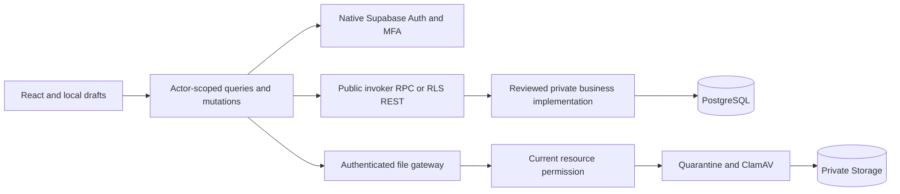

# Developer guide

This guide explains the actual implementation and its business boundaries. The complete target scope remains in the [implementation plan](IMPLEMENTATION_PLAN.md); executed checks are recorded in [QA_RESULTS](QA_RESULTS.md). An outstanding feature there is not implicitly complete. The separately established self-hosted CMS development environment and its release automation are documented in [HOSTINGER_DEVELOPMENT](HOSTINGER_DEVELOPMENT.md) and [HOSTINGER_AUTOMATIC_UPDATES](HOSTINGER_AUTOMATIC_UPDATES.md).

## Getting started and local development

Read [WORKLOG](WORKLOG.md), [IMPLEMENTATION_PLAN](IMPLEMENTATION_PLAN.md), [AGENTS](../AGENTS.md), the [master specification](UNIVERSAL_MASTER_PROMPT.txt) and the current Git status first. Preserve working modules, normal database volumes and concurrent changes. Use a separate `codex/` branch or worktree when the original directory contains other work.

```bash
./portal start
./portal status
./portal test
./portal stop
```

`start` installs locked dependencies when needed, applies migrations without resetting data and starts Vite, PostgreSQL, Auth, Storage, Realtime, Edge, Mailpit and ClamAV. `test` uses its own sanitized source copy and random project/volume identifiers. Details and ports: [LOCAL_DEVELOPMENT](LOCAL_DEVELOPMENT.md). Two ordinary checkouts of the same project share default ports/volumes; stop the managed stack in its original checkout before starting it from another. Port checks never terminate unrelated processes.

The normal environment contains fictional development data unless someone subsequently adds their own records. Startup does not overwrite passwords/MFA, profiles, roles, suspensions or accepted jobs. `./portal credentials` deliberately displays the original local bootstrap password in your terminal; it does not reset a password. Local invitations and recovery messages go to Mailpit. Production publication, real email and actual payment orders are separate operations.

## Application startup and responsibilities

| Entry point                                  | Responsibility                                                                                                         |
| -------------------------------------------- | ---------------------------------------------------------------------------------------------------------------------- |
| `src/main.tsx`                               | Shared providers, global styles and router application.                                                                |
| `src/app/app.tsx`                            | Actual routes, protected areas, error boundary and PWA state. Feature pages load lazily where appropriate.             |
| `src/app/shell.tsx`                          | Role-aware navigation, mobile navigation, search, notifications, language/theme and confirmed sign-out.                |
| `src/features/auth`                          | Native Supabase sign-in, invitation/recovery callback, password, MFA and session changes.                              |
| `src/lib/supabase.ts`                        | One browser client with a public URL/publishable key. No service credentials.                                          |
| `src/lib/queries.ts` and feature API modules | TanStack Query keys, server calls and DTOs. Private data belong in the cache associated with the current actor.        |
| `src/components`                             | Shared fields, states, dialogs and controls. Business permissions remain server-side.                                  |
| `supabase/migrations`                        | Versioned relational contract, including RLS, grants, private implementations and public API.                          |
| `supabase/functions`                         | Authenticated file/avatar gateway and account/invitation operations that require secrets.                              |
| `scripts/runtime-*`                          | Local process supervision, ownership checks, environment sanitization, persistence and isolated complete verification. |

The protected router outlet is additionally keyed by user ID: a direct account change removes local shell/form state. A token refresh for the same person preserves it. The public invitation/recovery callback is outside this remount boundary.

Auth events can arrive before the initial `getSession()` completes. The Auth provider therefore guards ordering and clears private queries before changing identity. Forms keep drafts locally; confirmed business state follows a successful server response. Failed or rejected SDK promises must leave a visible, retryable state. Keyboard submission, language changes and concurrent requests belong to each form's contract too.

## Data flow and permissions



Roles come from current database rows. Editable `user_metadata`, submitted author/user IDs and visible navigation do not grant permissions. The public SQL API uses `security invoker`; necessary privileged implementations live in an unexposed private schema, check the actual caller and have limited execution grants. Every exposed table has RLS.

Admin/owner accounts can exercise business roles. Financial, role, contract, enrollment and moderation actions retain their MFA/capability checks. Private DMs require real membership; private calendars remain owner data. The separate account HTTP API performs data operations using the caller's JWT. Only invitation delivery/completion uses server-side Auth administration rights. Both invitation entry points share the same durable reservation ledger.

The [generated API reference](API_REFERENCE.md) shows actual parameters, return types and execution grants from a migrated temporary PostgreSQL database. `scripts/api-surface-db-tests.mjs` connects actual frontend calls through compiler symbols to that database. A missing browser call does not make a documented API or migration dead code.

## Feature modules and their connections

| Module                 | Code and data contract                                                                       | Key boundary / documentation                                                                                                                                                       |
| ---------------------- | -------------------------------------------------------------------------------------------- | ---------------------------------------------------------------------------------------------------------------------------------------------------------------------------------- |
| Profiles and expertise | `features/profile`, `features/people`, profile/expertise tables and safe people projections  | Own contact/evidence data are separate from deliberately shared profile details. [PROFILES_REVIEWS](PROFILES_REVIEWS.md).                                                          |
| Profile pictures       | Avatar editor/API, `profile_avatars`, existing document versions and file avatar action      | Own clean image, exact version, authorized profile viewing and a fresh check before returning bytes. [PROFILE_AVATARS](PROFILE_AVATARS.md).                                        |
| Customers and courses  | `features/operations`, organization/template/run/session model                               | Private contacts/notes stay protected; content templates and actual runs are distinct entities. [OPERATIONS](OPERATIONS.md).                                                       |
| CBW building blocks    | Provenance catalogue, `building_blocks`, source revisions and referencing templates          | One subject template per code, each original revision with hash/pages/filename. No compensation, contacts or real learner import. [CBW_TEMPLATES](CBW_TEMPLATES.md).               |
| Teaching offers        | `features/admin`, `features/jobs`, job/session/requirement tables                            | Template → run → referenced job, verified current source data and immutable accepted state.                                                                                        |
| Instant allocation     | Claim RPC, lecturer/job locks, unique claims and interval exclusion                          | Every session or no allocation; one winner, idempotent retries and no drag/frontend shortcut.                                                                                      |
| Comments               | `features/comments`, private comment/revision data                                           | Resource-specific staff discussion; own versions/withdrawal, reasoned MFA moderation and no changes to accepted terms. [RESOURCE_COMMENTS](RESOURCE_COMMENTS.md).                  |
| Calendar               | `features/calendar`, private events, confirmed session snapshots and published global events | No global derivation of private appointments; real instants plus IANA zone.                                                                                                        |
| Chat                   | `features/chat`, rooms/members/messages and Realtime                                         | Separate teaching-team/participant rooms; future delivery and files follow current membership. [CHAT_SECURITY](CHAT_SECURITY.md).                                                  |
| Files                  | `features/files`, Edge gateway, documents/versions and quarantine/clean buckets              | MIME/magic/size, scan, hash/version and current permission; no permanent public URLs.                                                                                              |
| Knowledge and search   | `features/knowledge`, `features/search`, wiki revisions/forum and safe search projections    | A new draft never replaces a published wiki revision; content renders as an allowed editor tree/text. [KNOWLEDGE_SECURITY](KNOWLEDGE_SECURITY.md).                                 |
| Contracts and invoices | `features/commercial`, exact clean PDF versions, accepted claims and invoice items/payments  | Receipt acknowledgment is not an electronic signature; amounts come from accepted agreements. [COMMERCIAL_SECURITY](COMMERCIAL_SECURITY.md).                                       |
| Clients and commission | Client portal, current organization membership and private gross/share snapshots             | Default 50/50; lecturers see their own compensation, admin/owner full prices; unknown historical gross stays unknown. [CLIENT_COMMISSION_SECURITY](CLIENT_COMMISSION_SECURITY.md). |
| Account administration | `features/accounts`, accounts Edge function and role/activation/invitation RPCs              | MFA and current rights; the last active administrator is preserved under a shared lock.                                                                                            |

## Maintaining CBW provenance and offers

The catalogue contains no absolute local user paths and does not publish original PDFs. A source reference contains its code, exact filename, SHA-256, pages and date information. Corresponding LPC3/LPC4 revisions are different sources for the same subject building block. The import/verification routine and its arguments are documented in [CBW_TEMPLATES](CBW_TEMPLATES.md).

New runs use a selected template; customer, delivery mode, location/link and actual sessions are planned separately. The offer form opened from a course shows a pinned source state and submits only financial terms plus `source_revision`. The server reads and locks the real resources, compares that revision and retains the original session IDs. A stale draft is rejected. Once an offer exists, the source chain is protected; a new building-block revision gets a new template instead of retargeting existing offers.

Administrators with gross-price permission enter the full customer price; the existing private commission contract calculates lecturer compensation. Management without gross permission uses the existing net contract. That variant does not invent a full customer price. Currencies remain separate and accepted amounts/rates/terms remain unchanged.

## Files, images and cache lifetime

Files reserve a specific version and undergo actual verification before release. Cancellation or scanner failure is not a clean upload. Contracts/invoices reference exactly the confirmed bytes. A profile picture uses the same secure upload with a separate, tightly scoped read projection. This gives no access to general personal documents on other profiles.

The avatar editor creates a bounded raster image without original metadata; the server independently checks the canonical PNG. Replacement, removal and membership revocation are checked during downloads too. Blob URLs belong to the identity and selection, are released on change/unmount/offline transitions and are never stored as global URLs. The PWA caches only the public application shell, without private API/file responses.

## Code changes and comments

Keep components, DTOs and queries in their owning feature module. Share real business rules between callers; for example, `private.can_read_job` applies both to job RLS and job comments. Duplicated permission conditions can drift later.

Comment the reason for a lock, important ordering, authorization contract, version/retry behavior or memory release directly in code. Types and clear names describe data; security/architecture documents explain cross-cutting decisions. Update comments when behavior changes. Document known limits instead of returning success for unimplemented branches.

Create additive migrations with the installed CLI (`npx --no-install supabase migration new NAME`). Never edit previously delivered migrations. Check new tables, indexes, constraints, RLS and grants together with the UI/API. Avoid a second source of truth for accepted compensation, confirmed sessions or author identities.

## Loading behavior and runtime resilience

The [system audit](SYSTEM_AUDIT.md) documents status-dependent metadata intervals, the two-minute limit for fast scan polling, immutable version-specific image bytes and coalesced chat revalidation. It includes real before/after measurements and their limits. Language/theme persistence is best effort; blocked local storage must not break the active interface. Native Auth storage retains its separate SDK contract.

Session intervals must be finite at the database boundary. The added migration validates historical rows and stops on invalid data; existing accepted agreements are not silently changed. Process timeouts and cancellation require actual termination and honest cleanup acknowledgment.

## Testing strategy and debugging

| Layer               | What it proves                                                                                        | Execution                                                                              |
| ------------------- | ----------------------------------------------------------------------------------------------------- | -------------------------------------------------------------------------------------- |
| Source/components   | Validation, failed requests, state/language changes, cache/blob lifetimes and concrete UI regressions | `npm test`, or targeted `npx --no-install vitest run FILE`                             |
| Import/symbol graph | Connected modules, imports, routes, static assets and actual export use                               | `node scripts/code-integrity.mjs --exports` and automatically discovered runtime tests |
| PostgreSQL          | Fresh migrations, constraints, roles/RLS, versions, transactions and concurrency                      | Automatically discovered `*-db-tests.mjs` in the complete command                      |
| Real API            | Native Auth/TOTP, REST/RPC, WebSockets, private object bytes, actual scanning and Mailpit             | Automatically discovered `*-api-check.mjs` in the complete command                     |
| Browser             | Real data workflows, keyboard, DE/EN, layout, axe and permissions across separate people/sessions     | Playwright within `./portal test`                                                      |
| Built PWA           | Actual service worker, offline deep links and excluded private caches                                 | Separate build/preview step in the complete command                                    |

`scripts/testing/api.mjs` centralizes API fixtures: strictly random canonical projects, local test ports, real separate accounts/MFA and verified cleanup. Register owned resources through `defer`; resources are removed before their test accounts. Cleanup failures fail the check and are retained alongside the original error. `scripts/testing/database.mjs` creates and removes owned temporary databases.

First reproduce a real defect, add a meaningful failing check and fix the owning contract. Simulated SDK failures help test error presentation; they do not replace real Auth/server acceptance. Concurrent PostgreSQL calls must exercise actual concurrency. Use independent browser contexts for different people so their Auth storage is not shared.

The complete command also includes offline update/release/proxy checks. These additionally require Python 3; the run changes neither the hosted server nor its configuration. Deliberate operator review points for migrations remain in place. Package acceptance does not prove a migration has already been applied to the development instance.

The complete command writes protected reports under `.local/tests/<run>/`. Inspect the first failed step and its concrete trace/error context first. Verify the necessary correction and repeat complete acceptance before delivery. Private traces, tokens, QR codes and credentials do not belong in Git or screenshots.

Local Chromium emulation and automated axe do not replace physical mobile installation, other browsers, manual accessibility or later host/SMTP/restore checks. Remaining release gates are in the plan and [deployment runbook](DEPLOYMENT_RUNBOOK.md).
