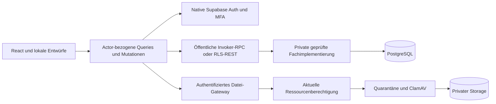

# Entwicklerhandbuch

Dieses Dokument erklärt den tatsächlich vorhandenen Code und die fachlichen Grenzen. Der vollständige Zielumfang steht im [Produktplan](IMPLEMENTATION_PLAN.md); ausgeführte Prüfungen stehen in [QA_RESULTS](QA_RESULTS.md). Eine dort offene Funktion ist kein stillschweigend fertiger Teil der Anwendung. Die inzwischen separat eingerichtete selbst gehostete CMS-Entwicklung und ihre Freigabeautomatik sind in [HOSTINGER_DEVELOPMENT](HOSTINGER_DEVELOPMENT.md) und [HOSTINGER_AUTOMATIC_UPDATES](HOSTINGER_AUTOMATIC_UPDATES.md) dokumentiert.

## Einstieg und lokale Arbeit

Lies zuerst [WORKLOG](WORKLOG.md), [AGENTS](../AGENTS.md), den [Master-Prompt](UNIVERSAL_MASTER_PROMPT.txt) und den aktuellen Git-Status. Bereits funktionierende Module, normale Datenbankvolumes und parallele Änderungen bleiben erhalten. Verwende einen eigenen `codex/`-Branch beziehungsweise ein getrenntes Worktree, wenn der ursprüngliche Ordner weitere Arbeiten enthält.

```bash
./portal start
./portal status
./portal test
./portal stop
```

`start` installiert bei Bedarf die gesperrten Abhängigkeiten, migriert ohne Reset und startet Vite, PostgreSQL, Auth, Storage, Realtime, Edge, Mailpit und ClamAV. `test` verwendet eine eigene bereinigte Kopie und zufällige Projekt-/Volumenkennungen. Details und Ports: [LOCAL_DEVELOPMENT](LOCAL_DEVELOPMENT.md). Zwei normale Checkouts desselben Projekts teilen Standardports/Volumes; stoppe den bisherigen verwalteten Stack in seinem ursprünglichen Checkout, bevor du ihn aus dem neuen startest. Die Portprüfung beendet keine fremden Prozesse.

Die normale Umgebung enthält ausschließlich fiktive Entwicklungsdaten, sofern später keine eigenen Daten ergänzt wurden. Ein Start überschreibt weder Passwörter/MFA noch Profile, Rollen, Sperren oder angenommene Aufträge. `./portal credentials` zeigt das ursprüngliche lokale Bootstrap-Passwort bewusst im eigenen Terminal; es setzt kein Passwort zurück. Einladungen und Wiederherstellung landen lokal in Mailpit. Produktionsveröffentlichung, echte E-Mails und echte Zahlungsaufträge sind getrennte Schritte.

## Programmstart und Zuständigkeiten

| Einstieg                                    | Aufgabe                                                                                                                     |
| ------------------------------------------- | --------------------------------------------------------------------------------------------------------------------------- |
| `src/main.tsx`                              | Gemeinsame Provider, globale Styles und Router-Anwendung.                                                                   |
| `src/app/app.tsx`                           | Tatsächliche Routen, geschützte Bereiche, Fehlergrenze und PWA-Status. Fachseiten werden soweit sinnvoll verzögert geladen. |
| `src/app/shell.tsx`                         | Rollenabhängige Navigation, mobile Hauptnavigation, Suche, Meldungen, Sprache/Farbschema und bestätigtes Abmelden.          |
| `src/features/auth`                         | Native Supabase-Anmeldung, Einladungs-/Recovery-Callback, Passwort, MFA und Sessionwechsel.                                 |
| `src/lib/supabase.ts`                       | Ein Browserclient mit öffentlichem URL/Publishable-Key. Keine Service-Zugangsdaten.                                         |
| `src/lib/queries.ts` und Feature-API-Module | TanStack-Query-Schlüssel, Serveraufrufe und DTOs. Private Daten gehören in den zur Identität passenden Cache.               |
| `src/components`                            | Gemeinsame Felder, Zustände, Dialoge und Bedienelemente. Fachliche Berechtigungen bleiben am Server.                        |
| `supabase/migrations`                       | Versionierter relationaler Vertrag einschließlich RLS, Grants, privaten Implementierungen und öffentlicher API.             |
| `supabase/functions`                        | Authentifizierte Datei-/Avatar-Gateway und secretsführende Account-/Einladungsoperationen.                                  |
| `scripts/runtime-*`                         | Überwachung lokaler Prozesse, Besitzprüfung, Umgebungsbereinigung, Datenpersistenz und isolierter Gesamtprüflauf.           |

Auth-Ereignisse können früher eintreffen als der erste `getSession()`-Aufruf. Der Auth-Provider schützt deshalb die Reihenfolge und leert private Queries vor einem Identitätswechsel. Formulare halten Entwürfe lokal; bestätigte Fachzustände entstehen nach einer erfolgreichen Serverantwort. Fehlgeschlagene oder abgelehnte SDK-Promises müssen einen sichtbaren, wiederholbaren Zustand hinterlassen. Auch Tastatur-Submit, Sprachwechsel und parallel laufende Requests gehören zum jeweiligen Formularvertrag.

## Datenfluss und Berechtigungen



Rollen werden aus aktuellen Datenbankzeilen gelesen. Editierbare `user_metadata`, übermittelte Autor-/Benutzerkennungen oder die sichtbare Navigationsleiste verleihen keine Rechte. Die öffentliche SQL-API verwendet `security invoker`; notwendige privilegierte Implementierungen liegen im nicht veröffentlichten privaten Schema, prüfen den tatsächlichen Aufrufer und besitzen begrenzte Ausführungsrechte. Alle exponierten Tabellen haben RLS.

Admin/Owner können fachliche Rollen ausüben. Finanz-, Rollen-, Vertrags-, Einschreibungs- und Moderationsaktionen behalten ihre MFA-/Capability-Prüfungen. Private DMs benötigen reale Mitgliedschaft; private Kalender bleiben Eigentümerdaten. Die getrennte Account-HTTP-API führt Datenoperationen mit dem JWT des Aufrufers aus. Nur die Einladungszustellung/-komplettierung verwendet serverseitige Auth-Verwaltungsrechte. Beide Einladungseinstiege teilen dasselbe dauerhafte Reservierungsprotokoll.

Die [generierte API-Referenz](API_REFERENCE.md) zeigt tatsächliche Parameter, Rückgabetypen und Ausführungsrechte aus einer migrierten temporären PostgreSQL-Datenbank. `scripts/api-surface-db-tests.mjs` verknüpft die tatsächlichen Frontend-Aufrufe über Compiler-Symbole mit dieser Datenbank. Ein fehlender Browseraufruf macht eine dokumentierte API oder Migration nicht zu totem Code.

## Fachmodule und ihre Verbindungen

| Modul                       | Code und Datenvertrag                                                                                       | Wichtige Grenze / Dokumentation                                                                                                                                                                 |
| --------------------------- | ----------------------------------------------------------------------------------------------------------- | ----------------------------------------------------------------------------------------------------------------------------------------------------------------------------------------------- |
| Profile und Expertise       | `features/profile`, `features/people`, Profile-/Expertise-Tabellen und sichere Personenprojektionen         | Eigene Kontakt-/Nachweisdaten sind getrennt von absichtlich geteilten Profilangaben. [PROFILES_REVIEWS](PROFILES_REVIEWS.md).                                                                   |
| Profilbilder                | Avatar-Editor/-API, `profile_avatars`, bestehende Dokumentversionen und Files-Avatar-Aktion                 | Eigenes sauberes Bild, exakte Version, berechtigte Profilbetrachtung, erneute Prüfung vor Byte-Ausgabe. [PROFILE_AVATARS](PROFILE_AVATARS.md).                                                  |
| Kunden und Kurse            | `features/operations`, Organisations-/Vorlagen-/Durchführungs-/Terminmodell                                 | Private Kontakte/Notizen bleiben geschützt; Inhaltsvorlage und konkrete Durchführung sind unterschiedliche Entitäten. [OPERATIONS](OPERATIONS.md).                                              |
| CBW-Bausteine               | Provenienz-Katalog, `building_blocks`, Quellfassungen und referenzierende Vorlagen                          | Eine fachliche Vorlage pro Kurzzeichen, jede Originalfassung mit Hash/Seiten/Dateiname. Kein Import von Vergütung, Kontakten oder echten Teilnehmenden. [CBW_TEMPLATES](CBW_TEMPLATES.md).      |
| Auftragsangebote            | `features/admin`, `features/jobs`, Job-/Termin-/Anforderungstabellen                                        | Vorlage → Durchführung → referenzierter Auftrag, geprüfte aktuelle Quelldaten, unveränderlicher angenommener Stand.                                                                             |
| Sofortzuweisung             | Claim-RPC, Lecturer-/Job-Sperren, eindeutige Claims und Intervall-Ausschluss                                | Alle Termine oder keine Zuweisung; ein Gewinner, idempotente Wiederholung, keine Drag-/Frontend-Abkürzung.                                                                                      |
| Kommentare                  | `features/comments`, private Kommentar-/Revisionsdaten                                                      | Ressourcenbezogener Lehrteam-Austausch; eigene Versionen/Rückzug, begründete MFA-Moderation; keine Änderung angenommener Bedingungen. [RESOURCE_COMMENTS](RESOURCE_COMMENTS.md).                |
| Kalender                    | `features/calendar`, private Ereignisse, bestätigte Termin-Snapshots und veröffentlichte globale Ereignisse | Keine globale Ableitung privater Termine; echte Instants plus IANA-Zone.                                                                                                                        |
| Chat                        | `features/chat`, Räume/Mitgliedschaften/Nachrichten und Realtime                                            | Separate Lehrteam-/Teilnahmeräume; zukünftige Zustellung und Dateien folgen aktueller Mitgliedschaft. [CHAT_SECURITY](CHAT_SECURITY.md).                                                        |
| Dateien                     | `features/files`, Edge-Gateway, Dokumente/-Versionen, Quarantäne/sauberer Bucket                            | MIME/Magic/Größe, Scan, Hash/Version und aktuelle Berechtigung; keine dauerhaften öffentlichen URLs.                                                                                            |
| Wissen und Suche            | `features/knowledge`, `features/search`, Wiki-Versionen/Forum und sichere Suchprojektionen                  | Neuer Entwurf ersetzt keine veröffentlichte Wiki-Version; Inhalt wird als erlaubter Editorbaum/Text gerendert. [KNOWLEDGE_SECURITY](KNOWLEDGE_SECURITY.md).                                     |
| Verträge und Rechnungen     | `features/commercial`, exakte saubere PDF-Versionen, akzeptierte Claims, Rechnungsposten/Zahlungen          | Empfangsbestätigung ist keine elektronische Signatur; Beträge kommen aus angenommenen Vereinbarungen. [COMMERCIAL_SECURITY](COMMERCIAL_SECURITY.md).                                            |
| Auftraggeber und Verteilung | Client-Portal, aktuelle Organisationsmitgliedschaft, private Gross-/Anteil-Snapshots                        | Standard 50/50; Dozierende sehen eigenes Honorar, Admin/Owner volle Preise; unbekannte historische Gesamtpreise bleiben unbekannt. [CLIENT_COMMISSION_SECURITY](CLIENT_COMMISSION_SECURITY.md). |
| Kontenverwaltung            | `features/accounts`, Accounts-Edge, Rollen-/Aktivierungs-/Einladungs-RPCs                                   | MFA und aktuelle Rechte; letzte aktive Administration bleibt unter gemeinsamem Lock erhalten.                                                                                                   |

## CBW-Provenienz und Angebote pflegen

Der Katalog enthält keine absoluten lokalen Benutzerpfade und veröffentlicht die Original-PDFs nicht. Die Dokumentreferenz besteht aus Kurzzeichen, konkretem Dateinamen, SHA-256, Seiten und Datumsangaben. Gleichlautende LPC3-/LPC4-Fassungen sind verschiedene Quellen desselben fachlichen Bausteins. Die Import-/Prüfroutine und ihre Argumente stehen in [CBW_TEMPLATES](CBW_TEMPLATES.md).

Neue Durchführungen übernehmen eine ausgewählte Vorlage; Kunde, Durchführungsart, Ort/Link und tatsächliche Termine sind separat planbar. Das Auftragsformular aus einem Kurs zeigt einen festgehaltenen Quellenstand und übermittelt ausschließlich finanzielle Bedingungen samt `source_revision`. Der Server liest und sperrt die echten Ressourcen, vergleicht die Revision und übernimmt die originalen Termin-IDs. Ein veralteter Entwurf wird abgewiesen. Nach einem Auftrag wird die Quellenkette geschützt; eine neue Bausteinfassung erhält eine neue Vorlage, statt bestehende Aufträge umzuhängen.

Gross-berechtigte Administration trägt den vollen Kundenpreis ein; der vorhandene private Verteilungsvertrag berechnet das Dozierendenhonorar. Management ohne Gross-Recht verwendet den bestehenden Netto-Vertrag. Diese Variante erzeugt keinen erfundenen Kunden-Gesamtpreis. Währungen bleiben getrennt, angenommene Beträge/Sätze/Bedingungen unverändert.

## Dateien, Bilder und Cache-Lebensdauer

Dateien reservieren eine konkrete Version und werden vor Freigabe tatsächlich geprüft. Ein Abbruch oder Scannerausfall ist kein sauberer Upload. Verträge/Rechnungen verweisen auf genau die bestätigten Bytes. Ein Profilbild verwendet denselben sicheren Upload, aber eine separate, eng begrenzte Leseprojektion. Allgemeine persönliche Dokumente erhalten dadurch keine Leserechte für andere Profile.

Der Avatar-Editor erzeugt ein begrenztes Rasterbild ohne ursprüngliche Metadaten; der Server prüft das kanonische PNG unabhängig davon. Wechsel, Entfernung und Mitgliedschaftsentzug werden auch während des Downloads überprüft. Blob-URLs gehören zur Identität und Auswahl, werden beim Wechsel/Unmount/Offline-Zustand freigegeben und nicht als globale URL gespeichert. Die PWA cached nur den öffentlichen App-Rahmen, keine privaten API-/Dateiantworten.

## Änderungen und Kommentare im Code

Halte Komponenten, DTOs und Queries im zuständigen Fachmodul. Teile echte fachliche Regeln zwischen Aufrufern; die neue `private.can_read_job`-Prüfung gilt beispielsweise gleichzeitig für Job-RLS und Auftragskommentare. Kopierte Berechtigungsbedingungen können später auseinanderlaufen.

Kommentiere den Grund einer Sperre, eine wichtige Reihenfolge, den Autorisierungsvertrag, einen Versions-/Wiederholungsfall oder eine Speicherfreigabe direkt am Code. Typen und klare Namen beschreiben die Daten; die Sicherheits-/Architekturdateien beschreiben die übergreifende Entscheidung. Passe Kommentare bei einer Verhaltensänderung an. Dokumentiere bekannte Grenzen, statt unimplementierte Zweige als Erfolg zurückzugeben.

Erzeuge additive Migrationen mit der tatsächlich installierten CLI (`npx --no-install supabase migration new NAME`). Bearbeite bereits ausgelieferte Migrationen nicht nachträglich. Prüfe neue Tabellen, Indizes, Constraints, RLS und Grants zusammen mit der UI/API. Vermeide eine zweite Quelle für akzeptierte Honorare, bestätigte Termine oder Autoridentitäten.

## Ladeverhalten und robuste Laufzeit

Der [Systemprüfbericht](SYSTEM_AUDIT.md) dokumentiert Status-abhängige Metadatenintervalle, das zweiminütige Limit für schnelle Scan-Abfragen, unveränderliche versionsbezogene Bildbytes und gebündelte Chat-Revalidierungen. Er enthält echte Vorher-/Nachher-Messungen und Grenzen. Sprach-/Theme-Persistenz ist best effort; eine blockierte lokale Ablage darf die aktive Oberfläche nicht abbrechen. Die native Auth-Speicherung behält ihren separaten SDK-Vertrag.

Terminintervalle müssen auf Datenbankebene endlich sein. Die neue Migration validiert Altdaten und stoppt bei einem ungültigen Bestand; vorhandene angenommene Vereinbarungen werden nicht still geändert. Prozess-Timeouts und Abbruch benötigen die tatsächliche Beendigung und eine ehrliche Cleanup-Bestätigung.

## Teststrategie und Fehleranalyse

| Ebene               | Was sie beweist                                                                                                      | Ausführung                                                                          |
| ------------------- | -------------------------------------------------------------------------------------------------------------------- | ----------------------------------------------------------------------------------- |
| Source/Komponenten  | Validierung, fehlgeschlagene Requests, Zustands-/Sprachwechsel, Cache-/Blob-Lebensdauer und konkrete UI-Regressionen | `npm test`, gezielt `npx --no-install vitest run DATEI`                             |
| Import-/Symbolgraph | Verbundene Module, Imports, Routen, statische Assets, tatsächliche Exportverwendungen                                | `node scripts/code-integrity.mjs --exports` und automatisch entdeckte Laufzeittests |
| PostgreSQL          | Frische Migrationen, Constraints, Rollen/RLS, Versionen, Transaktionen und Nebenläufigkeit                           | Autoentdeckte `*-db-tests.mjs` im Gesamtbefehl                                      |
| Echte API           | Native Auth/TOTP, REST/RPC, WebSockets, private Objektbytes, tatsächlicher Scan und Mailpit                          | Autoentdeckte `*-api-check.mjs` im Gesamtbefehl                                     |
| Browser             | Tatsächliche Datenabläufe, Tastatur, DE/EN, Layout, axe und Rechte über getrennte Personen/Sitzungen                 | Playwright innerhalb `./portal test`                                                |
| Gebaute PWA         | Echter Service Worker, Offline-Deep-Link und ausgeschlossene private Caches                                          | Separater Build-/Preview-Schritt im Gesamtbefehl                                    |

`scripts/testing/api.mjs` bündelt die neuen API-Fixtures: streng zufälliges kanonisches Projekt, lokale Testports, echte getrennte Accounts/MFA und geprüfte Aufräumaktionen. Registriere eigene Ressourcen über `defer`; Ressourcen werden vor den jeweiligen Testkonten entfernt. Fehler beim Aufräumen lassen die Prüfung fehlschlagen und werden zusammen mit dem ursprünglichen Fehler erhalten. `scripts/testing/database.mjs` erzeugt und entfernt eigene temporäre Datenbanken.

Reproduziere zuerst einen tatsächlichen Fehler, ergänze eine aussagekräftige fehlgeschlagene Prüfung und korrigiere den zuständigen Vertrag. Simulierte SDK-Fehler sind für die Fehlerdarstellung sinnvoll; sie ersetzen keine echte Auth-/Server-Abnahme. Gleichzeitige PostgreSQL-Aufrufe müssen echte Nebenläufigkeit prüfen. Verwende unabhängige BrowserContexts für unterschiedliche Personen, damit deren Auth-Storage nicht geteilt wird.

Der Gesamtbefehl umfasst auch die offline ausführbaren Update-/Release-/Proxy-Prüfungen. Dafür wird zusätzlich Python3 benötigt; der Testlauf verändert weder den gehosteten Server noch dessen Konfiguration. Bewusste Operator-Prüfpunkte für Migrationen bleiben bestehen. Eine Paketfreigabe ist keine Bestätigung, dass eine Migration auf der Entwicklungsinstanz bereits angewendet wurde.

Der Gesamtbefehl schreibt geschützte Berichte unter `.local/tests/<run>/`. Prüfe zuerst den ersten fehlgeschlagenen Schritt und dessen konkreten Trace/Fehlerkontext. Prüfe anschließend die notwendige Korrektur und führe die vollständige Abnahme vor Lieferung erneut aus. Private Traces, Tokens, QR-Codes und Zugangsdaten gehören nicht in Git oder Screenshots.

Lokale Chromium-Emulation und automatisches axe ersetzen keine echte mobile Installation, andere Browser, manuelle Barrierefreiheit oder spätere Host-/SMTP-/Restore-Prüfungen. Die verbleibenden Release-Gates stehen im Plan und [Deployment-Runbook](DEPLOYMENT_RUNBOOK.md).
