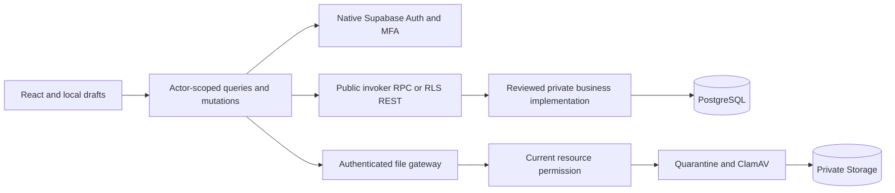

# Developer guide

This document explains the code that actually exists and its business boundaries. The full target scope is in the [implementation plan](IMPLEMENTATION_PLAN.md); executed checks are recorded in [QA_RESULTS](QA_RESULTS.md). A feature marked as pending there is not an implicitly completed part of the application. The separately configured self-hosted CMS development instance and its release automation are documented in [HOSTINGER_DEVELOPMENT](HOSTINGER_DEVELOPMENT.md) and [HOSTINGER_AUTOMATIC_UPDATES](HOSTINGER_AUTOMATIC_UPDATES.md).

## Getting started and working locally

Read [WORKLOG](WORKLOG.md), [AGENTS](../AGENTS.md), the [master specification](UNIVERSAL_MASTER_PROMPT.txt) and the current Git status first. Preserve working modules, normal database volumes and concurrent changes. Use your own `codex/` branch or a separate worktree when other work is present in the original directory.

```bash
./portal start
./portal status
./portal test
./portal stop
```

`start` installs locked dependencies when needed, migrates without resetting data and starts Vite, PostgreSQL, Auth, Storage, Realtime, Edge, Mailpit and ClamAV. `test` uses its own sanitized copy and random project/volume identities. Details and ports: [LOCAL_DEVELOPMENT](LOCAL_DEVELOPMENT.md). Two normal checkouts of the same project share default ports/volumes; stop the previously managed stack in its original checkout before starting it from a new one. The port check never terminates unrelated processes.

The normal environment contains only fictional development data unless you later add your own records. Startup does not overwrite passwords/MFA, profiles, roles, suspensions or accepted assignments. `./portal credentials` deliberately displays the original local bootstrap password in your own terminal; it does not reset passwords. Invitations and recovery messages are captured locally in Mailpit. Production publication, real email and real payment instructions are separate operations.

## Application startup and responsibilities

| Entry point                                  | Responsibility                                                                                                                      |
| -------------------------------------------- | ----------------------------------------------------------------------------------------------------------------------------------- |
| `src/main.tsx`                               | Shared providers, global styles and router application.                                                                             |
| `src/app/app.tsx`                            | Actual routes, protected areas, error boundary and PWA status. Feature pages are loaded lazily where appropriate.                   |
| `src/app/shell.tsx`                          | Role-aware navigation, mobile primary navigation, search, notifications, language/theme and confirmed sign-out.                     |
| `src/features/auth`                          | Native Supabase sign-in, invitation/recovery callback, password, MFA and session changes.                                           |
| `src/lib/supabase.ts`                        | One browser client with a public URL/publishable key. No service credentials.                                                       |
| `src/lib/queries.ts` and feature API modules | TanStack Query keys, server calls and DTOs. Private data belong in the cache scoped to the current identity.                        |
| `src/components`                             | Shared fields, states, dialogs and controls. Business permissions remain authoritative on the server.                               |
| `supabase/migrations`                        | Versioned relational contract, including RLS, grants, private implementations and the public API.                                   |
| `supabase/functions`                         | Authenticated file/avatar gateways and account/invitation operations requiring server secrets.                                      |
| `scripts/runtime-*`                          | Local process supervision, ownership checks, environment sanitization, data persistence and the isolated complete verification run. |

The protected router outlet is also keyed by user ID: a direct account change clears local shell/form state. Refreshing a token for the same actor preserves it. The public invitation/recovery callback is outside this remount boundary.

Auth events can arrive before the first `getSession()` call completes. The Auth provider therefore protects event ordering and clears private queries before an identity change. Forms keep drafts locally; confirmed business state follows a successful server response. Failed or rejected SDK promises must leave a visible state that supports retry. Keyboard submission, language changes and concurrent requests are also part of each form's contract.

## Data flow and permissions



Roles are read from current database rows. Editable `user_metadata`, submitted author/user IDs and visible navigation do not grant permissions. The public SQL API uses `security invoker`; necessary privileged implementations live in the unexposed private schema, check the actual caller and have restricted execution grants. Every exposed table has RLS.

Admin/owner accounts can exercise business roles. Financial, role, contract, enrollment and moderation operations retain their MFA/capability checks. Private DMs require actual membership; private calendars remain owner-only data. The separate account HTTP API performs data operations with the caller's JWT. Only invitation delivery/completion uses server-side Auth administration permissions. Both invitation entry points share the same durable reservation protocol.

The [generated API reference](API_REFERENCE.md) lists actual parameters, return types and execution grants from a migrated temporary PostgreSQL database. `scripts/api-surface-db-tests.mjs` connects actual frontend calls to this database through compiler symbols. A documented API or migration is not dead code merely because the browser does not call it.

## Feature modules and their connections

| Module                 | Code and data contract                                                                       | Important boundary / documentation                                                                                                                                                              |
| ---------------------- | -------------------------------------------------------------------------------------------- | ----------------------------------------------------------------------------------------------------------------------------------------------------------------------------------------------- |
| Profiles and expertise | `features/profile`, `features/people`, profile/expertise tables and safe person projections  | Own contact/evidence data are separate from intentionally shared profile information. [PROFILES_REVIEWS](PROFILES_REVIEWS.md).                                                                  |
| Profile pictures       | Avatar editor/API, `profile_avatars`, existing document versions and the files avatar action | Own clean image, exact version, authorized profile viewing and reauthorization before returning bytes. [PROFILE_AVATARS](PROFILE_AVATARS.md).                                                   |
| Customers and courses  | `features/operations`, organization/template/run/session model                               | Private contacts/notes remain protected; reusable content and an actual course run are separate entities. [OPERATIONS](OPERATIONS.md).                                                          |
| CBW building blocks    | Provenance catalogue, `building_blocks`, source versions and referencing templates           | One canonical template per code, each original source with hash/pages/filename. No import of compensation, contacts or real participants. [CBW_TEMPLATES](CBW_TEMPLATES.md).                    |
| Job offers             | `features/admin`, `features/jobs`, job/session/requirement tables                            | Template → run → referenced job, verified current source data and an immutable accepted snapshot.                                                                                               |
| Immediate allocation   | Claim RPC, lecturer/job locks, unique claims and interval exclusion                          | All sessions or none; one winner, idempotent retry, no drag/frontend shortcut.                                                                                                                  |
| Comments               | `features/comments`, private comment/revision data                                           | Resource-specific staff discussions; own versioned edits/withdrawal and reasoned MFA moderation; no modification of accepted terms. [RESOURCE_COMMENTS](RESOURCE_COMMENTS.md).                  |
| Calendar               | `features/calendar`, private events, confirmed session snapshots and published global events | No global derivation from private appointments; actual instants plus the intended IANA zone.                                                                                                    |
| Chat                   | `features/chat`, rooms/memberships/messages and Realtime                                     | Separate staff/participant rooms; future delivery and file access follow current membership. [CHAT_SECURITY](CHAT_SECURITY.md).                                                                 |
| Files                  | `features/files`, Edge gateway, documents/versions, quarantine/clean buckets                 | MIME/magic/size, scanning, hashes/versions and current permission; no permanent public URLs.                                                                                                    |
| Knowledge and search   | `features/knowledge`, `features/search`, wiki versions/forum and safe search projections     | A new draft does not replace a published wiki version; content is rendered as an allowed editor tree/text. [KNOWLEDGE_SECURITY](KNOWLEDGE_SECURITY.md).                                         |
| Contracts and invoices | `features/commercial`, exact clean PDF versions, accepted claims, invoice items/payments     | Receipt acknowledgement is not an electronic signature; amounts come from accepted agreements. [COMMERCIAL_SECURITY](COMMERCIAL_SECURITY.md).                                                   |
| Clients and commission | Client portal, current organization membership, private gross/commission snapshots           | Default 50/50; lecturers see their own compensation, admin/owner sees full prices; unknown historical gross prices remain unknown. [CLIENT_COMMISSION_SECURITY](CLIENT_COMMISSION_SECURITY.md). |
| Account management     | `features/accounts`, accounts Edge, role/activation/invitation RPCs                          | MFA and current permissions; the last active administrator is preserved under a shared lock.                                                                                                    |

## Maintaining CBW provenance and offers

The catalogue contains no absolute local user paths and does not publish the original PDFs. A source reference includes the code, exact filename, SHA-256, pages and dates. LPC3/LPC4 revisions with the same title are distinct sources of the same canonical building block. The import/check routine and its arguments are documented in [CBW_TEMPLATES](CBW_TEMPLATES.md).

New runs use a selected template; customer, delivery mode, location/link and actual sessions can be planned separately. The course-to-job form displays a frozen source snapshot and submits only financial terms with `source_revision`. The server reads and locks the real resources, compares the revision and uses the original session IDs. A stale draft is rejected. Once a job exists, its source chain is protected; a new building-block revision receives a new template rather than redirecting existing jobs.

Administrators with the gross-price capability enter the full client price; the existing private commission agreement calculates lecturer compensation. Management without that capability uses the existing net-price contract. This path does not invent a gross client price. Currencies remain separate, and accepted amounts/rates/terms stay unchanged.

## Files, images and cache lifetimes

Files reserve a specific version and are actually checked before release. Cancellation or scanner failure does not count as a clean upload. Contracts/invoices reference exactly the confirmed bytes. Profile pictures use the same secure upload path but a separate, narrowly scoped read projection. This does not grant other profiles access to general personal documents.

The avatar editor produces a bounded raster image without the original metadata; the server independently validates the canonical PNG. Replacement, removal and membership revocation are checked even during download. Blob URLs belong to the current identity and selection, are released on changes/unmount/offline transitions, and are not stored as global URLs. The PWA caches only the public application shell, not private API/file responses.

## Code changes and comments

Keep components, DTOs and queries in the feature module that owns them. Share actual business rules between callers; for example, `private.can_read_job` applies to both job RLS and job comments. Duplicated permission conditions can drift apart later.

Comment on the reason for a lock, important ordering, the authorization contract, version/retry handling or memory cleanup directly beside the code. Types and clear names describe the data; security/architecture documents explain broader decisions. Update comments when behavior changes. Document known limits instead of returning success from unimplemented branches.

Create additive migrations with the actually installed CLI (`npx --no-install supabase migration new NAME`). Do not modify migrations that have already been delivered. Check new tables, indexes, constraints, RLS and grants together with their UI/API. Avoid a second source of truth for accepted compensation, confirmed sessions or author identities.

## Loading behavior and runtime reliability

The [system audit](SYSTEM_AUDIT.md) documents status-dependent metadata polling intervals, the two-minute fast-scan polling limit, immutable version-specific image bytes and batched chat revalidation. It includes actual before/after measurements and their limits. Language/theme persistence is best effort; blocked local storage must not crash the active UI. Native Auth storage keeps its separate SDK contract.

Session intervals must be finite at the database layer. The new migration validates existing data and stops on an invalid record; it does not silently change accepted agreements. Process timeouts and cancellation require actual process termination and an honest cleanup confirmation.

## Testing strategy and failure diagnosis

| Layer               | What it proves                                                                                       | Execution                                                                              |
| ------------------- | ---------------------------------------------------------------------------------------------------- | -------------------------------------------------------------------------------------- |
| Source/components   | Validation, failed requests, state/language changes, cache/Blob lifetime and concrete UI regressions | `npm test`, or targeted `npx --no-install vitest run FILE`                             |
| Import/symbol graph | Connected modules, imports, routes, static assets and actual export references                       | `node scripts/code-integrity.mjs --exports` and automatically discovered runtime tests |
| PostgreSQL          | Fresh migrations, constraints, roles/RLS, versions, transactions and concurrency                     | Automatically discovered `*-db-tests.mjs` in the complete command                      |
| Real API            | Native Auth/TOTP, REST/RPC, WebSockets, private object bytes, actual scanning and Mailpit            | Automatically discovered `*-api-check.mjs` in the complete command                     |
| Browser             | Real data workflows, keyboard, DE/EN, layout, axe and permissions through separate actors/sessions   | Playwright within `./portal test`                                                      |
| Built PWA           | Actual service worker, offline deep links and excluded private caches                                | Separate build/preview stage in the complete command                                   |

`scripts/testing/api.mjs` provides shared API fixtures: a strictly random canonical project, local test ports, real separate accounts/MFA and checked cleanup. Register owned resources through `defer`; resources are removed before their test accounts. Cleanup failures fail the check and are retained alongside the original failure. `scripts/testing/database.mjs` creates and removes owned temporary databases.

Reproduce an actual failure first, add a meaningful failing check and correct the owning contract. Simulated SDK failures are useful for error presentation; they do not replace real Auth/server acceptance. Concurrent PostgreSQL calls must test actual concurrency. Use independent BrowserContexts for different actors so their Auth storage is not shared.

The complete command also includes offline update/release/proxy checks. These additionally require Python 3; the test run changes neither the hosted server nor its configuration. Deliberate operator review boundaries for migrations remain. Releasing a package is not proof that a migration has already been applied to the development instance.

The complete command writes protected reports under `.local/tests/<run>/`. Inspect the first failing stage and its specific trace/error context first. Verify the necessary correction, then run complete acceptance again before delivery. Private traces, tokens, QR codes and credentials do not belong in Git or screenshots.

Local Chromium emulation and automated axe checks do not replace actual mobile installation, other browsers, manual accessibility checks or subsequent host/SMTP/restore acceptance. Remaining release gates are in the plan and [deployment runbook](DEPLOYMENT_RUNBOOK.md).
