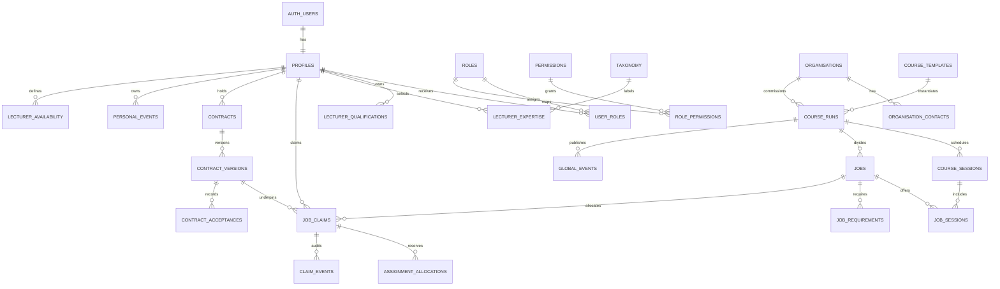
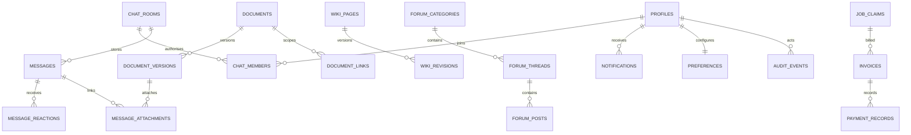
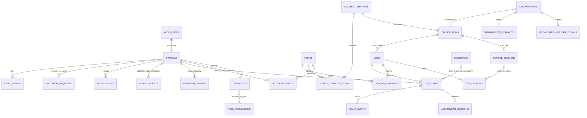
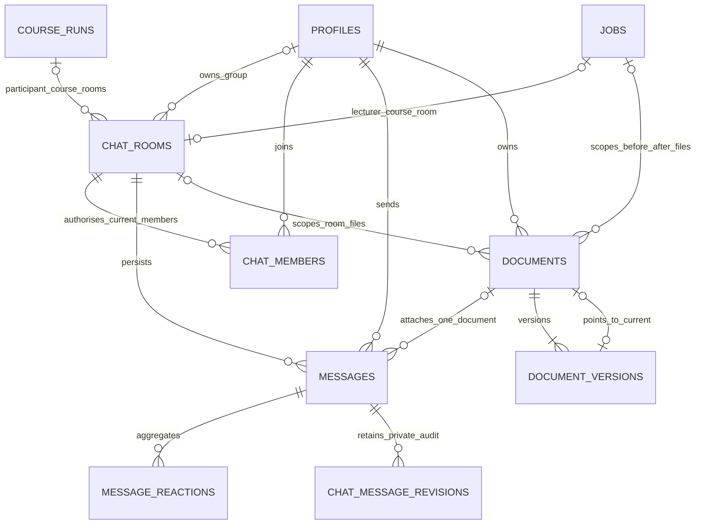
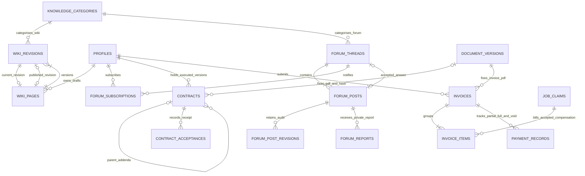
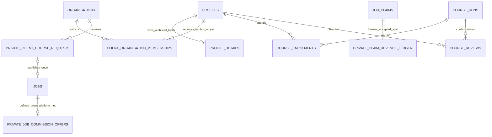
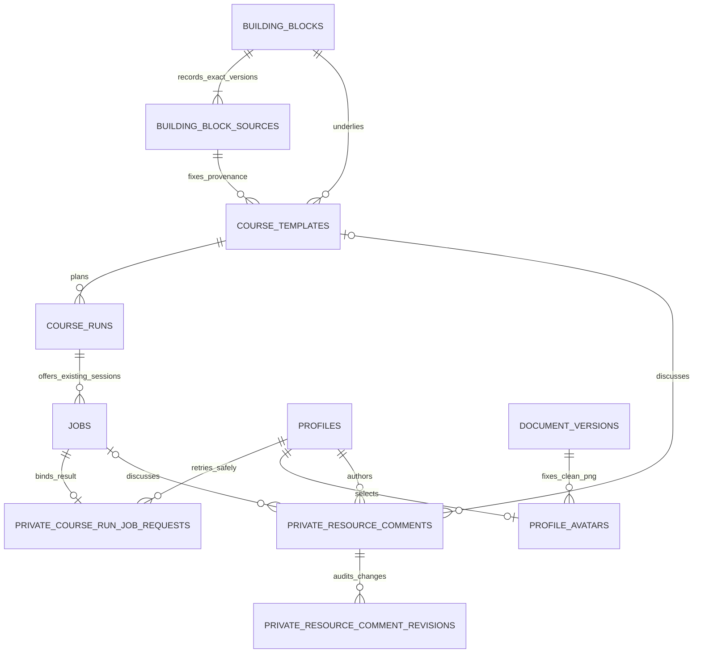

# Relational model and permission boundaries

## Added operational records

Readiness settings/tasks/instruction receipts/events reference course_runs and currently assigned profiles; percentages derive from current source records. Delivery records reference assignment_sessions, with immutable submissions and events plus actor/request receipts. Replacement offers link original job_claims to a new accepted job_claim only after atomic handover; allocation history remains in assignment_sessions. Support tickets link their requester, optional authorised course/claim/organisation and support assignee; separate messages/events/attachments enforce hidden internal entries. All new persistent operational tables are private, RLS-enabled and accessed by reviewed invoker RPCs over scoped implementations. [Schema/workflow guides](OPERATIONS_EXTENSION_STATUS.md) and additive migration source own exact columns and acceptance.

The target diagrams retain the complete product map. They are not a claim that every target table already exists. The implemented diagrams below use the actual names in `supabase/migrations/*.sql`, including the current local collaboration, files, knowledge, customer/course and commercial migrations. Migration source, RLS policies and executed API/database tests are authoritative for exact columns and behaviour. A local migration does not imply hosted deployment or production acceptance.

## Core target relations

## Collaboration and commercial target relations

## Implemented core and course relations

Roles and permission identifiers are text values in the implemented joins, rather than separate `roles`/`permissions` tables. `lecturer_topics` stores self-selection and separately managed verification; the target's separate expertise/qualification entities are not additional current tables. Availability rules and persisted general preferences remain broader target scope. In this schema each `contracts` row is one executed version; there is no separate implemented `contract_versions` table.

## Implemented collaboration and files

`chat_rooms.kind` distinguishes DMs, lecturer general chat, staff topics, lecturer job rooms and participant course channels. A participant room references the course run and keeps `job_id` null. It does not expose the commercial job relation. DM pair keys are unique; `(room_id,user_id)` memberships carry removal tombstones, monotone read state and mute preference. Messages retain sender-scoped retry UUIDs, edit/delete state and stable cursor order. Reactions use removal tombstones. There are no separate current `message_attachments` or `document_links` tables: a message has one optional `document_id`, while a document has a validated personal/room/job-before/job-after scope. Ordinary chat attachments follow that document's current clean version; commercial evidence instead fixes an exact historical version below.

`documents.current_version_id` is updated as versions are reserved. Versions carry the immutable storage object key, original filename/MIME/size, SHA-256 and scanner result/version. Metadata RLS is independent of scan state; binary download additionally requires a clean requested version. Quarantine and clean buckets are private, and restrictive Storage policies deny direct anonymous/authenticated object access. Files flow through the authenticated Edge gateway; they are not public or durable signed URLs.

Reservation retry UUIDs bind the create/replace operation and exact replacement document. Owner-scoped quota locks serialise both self uploads and uploads by different authorised managers on that owner's behalf. Those constraints are enforced in the follow-up migration `20261115132410_document_reservation_retry_quota.sql`, preserving the earlier applied migration files.

## Implemented knowledge and commercial relations

Wiki/forum categories share one `knowledge_categories` table with a kind discriminator. Wiki current and published version pointers are separate composite foreign keys, so an author's newer draft cannot replace the published reader snapshot. Bodies use server-validated Tiptap JSON plus server-derived searchable text, not stored arbitrary HTML. Wiki and forum are staff-only at this checkpoint; participant knowledge ACLs and knowledge attachments remain pending.

Executed contract rows fix a `document_versions.id` and SHA-256, with optional same-owner parent addendum. Legacy fictional contract metadata can have no PDF and cannot receive a file receipt. `contract_acceptances.kind` is explicitly `receipt_acknowledgement`, not a legal electronic signature. Accepted claims keep their immutable contract reference and original amount/currency/terms. Invoices join claims through `invoice_items`, with a unique active invoice per claim. Payment rows track the original currency; corrections void entries with audit rather than overwrite amounts. Referenced commercial file versions and agreement/invoice snapshots are immutable, and linked documents cannot be hidden through ordinary soft deletion.

## Implemented M3 account, profile and financial extension

`PRIVATE_*` entities in this diagram name actual `private.client_course_requests`, `private.job_commission_offers` and `private.claim_revenue_ledger`; they are not public REST tables. Only authorised security-invoker wrappers call the private implementations. The accepted ledger is one snapshot per claim. A client request may create a draft or published job; reports count publication from the actual job state. Invoice labels change metadata only; PDF versions, accepted compensation and payment history keep their original invariants.

`profile_details` separates the new authored country/languages/experience/labels from private contacts/evidence. `course_enrolments` keeps current membership/completion/removal, while `course_reviews` carries course/actual lecturer/author, versioned text/rating and moderation/withdrawal state. Direct review table reads are denied; identity-safe RPCs project each reader's authorised view. Existing `invitation_requests` now binds the requested role/organisation/display name; both invitation handlers use this single lifecycle. Exact schema/arguments are in [API_REFERENCE](API_REFERENCE.md) and the three additive M3 migrations.

## Implemented M4 source catalogue, avatars and discussions

A comment references exactly one job or template, enforced by a database constraint. Cursor indexes order each resource; actor request UUIDs deduplicate concurrent submissions and actor locks serialize rate checks. Private revisions are not ordinary reader data. A profile avatar selects an exact immutable clean image version; its owner-only metadata table does not grant peers the underlying personal document. Peer display uses the separate current-profile projection and authenticated gateway.

Source versions have stable provider/code/file/hash identity. LPC3/LPC4 each retain two real PDF variants under one block. Template/run provenance freezes when a linked job exists. The private course-offer request ledger binds the original financial request and resulting existing-run job; client full-fee requests remain in the existing client ledger when actually known. No new duplicate source columns are added to job/claim snapshots. See [CBW_TEMPLATES](CBW_TEMPLATES.md), [RESOURCE_COMMENTS](RESOURCE_COMMENTS.md) and [PROFILE_AVATARS](PROFILE_AVATARS.md).

## Required constraints and ownership

- Stable UUID foreign keys with explicit deletion behaviour; no accidental cascading deletion of executed contracts or accepted assignments. Unique role/permission/expertise and room membership joins. Verification is server-managed independently of lecturer self-selected expertise.
- Templates contain reusable course content; runs contain actual delivery/customer context; sessions contain canonical instants and intended display zone. A job includes one or more complete sessions. Jobs initially have capacity one, with one active claim per available slot. Future capacity cannot weaken conflict/atomicity constraints.
- Claims own immutable accepted amount/currency/rate unit/terms and the applicable executed-contract row. Its immutable file reference/hash fixes the agreement evidence when present. Idempotency keys are scoped to actor/request; claim events and notifications deduplicate by committed event. A later job edit never rewrites accepted terms.
- Allocation intervals use non-overlap protection per lecturer across jobs, together with transaction locking; private events/availability are included in server-side eligibility. Every session reserves or the entire transaction rolls back.
- Personal events belong solely to their creator. Global events require explicit publication. Business contacts/internal notes, contracts, CVs/evidence and invoices need separate capabilities or resource membership. Private room membership is not implied by admin status.
- Every exposed relation requires RLS and explicit least-privilege grants. Private schema objects are unexposed and execution-locked. User IDs/roles are derived from verified Auth/current database authority, never editable metadata.
- Implemented indexes include job publication/requirements, assignment exclusion ranges, owner/member and cursor lookups, wiki/forum searchable text, invoice active-claim uniqueness and scoped payment history. Search always runs under actor authorisation. Search/list limits are documented in the feature security notes; full-scale pagination remains part of the target.

## Implemented permission matrix

| Resource/action                  | Owner / eligible lecturer                                                                                   | Ordinary peer                                      | Privileged management                                                                   |
| -------------------------------- | ----------------------------------------------------------------------------------------------------------- | -------------------------------------------------- | --------------------------------------------------------------------------------------- |
| Own profile self-service fields  | Read/edit                                                                                                   | Only intentionally public fields, when implemented | Explicit management capability where needed                                             |
| Roles and verification           | Read own applicable grants; no self-promotion                                                               | No mutation                                        | Explicit capability plus MFA; audited                                                   |
| Published jobs                   | Read when authorised/eligible; claim through RPC                                                            | Same permission-based rules                        | Manage with `jobs.manage` and MFA                                                       |
| Accepted assignment snapshot     | Read own                                                                                                    | No                                                 | Explicit commercial/resource permission                                                 |
| Private calendar event           | Read/edit own                                                                                               | Denied                                             | Denied unless actual owner                                                              |
| Executed contract/file/receipt   | Read own; receipt own exact hash                                                                            | Denied                                             | Specific `contracts.read`/`contracts.manage` plus MFA; receipt cannot impersonate owner |
| Private DM/messages/revisions    | Current room member only                                                                                    | Denied                                             | No implicit access; DM membership is not administratively editable                      |
| Group/channel and room files     | Current nonremoved membership plus current role constraints                                                 | Denied outside membership                          | Owner or explicit capability within accessible room; no room bypass                     |
| Personal files                   | Owner; clean bytes only                                                                                     | Denied                                             | CV/certificate/contract/invoice each require their separate capability plus MFA         |
| Customer contacts/private notes  | No implicit lecturer access                                                                                 | Denied                                             | `organisations.manage` plus MFA                                                         |
| Course catalogue                 | Published/assigned; participants explicitly enrolled through managed enrolment or course-channel membership | Denied otherwise                                   | `courses.manage` plus MFA for changes                                                   |
| Wiki drafts/history              | Author and current wiki managers                                                                            | Published revisions only for staff                 | `wiki.manage` plus MFA for publish/archive                                              |
| Forum/report/revision            | Staff; own reports, own post revisions                                                                      | Staff discussion only                              | `forum.moderate` plus MFA for moderation/reports                                        |
| Earnings/invoice/payment history | Own original-currency records                                                                               | Denied                                             | `finance.manage` plus MFA; mutations audited                                            |

See `CHAT_SECURITY.md`, `KNOWLEDGE_SECURITY.md`, `COMMERCIAL_SECURITY.md`, `OPERATIONS.md` and `BACKEND_SECURITY_REVIEW.md` for actual tested boundaries and outstanding acceptance. Tombstones, archives and audit revisions preserve data; none is a production legal-erasure or retention-policy guarantee.
