# Relational model and permission boundaries

## Permanent deletion records

The permanent-deletion extension adds private `deletion_plans`, `deletion_operations`, `deletion_permits`, `deletion_upload_leases` and exact Storage-path fences. Plans bind current actor, typed target, dependency hashes and expiry; operations retain only reduced execution metadata. Permits are short-lived service execution authority; upload leases must actually settle before completion. No journal stores deleted bodies or provides restore. Typed owned children and protected inbound references are distinct; the [deletion contract](PERMANENT_DELETION.md) documents the confirmation and native cleanup boundary. These source additions still require their own native/functional acceptance.

## Added operational records

Readiness settings/tasks/instruction receipts/events reference course_runs and currently assigned profiles; percentages derive from current source records. Delivery records reference assignment_sessions, with immutable submissions and events plus actor/request receipts. Replacement offers link original job_claims to a new accepted job_claim only after atomic handover; allocation history remains in assignment_sessions. Support tickets link their requester, optional authorised course/claim/organisation and support assignee; separate messages/events/attachments enforce hidden internal entries. All new persistent operational tables are private, RLS-enabled and accessed by reviewed invoker RPCs over scoped implementations. [Schema/workflow guides](OPERATIONS_EXTENSION_STATUS.md) and additive migration source own exact columns and acceptance.

The target diagrams preserve the complete product map; conceptual entities do not claim that every table exists. Implemented diagrams show selected physical relations in the **71 SQL sources** including the proposed withdrawal migration on top of accepted main `85b02b8`, with `PRIVATE_*` aliases mapped to unexposed private relations. PR17, PR24 and PR25 cohorts are merged. This is a domain map, not a complete schema dump. Later routine replacements, triggers and constraints must be read in source order. [ARCHITECTURE](ARCHITECTURE.md), [MIGRATION_GUIDE](MIGRATION_GUIDE.md) and [API_REFERENCE](API_REFERENCE.md) explain the current boundaries. Source identity and a diagram do not establish hosted installation or complete acceptance; see [QA_RESULTS](QA_RESULTS.md).

The enquiry cohort adds private original-submission, history and retry records, with links to authorised management, directory organisations/contacts and an explicitly converted course run. These selected diagrams do not enumerate the complete enquiry schema. [WEBSITE_ENQUIRIES](WEBSITE_ENQUIRIES.md) and its owning migration describe exact columns and grants; directory linkage does not create customer-account membership.

## Core target relations

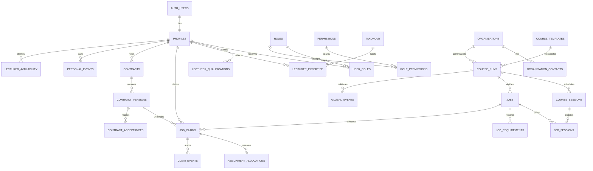

## Collaboration and commercial target relations

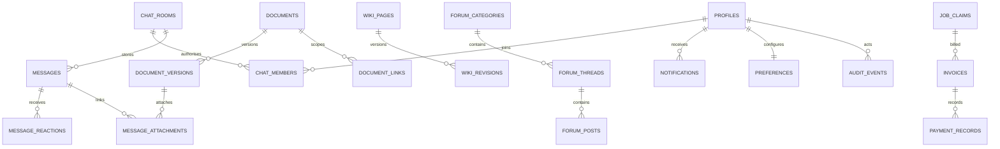

## Implemented core and course relations

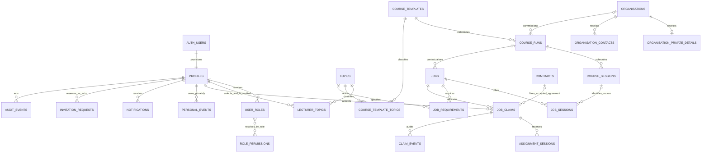

Roles and permission identifiers are text values in the implemented joins, rather than separate `roles`/`permissions` tables. `lecturer_topics` stores self-selection and separately managed verification; there is no separate public `lecturer_qualifications` table. M8 adds the private evidence/state/history relations below without replacing that eligibility record. M6 adds actual `lecturer_availability` and private notification preferences; M7 adds the separate own attention preference below. Broader scheduling and settings remain target scope. In this schema each `contracts` row is one executed version; there is no separate implemented `contract_versions` table.

## Implemented collaboration and files

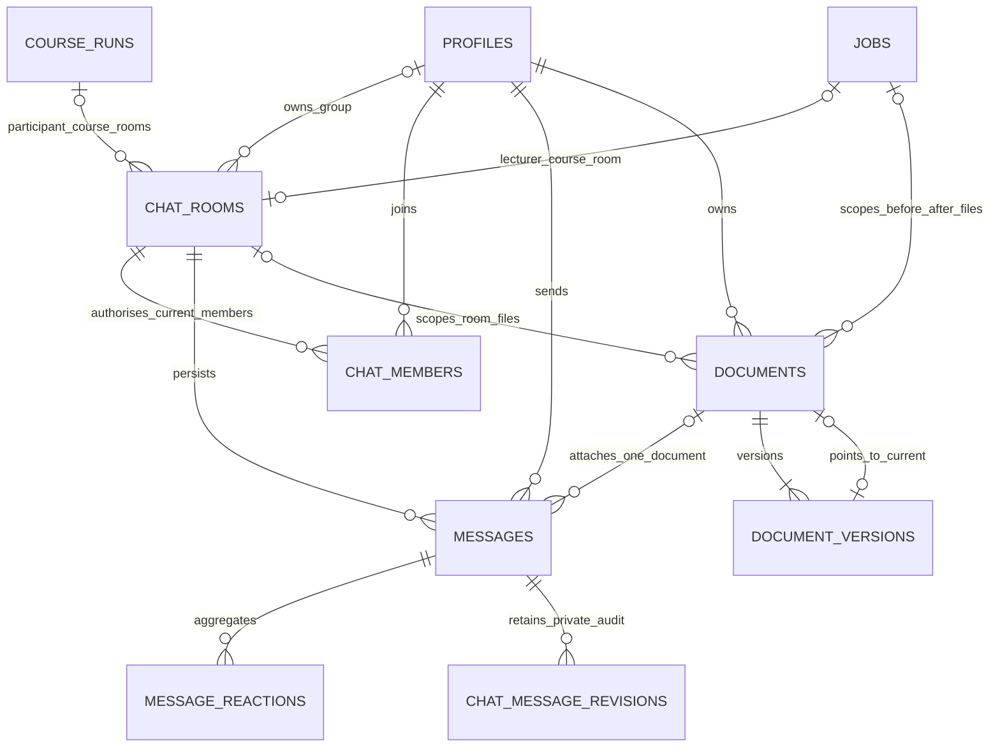

`chat_rooms.kind` distinguishes DMs, lecturer general chat, staff topics, lecturer job rooms and participant course channels. A participant room references the course run and keeps `job_id` null. It does not expose the commercial job relation. DM pair keys are unique; `(room_id,user_id)` memberships carry removal tombstones, monotone read state and mute preference. Messages retain sender-scoped retry UUIDs, edit/delete state and stable cursor order. Reactions use removal tombstones. There are no separate current `message_attachments` or `document_links` tables: a message has one optional `document_id`, while a document has a validated personal/room/job-before/job-after scope. Ordinary chat attachments follow that document's current clean version; commercial evidence instead fixes an exact historical version below.

`documents.current_version_id` is updated as versions are reserved. Versions carry the immutable storage object key, original filename/MIME/size, SHA-256 and scanner result/version. Metadata RLS is independent of scan state; binary download additionally requires a clean requested version. Quarantine and clean buckets are private, and restrictive Storage policies deny direct anonymous/authenticated object access. Files flow through the authenticated Edge gateway; they are not public or durable signed URLs.

Reservation retry UUIDs bind the create/replace operation and exact replacement document. Owner-scoped quota locks serialise both self uploads and uploads by different authorised managers on that owner's behalf. Those constraints are enforced in the follow-up migration `20261115132410_document_reservation_retry_quota.sql`, preserving the earlier applied migration files.

## Implemented knowledge and commercial relations

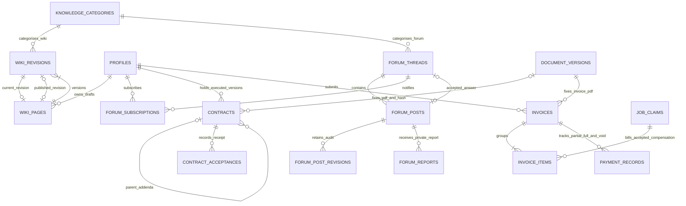

Wiki/forum categories share one `knowledge_categories` table with a kind discriminator. Wiki current and published version pointers are separate composite foreign keys, so an author's newer draft cannot replace the published reader snapshot. Bodies use server-validated Tiptap JSON plus server-derived searchable text, not stored arbitrary HTML. Wiki and forum are staff-only at this checkpoint; participant knowledge ACLs and knowledge attachments remain pending.

Executed contract rows fix a `document_versions.id` and SHA-256, with optional same-owner parent addendum. Legacy fictional contract metadata can have no PDF and cannot receive a file receipt. `contract_acceptances.kind` is explicitly `receipt_acknowledgement`, not a legal electronic signature. Accepted claims keep their immutable contract reference and original amount/currency/terms. Invoices join claims through `invoice_items`, with a unique active invoice per claim. Payment rows track the original currency; corrections void entries with audit rather than overwrite amounts. Referenced commercial file versions and agreement/invoice snapshots are immutable, and linked documents cannot be hidden through ordinary soft deletion.

## Implemented M3 account, profile and financial extension

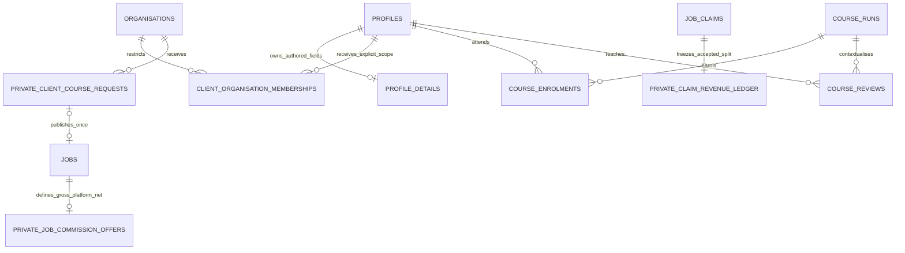

`PRIVATE_*` entities in this diagram name actual `private.client_course_requests`, `private.job_commission_offers` and `private.claim_revenue_ledger`; they are not public REST tables. Only authorised security-invoker wrappers call the private implementations. The accepted ledger is one snapshot per claim. A client request may create a draft or published capacity-one job; reports count publication from the actual job state. M6 permits several historical revenue-ledger rows for a job, one immutable row per accepted claim, and sums current accepted position revenue without counting that course several times. Invoice labels change metadata only; PDF versions, accepted compensation and payment history keep their original invariants.

`profile_details` separates the new authored country/languages/experience/labels from private contacts/evidence. `course_enrolments` keeps current membership/completion/removal, while `course_reviews` carries course/actual lecturer/author, versioned text/rating and moderation/withdrawal state. Direct review table reads are denied; identity-safe RPCs project each reader's authorised view. Existing `invitation_requests` now binds the requested role/organisation/display name; both invitation handlers use this single lifecycle. Exact schema/arguments are in [API_REFERENCE](API_REFERENCE.md) and the three additive M3 migrations.

## Implemented private policy and welcome progress

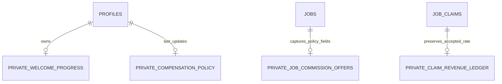

`private.welcome_progress.user_id` is both the primary key and a cascading profile foreign key. Its step/status/version are personal presentation state. The table has no direct client grants or administrator bypass; only active own-account RPCs can read/change progress, with compare-and-swap versions.

`private.compensation_policy` is an optional singleton whose `updated_by` references the responsible administrator profile. It contains no seeded business values. `private.job_commission_offers` stores its own regular/senior percentage and policy-version snapshot; these are copied values, not foreign keys to the mutable singleton. Later policy edits cannot alter existing offers or accepted revenue rows. The existing private revenue ledger still freezes actual accepted gross/net/platform amounts per claim. Raw role-priced `jobs` columns contain no alternate-role fee; `job_offers()` projects the current actor's net quote. [Detailed authority and upgrade rules](DELEGATED_ROLES_PRICING.md).

## Implemented M4 source catalogue, avatars and discussions

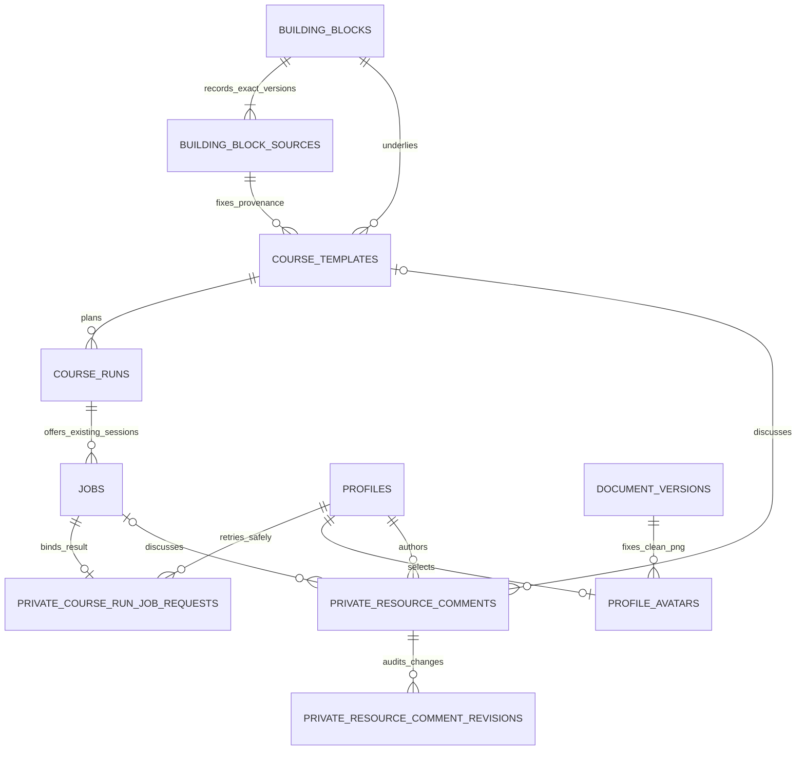

A comment references exactly one job or template, enforced by a database constraint. Cursor indexes order each resource; actor request UUIDs deduplicate concurrent submissions and actor locks serialize rate checks. Private revisions are not ordinary reader data. A profile avatar selects an exact immutable clean image version; its owner-only metadata table does not grant peers the underlying personal document. Peer display uses the separate current-profile projection and authenticated gateway.

Source versions have stable provider/code/file/hash identity. LPC3/LPC4 each retain two real PDF variants under one block. Template/run provenance freezes when a linked job exists. The private course-offer request ledger binds the original financial request and resulting existing-run job; client full-fee requests remain in the existing client ledger when actually known. No new duplicate source columns are added to job/claim snapshots. See [COURSE_BUILDING_BLOCKS](COURSE_BUILDING_BLOCKS.md), [RESOURCE_COMMENTS](RESOURCE_COMMENTS.md) and [PROFILE_AVATARS](PROFILE_AVATARS.md).

## Implemented M6 operations additions

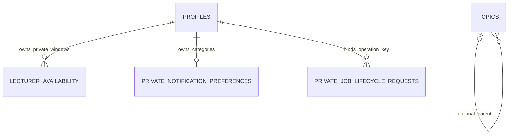

These entities map to `public.topics`, `public.lecturer_availability`,
`private.notification_preferences` and `private.job_lifecycle_requests`.
Topics retain shared IDs across expertise, course templates and job requirements;
archive/version/parent guards do not rewrite existing references. Availability
keeps finite instants, IANA zone, own notes and default-false explicit management
sharing. The direct table read policy remains owner-only; the shared RPC exposes
only its reduced opt-in projection. Notification preferences have one profile-FK
primary key and the four independent `chat`, `forum`, `job_updates`, `reminders`
booleans with optimistic versioning.

`private.job_lifecycle_requests` has primary key `(actor_id,request_id)` and a
profile FK. Its `result` UUID binds the operation result through checked RPC logic;
it is **not** a declared job foreign key. Job lifecycle metadata/board/audit reads
are projections, not additional storage tables. [JOB_LIFECYCLE](JOB_LIFECYCLE.md),
[TAXONOMY](TAXONOMY.md), [AVAILABILITY](AVAILABILITY.md),
[NOTIFICATIONS](NOTIFICATIONS.md) and [ADMIN_AUDIT](ADMIN_AUDIT.md) describe the
scoped APIs.

M6 replaces the original single-confirmed-claim-per-job index with partial unique
`(job_id,lecturer_id) WHERE status='confirmed'`. Job capacity is 1–20;
`capacity_basis='single_position'` requires capacity 1, while an explicitly new
per-position offer may have several positions. The transactional job lock guards
its remaining count. `assignment_sessions.released_at` preserves cancelled
intervals; only unreleased rows participate in the GiST lecturer/time exclusion.
Cancellation preserves accepted claim/fee/session/revenue history and closes the
offer to draft until audited reopening. Shared lecturer locking prevents invoice
submission racing cancellation. There is no new refund or bank-payment relation.

## Implemented M7 private personal organization

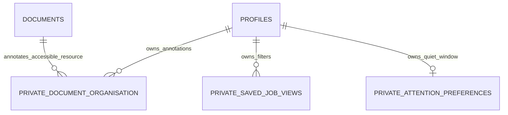

| Diagram entity / physical table                                   | Key and actual foreign keys                                                              | Stored invariant / API                                                                                                                                                                                |
| ----------------------------------------------------------------- | ---------------------------------------------------------------------------------------- | ----------------------------------------------------------------------------------------------------------------------------------------------------------------------------------------------------- |
| `PRIVATE_DOCUMENT_ORGANISATION` / `private.document_organisation` | PK `(user_id,document_id)`; FKs to `profiles.id` and `documents.id`, both delete-cascade | Own tags/folder/version only; `document_discovery`, `save_document_organisation`. No Storage path or shared-file move.                                                                                |
| `PRIVATE_SAVED_JOB_VIEWS` / `private.saved_job_views`             | PK `id`; `user_id` FK to `profiles.id`, delete-cascade; unique `(user_id,lower(name))`   | At most 20 canonical closed-JSON views per actor, checked under quota lock; `saved_job_views`, `save_job_view`, `remove_job_view`. Filter IDs inside JSON are validated by the API, not declared FKs. |
| `PRIVATE_ATTENTION_PREFERENCES` / `private.attention_preferences` | PK/FK `user_id` to `profiles.id`, delete-cascade                                         | Separate versioned daily minute window/IANA zone; `attention_preferences`, `save_attention_preferences`. Missing row reads as version 0 without insertion.                                            |

All three tables enable RLS and revoke direct PUBLIC/anon/authenticated access.
The first two explicitly grant service-role table access; this is not a browser
permission or an administrator read bypass. Scoped invoker RPCs/private definers
check the current actor and resource. Personal document metadata requires current
underlying document access, including after room revocation. Saved views confer
no access to a filtered job. Quiet settings confer no access to another inbox.

`job_discovery`, `job_detail`, `job_dashboard` and `assignment_job_titles` are
projections of existing job/claim/session/profile data, **not** duplicated job or
dashboard tables. Discovery cursors include stable sort/UUID values and a filter
fingerprint. File discovery orders by `(created_at,id)`. Both page on the server;
neither raises the global 1,000-row Data API setting. Dashboard totals are
server-authorized aggregates, not counts of a preview page. Calendar title lookup
returns only requested own confirmed assignment jobs. See [JOB_DISCOVERY](JOB_DISCOVERY.md)
and [FILES](FILES.md).

Both saved-view mutations take actor profile `FOR SHARE` **before** the separate
current-role/capability check and saved-view row lock. The volatile entry's new
statement snapshot observes a role withdrawal that held profile `FOR UPDATE`.
A stale expected view version fails with `40001`; an authoritative `42501` hides
and discards captured private editor/list data. Network errors retain the draft.
Operation UUID reuse is limited to retries of the same open create dialog.

## Implemented M7 chat content and mention versions

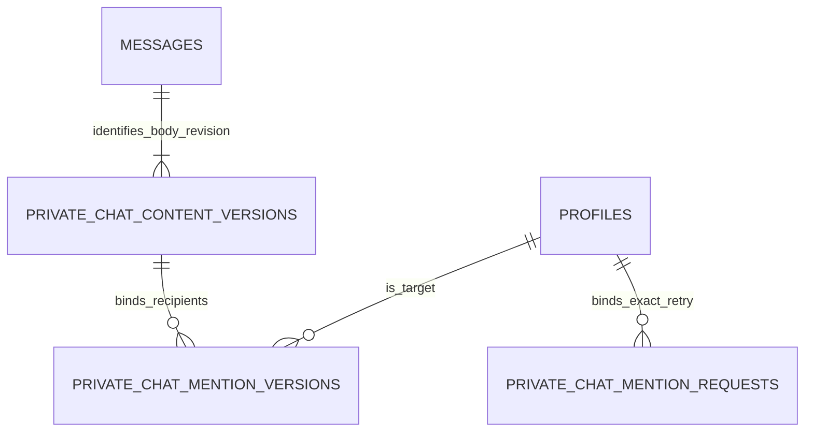

| Physical table                  | Key / relation                                                                                                                                                           |
| ------------------------------- | ------------------------------------------------------------------------------------------------------------------------------------------------------------------------ |
| `private.chat_content_versions` | PK `(message_id,version)`; message FK delete-cascade. Records version identity/time; existing private message revisions retain body audit.                               |
| `private.chat_mention_versions` | PK `(message_id,version,user_id)`; composite FK to content versions, delete-cascade; target profile FK. Index `(message_id,user_id)` supports first-ever mention lookup. |
| `private.chat_mention_requests` | PK `(actor_id,request_id)`; actor profile FK delete-cascade; exact normalized payload/result JSON, not ordinary chat history.                                            |

`messages.content_version` changes with body/edit/deletion state, including legacy
API edits; only the current version's authorized recipients appear in
`chat_messages_with_mentions`. A legacy edit does not carry forward an earlier
structured selection. `send_message_with_mentions` and
`edit_message_with_mentions` atomically bind current eligible room members and
exact retry parameters; `chat_mention_candidates` is a current-room projection.
Internal helpers and these three RLS-enabled private tables have no direct browser
grants. Normal chat membership/role predicates still apply to reads, edits,
moderation, attachments and Realtime; administrator status does not open DMs.

Notifications reuse unique `(user_id,kind,resource_id)` with kind `chat_message`
and the message UUID. The **first ever** committed structured message/recipient
mention can renew that same notice; retries and remove/re-add cycles do not.
History retains that fact even if category preference suppressed delivery.
Room mute may be overridden by an explicit mention; the global category opt-out
still applies. Quiet hours affect attention only. The polymorphic notification
`resource_id` has no message FK; current target resolution supplies authorization.
See [CHAT](CHAT.md) and [CHAT_SECURITY](CHAT_SECURITY.md).

## Implemented M7 announcement snapshots and acknowledgements

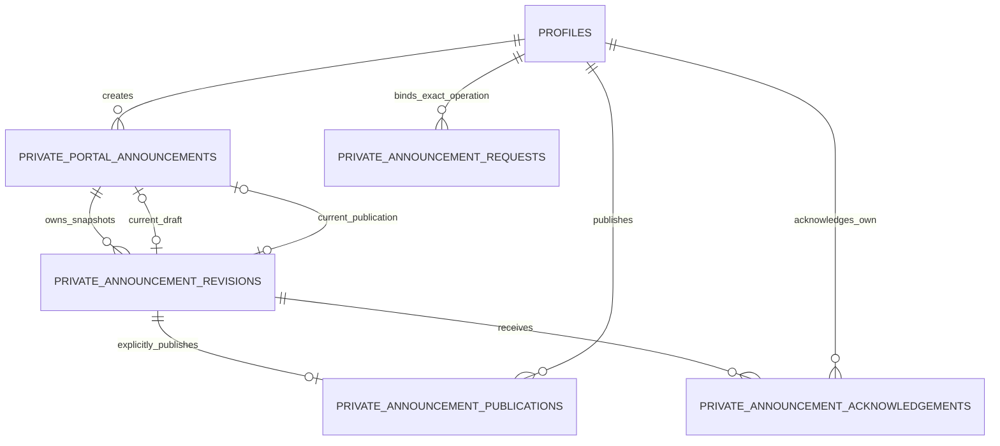

| Physical table                          | Keys and state boundary                                                                                                                                                                                              |
| --------------------------------------- | -------------------------------------------------------------------------------------------------------------------------------------------------------------------------------------------------------------------- |
| `private.portal_announcements`          | UUID PK; creator profile FK; optimistic parent `version`, archive state, separate draft/published revision pointers.                                                                                                 |
| `private.announcement_revisions`        | UUID PK; parent FK delete-cascade; unique `(announcement_id,revision)` and `(announcement_id,id)`; creator profile FK. Immutable DE/EN title/body, importance, role audience, finite display instants and IANA zone. |
| `private.announcement_publications`     | PK/FK `revision_id` delete-cascade; publisher profile FK; immutable publication timestamp. A draft alone has no publication receipt.                                                                                 |
| `private.announcement_acknowledgements` | PK `(user_id,revision_id)`; profile/revision FKs delete-cascade; exact retry preserves original acknowledgement timestamp.                                                                                           |
| `private.announcement_requests`         | PK `(actor_id,request_id)`; actor profile FK delete-cascade; exact action/version/payload and original result. No JSON-result FK is implied.                                                                         |

Parent `(id,draft_revision_id)` and `(id,published_revision_id)` are separate
**composite**, initially deferred FKs to revision `(announcement_id,id)`. Thus a
parent cannot point to another announcement's revision. Saving a new immutable
draft leaves the published snapshot intact. Update guards protect revisions and
publication receipts. Ordinary reads start from the current published pointer;
older, draft, archived, expired and newly unauthorized revisions fail exact reads.

`manage_announcement` uses current `announcements.manage`/MFA, profile-first locks,
parent version and exact request binding. Publication, optional important inbox
fanout, safe audit and retry result commit atomically. Future-start publication is
explicitly refused until manually due. `announcements` and `announcement` return
only currently authorized display-window publications;
`admin_announcements`/`admin_announcement` expose the separately permissioned
editor. `acknowledge_announcement` locks the actor profile before current audience
checks, binds only that actor/revision and marks only its corresponding own inbox
row read. Archive/recover preserves existing ACK/notice identity; a new published
revision is a new acknowledgement target.

All five private tables enable RLS and revoke direct PUBLIC/anon/authenticated
access; internal helpers are also execution-restricted. Audience roles come from
current database grants, never user metadata. Important notices use
`portal_announcement` plus revision UUID in the existing notification uniqueness
key. These are logical references, not additional FKs. Important current readable
publications add quiet-hour attention; ordinary inbox rows and full unread count
remain unchanged. The older four-category preference table/API is not replaced.
No scheduler, email delivery, push transport or history-purge policy is implied.
See [ANNOUNCEMENTS](ANNOUNCEMENTS.md) and [NOTIFICATIONS](NOTIFICATIONS.md).

## Implemented M8 qualification evidence and decisions

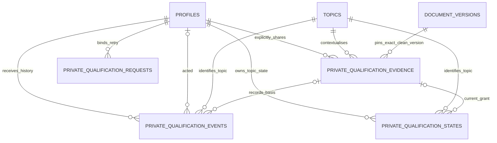

| Physical table                   | Keys and actual foreign-key behavior                                                                                                                                                                                                       |
| -------------------------------- | ------------------------------------------------------------------------------------------------------------------------------------------------------------------------------------------------------------------------------------------ |
| `private.qualification_states`   | PK `(user_id,topic_id)`; profile FK delete-cascade; topic FK; optional evidence FK delete-set-null. Current nonnegative CAS version and current binding.                                                                                   |
| `private.qualification_evidence` | UUID PK; owner profile FK delete-cascade; topic FK; exact `document_version_id` FK delete-cascade; stored SHA-256 and withdrawal instant.                                                                                                  |
| `private.qualification_events`   | UUID PK; unique `(user_id,topic_id,version)`; owner profile FK delete-cascade, actor profile FK delete-set-null, topic FK and optional evidence FK delete-cascade. Bind/withdraw/deselect/attest events retain decision, expiry and basis. |
| `private.qualification_requests` | PK `(actor_id,request_id)`; actor profile FK delete-cascade; exact-command fingerprint. No stored result/document FK is implied.                                                                                                           |

The same `(user_id,topic_id)` coordinates current `lecturer_topics` and private
state through RPC/trigger logic; it is **not** a new composite FK to
`lecturer_topics`. Owner/topic consistency of evidence bindings is checked by the
mutators, not a diagram-implied extra constraint. Evidence/version/topic and
cursor/actor-rate indexes support these references. All four private tables enable
RLS, revoke PUBLIC/anon/authenticated table access and explicitly grant service-role
access. Normal browser calls use reviewed invoker wrappers/private implementations.
They cannot directly change protected history or promote themselves as verified.

`save_qualification_evidence` accepts only a selected topic and one own clean
personal certificate version; null withdraws access. `qualification_review`,
`qualification_history` and `qualification_evidence_access` project only permitted
current state/history. `attest_qualification` uses observed version/request identity;
legacy `verify_lecturer_topic` keeps its signature and uses the same manual
attestation/history core. Both own and review mutations take actor profile SHARE
before fresh current-role/MFA checks. Unchanged expiry fields retain the original
instant, and captured dirty drafts retain their observed CAS/evidence identity.
Retries append no event and return current sanitized state rather than old private
metadata. Earlier verifications are not backfilled with invented decisions.

The binding grants **one version**, not `documents` or all `document_versions`
reads. The existing users-manage CV policy remains, as do separate contracts and
finance policies. Qualification permission alone grants none of those. Files Edge
`qualification_evidence_download` performs current caller ACL before and after
fetching/hash-checking exact bounded bytes. Withdrawal, document archive and topic
deselection stop subsequent reads; historical event IDs grant no historical byte
access. Re-adding expertise does not restore an old grant. Existing verified state,
accepted claims/compensation and assignments are not rewritten by evidence changes.

History is immutable to browser users; trusted server purges retain explicit
cascade/set-null cleanup semantics. Topic FKs do not silently cascade history on
physical taxonomy deletion. Normal taxonomy uses archive; normal file UI uses
soft deletion, not a privileged version purge. This is not a shipped retention
policy or tamper-proof archival claim. See [QUALIFICATIONS](QUALIFICATIONS.md).

## Implemented M8 global-event lifecycle and picker projections

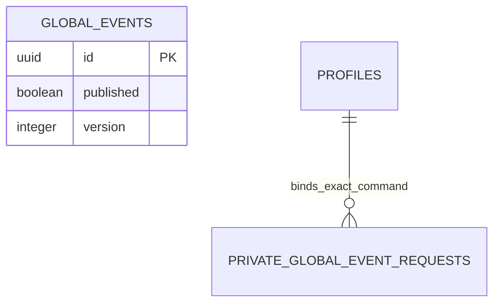

`public.global_events` is the existing physical event table, extended with
`description`, `link_url`, `archived_at`, positive `version` and `updated_at`.
There is no duplicate global-calendar table or announcement-revision pointer.
The event table has no creator-profile or course-run FK; the actor is recorded
in the request/audit records, and published course sessions are a separate
calendar projection.
`private.global_event_requests` adds PK `(actor_id,request_id)`, profile FK
with delete-cascade, exact payload and original result JSON. Its JSON result is
not an event FK. The ledger enables RLS and revokes browser table access. Event
rows retain public RLS: ordinary active readers see published/nonarchived records;
management access requires its current capability/MFA.

`global_calendar_events` checks actual interval overlap in a finite window of at
most 93 days and returns timestamp/UUID pages (maximum 100). `manage_global_event`
uses profile-first fresh role checks, parent row/version locks and exact retry
binding. Save creates/unpublishes a draft; publish/unpublish/archive/recover are
explicit, and recovery is unpublished. Audit rows expose only reviewed safe
metadata. Descriptions/HTTPS links do not expose private appointments, attach
files or trigger remote fetching. Existing course-session calendar queries remain
separately authorized and retain their own bounds. See [CALENDAR](CALENDAR.md).

The new `job_picker` and private `job_picker_candidates` are **projections**, not
new tables or relationships. `job_attachment` follows `jobs.manage`/MFA;
`participant_course` follows `courses.manage`/MFA and returns one course run with
an existing representative job UUID for compatibility. Course labels/search use
permitted template/organization metadata plus first-session/IANA information,
not hidden job text or fees. Its selected item is resolved in the same bounded
request. Purpose/search-bound cursors and job/run/session lookup indexes replace
the last two unpaged `jobsQuery` callers without widening commercial rights or
changing claim/upload/channel mutation APIs. No per-option RPC or all-pages loop
is added. The administrative board remains separately limited to 500. See
[JOB_PICKERS](JOB_PICKERS.md).

The three additive sources are `20261116080741_scoped_administrative_job_pickers`,
`20261116080743_global_calendar_publications` and
`20261116080746_qualification_evidence_and_attestation_history`. Together with the
29 earlier migration sources these form the historical 32-migration M7/M8 model.
The following diagram covers the fourteen-source operational cohort depicted here, not every later addition in the current 69-source inventory. Focused source,
SQL/component/Edge checks do not establish combined native acceptance.

## Implemented personal settings and external delivery

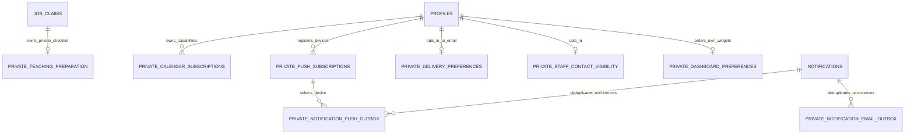

Aliases name `private.dashboard_preferences`, `teaching_preparation`, `staff_contact_visibility`, `delivery_preferences`, `push_subscriptions`, `calendar_subscriptions`, `notification_email_outbox` and `notification_push_outbox`. `private.push_configuration` is a separate singleton for the enabled state/public VAPID key, not an account or private-key table. Dashboard/contact/preferences use own identity and revision checks. The teaching-day checklist belongs to the claim owner; it is not the customer's shared preparation.

Email occurrence uniqueness is `(notification_id, occurrence_at)`; Push adds `subscription_id`. Leases, attempts, availability, fixed outcome/error codes and terminal uncertain state distinguish a committed inbox notice from an external accepted delivery. Worker APIs have separate service-only grants and recheck current recipient/resource/channel rights. Push subscriptions retain private provider endpoint/encryption material; ordinary UI/device projections do not expose it. Mail/VAPID credentials are operating configuration, not a diagrammed database relation.

Calendar subscriptions retain a token hash, explicit private-event inclusion, expiry/revocation, version and owner-bound creation/rotation retry keys. Snapshot/recheck RPCs are service-only; possession of a currently valid high-entropy feed capability is the read boundary at the exact calendar-feed endpoint. The feed does not create event copies in a new table. The separately opted-in minimal offline teaching snapshot is an expiring, identity-cleared IndexedDB record, not a PostgreSQL relation or a generic private-response cache.

## Implemented waitlists, tasks and teaching-time evidence

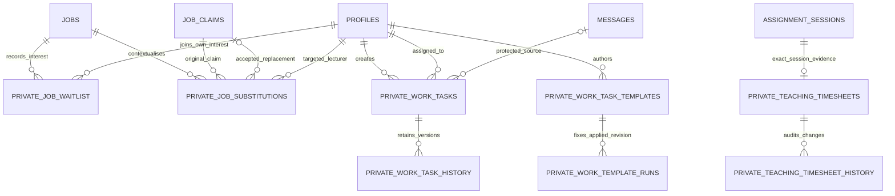

These aliases map directly to `private.job_waitlist`, `job_substitutions`, `work_tasks`, `work_task_history`, `work_task_templates`, `work_template_runs`, `teaching_timesheets` and `teaching_timesheet_history`. Additional actual private tables are `personal_favourites` and `teaching_timesheet_requests`. The favourite key `(user_id, kind, resource_id)` is a polymorphic reference checked on read/write, not a foreign key to every possible resource. Template runs retain a template revision and `task_ids uuid[]`; those array elements are application-validated references, not individual SQL foreign keys. Timesheet action retries use `(actor_id, request_id)` with the exact payload/result.

Waitlist primary key is `(job_id, user_id)` and gives no allocation. A substitution binds original/accepted claim IDs, proposer/target, quote/hash and expiry; one pending/accepting proposal per original claim is enforced. Its scheduling/claim transaction preserves the all-session boundary. Task history/template/user/message references and timesheet history deliberately restrict deletion unless an explicit cascade is defined; these are not a user erasure service. Private tasks remain creator-only even for administrators. Operations/message-derived tasks need their current task and source-room rights.

A timesheet has one unique `assignment_sessions.id`, current lecturer and optional reviewer references, bounded real intervals/breaks, state/version and a nonoverlap exclusion per lecturer except rejected entries. It does not replace accepted claim compensation or participant attendance. Financial statements, forecasts and Control Center are checked projections over existing claims/invoices/payments/timesheets/tasks/courses; there is no fabricated bank account, forecast ledger or finance-export table. See [WORKBENCH](WORKBENCH.md), [ASSIGNMENT_HANDOVER](ASSIGNMENT_HANDOVER.md) and [TIMESHEETS_FINANCE_CONTROL_CENTER](TIMESHEETS_FINANCE_CONTROL_CENTER.md).

## Implemented shared course preparation and exact materials

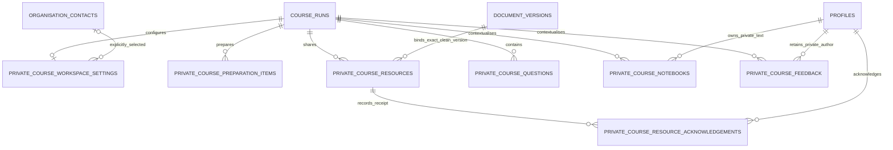

Aliases name actual `private.course_workspace_settings`, `course_preparation_items`, `course_resources`, `course_resource_acknowledgements`, `course_questions`, `course_notebooks` and `course_feedback`. Settings use `run_id` as primary key; deleting the selected organisation contact sets the contact pointer null. The RPC independently requires the contact's organisation to match this course. Preparation has a client-visible flag and CAS version. A material/report resource is unique by `(run_id, version_id, audience)` and can be explicitly removed; acknowledgements use `(resource_id, user_id)` and do not grant future access.

Notebook and feedback keys are `(run_id, user_id)`. Notebook text is owner-only; Q&A author/answer references remain private while the current course projection determines which users can read or respond. Feedback keeps an author for server integrity but ordinary aggregate results disclose no author identity and remain unavailable below three responses. There is no true-anonymity assertion or participant-notebook management bypass. Clean resource bytes remain behind the authenticated exact-version gateway; ordinary file RLS is unchanged.

## Implemented participant attendance, quizzes and completion facts

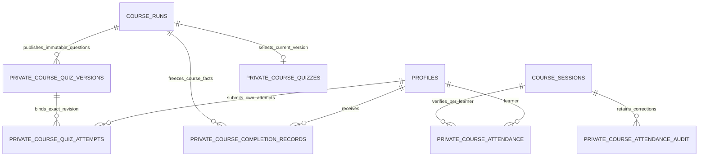

Aliases map to `private.course_attendance`, `course_attendance_audit`, `course_quizzes`, `course_quiz_versions`, `course_quiz_attempts` and `course_completion_records`. Attendance's key is `(session_id, user_id)`; audit rows independently retain affected user, actor, before/after states and reason, with restrictive history references. Self-report and verified attendance are different states. Completion locks subsequent attendance correction until explicit revocation.

Quiz versions use `(run_id, version)`; the attempt uses that composite foreign key and `(user_id, request_id)` retry uniqueness. The current-quiz integer is an application-managed pointer, not an additional composite foreign key. Learner projections omit correct answers; submission checks current publication, attempt allowance and current membership. A partial unique index permits one nonrevoked completion per `(run_id, user_id)`. Immutable completion facts require completed enrolment, ended sessions, verified 80% attendance per session and current-quiz pass where required. Revocation retains the old record and constrains reissue; PDF generation adds no separate completion/qualification/legal-signature table. See [COURSE_LEARNING_WORKSPACE](COURSE_LEARNING_WORKSPACE.md).

## Implemented customer request briefs and retained revisions

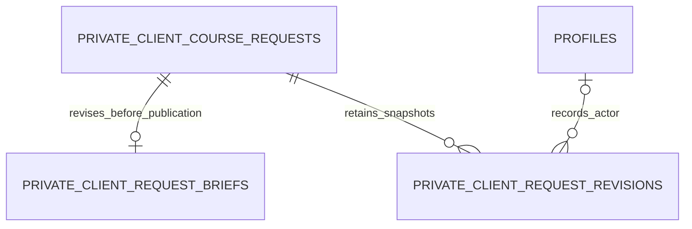

`PRIVATE_CLIENT_REQUEST_BRIEFS` and `PRIVATE_CLIENT_REQUEST_REVISIONS` are `private.client_request_briefs` and `private.client_request_revisions`. They cascade only when the parent request is deliberately removed; an actor account purge sets the history actor pointer null. A generated revision ID supplies stable decreasing cursor pages. No authenticated history update/delete API exists. Older requests receive an accurately labelled migration baseline; past events are not reconstructed.

Brief JSON stores whole teaching units, 45/60-minute units, preparation instructions, required-document descriptions and exact version/category references. These JSON version IDs are validated by the RPC; they are not declared document foreign keys. Only own clean personal materials or already explicitly shared request versions can be retained, categorized as material/report. Contracts, CVs, qualification evidence and invoices have no attachment bypass. The current request organisation/gross-finance boundary authorizes the protected byte gateway, which checks exact hash and rechecks rights before release. Required time cannot exceed real session duration; it never derives the quote. Creation retry compares the immutable first brief, and revisions share the publication row lock and expected version. Repeat booking copies requirements/time but no attachments or learner records. See [CLIENT_REQUEST_BRIEFS](CLIENT_REQUEST_BRIEFS.md).

## Required constraints and ownership

- Stable UUID foreign keys with explicit deletion behaviour; no accidental cascading deletion of executed contracts or accepted assignments. Unique role/permission/expertise and room membership joins. Verification is server-managed independently of lecturer self-selected expertise.
- Templates contain reusable course content; runs contain actual delivery/customer context; sessions contain canonical instants and intended display zone. A job includes one or more complete sessions. Legacy/client/Course jobs keep capacity one; explicit new administrative per-position jobs support 1–20. Job locks, confirmed-count checks and unique active job/lecturer claims protect capacity without partial multi-session allocation.
- Claims own immutable accepted amount/currency/rate unit/terms and the applicable executed-contract row. Its immutable file reference/hash fixes the agreement evidence when present. Idempotency keys are scoped to actor/request; claim events and notifications deduplicate by committed event. A later job edit never rewrites accepted terms.
- Allocation intervals use non-overlap protection per lecturer across jobs, together with transaction locking; private events/availability are included in server-side eligibility. Every session reserves or the entire transaction rolls back.
- Personal events belong solely to their creator. Global events require explicit publication. Business contacts/internal notes, contracts, CVs/evidence and invoices need separate capabilities or resource membership. Private room membership is not implied by admin status.
- Every exposed relation requires RLS and explicit least-privilege grants. Private schema objects are unexposed and execution-locked. User IDs/roles are derived from verified Auth/current database authority, never editable metadata.
- Implemented indexes include job publication/requirements, assignment exclusion ranges, owner/member and cursor lookups, wiki/forum searchable text, invoice active-claim uniqueness and scoped payment history. Search always runs under actor authorisation. Search/list limits are documented in feature notes. M7 job/file discovery pages beyond 1,000; M8 replaces the legacy file/chat job pickers with bounded purpose-specific pages, while the administrative board retains its explicit newest-500 bound. Other unconverted lists are not claimed unbounded.

## Implemented permission matrix

| Resource/action                  | Owner / eligible lecturer                                                                                   | Ordinary peer                                          | Privileged management                                                                                             |
| -------------------------------- | ----------------------------------------------------------------------------------------------------------- | ------------------------------------------------------ | ----------------------------------------------------------------------------------------------------------------- |
| Own profile self-service fields  | Read/edit                                                                                                   | Only intentionally public fields, when implemented     | Explicit management capability where needed                                                                       |
| Roles and verification           | Read own applicable grants; no self-promotion                                                               | No mutation                                            | Explicit capability plus MFA; audited                                                                             |
| Published jobs                   | Read when authorised/eligible; claim through RPC                                                            | Same permission-based rules                            | Manage with `jobs.manage` and MFA                                                                                 |
| Accepted assignment snapshot     | Read own                                                                                                    | No                                                     | Explicit commercial/resource permission                                                                           |
| Private calendar event           | Read/edit own                                                                                               | Denied                                                 | Denied unless actual owner                                                                                        |
| Executed contract/file/receipt   | Read own; receipt own exact hash                                                                            | Denied                                                 | Specific `contracts.read`/`contracts.manage` plus MFA; receipt cannot impersonate owner                           |
| Private DM/messages/revisions    | Current room member only                                                                                    | Denied                                                 | No implicit access; DM membership is not administratively editable                                                |
| Group/channel and room files     | Current nonremoved membership plus current role constraints                                                 | Denied outside membership                              | Owner or explicit capability within accessible room; no room bypass                                               |
| Personal files                   | Owner; clean bytes only                                                                                     | Denied                                                 | CV/contract/invoice retain specific capability/MFA boundaries; certificates need the current exact evidence grant |
| Customer contacts/private notes  | No implicit lecturer access                                                                                 | Denied                                                 | `organisations.manage` plus MFA                                                                                   |
| Course catalogue                 | Published/assigned; participants explicitly enrolled through managed enrolment or course-channel membership | Denied otherwise                                       | `courses.manage` plus MFA for changes                                                                             |
| Wiki drafts/history              | Author and current wiki managers                                                                            | Published revisions only for staff                     | `wiki.manage` plus MFA for publish/archive                                                                        |
| Forum/report/revision            | Staff; own reports, own post revisions                                                                      | Staff discussion only                                  | `forum.moderate` plus MFA for moderation/reports                                                                  |
| Earnings/invoice/payment history | Own original-currency records                                                                               | Denied                                                 | `finance.manage` plus MFA; mutations audited                                                                      |
| Private file tags/virtual folder | Own annotation for a currently accessible document                                                          | Other account's annotation denied                      | No annotation read bypass                                                                                         |
| Saved job views / quiet window   | Own active actor; saved views additionally require current lecturer/manage access                           | Denied                                                 | Only own records under the same rules                                                                             |
| Qualification evidence / review  | Own explicit exact certificate-version sharing/withdrawal                                                   | No foreign grant                                       | Current `qualifications.verify`/MFA for the selected shared version; no blanket document/CV/contract access       |
| Global events                    | Published, unarchived records only; private appointments remain separate                                    | Same public-event policy                               | `courses.manage`/MFA for bounded drafts/lifecycle; no private-calendar bypass                                     |
| Scoped resource choices          | Only the current action's capability/MFA                                                                    | No privileged query from ordinary personal/topic flows | Job attachment vs participant-course metadata; no additional financial rights                                     |
| Structured chat recipients       | Current eligible room members, current message version                                                      | Denied outside room                                    | Room-scoped moderation only; no DM/history bypass                                                                 |
| Published announcements / ACK    | Current active-account audience/window; own exact-revision ACK                                              | Same current audience rules                            | Management drafts/publication need `announcements.manage` and MFA                                                 |

Additional operational boundaries:

| Resource/action                          | Own current account / authorised participant                    | Other accounts and management                                                       |
| ---------------------------------------- | --------------------------------------------------------------- | ----------------------------------------------------------------------------------- |
| Personal widget/preparation preferences  | Own versioned presentation or confirmed claim                   | No private-checklist bypass                                                         |
| Staff directory contact                  | Explicit own email/phone consent                                | Active staff only; no client/participant or admin consent override                  |
| Waitlist / substitution                  | Own interest; explicit targeted quote acceptance                | Scoped proposer/manager actions; no private-calendar contents                       |
| Private task or message-derived task     | Creator-only or current permitted operations relationship       | Management never bypasses private scope or source-room access                       |
| Timesheet / financial facts              | Own accepted session/time and net facts                         | Current finance capability/MFA; gross requires its own capability                   |
| Course shared checklist/material/contact | Current server-scoped role and explicit audience                | No private notes, contract or implicit personal-file access                         |
| Notebook / feedback                      | Own notebook/feedback; identity protected in ordinary summaries | No foreign notebook read; feedback threshold does not remove private author storage |
| Attendance / quiz / completion           | Current learner eligibility; server-confirmed records           | Staff correction/revocation is audited; quiz answers remain role-scoped             |
| Request brief/history/material           | Current exact client organisation                               | Existing gross-finance/MFA scope only; original private file RLS unchanged          |
| Calendar capability / offline schedule   | Explicit owner opt-in; expiry/revocation and identity clearing  | No administrator calendar bypass; no general private-response cache                 |
| Notification channel/device              | Own preference/device; current eligible event                   | Service-only delivery leases do not grant browser data access                       |

See [CHAT_SECURITY](CHAT_SECURITY.md), [KNOWLEDGE_SECURITY](KNOWLEDGE_SECURITY.md), [COMMERCIAL_SECURITY](COMMERCIAL_SECURITY.md), [OPERATIONS](OPERATIONS.md) and [BACKEND_SECURITY_REVIEW](BACKEND_SECURITY_REVIEW.md) for tested boundaries and outstanding acceptance. Current combined 62-source native acceptance is recorded separately in QA results; authored cases and focused passes do not establish that result. Tombstones, archives and audit revisions preserve data; none is a production legal-erasure or retention-policy guarantee.

## Assignment withdrawal applications

`private.assignment_withdrawals` references the immutable `job_claims` and its
lecturer profile. It stores the bounded authored reason, pending/final status,
reviewer, decision note and timestamps. A partial unique index allows one pending
application per claim. `private.assignment_withdrawal_commands` binds each actor
and request UUID to its exact payload and application for safe transport retries.
Both tables have RLS and no client table grants; scoped RPCs expose only own or
current MFA-authorized management work. Existing claim/session/commercial rows
retain their identities and accepted snapshots. See
[assignment withdrawals](ASSIGNMENT_WITHDRAWALS.md).

## Job briefing

`private.job_briefings.job_id` links the authored briefing to its job. `private.job_briefing_requests` binds each request to its actor, job and version for idempotency. Both tables use RLS without direct browser grants; [JOB_BRIEFING](JOB_BRIEFING.md) describes the current permission boundaries.
