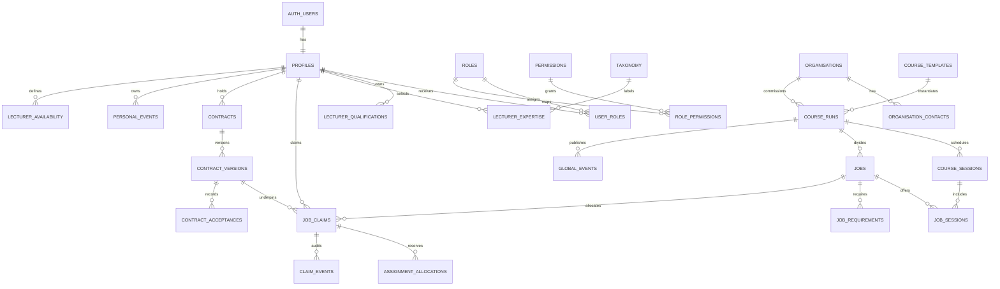
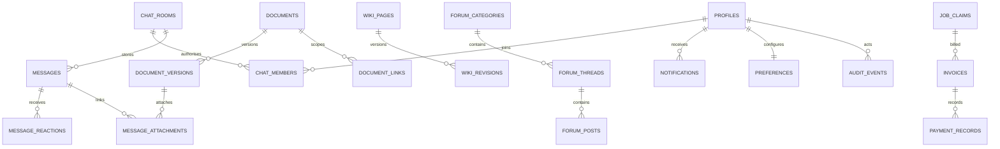

# Relational model and permission boundaries

The target diagram is a product map, not a claim that every table already exists. The current M1 schema is defined by committed `supabase/migrations/*.sql`; use backend API notes and migration tests for exact column names, constraints and implemented relations.

## Core target relations

## Collaboration and commercial target relations

## Required constraints and ownership

- Stable UUID foreign keys with explicit deletion behaviour; no accidental cascading deletion of executed contracts or accepted assignments. Unique role/permission/expertise and room membership joins. Verification is server-managed independently of lecturer self-selected expertise.
- Templates contain reusable course content; runs contain actual delivery/customer context; sessions contain canonical instants and intended display zone. A job includes one or more complete sessions. Jobs initially have capacity one, with one active claim per available slot. Future capacity cannot weaken conflict/atomicity constraints.
- Claims own immutable accepted amount/currency/rate unit/terms and the applicable contract version/hash. Idempotency keys are scoped to actor/request; claim events and notifications deduplicate by committed event. A later job edit never rewrites accepted terms.
- Allocation intervals use non-overlap protection per lecturer across jobs, together with transaction locking; private events/availability are included in server-side eligibility. Every session reserves or the entire transaction rolls back.
- Personal events belong solely to their creator. Global events require explicit publication. Business contacts/internal notes, contracts, CVs/evidence and invoices need separate capabilities or resource membership. Private room membership is not implied by admin status.
- Every exposed relation requires RLS and explicit least-privilege grants. Private schema objects are unexposed and execution-locked. User IDs/roles are derived from verified Auth/current database authority, never editable metadata.
- Useful indexes: job publication/deadline/status and tag joins; session and allocation time ranges; owner-based private data; participant/member joins; future message/wiki text search. Search always runs under actor authorisation.

## M1 permission matrix

| Resource/action | Owner / eligible lecturer | Ordinary peer | Privileged management |
| --- | --- | --- | --- |
| Own profile self-service fields | Read/edit | Only intentionally public fields, when implemented | Explicit management capability where needed |
| Roles and verification | Read own applicable grants; no self-promotion | No mutation | Explicit capability plus MFA; audited |
| Published jobs | Read when authorised/eligible; claim through RPC | Same permission-based rules | Manage with `jobs.manage` and MFA |
| Accepted assignment snapshot | Read own | No | Explicit commercial/resource permission |
| Private calendar event | Read/edit own | Denied | Denied unless actual owner |
| Own contract | Read own | Denied | `contracts.read` where explicitly granted |
| Private DM (future) | Current room member only | Denied | No implicit access |
